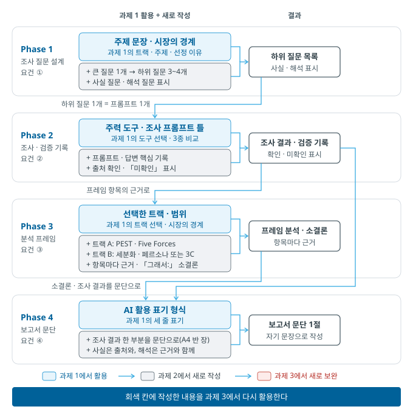

# 경영경제 AI 활용 입문 — 과제 2 안내

## 1. 과제 개요

| 항목 | 내용 |
|------|------|
| 과제명 | **과제 2 — 1차 조사·분석** |
| 부여와 제출 | 7주 부여 → **10주 제출** (제출 위치와 마감 시각은 수업에서 안내) |
| 분량 | A4 3\~4장 |
| 성격과 배점 | 학기 종합 과제(3회) 중 2회차, **배점 9%** (과제 3회 합산 30%, 강의계획서 기준) |

**주제는 과제 1에서 정한 것을 그대로 이어 갑니다.** 과제 1이 도구를 고르는 과제였다면, 과제 2는 그 도구로 **실제 조사를 수행하고 결과를 검증하는** 과제입니다.

> 7주 수업의 실습 결과를 그대로 이어 가면 부담이 적습니다.

## 2. 제출물 구성 (4개 요건)

### 요건 ① 조사 질문 설계

무엇을 알아야 하는지를 **답할 수 있는 크기의 하위 질문**으로 나눕니다(4주 수업).

- 큰 질문 1개 → 하위 질문 3\~4개
- 각 하위 질문이 **사실 질문**인지 **해석 질문**인지 표시합니다
- 하위 질문 하나가 프롬프트 하나가 됩니다

### 요건 ② AI 조사 결과 + 검증 기록

각 하위 질문에 대한 조사 결과와 **검증의 흔적**을 함께 제출합니다.

- 조사에 사용한 주요 프롬프트
- 받은 답변의 핵심 내용
- **검증 기록** — 수치와 주장의 출처를 확인한 결과(실재하는가 / 원문에 있는가 / 1차 출처인가)
- 확인되지 않은 항목은 지우지 말고 **"미확인"으로 표시**합니다

> 검증 기록은 따로 만드는 문서가 아닙니다. 조사하면서 "이 수치를 어디서 확인했는지"를 확인할 때마다 적어 두면 그것이 곧 기록입니다.

### 요건 ③ 분석 프레임 적용

수업에서 다룬 분석 프레임을 트랙에 맞게 적용하고, 각 항목에 **근거를 병기**합니다.

| 트랙 | 적용 프레임 |
|:--:|------|
| **A. 기업·산업 분석** | 매크로 환경 분석(PEST, 6주)과 산업 분석(Five Forces, 5주)을 모두 적용합니다. SWOT은 과제 3에서 다룹니다 |
| **B. 아이디어 검증** | 세분화와 페르소나(7주) 또는 3C — 목표 고객을 좁히고 그 고객의 문제를 서술합니다 |

- 프레임 **개수보다 근거의 질**이 중요합니다. 하나를 근거와 함께 채우는 것이 셋을 비워 두는 것보다 바람직합니다.
- 프레임을 마칠 때마다 **"그래서:"로 시작하는 소결론 한 문장**을 붙입니다(6주 수업).

### 요건 ④ 보고서 문장화 1절

조사 결과 중 한 부분을 골라 **보고서 문단**으로 작성합니다(A4 반 장 내외).

- **사실은 출처와 함께**, **해석은 근거와 함께** 작성합니다(4주 수업)
- AI가 만든 문장을 그대로 옮기지 않고, 검증한 내용을 자기 문장으로 다시 작성합니다

## 3. 평가에서 보는 것

| 보는 것 | 설명 |
|------|------|
| 질문의 구조 | 큰 질문이 답할 수 있는 크기로 나뉘었는가 |
| **검증의 흔적** | 출처를 확인한 기록이 실제로 있는가 — 이 과제의 핵심 |
| 프레임 적용 | 항목에 근거가 붙어 있는가, 소결론이 있는가 |
| 문장화 | 사실과 해석이 구분되어 서술되었는가 |

**AI 답변을 그대로 옮기면 감점, 검증하면 가점**이라는 원칙이 이 과제에서 처음 실질적으로 적용됩니다.

## 4. AI 활용 수칙 (3주 수업 내용 — 계속 적용)

- **모든 AI 답변은 초안입니다** — 검증 전에는 어떤 수치도 확정된 것이 아닙니다.
- **출처 확인** — 실재하는가 / 원문에 있는가 / 1차 출처인가.
- **AI 활용 표기** — 과제 말미에 세 줄로 기록합니다: 활용 도구(모델과 버전, 실행 날짜) / 주요 프롬프트 / 검증 내용.
- **기밀과 개인정보 입력 금지** — 인턴, 아르바이트 등에서 접한 내부 자료, 타인의 개인정보는 입력하지 않습니다.

## 5. 자주 하는 질문

- **조사했지만 자료가 거의 없다면** — 주제 범위가 너무 좁을 수 있습니다. 공식 통계나 리포트가 존재하는 범위까지 넓힌 뒤(4주 수업 5절), 좁은 대상은 사례로 다룹니다. 자료가 없다는 사실 자체를 기록해 두면 그것도 조사 결과입니다.
- **AI 답변의 출처를 확인한 결과 해당 내용이 없다면** — 그 발견이 검증 기록입니다. 지우지 말고 "출처에 해당 수치 없음"으로 적고, 다른 경로로 다시 확인합니다.
- **프레임을 어디까지 채워야 하는지 모르겠다면** — 칸을 다 채우는 것이 목적이 아닙니다. 근거가 있는 항목만 작성하고, 비는 칸은 비워 두되 왜 비었는지 한 줄로 적습니다.
- **시간이 부족하다면** — 요건 ①②를 먼저 완성해 두면 ③④는 그 위에서 짧게 정리됩니다. 조사 없이 프레임부터 채우는 순서는 권하지 않습니다.

---

*문의는 수업 시간 또는 안내된 연락 방법으로 합니다.*

---

## 개정 이력

| 날짜 | 내용 |
|:--:|------|
| 2026-11-11 | 최초 게시 |
