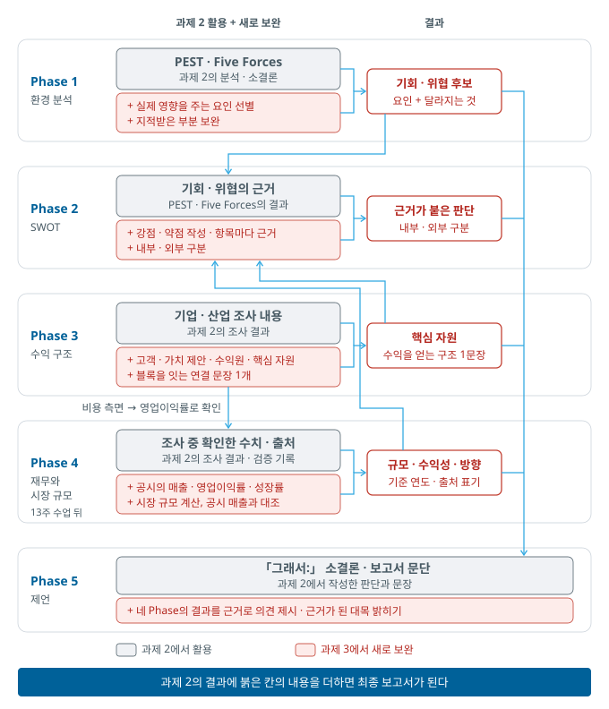
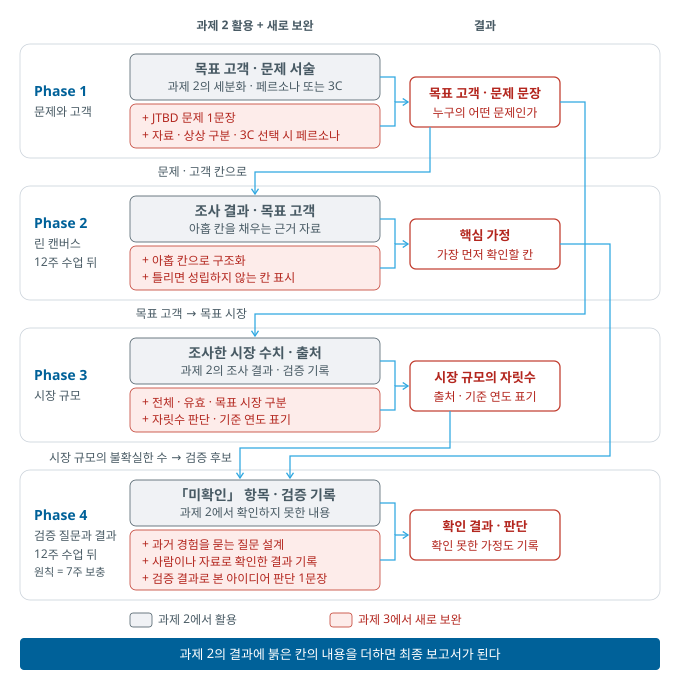

# 경영경제 AI 활용 입문 — 과제 3 안내

## 1. 과제 개요

| 항목 | 내용 |
|------|------|
| 과제명 | **과제 3 — 최종 분석보고서** |
| 부여 · 제출 | 11주 부여 → **12월 20일(일) 23:59까지 제출** (제출 채널은 별도 안내) |
| 분량 | A4 5\~7장 |
| 성격 · 배점 | 학기 종합 과제(3회) 중 3회차 — **배점 15%** (과제 3회 합산 30% · 강의계획서 기준) |

**주제와 트랙은 과제 1에서 정한 것을 그대로 이어 갑니다.** 과제 1은 도구를 고르는 과제였고, 과제 2는 조사를 수행하고 검증하는 과제였습니다. 과제 3은 그 결과를 **하나의 보고서로 완성하는** 과제입니다.

> 새로 조사를 시작하기보다 **과제 2의 결과를 확장하기**를 권합니다. 12주와 13주 수업에서 다루는 내용이 이 보고서의 남은 부분에 그대로 대응합니다.

## 2. 제출물 구성 — 트랙 A(기업·산업 분석)

다섯 부분으로 구성합니다.

### ① 환경 분석 (PEST)

대상 기업이나 산업을 둘러싼 거시 환경을 정리합니다(6주 수업 · 과제 2의 분석을 다듬어 이어서 작성합니다).

- 네 축(정치·경제·사회·기술) 전부를 채울 필요는 없습니다. **해당 주제에 실제로 영향을 주는 축**만 다루고, 나머지는 다루지 않은 이유를 한 줄로 적습니다.
- 각 요인에는 **"그래서 무엇이 달라지는가"를** 붙입니다. 요인 나열로 끝나면 분석이 아니라 목록입니다.

### ② SWOT

내부 요인(강점·약점)과 외부 요인(기회·위협)을 구분해 정리합니다(6주 수업).

- 내부와 외부의 혼동이 가장 흔한 오류입니다. 항목마다 **"이것은 우리가 가진 것인가, 바깥에서 오는 것인가"를** 확인합니다.
- 근거 없는 항목은 넣지 않습니다. AI가 만든 SWOT을 그대로 옮긴 경우 대부분 여기서 드러납니다.

### ③ 비즈니스 모델 — 수익 구조

이 회사가 **무엇으로 돈을 버는지**를 분해합니다(5주 수업).

- 아홉 블록 전부를 채우지 않아도 됩니다. **고객·가치 제안·수익원·핵심 자원** 네 블록을 중심으로 서술합니다.
- 5주 시연에서 추출한 네 항목(고객·제공 가치·수익원·주요 비용)에 **핵심 자원**을 더한 구성입니다. 비용 측면은 ④ 재무 하이라이트에서 영업이익률로 확인하고, 핵심 자원은 ② SWOT의 강점과 ⑤ 제언의 근거가 되기 때문입니다.
- 블록 사이의 연결을 한 문장으로 씁니다 — "어떤 고객에게 무엇을 제공해 어떻게 수익을 얻는가."

### ④ 재무 하이라이트

공시 자료에서 세 가지 수치를 확인합니다(5주 수업).

| 수치 | 무엇을 보는가 |
|------|------|
| 매출 | 규모 |
| 영업이익률 | 수익성 |
| 성장률 | 방향 |

- 각 수치에 **기준 연도와 출처**를 반드시 표기합니다.
- **재무 추정(향후 매출 예측·손익계산)은 이 보고서의 범위가 아닙니다.** 확인한 수치를 읽고 해석하는 것까지가 범위입니다.

### ⑤ 제언

앞의 네 부분에서 확인한 것을 근거로 의견을 제시합니다.

- 제언은 **분석에서 나와야 합니다.** ①\~④에서 언급되지 않은 근거로 제언하지 않습니다.
- 분량보다 연결이 중요합니다 — 어느 분석의 어느 대목이 이 제언의 근거인지 밝힙니다.

## 3. 제출물 구성 — 트랙 B(아이디어 검증)

네 부분으로 구성합니다.

### ① 문제와 고객

누구의 어떤 문제를 다루는지 정의합니다(7주 수업).

- **페르소나**를 작성하되, 항목마다 **자료로 확인한 것과 상상으로 채운 것을 구분해 표시**합니다.
- 고객이 이루려는 일(JTBD) 관점으로 문제를 한 문장으로 씁니다 — "[상황]에서 [동기] 때문에 [기대하는 결과]."

### ② 린 캔버스

아이디어를 아홉 칸으로 구조화합니다(12주 수업).

- 칸을 채우는 것이 목적이 아닙니다. 각 칸은 **아직 검증되지 않은 가정**이며, 그중 **틀리면 전체가 성립하지 않는 칸**이 무엇인지 표시합니다.

### ③ 시장 규모의 감

전체 시장·유효 시장·목표 시장을 자릿수 수준으로 잡습니다(4주 수업).

- 정밀한 추정이 아니라 **자릿수의 감**입니다. 억 단위인지 조 단위인지를 판단할 수 있으면 충분합니다.
- 근거가 된 수치의 **출처와 기준 연도**를 표기하고, AI가 제시한 수치는 원출처를 확인한 뒤 사용합니다.

### ④ 검증 질문과 그 결과

②에서 표시한 핵심 가정을 확인할 질문을 설계하고, 실제로 확인한 결과를 적습니다(질문 작성 원칙 = 7주 강의자료 6.6 보충).

- 질문은 **과거의 구체적 경험**을 묻습니다 — "그럴 것 같습니까"가 아니라 "최근에 그런 적이 있었습니까."
- 확인 대상은 사람이어도 되고 자료여도 됩니다. **확인하지 못한 가정은 확인하지 못했다고 적습니다.**

## 4. 공통 요건 — AI 활용 부록

**두 트랙 모두 부록을 포함합니다.** 본문 뒤에 붙이며 분량에는 포함하지 않습니다.

| 항목 | 내용 |
|------|------|
| 주요 프롬프트 | 보고서 작성에 실제로 사용한 프롬프트 중 핵심적인 것 3\~5개 (도구명 · 모델·버전 · 실행 날짜 병기) |
| 검증 기록 | AI 답변 중 **확인한 항목**과 그 확인 방법 — 출처를 찾아본 것, 다른 도구와 대조한 것, 원자료와 검산한 것 |
| 수정한 지점 | AI 답변을 그대로 쓰지 않고 고친 곳과 그 이유 |

> **AI 답변을 그대로 옮기면 감점이고, 검증한 흔적이 있으면 가점입니다.** 이 과목이 학기 내내 다뤄 온 기준이 부록에서 확인됩니다.

## 5. 차트와 표를 넣을 때 (14주 수업)

보고서에 시각 자료를 넣는 경우 아래를 확인합니다.

| 확인 | 내용 |
|------|------|
| 세로축 시작값 | 막대는 0에서 시작합니다 |
| 기간의 범위 | 왜 그 구간을 선택했는지 설명할 수 있어야 합니다 |
| 캡션 | **출처 · 기준 시점 · 단위**를 그림 아래에 표기합니다 |
| 유형 | 비교는 막대, 추세는 선, 구성은 파이 — 전달할 관계에 맞춥니다 |

AI로 차트를 생성한 경우에도 같은 기준이 적용됩니다. 생성된 그림에 출처와 단위가 유지되지 않는 경우가 많으므로 직접 확인해 보완합니다.

## 6. 평가에서 보는 것

| 항목 | 무엇을 확인하는가 |
|------|------|
| 근거의 연결 | 각 서술이 어느 자료·분석에서 나왔는지 확인할 수 있는가 |
| 검증의 흔적 | AI 답변을 확인 없이 옮긴 곳이 있는가 |
| 출처 표기 | 수치와 인용에 출처·기준 시점이 있는가 |
| 프레임의 적용 | 프레임을 채우는 데 그치지 않고 **판단에 사용**했는가 |
| 구성의 완결 | 문제 제기부터 결론까지 이어지는가 |

분량이 많다고 좋은 평가를 받지 않습니다. **확인되지 않은 서술이 적은 보고서**가 좋은 보고서입니다.

## 7. AI 활용 수칙 (3주 수업 내용 — 계속 적용)

- **모든 AI의 답변은 초안으로 활용합니다** — 검증한 내용을 자기 문장으로 다시 쓰고, 그 기록을 부록(4절)에 남깁니다.
- AI를 사용한 사실과 사용 범위를 표기합니다.
- 출처가 확인되지 않은 수치는 사용하지 않거나, 확인되지 않았음을 밝힙니다.
- 기밀·개인정보는 입력하지 않습니다.

## 8. 자주 하는 질문

**Q. 트랙을 바꿔도 됩니까?**
권하지 않습니다. 과제 1·2가 그 트랙 기준으로 진행됐으므로 처음부터 다시 조사해야 합니다.

**Q. 과제 2의 내용을 그대로 옮겨도 됩니까?**
됩니다. 과제 3은 새 보고서가 아니라 **완성본**입니다. 다만 과제 2에서 지적받은 부분은 보완합니다.

**Q. 12주 수업 전에 트랙 B의 ②④를 작성할 수 있습니까?**
어렵습니다. 린 캔버스는 12주에 다루고, ④는 ②에서 표시한 핵심 가정을 확인하는 질문이므로 ②를 먼저 작성해야 합니다. 그 전에는 ①③을 먼저 작성하는 것이 효율적입니다. ④의 질문 작성 원칙은 3절 ④와 7주 강의자료 6.6 보충에 있습니다.

**Q. 차트를 반드시 넣어야 합니까?**
아닙니다. 전달할 관계가 있을 때만 넣습니다. 값이 몇 개 되지 않으면 표가 적합합니다.

**Q. AI 활용 부록의 프롬프트는 전부 적어야 합니까?**
아닙니다. 보고서의 핵심 내용을 만든 것 3\~5개면 충분합니다. 대신 그 프롬프트로 받은 답을 어떻게 확인했는지를 함께 적습니다.

---

*문의는 수업 시간 또는 안내된 연락 방법으로 합니다.*

---

## 개정 이력

| 날짜 | 내용 |
|------|------|
| 2026-11-25 | 제출 기한 변경(14주 제출 → 12월 20일(일) 23:59까지) — 1절 과제 개요 |
| 2026-11-19 | 트랙 A의 비용 표현 정정(비용 측면은 재무 하이라이트에서 영업이익률로 확인) — 본문 2절과 진행 흐름 그림 |
| 2026-11-18 | 최초 게시 |
