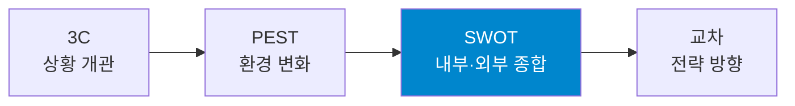
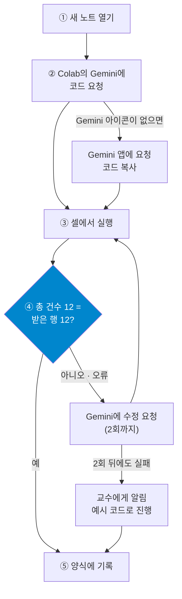

# 6주차 — 분석 프레임: 3C · SWOT · PEST

> 경영경제 분야 AI 활용 입문 · 단국대학교
> **복습 기준 = 이 자료 + 수업 중 필기**

## 목차

- [1. 이번 주 개요 및 목표](#1-이번-주-개요-및-목표)
- [2. 분석 프레임과 3C·SWOT — 안과 밖을 나누는 눈](#2-분석-프레임과-3cswot--안과-밖을-나누는-눈)
- [3. 실습 1\~3 — 같은 기업의 SWOT을 지정으로 다듬기](#3-실습-13--같은-기업의-swot을-지정으로-다듬기)
- [4. PEST와 공식 수치 — 환경을 SWOT으로 옮기기](#4-pest와-공식-수치--환경을-swot으로-옮기기)
- [5. 실습 4\~6 — 공식 수치로 PEST와 SWOT 검증](#5-실습-46--공식-수치로-pest와-swot-검증)
- [6. 심화·확장 — 프레임의 한계와 확장](#6-심화확장--프레임의-한계와-확장)
- [7. 요약과 AI 지문 비판](#7-요약과-ai-지문-비판)
- [개정 이력](#개정-이력)

---

## 1. 이번 주 개요 및 목표

### 1.1 이번 주 학습 목표

1. 3C(자사·경쟁·고객)·SWOT(강점·약점·기회·위협)·PEST(정치·경제·사회·기술)의 구조와 용도를 구분해 적용한다.
2. AI에게 프레임 분석을 요청하는 프롬프트를 설계한다.
3. AI 프레임 분석의 전형적 오류(내부·외부 혼동, 근거 없는 항목)를 식별하고 교정한다.
4. PEST 요인을 SWOT의 기회·위협으로 옮기는 절차를 적용한다.
5. AI가 작성한 코드를 실행해 공공 통계의 공식 값을 확보하고, AI가 제시한 수치와 대조한다.

시장(4주)과 기업(5주)을 읽었으므로, 오늘은 그 재료를 **정리하는 틀**을 갖춥니다. AI가 프레임 분석에서 저지르는 오류를 찾아 고치는 훈련이 함께 진행됩니다.

오늘은 **처음으로 코드를 실행**합니다. AI가 작성한 코드로 한국은행 경제통계시스템(ECOS, Economic Statistics System)의 공식 통계를 직접 가져와 AI가 답한 수치와 대조합니다. 오늘은 **과제 1 제출일**이기도 합니다.

### 1.2 이번 주 진행 순서

오늘은 설명과 실습이 번갈아 진행됩니다. **절 번호가 곧 진행 순서**입니다.

| 절 | 내용 |
|:--:|------|
| §2 | 프레임의 역할 · 세 프레임의 용도 · 3C · SWOT · 이마트 함께 채우기 · 프레임 분석 프롬프트 |
| **§3** | **실습 1\~3** — 같은 기업의 SWOT을 지정으로 다듬기 |
| §4 | PEST · 기준금리의 공식 값 · PEST에서 SWOT으로 · 교차 · Google Colab · 코드 실습 안내 |
| **§5** | **실습 4\~6** — 공식 수치로 PEST와 SWOT 검증 → 조 결론 → 수업 종료 |

- 오늘 실습은 **6단계**이며 세 유형이 섞여 있습니다.
  - **〈실습만〉** = 실행·기록·검증
  - **〈토론〉** = 〈실습만〉에 조원 간 논의와 합의를 더한 유형
  - **〈코드〉** = AI에게 코드를 요청해 실행하고 결과를 검증하는 개별 실습(실습 5)
- **앞 실습의 결과가 다음 실습의 재료입니다.** 기록 양식에도 같은 순서로 칸이 있으므로 순서대로 채웁니다.
- 조별 실습은 2\~4명이 자유롭게 조를 만들어 진행합니다. 한 사람이 **기록 양식의 사본**을 만들어 조원과 공유합니다 — [6주 기록 양식 사본 만들기](https://docs.google.com/document/d/1t0VoqG_cie2dx-4blyy-Jp5BARKjWBvkhb9ttRyu6po/copy) (저장소 첫 화면 README에도 있습니다).
- 조원은 각자 기록한 문서를 수업 후 **PDF로 내려받아** e-campus에 제출합니다. 파일명은 `6주_이름1_이름2_이름3.pdf`, 마감은 오늘 23:59입니다.

- **실습 5는 Google Colab에서 진행합니다.** 수업 전에 `colab.research.google.com`에 학교 계정 또는 개인 Google 계정으로 로그인해 둡니다. 설치할 프로그램은 없습니다.
- 코드는 직접 작성하지 않고 **Colab 안의 Gemini에게 요청**합니다.
- 오늘은 **과제 1 제출일**입니다. 제출 방법과 마감은 과제 1 안내를 따릅니다.

### 1.3 프롬프트 기법 ① — 구분자와 조건

> [!IMPORTANT]
> - 프롬프트 안을 **지시·데이터·요구**의 구획으로 나눈다
> - 조건과 필수 요건은 문장에 섞지 않고 **목록**으로 적는다
> - 강조어를 반복하기보다 **조건을 구체적으로** 적는다

프롬프트가 길어지면 AI가 어디까지가 지시이고 어디부터가 처리할 자료인지 혼동할 수 있습니다. 자료 안에 "요약해 줘" 같은 문장이 섞여 있으면 그 문장을 지시로 처리하는 경우도 있습니다. **구분자**는 구획마다 제목을 붙여 이 경계를 표시하는 방법입니다.

이 과목은 Markdown 제목(`## 지시`·`## 데이터`·`## 요구`)을 구분자로 사용합니다. 참고 자료에 자주 등장하는 `###지시###` 형태도 구획을 나누는 효과는 같습니다. 구획을 나누는 방법은 Google·OpenAI·Anthropic의 프롬프트 작성 안내가 공통으로 권장합니다.

**조건·필수 요건 명시**는 결과물이 갖추어야 할 조건을 따로 적는 방법입니다. "반드시"·"절대" 같은 강조어를 반복하는 대신, 무엇을 포함하고 어떤 형식으로 출력할지를 항목별로 적습니다. Google의 Gemini 3 프롬프트 안내도 지나치게 강하게 요구하는 표현을 피하도록 권합니다. *(출처: Google Gemini 3 프롬프트 가이드 · OpenAI·Anthropic 프롬프트 엔지니어링 문서 — 2026-10-09 확인)*

예를 들어 실습 5에서 Colab의 Gemini에 입력할 코드 요청은 다음과 같이 구획을 나눕니다.

```
## 지시
한국은행 ECOS에서 기준금리를 조회하는 Python 코드를 작성해줘.

## 데이터
- 통계표 코드: 722Y001 / 항목 코드: 0101000
- 주기: 분기(Q) / 기간: 2023Q4 ~ 2026Q3
- 인증키: sample

## 요구
- 모든 줄에 한국어 주석을 달 것
- 응답의 총 건수와 실제로 받은 행 수를 출력할 것
- 10건씩 나누어 두 번 요청할 것(1~10번, 11~20번)
- 오류 응답이 오면 오류 코드와 메시지를 출력할 것
```

`## 요구`의 네 줄이 조건 목록입니다. 구획이 나뉘어 있으면 조건 하나를 바꿀 때 그 줄만 고치면 되고, 조원끼리 프롬프트를 비교하기도 쉽습니다.

---

## 2. 분석 프레임과 3C·SWOT — 안과 밖을 나누는 눈

**학습목표**

- 프레임이 해 주는 것과 해 주지 않는 것을 설명하고, 세 프레임의 용도를 구분할 수 있다.
- 3C의 세 관점으로 사업 상황을 빠짐없이 개관할 수 있다.
- SWOT의 내부·외부 판별 기준을 적용하고, AI가 자주 혼동하는 유형을 판별할 수 있다.
- 프레임 분석을 요청하는 프롬프트에 지정할 네 가지를 설명할 수 있다.

### 2.1 프레임이란 — 질문의 묶음

> [!IMPORTANT]
> - 프레임 = 빠뜨리지 않게 해 주는 **질문의 묶음**
> - 칸을 채우는 것이 아니라 채운 것을 **판별하고 판단**하는 것이 역량이다
> - 프레임은 조사의 **다음**에 사용한다

분석 프레임(framework)은 정답을 주는 공식이 아니라 **빠뜨리지 않게 해 주는 질문의 묶음**입니다. 3C는 "세 방향을 모두 검토했는가"를, SWOT은 "안과 밖을 모두 검토했는가"를, PEST는 "거시 환경 네 축을 모두 검토했는가"를 묻습니다.

이 정의를 먼저 세우는 이유는 프레임의 가장 흔한 실패가 **칸 채우기**이기 때문입니다. 네 칸을 채웠다고 분석이 끝나지는 않습니다. 채운 내용이 판단으로 이어져야 분석입니다. AI는 칸을 채우는 데 매우 능숙하므로, AI 시대의 프레임 역량은 **채워진 것을 판별하고 판단으로 연결하는 능력**입니다.

프레임을 사용하는 시점은 **조사 다음**입니다. 4·5주에 모은 재료(시장 수치·기업 구조)가 있어야 칸에 적을 내용이 생깁니다. 재료 없이 프레임부터 채우면 AI든 사람이든 일반론으로 채우게 되며, 지난주까지 다룬 "산만한 답"의 문제가 프레임에서 반복됩니다.

반대로 재료만 모으고 프레임이 없으면 보고서의 여러 절에서 같은 내용이 중복되고 중요한 축이 빠집니다. 프레임은 이 중복과 누락을 막는 정리 도구입니다.

**세 프레임의 이름**

| 약어 | 글자별 뜻 |
|:--:|------|
| **3C** | 자사(Company) · 경쟁(Competitor) · 고객(Customer) |
| **SWOT** | 강점(Strengths) · 약점(Weaknesses) · 기회(Opportunities) · 위협(Threats) |
| **PEST** | 정치(Political) · 경제(Economic) · 사회(Social) · 기술(Technological) |

**누가 처음 제시했나**

- **3C**는 사업을 둘러싼 세 주체를 개관하는 틀입니다. 맥킨지의 오마에 겐이치가 『The Mind of the Strategist』(1982)에서 「전략적 삼각형」으로 제시했습니다.
- **SWOT**은 회사 안(강점·약점)과 밖(기회·위협)을 종합하는 틀입니다. 스탠퍼드연구소(SRI)의 Robert F. Stewart가 1965년에 만든 기획 기법 SOFT가 1967년 SWOT으로 이름이 바뀌었습니다. 기원은 오랫동안 불분명했으며 2020·2023년 연구에서 정리되었습니다.
- **PEST**는 회사가 통제할 수 없는 거시 환경을 네 축으로 개관하는 틀입니다. 하버드 경영대학원의 Francis Aguilar가 1967년에 제시한 ETPS가 바탕입니다(4.1).

*(출처: Ohmae, The Mind of the Strategist, McGraw-Hill, 1982 · Puyt·Lie·Wilderom, "The origins of SWOT analysis", Long Range Planning 56(3), 2023 · Aguilar, Scanning the Business Environment, 1967)*

### 2.2 세 프레임의 용도와 선택

> [!IMPORTANT]
> - 3C = 지금 상황의 개관 · PEST = 환경의 변화 · SWOT = 유리한가의 종합
> - 프레임에 따라 **분석 단위**(산업·기업)가 달라진다
> - 사용 순서 = 3C → PEST → SWOT → 교차(전략)

세 프레임은 경쟁 관계가 아니라 각기 다른 질문에 답합니다. 상황에 맞는 질문을 먼저 정하면 사용할 프레임이 정해집니다.

| 프레임 | 답하는 질문 | 주된 분석 단위 | 산출물 |
|:--:|------|:--:|------|
| **3C** | 지금 상황은 어떤가 | 기업·사업 | 세 방향의 개관 |
| **PEST** | 환경이 어떻게 바뀌는가 | 산업·시장 | 기회·위협 후보 |
| **SWOT** | 이 회사는 지금 유리한가 | 기업 한 곳 | 내부·외부의 종합 |
| **교차** | 그렇다면 무엇을 할 것인가 | 기업 한 곳 | 전략 방향 |

분석 단위를 함께 확인합니다. PEST는 산업 전체에 미치는 조건을 다루고, SWOT은 그 산업 안의 **기업 한 곳**을 다룹니다. 같은 이마트를 분석해도 PEST의 대상은 "국내 대형마트 산업"이고, SWOT의 대상은 "이마트"입니다. 분석 단위를 정하지 않으면 산업 서술과 기업 서술이 한 표에 섞입니다(2.7).



이 순서로 사용하면 앞 프레임의 산출물이 다음 프레임의 입력이 됩니다. 3C의 경쟁·고객 칸은 SWOT의 판단 근거가 되고, PEST의 기회·위협 후보는 SWOT의 O·T 칸으로 옮겨집니다(4.3). 과제 2의 「프레임 1개 이상 적용」 요건도 이 순서에서 시작하면 작업이 중복되지 않습니다.

### 2.3 3C — 세 방향을 보는 개관

> [!IMPORTANT]
> - 자사·경쟁·고객의 세 방향을 **비슷한 분량**으로 채운다
> - **고객부터** 채우면 경쟁의 범위가 정확해진다
> - 경쟁 칸에는 **대체재**까지 포함한다

3C는 자사(Company)·경쟁(Competitor)·고객(Customer)의 세 방향에서 상황을 개관하는 틀입니다. 어느 분석에서나 처음 사용하기 좋은, 가장 가벼운 프레임입니다.

채우는 순서는 자유이지만 **고객부터 시작하는 것을 권장**합니다. 자사부터 시작하면 아는 것이 가장 많은 칸에 시간을 쓰게 되어 나머지 두 칸이 부실해집니다. 고객이 정해져야 "그 고객을 두고 경쟁하는" 상대의 범위도 정확해집니다.

| C | 질문 | 5주와의 연결 |
|:--:|------|------|
| **자사** (Company) | 무엇을 잘하고 무엇을 가졌는가 | BMC(Business Model Canvas) 핵심 자원·가치 제안 |
| **경쟁** (Competitor) | 같은 고객을 두고 경쟁하는 상대는 누구인가 | Five Forces·경쟁사 BMC |
| **고객** (Customer) | 고객은 누구이고 무엇을 원하는가 | BMC 고객 세그먼트 (상세는 7주 페르소나) |

**함께 채우기 — 이마트의 3C** (5주 2.4·4.3에서 수치와 구조로 읽은 회사)

- **고객**: 주 단위로 장을 보는 가구 · 창고형 할인점(트레이더스) 이용자 · 온라인 주문 고객 — 5주 4.3 고객 세그먼트
- **경쟁**: 동종 대형마트 + 이커머스·SSM(Super Supermarket, 기업형 슈퍼마켓)·편의점 — 대체재까지 포함
- **자사**: 매입 규모(바잉파워) · 전국 점포망 · 자체 브랜드(노브랜드·피코크) — 5주 4.3 핵심 자원

**그래서**(소결론): 규모와 점포망의 우위는 유지되고 있으나, 같은 고객을 두고 경쟁하는 이커머스와 대체재가 많아 **점포를 방문할 이유를 가격 이외의 요소로도 제시해야 하는 상황**입니다. 이 한 문장이 3C를 분석으로 만드는 마무리입니다(6.1에서 습관으로 정리합니다).

3C에서 주의할 점은 **자기중심 분석**입니다. 자사 칸만 자세하고 경쟁·고객 칸이 한두 줄에 그치면 분석이 아니라 자기소개가 됩니다. 세 방향의 분량이 비슷해야 개관이 성립합니다.

경쟁 칸에는 동종 업체만이 아니라 **대체재까지** 포함합니다(5주 — 경쟁은 경쟁사만이 아니다). 고객 칸을 깊게 분석하는 도구(페르소나·JTBD(Jobs To Be Done, 고객이 해결하려는 일))는 7주의 주제입니다.

세 방향을 채우면 다음 질문이 이어집니다. "그렇다면 강점과 약점은 무엇이고, 환경은 유리한가?" 이 질문이 SWOT입니다. 3C가 개관이라면 SWOT은 종합입니다.

### 2.4 SWOT — 내부와 외부의 구분

> [!IMPORTANT]
> - 내부(S·W) = **통제할 수 있는 것** · 외부(O·T) = **회사가 없어도 존재하는 것**
> - 판별 질문 = "우리 회사가 없어도 이것은 존재하는가?"
> - 강점은 **비교 우위**여야 한다

SWOT은 강점(Strengths)·약점(Weaknesses)·기회(Opportunities)·위협(Threats)의 네 칸입니다. 네 단어보다 중요한 것은 **경계선**입니다.

| 구분 | 칸 | 판별 기준 |
|------|----|----------|
| **내부** | 강점 S · 약점 W | **통제·개선할 수 있는가** — 역량·자원·구조 |
| **외부** | 기회 O · 위협 T | **회사와 무관하게 존재하는가** — 시장·정책·기술 변화 |

판별이 어려울 때는 한 문장 검사를 사용합니다. **"우리 회사가 없어도 이것은 존재하는가?"** 존재한다면 외부(O·T)이고, 회사가 있어야 성립하면 내부(S·W)입니다. "시장이 성장한다"는 회사가 없어도 성립하므로 기회이고, "브랜드 인지도가 높다"는 회사의 속성이므로 강점입니다.

경계에 걸치는 항목(제휴 관계·평판처럼 회사와 환경이 함께 만든 것)은 어느 칸으로도 논리를 세울 수 있습니다. 정답을 고민하기보다 **한 분석 안에서 기준을 일관되게** 적용하는 것이 우선입니다.

내부 칸에는 조건이 하나 더 있습니다. **강점은 비교 우위**여야 합니다. "상품이 좋다"·"서비스가 좋다"는 어느 회사나 작성할 수 있는 문장이므로 강점 서술이 되지 못합니다. "경쟁 대비 무엇이 어떻게 우월하고 그 근거는 무엇인가"까지 있어야 강점입니다(근거 = 3C의 경쟁 칸·5주 재무 수치).

AI가 채운 S 칸이 유창하지만 내용이 없다고 느껴진다면, 대부분 이 비교와 근거가 빠진 경우입니다. SWOT의 질은 입력의 질에 따라 달라집니다. 외부 요인(O·T)은 4주 시장조사와 오늘 §4의 PEST에서, 내부 요인(S·W)은 5주 기업 읽기(재무 하이라이트·BMC)에서 가져오면 근거 있는 SWOT이 됩니다.

### 2.5 함께 짚어보기 — AI가 자주 틀리는 세 유형

AI에게 SWOT을 요청하면 유창한 네 칸이 생성됩니다. 그러나 전형적인 오류가 반복됩니다. 다음 두 항목을 함께 판별합니다.

**Q**: 다음 두 항목은 각각 어느 칸에 있어야 합니까? 잘못 배치된 이유도 함께 지적합니다.

- ① [기회 칸에] "당사의 신제품 출시가 예정되어 있음"
- ② [강점 칸에] "건강 음료 시장이 빠르게 성장하고 있음"

**A**: 둘 다 잘못된 칸입니다.

- ① 회사의 계획이므로 **내부**입니다. 기회가 아니라 강점(또는 계획 중인 대응)에 해당합니다.
- ② 시장 성장은 회사의 속성이 아니라 환경이므로 **기회**입니다. 강점 칸에 두면 "회사가 잘해서 시장이 성장한다"는 어색한 문장이 됩니다.

한 문장 검사를 적용하면 두 오류가 모두 걸러집니다. 세 번째 유형은 **약점(W)과 위협(T)의 혼동**입니다. "경쟁이 심해지고 있다"를 약점 칸에 두는 경우가 전형입니다. 경쟁 심화는 환경의 변화이므로 위협이고, 그 경쟁에 대응할 역량이 부족하다는 사실이 약점입니다.

| 유형 | 전형적인 오류 | 판별 |
|------|------|------|
| 기회 칸의 내부 항목 | 회사의 계획을 기회로 분류 | 회사가 없으면 성립하지 않음 → 내부 |
| 강점 칸의 외부 항목 | 시장 성장을 강점으로 분류 | 회사가 없어도 성립 → 외부 |
| 약점과 위협의 혼동 | 경쟁 심화를 약점으로 분류 | 환경 변화 = 위협 · 대응 역량 부족 = 약점 |

이 세 유형이 AI에게서 잦은 이유는 학습 데이터에 있습니다. AI는 공개된 문서에서 SWOT 표의 패턴을 학습했습니다. 학습한 문서 가운데에도 칸을 혼동한 SWOT이 많습니다. **틀린 문서를 학습한 AI는 틀린 패턴을 유창하게 재현합니다**(2주 — 패턴 학습). 따라서 AI의 SWOT은 내용의 참·거짓보다 **칸이 올바른지**를 먼저 확인합니다.

### 2.6 이마트 SWOT 함께 채우기

> [!IMPORTANT]
> - 같은 회사도 프레임이 바뀌면 **다른 질문**에 답하게 된다
> - 항목은 **개조식 + 근거**로 적고, 근거가 없으면 **추정**으로 표시한다
> - 같은 사실이 **두 칸에** 함께 등장할 수 있다

5주에 수치(2.4)와 BMC(4.3)로 읽은 이마트를 SWOT으로 정리합니다. BMC가 "이 회사는 어떻게 수익을 내는가"를 설명했다면, SWOT은 "이 회사는 지금 유리한가"를 묻습니다. 프레임 선택이 곧 질문 선택이라는 점을 같은 회사로 확인하는 것이 이 함께 채우기의 목적입니다.

| 칸 | 항목 | 근거 |
|:--:|------|------|
| **S** | 매입 규모(바잉파워)·전국 점포망·자체 브랜드 | 5주 4.3 핵심 자원 |
| **S** | 본업 수익성 개선 — 별도 영업이익 전년 대비 +127.5% | 2025년 사업보고서(5주 2.4) |
| **W** | 낮은 수익성 — 연결 영업이익률 약 1.1% | 2025년 사업보고서(5주 2.4) |
| **W** | 점포 인건비·임차료 등 대규모 고정비 | 5주 4.3 비용 구조 |
| **O** | 가격에 민감한 장보기 수요 | **추정** — 근거 확인 필요 |
| **T** | 이커머스의 성장 — 시가총액 기준 쿠팡이 이마트를 추월(2021) | 한국경제 2021-10 보도(5주 6.1) |

주목할 점은 **같은 사실이 칸을 바꾸어 등장한다**는 것입니다. 전국 점포망은 접근성을 만드는 강점이면서, 인건비·임차료라는 고정비의 원인이므로 약점이기도 합니다. 하나의 사실이 S와 W 양쪽에 걸치는 것은 오류가 아니라 정상이며, 어느 칸의 비중이 큰지가 해석의 몫입니다.

O 칸의 **추정** 표시도 확인합니다. "가격에 민감한 수요"는 그럴듯하지만 지금 표에는 그 근거가 없습니다. 근거 없는 항목을 근거 있는 항목과 같은 어조로 적지 않고 추정으로 표시해 두면, 실습에서 무엇을 확인해야 하는지가 명확해집니다.

과제에서 SWOT을 작성할 때의 형식도 정해 둡니다. 칸의 항목은 **개조식 + 근거 병기**로 적습니다. "브랜드 인지도(○○ 조사 1위, 연도)"처럼 근거가 있는 항목과 "인지도 높음"만 있는 항목은 보고서에서 무게가 다릅니다. 4주의 서술 규칙(사실은 출처와, 해석은 근거와)이 SWOT 칸 안에서도 그대로 적용됩니다.

### 2.7 프레임 분석을 요청하는 프롬프트 — 4지정

> [!IMPORTANT]
> - 지정할 것 = **분석 단위 · 판별 기준 · 근거 표시 · 추정 표시**
> - 근거·추정 표시는 판별 작업을 **답변 안으로** 옮긴다
> - **항목 개수는 지정하지 않는다**

3주의 조사 프롬프트 틀에 프레임 분석용 지정 네 가지를 더합니다. 지정하지 않으면 무엇이 잘못되는지가 지정의 이유입니다.

| 지정할 것 | 지정하지 않으면 |
|----------|----------------|
| **분석 단위** — 무엇 하나에 대한 분석인가 | 산업과 기업이 한 표에 섞임(2.2) |
| **판별 기준** — "우리 회사가 없어도 존재하는가" | 내부·외부 혼동이 그대로 생성됨(2.5) |
| **근거 표시** — 항목마다 근거 | 유창하지만 출처가 없는 칸 |
| **추정 표시** — 근거가 없으면 "추정" | 자료와 추정이 같은 어조로 나열됨 |

1.3의 구분자 형식으로 정리하면 다음과 같습니다.

```
## 지시
이마트의 SWOT을 작성해줘.

## 조건
- 분석 단위: 이마트 한 회사로 한정할 것
- 판별 기준: 내부(S·W)와 외부(O·T)는 "우리 회사가 없어도 존재하는가"로 나눌 것
- 근거 표시: 항목마다 근거가 된 자료나 사실을 함께 적을 것
- 추정 표시: 근거가 없는 항목은 "추정"이라고 표시할 것
```

뒤의 두 조건이 핵심입니다. 근거·추정 표시를 요구하면 **판별 작업이 답변 안으로 옮겨집니다.** 받은 뒤에 찾아내는 대신, 받을 때 표시가 함께 생성되게 하는 방법입니다. 표시가 정확한지는 사람이 다시 확인해야 하지만, 어디를 확인할지는 이 두 줄이 알려 줍니다.

**지정하지 않을 것**도 하나 있습니다. **항목 개수**입니다. "각 칸에 3개씩"이라고 정하면 AI는 개수를 채우기 위해 근거 없는 항목을 생성합니다.

원인은 생성 방식에 있습니다. 공개된 문서 가운데 "기회: 해당 없음"처럼 빈칸으로 끝나는 SWOT은 드뭅니다. AI는 학습한 문서에서 가장 흔한 형태를 따라 생성하므로, 칸이 비어 있지 않은 답을 생성하는 경향이 있습니다(2주 — 확률 예측). 개수까지 지정하면 이 경향이 더 강해집니다. 개수는 비워 두고 근거 있는 항목만 받은 뒤, 부족한 칸은 4·5주에 모은 재료로 사람이 채웁니다.

---

## 3. 실습 1\~3 — 같은 기업의 SWOT을 지정으로 다듬기

**학습목표**

- 조원과 대상 기업을 정하고 같은 질문을 동시에 실행해 3C 응답의 차이를 비교할 수 있다.
- AI의 SWOT에서 내부·외부 오분류를 찾아 개수를 기록할 수 있다.
- 4지정으로 다시 요청해 오분류가 줄어드는지 확인하고, 조의 SWOT을 합의할 수 있다.

### 3.1 진행 방식과 조 편성

**준비 (3분)**

1. 2\~4명이 조를 만듭니다. 조장은 없습니다.
2. 조원 1인이 기록 양식 사본을 만들어 나머지 조원에게 **편집 권한으로 공유**합니다. 조원 명단(이름·학번)을 채웁니다.
3. 조가 함께 **대상 기업 1곳**을 정합니다 — **5주와 같은 기업을 권장**합니다. 5주 실습 3에서 공시로 확인한 수치를 SWOT의 근거로 다시 사용할 수 있습니다.
   - ⚠️ **상장기업으로 정합니다** — 실습 3에서 근거 1건을 사업보고서로 확인합니다.
4. 대상 기업의 DART 사업보고서를 열어 양식의 링크 칸에 주소를 붙여 넣어 둡니다.

**오늘 실습의 규칙 네 가지**

- **실습 1과 실습 4에서는 조원 전원이 같은 프롬프트를 각자의 Gemini에서 동시에 실행**하고 결과를 비교합니다. 나머지 실습은 조원 간 비교 없이 검증에 집중합니다 — **검증은 모든 실습에서 합니다.**
- 실습 사이에는 질문의 **한 요소만** 바꿉니다. 바꿀 요소는 3.2와 5.1의 표에 정해져 있으며, 문안은 조가 작성합니다.
- **앞 실습의 결과가 다음 실습의 재료입니다.** 표의 「가져올 것」 열이 그 연결입니다.
- **실행은 Gemini 앱에서 하고, 결과는 기록 양식에 붙여 넣습니다.** 실습 5만 Colab에서 각자 진행하며, 코드는 Colab 안의 Gemini에 요청합니다.

각 실습이 끝나면 조원은 각자의 이름 절에 **검증 결과**를 기록하고, 실행한 조원은 **프롬프트와 응답**도 함께 기록합니다. 조는 기록표의 해당 행을 함께 채웁니다. 응답은 요약하지 않고 **AI가 출력한 문장 그대로** 붙여 넣습니다. 이 기록이 곧 AI 활용 로그입니다.

### 3.2 실습 1\~3

| 실습 | 유형 | 바꾸는 것 | 가져올 것 | 비교 관점 | **검증할 것** |
|:--:|:--:|------|------|------|------|
| 1 | 〈실습만〉 | 대상 기업의 **3C** 요청 | 대상 기업 | 세 칸 분량 · 경쟁 칸 범위 | 자기중심 분석 · 대체재 포함 여부 |
| 2 | 〈실습만〉 | 같은 기업의 **SWOT 기본형** 요청 | 실습 1의 3C | — | 오분류 항목 표시 · **개수 기록** |
| 3 | **〈토론〉** | **4지정**으로 다시 요청 | 실습 2의 답 | — | 오분류 감소 · 근거 1건 확인 · 추정 수 |

- **실습 1** — 「○○의 3C를 정리해줘」처럼 프레임 이름만 지정해 요청합니다. 조원 간에 세 칸의 분량과 경쟁 칸의 범위가 어떻게 다른지 비교합니다. 자사 칸만 길다면 자기중심 분석이고, 경쟁 칸에 대체재가 없다면 범위가 좁은 상태입니다(2.3).
- **실습 2** — 같은 기업의 SWOT을 기본형(「○○의 SWOT을 작성해줘」)으로 요청합니다. 네 칸의 항목마다 한 문장 검사를 적용해 오분류 항목에 표시하고 **개수를 기록**합니다(2.4·2.5).
- **실습 3** — 2.7의 4지정을 포함해 다시 요청하고, 아래 「실습 3의 확인 순서」로 결과를 확인합니다.

**실습 3의 확인 순서**

1. O·T 칸에 내부 항목이 섞여 있는가(한 문장 검사)
2. S 칸에 시장·환경 서술이 섞여 있는가
3. 근거 없는 수치·항목이 「추정」 표시 없이 남아 있는가
4. 사업보고서에 있는 중요한 요인이 빠지지 않았는가

- 근거가 표시된 항목 **1건을 선택해** 사업보고서에서 직접 확인합니다.
- **실습 3은 토론형입니다.** 확인을 마친 뒤 조가 함께 **조의 SWOT**을 합의해 기록표 ① 아래 칸에 적습니다. 실습 2와 실습 3의 오분류 개수를 함께 적습니다.

⛔ **여기까지 실습 1\~3입니다.** 기록 양식에도 같은 자리에 경계선이 있습니다. **실습 4로 넘어가지 말고** 여기서 멈춘 뒤 §4 설명을 듣습니다 — 실습 4부터는 §4에서 다룰 PEST와 공식 수치를 사용하므로, 실습 4를 먼저 수행하면 같은 작업을 두 번 하게 됩니다.

> **실습 4의 입력** — 조가 합의한 **SWOT(근거·추정 표시 포함)**. 실습 6에서 이 SWOT의 O·T 칸을 고칩니다.

---

## 4. PEST와 공식 수치 — 환경을 SWOT으로 옮기기

**학습목표**

- PEST 네 축으로 거시 환경을 개관하고, 요인마다 "그래서 무엇이 달라지는가"를 덧붙일 수 있다.
- AI가 제시한 수치와 공식 통계에서 조회한 값의 차이를 설명할 수 있다.
- PEST 요인을 SWOT의 기회·위협으로 옮기는 절차를 적용할 수 있다.
- Colab 노트의 셀·출력·런타임을 구분하고, 코드가 어디에서 실행되고 저장되는지 설명할 수 있다.
- 실습 5의 코드 실습 절차와 인증키 관리 원칙을 설명할 수 있다.

### 4.1 PEST — 거시 환경 네 축

> [!IMPORTANT]
> - PEST = 회사가 통제할 수 없는 **거시 환경**의 네 축
> - 요인마다 **"그래서 무엇이 달라지는가"** 한 줄을 덧붙여야 분석이다
> - AI가 답한 수치는 **조회한 값이 아니라 생성한 문자열**이다

PEST는 사업을 둘러싼 **통제할 수 없는 환경**을 정치(Political)·경제(Economic)·사회(Social)·기술(Technological)의 네 축으로 개관하는 틀입니다. 1967년 하버드 경영대학원의 Francis Aguilar가 제시한 ETPS(Economic·Technical·Political·Social) 개념이 정리되어 현재의 형태가 되었습니다. *(출처: Aguilar, Scanning the Business Environment, 1967)*

| 축 | 보는 것 | 확인 원천 |
|:--:|--------|----------|
| **P** 정치·정책 | 정부 정책·규제·지원 제도 | 부처 보도자료·업무계획 · 지원사업 공고 |
| **E** 경제 | 경기·금리·물가·환율·소비 여력 | 한국은행 경제통계시스템 · 국가통계포털 |
| **S** 사회·문화 | 인구·가구·라이프스타일·가치관 | 국가데이터처 인구동향조사·사회조사 |
| **T** 기술 | 기술 변화·디지털 전환·특허 | 특허정보넷 · 기술 동향 보고서 |

PEST의 원칙은 하나입니다. **요인 나열은 분석이 아닙니다.** "AI 기술이 빠르게 발전하고 있다"는 어느 사업 문서에나 적을 수 있는 배경 서술입니다. 요인 하나를 적을 때마다 "**그래서 이 사업의 무엇이 달라지는가**"를 한 줄로 덧붙여야 분석이 됩니다. 이 한 줄이 요인을 기회 또는 위협으로 분류하며, 그 결과가 SWOT의 O·T 칸으로 옮겨집니다(4.3).

PEST는 특정 시점의 기록이라는 점도 기억합니다. 환경은 변하므로 분석에는 **기준 시점을 명시**하고, 시간이 지나면 다시 확인합니다. 경제 축은 10주(경제지표)에서 깊게 다룹니다.

AI의 PEST 분석에는 **근거 없는 수치가 섞이기 쉽습니다.** "1인 가구가 전체의 40%를 돌파"처럼 구체적인 수치가 출처 없이 생성되는 경우입니다.

원인은 AI가 수치를 만드는 방식에 있습니다. AI가 답한 수치는 통계 기관에서 **조회한 값이 아니라**, 앞 문장에 이어질 가능성이 높은 형태로 **생성한 문자열**입니다(2주 — 확률 예측). 학습 데이터에서 수치와 그 출처는 서로 다른 문장이나 문서에 흩어져 있는 경우가 많습니다. 따라서 수치의 형태는 재현되어도 출처는 함께 생성되지 않습니다.

AI의 수치는 4주의 절차(출처·집계 기준·기준 연도)로 확인하기 전에는 사용하지 않습니다. 네 축을 한 번에 묻기보다 **축별로 나누어 묻는 것**도 답이 얕아지지 않는 방법입니다(3주 — 질문 분해).

### 4.2 E축의 공식 값 — 기준금리와 ECOS

> [!IMPORTANT]
> - 경제 축의 수치는 **공식 통계에서 조회**한다
> - 기준금리 = ECOS 통계표 `722Y001` · 항목 `0101000`
> - 값과 함께 **기준 시점**을 적는다

경제 축의 대표 지표인 **기준금리**는 한국은행 금융통화위원회가 결정하고, 그 값은 ECOS에 공개됩니다. 실제 케이스로 2026년 하반기의 변화를 확인합니다.

| 시점(월) | 기준금리(연%) |
|:--:|:--:|
| 2026-06 | 2.50 |
| 2026-07 | 2.75 |
| 2026-08 | **3.00** |
| 2026-09 | 3.00 |

*(출처: 한국은행 경제통계시스템 통계표 722Y001 「한국은행 기준금리 및 여수신금리」 · 월별 · 2026-10-09 조회)*

8월 금융통화위원회는 기준금리를 3.00%로 인상했습니다(10주에서 결정문을 다룹니다). 석 달 사이에 0.5%p가 오른 셈이며, 학습 시점에 고정된 AI는 이 변화를 반영하지 못할 수 있습니다.

이 표의 값과 AI가 답한 기준금리는 성격이 다릅니다.

| 구분 | AI가 답한 값 | ECOS에서 조회한 값 |
|------|------|------|
| 만들어지는 방식 | 학습한 문장에서 생성 | 통계표에서 조회 |
| 기준 시점 | 학습 시점에 고정될 수 있음 | 조회 시점까지 반영 |
| 출처 | 대개 표시되지 않음 | 통계표 이름·코드로 특정 |
| 확인 방법 | 공식 값과 대조해야 함 | 그대로 인용 가능 |

웹 검색을 사용하는 AI는 최근 값을 찾아 답할 수 있습니다(2주). 그 경우에도 어느 문서의 값을 인용했는지 확인해야 합니다. 오늘은 공식 값을 **코드로 직접 조회**해 이 대조를 수행합니다(실습 5).

통계를 조회할 때는 두 가지를 확인합니다.

- **통계표와 항목** — 같은 "금리"라도 기준금리·시장금리·대출금리는 서로 다른 통계입니다. 기준금리는 통계표 `722Y001`(1.3.1. 한국은행 기준금리 및 여수신금리)의 항목 `0101000`(한국은행 기준금리)입니다.
- **주기와 기준 시점** — 같은 통계를 일별·월별·분기별·연간으로 조회할 수 있습니다. 실습 5는 분기 값을 조회하며, 값마다 어느 시점의 값인지 함께 적습니다.

### 4.3 PEST에서 SWOT으로 — 요인을 기회·위협으로 옮기는 절차

> [!IMPORTANT]
> - 요인 → 그래서 → 유리·불리 → 영향도·확실성 → O·T 배치
> - 같은 요인이 **기회이면서 위협**일 수 있다
> - 불확실한 요인은 **조건부**로 적는다

4.1에서 PEST의 결과가 SWOT의 O·T 칸으로 옮겨진다고 했습니다. 옮기는 절차는 다음 다섯 단계입니다.

1. **요인 적기** — 축별로 변화 신호를 적고, 수치에는 출처와 기준 시점을 함께 적습니다.
2. **그래서** — "이 요인이 바뀌면 이 사업의 무엇이 달라지는가"를 한 줄로 적습니다. 답할 수 없으면 그 요인은 제외합니다.
3. **유리·불리 판단** — 달라지는 것이 사업에 유리하면 기회, 불리하면 위협입니다.
4. **영향도·확실성 확인** — 영향이 큰지, 실현 여부를 지금 확신할 수 있는지 확인합니다.
5. **O·T 배치** — 영향이 크고 확실한 요인부터 근거와 함께 SWOT의 O·T 칸에 옮깁니다.

**예 — 기준금리 인상(4.2)을 이마트에 적용**

| 단계 | 내용 |
|:--:|------|
| 요인 | 기준금리 3.00%(2026-08 인상 · ECOS) |
| 그래서 | 가계의 이자 부담이 늘어 소비 여력이 줄어들 수 있음 |
| 유리·불리 | 대형마트 매출에 불리 → **위협 후보** |
| 영향도·확실성 | 금리 수준 = 확실 · 소비에 미치는 크기 = 불확실 |
| O·T 배치 | T 칸 — "기준금리 인상에 따른 소비 위축 가능성(조건부)" |

같은 요인이 **기회이면서 위협**인 경우도 있습니다. 기술 축의 "AI 확산"은 점포 운영과 수요 예측의 효율을 높일 수 있으므로 기회이고, 같은 기술을 먼저 도입한 경쟁사가 앞설 수 있으므로 위협이기도 합니다. 이 경우 한 칸으로 억지로 분류하지 않고 **두 칸에 각각의 이유와 함께** 적습니다. 2.6에서 같은 사실이 S와 W에 함께 등장한 것과 같은 원리입니다.

4단계의 영향도와 확실성은 다음 표로 판단합니다.

| 구분 | 영향 큼 | 영향 작음 |
|------|------|------|
| **확실함** | **판단의 전제** — 근거로 사용 | 배경으로만 기록 |
| **불확실함** | **감시 대상** — 조건부로 적고 다시 확인 | 기록만 해 둠 |

확정된 요인(시행 중인 제도·발표된 수치)은 판단의 전제로 사용합니다. 불확실한 요인(논의 중인 정책·전망)은 "확정되면 기회 또는 위협이 된다"는 **조건부**로 적습니다. 불확실한 것을 확실한 것처럼 적으면 분석 전체의 신뢰가 떨어집니다. AI의 답변은 이 구분이 흐려진 채 생성되는 경우가 많으므로 사람이 다시 분류합니다.

### 4.4 TOWS — SWOT에서 전략 방향으로

> [!IMPORTANT]
> - 칸끼리 **교차**하면 전략 방향이 도출된다
> - S×O = 공격 방향 · W×T = 방어 방향
> - 정리는 전략이 아니고, **교차가 전략**이다

네 칸을 채운 다음이 분석의 시작입니다. 칸끼리 **교차**하면 전략 방향이 도출됩니다. 이 교차를 표로 정리한 도구가 **TOWS 매트릭스**(Threats·Opportunities·Weaknesses·Strengths)입니다. Heinz Weihrich가 1982년 학술지 *Long Range Planning*에 발표했습니다.

| 교차 | 질문 | 성격 |
|:--:|------|------|
| **S × O** | 강점으로 기회를 활용하려면? | 공격 방향 |
| **W × T** | 약점과 위협이 겹치는 지점을 어떻게 방어하는가? | 방어 방향 |

교차의 전제는 입력의 품질입니다. 근거 없는 항목끼리 교차하면 그럴듯하지만 내용 없는 전략 문장이 생성되므로, 2.6의 근거 병기가 여기서 효력을 냅니다. 나머지 두 방향(S×T·W×O)은 6.2에서 다룹니다. *(출처: Weihrich, "The TOWS Matrix — A Tool for Situational Analysis", Long Range Planning, 1982)*

**Q**: 2.6의 이마트 SWOT에서 S(매입 규모·자체 브랜드)와 O(가격에 민감한 장보기 수요 — 추정)를 교차하면 어떤 전략 방향이 도출됩니까?

**A**: 예를 들어 "매입 규모와 자체 브랜드의 가격 경쟁력으로 가격에 민감한 수요를 흡수하는 방향"입니다. 중요한 것은 정답이 아니라 **문장의 구조**입니다. 「[강점]으로 [기회]를 활용한다」가 성립하면 교차가 된 것입니다.

반대로 W(대규모 고정비)와 T(이커머스의 성장)를 교차하면 "점포를 판매 장소로만 사용하지 않고 온라인 주문의 거점으로도 활용해 고정비 부담을 나누는 방향" 같은 방어 방향이 도출됩니다.

두 문장 가운데 첫 문장은 O 칸의 **추정** 항목에 근거합니다. 교차로 얻은 전략은 재료가 확인된 만큼만 신뢰할 수 있으므로, 전략 아래에 **「그래서:」로 시작하는 소결론**을 적을 때도 근거가 확인된 교차부터 적습니다.

### 4.5 Google Colab — 브라우저에서 실행하는 코드 노트

> [!IMPORTANT]
> - Colab = 설치 없이 브라우저에서 Python을 실행하는 **코드 노트**
> - 코드는 **셀** 단위로 실행하고, 결과는 셀 아래 **출력**에 나타난다
> - 계산은 Google 서버의 **런타임**에서 이루어지고, 노트는 **Google Drive**에 저장된다

Google Colab(Colaboratory)은 설치 없이 사용하는 Jupyter 노트 서비스입니다. Jupyter 노트는 설명 글과 코드, 실행 결과를 한 문서에 함께 담는 형식이며, Colab은 이 노트를 웹 브라우저에서 사용할 수 있게 합니다. 사용료는 없습니다. *(출처: Google Colab FAQ — 2026-10-09 확인)*

**노트의 구성**

| 요소 | 역할 |
|------|------|
| 코드 셀 | Python 코드를 적고 실행하는 칸 |
| 텍스트 셀 | 설명 글을 적는 칸 |
| 실행 버튼 | 코드 셀 왼쪽의 버튼 — 그 셀만 실행 |
| 출력 | 코드 셀 바로 아래에 나타나는 실행 결과 |
| Gemini 아이콘 | 화면 아래 도구 모음 — Gemini 대화 창을 연다 |
| 보안 비밀 | 왼쪽의 열쇠 아이콘 — 인증키를 저장한다(6.4) |

**코드가 실행되는 곳과 저장되는 곳**

- 코드는 각자의 컴퓨터가 아니라 Google 서버에서 계정마다 배정되는 가상 머신에서 실행됩니다. 이 실행 환경을 **런타임**이라고 합니다.
- 노트(코드·설명·출력)는 **Google Drive**에 저장되며, Google Docs처럼 다른 사람과 공유할 수 있습니다.
- 강의실 PC에 아무것도 설치하지 않으므로, 다른 PC에서 같은 계정으로 로그인하면 같은 노트를 이어서 사용할 수 있습니다.

**사용할 때 알아 둘 점**

| 상황 | 결과 | 대응 |
|------|------|------|
| 한동안 사용하지 않음 | 런타임 연결이 끊김(무료판은 최대 12시간) | 위쪽 셀부터 **다시 실행** |
| 노트를 공유함 | 코드와 출력이 함께 공유됨 | 출력에 키·개인정보가 없는지 확인 |
| 브라우저 | Chrome·Firefox·Safari 최신판에서 가장 많이 시험됨 | 최신 브라우저 사용 |

*(출처: Google Colab FAQ — 2026-10-09 확인)*

**함께 짚어보기**

**Q**: Colab의 Gemini가 코드와 함께 "이 코드를 실행하면 기준금리 3.00%가 출력됩니다"라고 설명했습니다. 이 문장을 실습 5의 결과로 기록해도 됩니까?

**A**: 기록하지 않습니다. 출력은 셀을 실행해야 생깁니다. 실행하기 전의 설명은 Gemini가 **생성한 예상 문장**이며, 4.2에서 다룬 「생성한 값」과 성격이 같습니다. 결과로 기록할 수 있는 것은 셀 아래에 실제로 출력된 값뿐입니다. 코드를 실행하는 이유는 생성된 값이 아니라 **조회한 값**을 얻기 위해서입니다.

### 4.6 코드 실습 안내 — Colab과 ECOS

> [!IMPORTANT]
> - 코드는 직접 작성하지 않고 **Colab 안의 Gemini에게 요청**해 실행한다
> - 인증키는 기관이 공개한 `sample`을 사용한다(1회 최대 10건)
> - **받은 행 수와 총 건수**가 같은지 확인한다

실습 5는 오늘 처음 진행하는 **코드 실습**입니다. 코드를 직접 작성하지 않습니다. Colab 안의 Gemini에게 코드를 요청하고, 그 코드를 실행해 결과를 검증합니다. 요청을 거듭해도 동작하는 코드를 얻지 못하면 교수가 준비한 **예시 코드**로 전환합니다. 확인할 것은 코드의 문법이 아니라 **결과가 정확한가**입니다.

| 단계 | 내용 |
|:--:|------|
| ① 준비 | Colab에서 새 노트를 연다 |
| ② 요청 | Colab의 Gemini에 코드를 요청한다(1.3의 구분자 형식) |
| ③ 실행 | 생성된 코드를 셀에 추가하고 실행한다 |
| ④ 확인 | 총 건수·받은 행 수·통계 이름을 확인한다 |
| ⑤ 기록 | 결과·프롬프트·코드·검증 결과를 양식에 기록한다 |

Colab에는 Gemini가 내장되어 있어, 노트 화면 아래 도구 모음의 **Gemini 아이콘**(반짝이 모양)으로 대화 창을 열고 같은 화면에서 코드를 요청할 수 있습니다(화면 구성 = 4.5). *(출처: Google Colab FAQ · Google Developers Blog 2025-06-24 — 2026-10-09 확인)*

**인증키** — ECOS의 데이터를 받으려면 인증키가 필요합니다. 오늘은 한국은행이 시험용으로 공개한 키 `sample`을 사용합니다. 가입 없이 사용할 수 있으나 **한 번에 최대 10건**까지만 받을 수 있습니다. 실습 5는 12건이 필요하므로 **10건씩 두 번** 요청합니다.

**받은 행 수와 총 건수** — ECOS는 응답에 조건에 맞는 **총 건수**를 함께 알려 줍니다. 1\~10번만 요청하면 오류 없이 10행만 반환됩니다. 오류가 없으므로 정상처럼 보이지만, 총 건수 12와 비교해야 2건이 빠졌다는 사실을 알 수 있습니다. **오류가 나지 않았다고 결과가 온전한 것은 아닙니다.**

**직접 발급한 키를 사용할 때의 원칙** — 개인 인증키는 회원가입과 본인인증을 거쳐 발급받으며, 약관상 다른 사람에게 양도할 수 없습니다. 직접 발급한 키는 **코드와 기록 양식에 적지 않고** Colab의 보안 비밀(Secrets)에 저장해 불러옵니다(6.4). 오늘의 `sample` 키는 기관이 공개한 값이므로 이 원칙의 대상이 아닙니다. Colab의 Gemini에 입력한 프롬프트와 코드는 Google이 수집하며 검토자가 읽을 수 있으므로, 인증키와 개인정보는 프롬프트에 입력하지 않습니다(Colab FAQ).

**Gemini의 코드가 동작하지 않을 때** — 코드를 직접 고치지 않고, 오류 메시지와 함께 Colab의 Gemini에 수정을 요청합니다. 두 번 다시 요청해도 해결되지 않으면 교수에게 알리고, 교수가 안내하는 예시 코드로 실습을 이어 갑니다.

---

## 5. 실습 4\~6 — 공식 수치로 PEST와 SWOT 검증

**학습목표**

- AI의 PEST 분석에서 판단 없는 요인과 출처 없는 수치를 식별할 수 있다.
- AI가 작성한 코드를 실행해 공식 기준금리를 조회하고, 응답이 온전한지 확인할 수 있다.
- AI의 수치와 공식 값을 대조해 PEST를 고치고, 그 결과를 SWOT의 O·T 칸에 반영할 수 있다.

**시작하기 전에** — 실습 4는 **실습 3에서 조가 합의한 SWOT**에서 출발합니다. 기록 양식의 실습 3 칸을 먼저 확인합니다.

### 5.1 실습 4\~6

§4에서 다룬 PEST·공식 값·변환 절차를 실습 3의 대상 기업에 적용합니다.

| 실습 | 유형 | 바꾸는 것 | 가져올 것 | 비교 관점 | **검증할 것** |
|:--:|:--:|------|------|------|------|
| 4 | 〈실습만〉 | 대상 기업 산업의 **PEST** 요청 | 실습 3의 SWOT | E축 기준금리 값·시점 | 「그래서」의 판단 여부 · 수치의 출처·시점 |
| 5 | **〈코드〉** | **ECOS 기준금리 조회** 코드 요청·실행 | 실습 4의 E축 수치 | — (개별) | 총 건수 = 받은 행 수 · 통계 이름 |
| 6 | **〈토론〉** | AI 수치와 **공식 값** 대조 → PEST·SWOT 수정 | 실습 3·4·5 | — | 일치 여부와 원인 · 변환 뒤 O·T 칸 |

- **실습 4** — 대상 기업이 속한 산업의 PEST를 요청하면서 두 가지를 요구합니다. 요인마다 「그래서」 한 줄을 덧붙일 것과, E축에 **기준금리의 현재 값과 기준 시점**을 포함할 것입니다. 조원 전원이 같은 프롬프트로 실행하고, 조원 간 기준금리 값과 시점이 같은지 비교합니다.
- **실습 5** — 5.2의 절차를 각자 진행합니다. 코드는 Colab의 Gemini에 요청합니다. 조원끼리 코드를 비교하지 않으며, 결과와 검증만 기록합니다.
- **실습 6** — 실습 4에서 AI가 답한 기준금리를 실습 5의 공식 값과 대조합니다. 어긋났다면 원인을 **기준 시점 · 통계의 정의 · 환각** 가운데에서 판단합니다. 그 결과로 PEST의 E축을 고치고, 4.3의 절차로 **SWOT의 O·T 칸에 반영**합니다.

- 실습 3이 SWOT의 **칸**을 검증했다면, 실습 6은 SWOT의 **재료**를 검증합니다. 공식 값으로 확인한 요인만 판단의 전제로 사용합니다.
- **시간이 남는 조**는 조 SWOT에서 S×O 교차 1개를 「[강점]으로 [기회]를 활용한다」 문장으로 작성합니다(4.4).

### 5.2 실습 5 — 코드로 기준금리 조회하기



**① Colab에서 새 노트를 엽니다.**

- 실행: `colab.research.google.com`에 접속해 「새 노트」를 선택합니다.
- 확인: 빈 코드 셀 하나가 있는 화면이 열리면 정상입니다(화면 구성 = 4.5).
- 아니면: 학교 계정으로 열리지 않으면 개인 Google 계정으로 로그인한 뒤 **①을 다시** 진행합니다.

**② Colab의 Gemini에 코드를 요청합니다.**

- 실행: 화면 아래 도구 모음의 **Gemini 아이콘**(반짝이 모양)을 눌러 대화 창을 열고, 1.3의 프롬프트를 입력합니다(문안은 각자 바꾸어도 됩니다).
- 확인: 응답에 코드가 있고, 줄마다 한국어 주석이 있으면 정상입니다.
- 아니면: 「모든 줄에 한국어 주석을 달아 다시 작성해줘」를 입력하고 **②의 확인부터 다시** 진행합니다.
- Gemini 아이콘이 없으면: Gemini 앱(`gemini.google.com`)에 같은 프롬프트를 입력하고, 응답의 코드를 복사해 **③으로** 진행합니다.

**③ 코드를 셀에 추가하고 실행합니다.**

- 실행: Gemini가 제시한 코드를 셀에 추가하고(Gemini 앱을 사용했다면 복사해 붙여 넣고), 셀 왼쪽의 실행 버튼을 누릅니다.
- 확인: 셀 아래에 결과가 출력되면 ④로 진행합니다.
- 아니면: 코드를 직접 고치지 않고, 출력된 내용에 따라 다음 표대로 Gemini에 요청합니다.

| 출력 | 원인 | 조치 → 돌아갈 단계 |
|------|------|------|
| `ERROR-301` — 메시지 끝 「sample은 최대 10건 이내…」 | 한 번에 10건을 넘게 요청 | 「10건씩 두 번 요청하도록 고쳐줘」 → **③ 다시** |
| 그 밖의 오류 메시지 | 코드 오류 | 오류 메시지와 함께 수정 요청 → **③ 다시** |
| 두 번 다시 요청해도 실패 | — | **교수에게 알림** → 예시 코드로 ④ |

**④ 결과를 확인합니다.**

1. 출력된 **총 건수가 12**이고, 받은 행 수의 합(10 + 2)도 **12**인가
2. 통계 이름이 「**한국은행 기준금리**」인가
3. 값마다 **시점**(예: 2026Q3)이 함께 출력되는가

- 아니면: 받은 행이 10에서 멈추었다면 두 번째 요청(11\~20번)이 빠진 것입니다. 「11번부터 20번까지 두 번째 요청을 추가해줘」를 입력하고 **③ 다시** 진행합니다.
- 통계 이름이 다르면 프롬프트의 통계표·항목 코드(`722Y001`·`0101000`)를 확인하고 **② 다시** 진행합니다.

**⑤ 기록합니다.** 기록 양식의 각자 이름 절에 네 가지를 붙여 넣습니다 — 결과(최근 분기 값과 시점) · 프롬프트 · 코드 · 검증 결과(④의 세 가지).

> [!WARNING]
> **자주 하는 실수**
>
> 오류 메시지가 없다는 이유로 완료로 기록하는 경우입니다 — 1\~10번만 요청하면 오류 없이 10행만 반환되므로, 총 건수 12와 비교해야 누락이 확인됩니다.
>
> 오류가 난 코드를 직접 고치는 경우입니다 — 수정은 Gemini에 요청하고, 두 번 실패하면 예시 코드로 전환합니다.

### 5.3 조 결론과 제출

기록 양식의 조 결론 두 문항을 조가 함께 채웁니다.

- 실습 2에서 실습 3으로 진행하며 **오분류는 몇 개에서 몇 개로** 줄었는가. 줄인 것은 어느 지정이었고, 끝까지 남은 오분류는 무엇인가.
- **공식 기준금리와 AI의 수치가 일치했는가.** 어긋났다면 원인은 무엇인가. 이를 반영한 SWOT 아래에 **「그래서:」로 시작하는 소결론** 한 문장을 적는다.

조 결론까지 기록하면 오늘 수업을 마칩니다. 문서는 **PDF로 내려받아 조원 각자** e-campus 6주 과제란에 제출합니다 — 파일명 `6주_이름1_이름2_이름3.pdf`, 마감 오늘 23:59.

---

## 6. 심화·확장 — 프레임의 한계와 확장

오늘 §2·§4에서 프레임을 사용하는 방법을 다루었다면, 이 절은 프레임의 한계와 확장을 다룹니다.

**학습목표**

- 칸 채우기의 한계를 인식하고 프레임을 질문 도구로 사용할 수 있다.
- SWOT의 네 방향 교차(SO·ST·WO·WT)로 전략 방향을 도출할 수 있다.
- PESTLE 확장 축(법·환경)이 필요한 상황을 판별할 수 있다.
- 실습 5의 코드를 바꾸어 다른 지표와 기간을 조회할 수 있다.

### 6.1 프레임의 한계 — 칸 채우기와 억지 채움

프레임을 사용할 때 주의할 점은 두 가지입니다.

**① 칸을 채우고 끝내는 것** — 네 칸이 가득해도 "그래서 무엇을 할 것인가"가 없으면 정리이지 분석이 아닙니다. 프레임은 정답표가 아니라 질문 도구입니다. 실천 방법은 간단합니다. 프레임 하나를 마칠 때마다 그 아래에 **「그래서:」로 시작하는 소결론 한 문장**을 적는 습관입니다. 이 한 문장이 적히지 않는 프레임은 아직 분석이 끝나지 않은 것입니다.

**② 빈칸을 억지로 채우는 것** — 칸이 비는 것이 불안해 관련 없는 항목을 포함하면, 전략을 도출할 때 핵심이 흐려집니다. **축·칸별 개수는 달라도 됩니다.** 위협이 넷이고 기회가 하나여도, 그것이 실제 구조라면 올바른 분석입니다.

AI를 활용하면 ②의 위험이 커집니다. 2.7에서 다룬 것처럼 AI는 빈칸으로 끝나는 표를 거의 생성하지 않으므로, **모든 칸이 고르게 그럴듯한 결과**가 생성됩니다. 고르게 충실한 결과 자체가 확인이 필요하다는 신호일 수 있습니다. 칸마다 근거를 확인하고, 근거가 없는 항목은 추정으로 표시하거나 삭제합니다.

### 6.2 네 방향 전략 — SO·ST·WO·WT

4.4에서 다룬 S×O·W×T에 나머지 두 방향을 더하면 TOWS의 네 방향이 됩니다.

| 교차 | 방향 | 문장 구조 |
|:--:|------|------|
| **SO** | 강점으로 기회를 활용 | [강점]으로 [기회]를 활용한다 |
| **ST** | 강점으로 위협을 방어 | [강점]으로 [위협]의 영향을 줄인다 |
| **WO** | 기회를 이용해 약점을 보완 | [기회]를 이용해 [약점]을 보완한다 |
| **WT** | 약점·위협의 동시 노출을 줄임 | [약점]과 [위협]이 겹치는 지점을 줄인다 |

TOWS라는 이름은 SWOT의 철자를 뒤집은 것입니다. 위협(T)과 기회(O)를 앞세운 이 순서에는 **외부 환경과의 대조에서 시작하라**는 원칙이 담겨 있습니다. 강점과 약점은 그 자체로는 판단 기준이 없으며, 어떤 외부 기회·위협 앞에 놓이는가에 따라 전략적 의미가 생긴다는 논리입니다.

**함께 짚어보기**

**Q**: 이마트의 W(대규모 고정비)와 T(기준금리 인상에 따른 소비 위축 가능성 — 4.3)를 교차하면 어떤 방어 방향이 도출됩니까?

**A**: 예를 들어 "고정비가 큰 점포의 비중을 줄이고, 소비가 위축되어도 수요가 유지되는 생필품·자체 브랜드의 비중을 높이는 방향"입니다. T 칸의 요인이 조건부이므로, 이 전략에도 "소비 위축이 확인되면"이라는 조건을 함께 적습니다.

네 방향을 모두 채울 필요는 없습니다. 각자의 주제에서 **가장 중요한 교차 한두 개**를 선택하는 것이 실무의 방식입니다. **정리는 전략이 아니고, 교차가 전략입니다.** 이 방법은 과제 3(최종 보고서)의 제언 절에서 다시 사용합니다.

### 6.3 PESTLE — 법·환경 축을 더할 때

PEST에 법(Legal)과 환경(Environmental)의 두 축을 더한 확장형이 **PESTLE**입니다. 두 축을 따로 세우는 이유는 규제와 환경 의무가 사업의 성립 여부를 직접 결정하는 경우가 늘었기 때문입니다. AI·의료·개인정보 분야의 규제는 법 축에, 탄소 배출과 ESG(Environmental·Social·Governance, 환경·사회·지배구조) 관련 의무는 환경 축에 해당합니다.

PESTLE에는 **E가 둘** 있습니다. Economic(경제)과 Environmental(환경)입니다. 친환경 규제를 경제 축에 적으면 두 축이 겹치므로, 경제 축에는 시장·금리·소비를 적고 환경 축에는 탄소·ESG·친환경 규제를 적습니다.

축을 더할지는 **독립된 축으로 다룰 만큼 중요한 변수인가**로 판단합니다. 대부분의 주제는 PEST로 충분합니다. 축을 늘리면 분석이 정교해지는 것이 아니라 채워야 할 칸이 늘어나며, 6.1의 억지 채움이 생기기 쉽습니다.

| 주제 예 | 판단 |
|------|------|
| 헬스케어 앱 | 의료 데이터 규제가 사업의 성립을 결정 → **법 축 필수** |
| 화장품·패션 | 친환경 인증·포장 규제의 비중에 따라 **환경 축 판단** |
| 배달·커머스 플랫폼 | 플랫폼 규제 논의 → **법 축 후보** |

판단 질문은 "이 축이 빠지면 분석에서 중요한 변수가 누락되는가"입니다.

법 축의 실제 케이스는 **AI 기본법**입니다. 2026년 1월 시행된 이 법의 시행령과 하위 고시가 7월부터 시행되면서, 생성형 AI로 만든 결과물에 **AI 생성 사실을 표시할 의무**가 생겼습니다. AI를 활용하는 사업은 업종과 관계없이 이 법의 적용 범위를 확인해야 합니다. 정치(P) 축에서 다루던 정책 논의가 법(L) 축에서 별도로 확인할 의무가 된 사례입니다. *(출처: AI 기본법 시행령·하위 고시 2026-07-21 시행 — 경향신문 2026-07-21 보도)*

**2026년 하반기 국내외 AI 규제의 시행 시점** — 법 축을 확인할 때 기준이 되는 날짜입니다.

| 규범 | 시행·적용 | 사업에 미치는 영향 |
|------|------|------|
| 한국 AI 기본법·시행령 | 2026-07-21 시행 | AI 생성물 표시 의무(과태료 최대 3,000만 원) · 고영향 AI 영향평가 · AI 제품·서비스 확인 제도 |
| EU 인공지능법 제50조 | 2026-08-02 적용 | 챗봇 사용 고지 · AI 생성 콘텐츠 표시 — EU 대상 서비스 |
| EU 고위험 AI 의무(독립형) | 2027-12-02로 연기 확정 | 채용·평가 등 고용 AI가 대상(1주 아마존 채용 사례) |
| EU 고위험 AI 의무(제품 내장형) | 2028-08-02로 연기 확정 | 의료기기·기계 등 규제 제품에 내장된 AI |

*(출처: 법률신문 2026 AI기본법 시행령 개정 보도 · EU 관보 2026-07-24 Regulation (EU) 2026/1744(AI 옴니버스) — Future of Privacy Forum 해설 · 2026-10-09 확인)*

법 축은 **시행일·적용 대상·의무 내용**의 세 가지를 원문(국가법령정보센터·EU 관보)에서 확인한 뒤 적습니다. AI가 요약한 규제 내용에는 시행 전 논의와 시행 후 확정 사항이 섞여 있는 경우가 많습니다. EU 고위험 AI 의무의 연기도 2025년 11월에 제안되었고 2026년 7월 관보 게재로 확정되었습니다. 논의 단계의 내용은 4.3의 기준에 따라 조건부로 적습니다. 제도 전체의 구조는 12주에서 다룹니다.

### 6.4 코드 자습 확장 — 다른 지표와 기간의 조회

실습 5의 코드는 프롬프트의 `## 데이터` 구획만 바꾸면 다른 통계를 조회하는 코드가 됩니다. 자습에서도 코드를 직접 고치지 않고, 바꾼 프롬프트를 Colab의 Gemini에 입력해 코드를 다시 생성합니다. 수업 뒤에 다음 순서로 확장합니다.

| 단계 | 과제 | 바꾸는 것 |
|:--:|------|------|
| 1 | 지표 교체 | 통계표·항목 코드 — 소비자물가지수 · 원/달러 환율 |
| 2 | 기간 확장 | 주기와 기간(예: 월별 10년) — 건수에 맞추어 요청 횟수 조정 |
| 3 | 직접 발급한 키 | `sample` 대신 본인에게 발급된 ECOS 인증키 |
| 4 | 도구 제작 | SWOT 네 칸을 입력하면 교차 표를 만드는 간단한 도구 |

통계표 코드와 항목 코드는 ECOS 사이트의 통계 검색에서 확인한 뒤 `## 데이터`에 적습니다. 코드를 AI에게 묻지 않는 이유는 4.1과 같습니다. AI가 답한 코드는 조회한 값이 아니라 생성한 문자열입니다. ECOS는 2022년 5월 개편으로 통계표·항목 코드가 바뀐 이력도 있습니다.

`sample` 키는 한 번에 10건까지만 받습니다. 월별 10년(120건)처럼 건수가 많으면 10건씩 나누어 여러 번 요청하거나 직접 발급한 키를 사용합니다. 직접 발급한 키의 호출 한도는 ECOS 이용 안내에서 확인합니다.

**인증키 관리** — 직접 발급한 키는 본인에게 발급된 값입니다. 양도·증여하면 서비스 이용이 중단될 수 있습니다(ECOS 이용약관 제6조).

- 키를 코드에 직접 적지 않고, Colab 왼쪽의 **보안 비밀**(열쇠 아이콘)에 저장해 코드에서 불러 사용합니다.
- 조별 기록 문서(Google Docs)에는 키를 적지 않습니다. 조원끼리 서로의 기록에 키가 없는지 확인합니다.

```python
# Colab 보안 비밀에 'ECOS_KEY'라는 이름으로 저장한 키를 불러온다
from google.colab import userdata
api_key = userdata.get('ECOS_KEY')  # 코드와 기록 문서에는 키 값이 남지 않는다
```

**도구 제작** — Gemini 앱에서 Canvas 기능을 사용할 수 있으면, SWOT 네 칸을 입력해 SO·ST·WO·WT 교차 표를 만드는 간단한 웹 도구를 요청합니다. 완성한 도구에 이마트 SWOT(2.6)을 입력하고, 교차 문장이 각 칸의 내용과 일치하는지 확인합니다. 도구를 만든 뒤에도 검증 대상은 변하지 않습니다.

### 6.5 보충 — 더 알아보기

- **과제 2의 권장 최소 세트**: 과제 2의 요건은 「프레임 1개 이상 적용」입니다. 트랙 A(기업·산업 분석)는 SWOT이 적합하며, 입력은 4·5주의 조사 결과와 간단히 적용한 PEST입니다. 트랙 B(아이디어 검증)는 3C 또는 시장·고객 분석이 적합합니다. 평가의 핵심은 적용한 프레임의 수가 아니라 **근거의 질**입니다.

- **분량이 제한된 분석의 PEST**: 과제처럼 분량이 제한된 분석에서는 네 축을 같은 분량으로 채우지 않습니다. 「그래서」 한 줄이 적히는 요인만 남기고, 영향이 큰 순서로 축마다 한두 개를 적습니다. 적을 요인이 없는 축은 비워 두고 그 이유를 한 줄 적습니다(예: "이 사업에 영향을 주는 정책 변화 없음 — 2026-10 기준"). 빈 축에 이유가 적혀 있으면 검토를 생략한 것이 아니라 검토한 결과임이 드러납니다.

- **Five Forces와의 관계**: Five Forces(5주)도 외부 분석입니다. PEST가 모든 산업에 미치는 거시 환경을 다룬다면, Five Forces는 한 산업 안의 경쟁 구조를 다룹니다. 두 틀은 층위가 다르므로 서로 대체하지 않으며, 둘 다 SWOT의 O·T 칸에 입력을 공급합니다. 거시(PEST) → 산업(Five Forces) → 기업(BMC·재무) → 종합(SWOT)의 층위로 정리하면 프레임 사이의 관계가 명확해집니다.

- **PEST의 변형 계열**: PESTLE 외에도 생태 축을 독립시킨 STEEP, 인구 축을 더한 DESTEP 등 여러 변형이 있습니다. 이름을 암기할 필요는 없습니다. 변형들은 모두 「어떤 축을 독립시킬 만큼 중요하게 다룰 것인가」라는 같은 질문의 답이며, 축이 늘어나면 채워야 할 칸도 늘어납니다. 이 원리를 알면 처음 접하는 변형도 구조를 파악할 수 있습니다. 변형이 많다는 사실에서 프레임이 완성된 정답이 아니라 필요에 따라 조정하는 도구라는 점을 확인할 수 있습니다.

---

## 7. 요약과 AI 지문 비판

### 7.1 오늘의 요약

- 프레임 = **빠뜨리지 않게 하는 질문의 묶음** — 채우기가 아니라 판별·판단이 역량
- 세 프레임의 용도 = 3C 개관 · PEST 환경 변화 · SWOT 종합 · 교차 전략 — 사용 순서도 이와 같다
- SWOT 판별 질문 = "우리 회사가 없어도 존재하는가" — AI 오분류 3유형(O·T 혼동 · S·O 뒤섞임 · W·T 혼동)
- 프레임 분석 프롬프트 = 분석 단위 · 판별 기준 · 근거 · 추정의 4지정 — 항목 개수는 지정하지 않는다
- PEST 요인마다 **"그래서"** 한 줄 — AI가 답한 수치는 조회한 값이 아니라 생성한 문자열

- E축의 공식 값 = ECOS 통계표 `722Y001` · 기준금리 3.00%(2026-08 인상) — 값과 기준 시점을 함께 적는다
- PEST → SWOT = 요인 → 그래서 → 유리·불리 → 영향도·확실성 → O·T 배치 — 불확실한 요인은 조건부
- 교차(SO·ST·WO·WT) → 전략 방향 — 정리는 전략이 아니다
- 코드 실습 = 코드는 **Colab의 Gemini에 요청**(직접 작성하지 않음 · 두 번 실패하면 예시 코드) · **총 건수와 받은 행 수**의 대조 · `sample` 키는 1회 10건
- 법 축의 기준일 = AI 기본법 2026-07-21 · EU 투명성 의무 2026-08-02 · EU 고위험 의무 2027-12-02(연기 확정)
- 📝 과제 1 제출 — 과제 2는 다음 주(7주) 부여

### 7.2 AI 지문 비판

**문항 1** — 다음은 AI가 작성한 어느 화장품 기업의 SWOT 일부입니다. 문제점을 2개 이상 지적하고 교정안을 작성합니다.

> 강점: 국내 화장품 시장의 꾸준한 성장, 자사 브랜드의 높은 인지도 / 기회: 당사의 신규 온라인몰 출시 계획, 동남아 수출 수요 증가 / 위협: 경쟁 심화

<details>
<summary><b>문항 1 정답 및 해설 보기</b></summary>

① **강점 칸의 외부 요인** — "시장의 꾸준한 성장"은 이 회사가 없어도 존재하는 환경이므로 기회(O)로 옮깁니다.

② **기회 칸의 내부 요인** — "당사의 온라인몰 출시 계획"은 회사의 계획이므로 내부 요인(강점 또는 실행 계획)입니다.

③ **근거 없는 항목** — "동남아 수출 수요 증가"는 수치·출처 없이 단정되었고, "경쟁 심화"에는 누구와의 경쟁이 어떻게 심해지는지가 없습니다.

**교정 예**: 강점 = 브랜드 인지도(근거 병기) / 기회 = 국내 시장 성장(출처) · 동남아 수요(출처 확인 후) / 위협 = 저가 브랜드의 온라인 채널 확장 등으로 구체화

**통찰**: SWOT 검증의 첫 질문은 내용의 참·거짓보다 앞서 **칸의 분류가 올바른가**입니다. 한 문장 검사를 모든 항목에 적용합니다.

</details>

**문항 2** — 다음은 AI가 작성한 PEST 분석의 일부입니다. 문제점을 2개 이상 지적합니다.

> [정치] 정부가 소상공인 지원을 확대하는 추세다. [경제] 최근 소비 심리가 회복되고 있으며, 관련 시장은 연 25% 성장 중이다. [사회] 1인 가구 비중이 크게 늘었다. [기술] AI 기술이 빠르게 발전하고 있다. 이상으로 볼 때 사업 환경은 매우 긍정적이다.

<details>
<summary><b>문항 2 정답 및 해설 보기</b></summary>

① **요인 나열, 판단 없음** — 네 축 모두 "그래서 이 사업의 무엇이 달라지는가"가 없습니다. 특히 [기술] 축은 어느 문서에나 적을 수 있는 배경 문장입니다.

② **근거 없는 수치** — "연 25% 성장"에는 출처·기준 연도·집계 범위가 없습니다(4주). 경제 축의 수치는 공식 통계와 대조합니다(4.2).

③ **일방향 결론** — 네 축을 모두 긍정 신호로만 해석하고 "매우 긍정적"으로 결론지었습니다. 위협 방향의 요인이 하나도 없는 환경 분석은 그 자체가 편향 신호입니다(6.1 — 고르게 그럴듯한 결과처럼, 고른 낙관도 확인이 필요한 신호).

**통찰**: PEST를 검토할 때는 세 가지를 확인합니다. 판단이 적혀 있는가, 수치에 출처와 기준 시점이 있는가, 기회와 위협을 균형 있게 탐색했는가.

</details>

---

## 개정 이력

| 날짜 | 내용 |
|:--:|------|
| 2026-10-14 | 최초 게시 |
