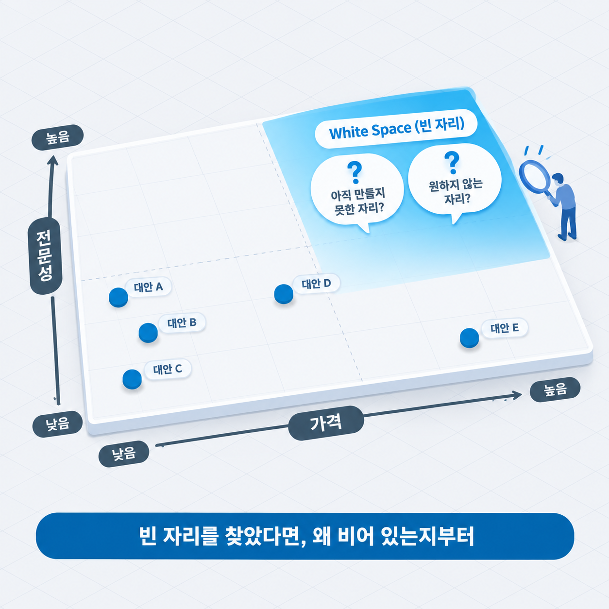
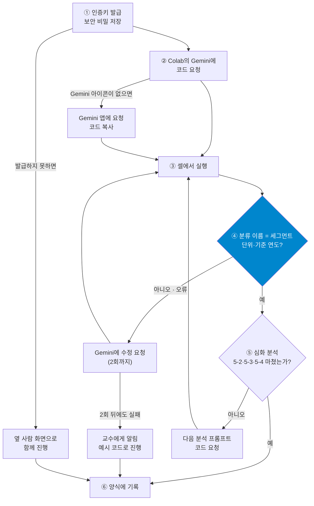

# 7주차 — 소비자와 페르소나

> 경영경제 분야 AI 활용 입문 · 단국대학교
> **복습 기준 = 이 자료 + 수업 중 필기**

## 목차

- [1. 이번 주 개요 및 목표](#1-이번-주-개요-및-목표)
- [2. 세분화와 포지셔닝 — 시장을 나누고 자리를 정하기](#2-세분화와-포지셔닝--시장을-나누고-자리를-정하기)
- [3. 실습 1\~3 — 같은 시장을 두 기준으로 나누고 세그먼트 선택하기](#3-실습-13--같은-시장을-두-기준으로-나누고-세그먼트-선택하기)
- [4. 페르소나와 공식 수치 — 한 사람의 근거 확인하기](#4-페르소나와-공식-수치--한-사람의-근거-확인하기)
- [5. 실습 4\~6 — 페르소나를 공식 수치로 검증하기](#5-실습-46--페르소나를-공식-수치로-검증하기)
- [6. 심화·확장 — 고객이 이루려는 일과 AI가 만든 고객 조사](#6-심화확장--고객이-이루려는-일과-ai가-만든-고객-조사)
- [7. 요약과 AI 지문 비판](#7-요약과-ai-지문-비판)
- [개정 이력](#개정-이력)

---

## 1. 이번 주 개요 및 목표

### 1.1 이번 주 학습 목표

1. AI로 한 시장을 여러 기준(인구통계·상황)으로 나누고, 공략할 세그먼트 하나를 정한다 — 타깃과 포지셔닝은 개요 수준으로 다룬다.
2. AI로 세그먼트에 속한 고객 한 명의 페르소나 초안을 작성하고, 조사할 항목을 조사 계획으로 정리한다.
3. JTBD(Jobs-to-be-Done, 고객이 해결하려는 일) 관점으로 고객이 이루려는 일을 서술한다.
4. 역질문과 긍정형 지시로 AI에게서 필요한 결과를 얻는다.
5. 코딩 없이 AI가 작성한 코드로 공식 통계(KOSIS)를 조회하고, 세그먼트의 추세 · 지역 · 연령 분포를 그래프로 분석해 타깃 선정의 근거를 만든다.

4주에 시장의 크기를, 5주에 그 안의 기업을, 6주에 정리하는 틀을 다루었습니다. 오늘은 그 시장을 이루는 **사람**으로 범위를 좁힙니다. 시장 규모가 조 단위여도 실제로 비용을 지불하는 것은 특정한 상황에 놓인 개인입니다. 그 개인을 그리는 구체성에 따라 분석의 해상도가 달라집니다.

오늘 AI로 만드는 것은 두 가지입니다.

- **고객 분석의 초안** — 시장을 나누고(세분화) 공략할 세그먼트를 정한 뒤, 그 세그먼트의 고객 한 명(페르소나)까지 AI로 작성합니다.
- **초안의 근거가 될 공식 수치** — 국가통계포털(KOSIS)의 인증키를 각자 발급받고, 코딩 없이 AI가 작성한 코드로 세그먼트의 가구 수를 조회합니다(두 번째 코드 실습).

오늘 **과제 2가 부여**됩니다.

### 1.2 이번 주 진행 순서

오늘은 설명과 실습이 번갈아 진행됩니다. **절 번호가 곧 진행 순서**입니다.

| 절 | 내용 |
|:--:|------|
| §2 | 세분화의 정의 · 나누는 기준 세 가지 · 밀크셰이크 케이스 · 타깃과 포지셔닝 · 포지셔닝 맵 · 세분화 프롬프트 |
| **§3** | **실습 1\~3** — 같은 시장을 두 기준으로 나누고 세그먼트 선택하기 |
| §4 | 페르소나 · 「20\~30대 직장인」이 생성되는 이유 · 세 층 · 세그먼트 규모의 공식 값 · 과제 2 · KOSIS 인증키와 Colab 보안 비밀 · 코드 실습 안내 |
| **§5** | **실습 4\~6** — 페르소나를 공식 수치로 검증 → 조 결론 → 수업 종료 |

- 오늘 실습은 **6단계**이며 세 유형이 섞여 있습니다.
  - **〈실습만〉** = 실행·기록·검증
  - **〈토론〉** = 〈실습만〉에 조원 간 논의와 합의를 더한 유형
  - **〈코드〉** = AI에게 코드를 요청해 실행하고 결과를 검증하는 개별 실습(실습 5)
- **앞 실습의 결과가 다음 실습의 재료입니다.** 기록 양식에도 같은 순서로 칸이 있으므로 순서대로 채웁니다.
- 조별 실습은 2\~4명이 자유롭게 조를 만들어 진행합니다. 한 사람이 **기록 양식의 사본**을 만들어 조원과 공유합니다 — [7주 기록 양식 사본 만들기](https://docs.google.com/document/d/1J-85-DQxT1wuGb8gCejxlkif_b_r-i8cIDsLi73QL-8/copy) (저장소 첫 화면 README에도 있습니다).
- 조원은 각자 기록한 문서를 수업 후 **PDF로 내려받아** e-campus에 제출합니다. 파일명은 `7주_이름1_이름2_이름3.pdf`, 마감은 오늘 23:59입니다.

- **실습 5는 Google Colab에서 진행합니다.** 6주와 같이 `colab.research.google.com`에 학교 계정 또는 개인 Google 계정으로 로그인해 둡니다.
- 이번 주 실습 5에서는 **국가통계포털(KOSIS)의 인증키를 각자 발급**받습니다. 회원 가입과 발급은 수업 중에 진행합니다(4.6).
- 코드는 직접 작성하지 않고 **Colab 안의 Gemini에게 요청**합니다.
- 오늘 **과제 2가 부여**됩니다. 요건과 중간고사(8주) 범위는 §4에서 안내합니다.

### 1.3 프롬프트 기법 ② — 역질문과 긍정형 지시

> [!IMPORTANT]
> - 정보가 부족하면 AI가 **추측하지 않고 되묻도록** 지시한다(역질문)
> - 「하지 마라」 대신 「**이렇게 하라**」로 원하는 결과를 지시한다(긍정형 지시)
> - 두 기법 모두 AI가 **빈칸을 임의로 채우는 범위**를 줄인다

AI는 프롬프트에 필요한 정보가 빠져 있어도 대개 답을 생성합니다. 빠진 정보는 학습한 문서에서 가장 흔한 값으로 채워집니다(2주 — 확률 예측). 고객의 연령이나 지역을 지정하지 않으면 가장 흔한 고객 서술이 생성되는 것도 같은 원리입니다(4.2).

**역질문**은 이 빈칸을 AI가 채우기 전에 사람에게 되묻도록 지시하는 방법입니다. 프롬프트 끝에 「답하기 전에 판단에 필요한 정보가 부족하면 먼저 질문해줘」를 덧붙입니다. AI가 되물은 질문은 그 자체로 **사람이 아직 정하지 않은 조건의 목록**이 됩니다. Google의 Gemini API 프롬프트 안내도 AI가 스스로 가정해도 되는 경우와 사용자에게 확인을 요청해야 하는 경우를 지시문에서 구분하는 예를 제시합니다.

**긍정형 지시**는 금지할 행동 대신 원하는 결과를 적는 방법입니다. 「추측하지 마」라고만 적으면 AI가 무엇을 해야 하는지는 정해지지 않습니다. 금지만 있는 지시에는 따를 기준이 없기 때문입니다.

| 금지형 | 긍정형 |
|------|------|
| 상상으로 채우지 마 | 근거가 없는 항목은 「가정」으로 표시할 것 |
| 합계를 세그먼트 값으로 사용하지 마 | 받은 값마다 분류 이름을 함께 출력할 것 |
| 분류 코드를 추측하지 마 | 분류 코드가 불분명하면 코드를 완성하기 전에 질문할 것 |

Anthropic의 프롬프트 작성 안내는 출력 형식을 정할 때 「하지 말 것」 대신 「할 것」을 지시하도록 권합니다. Google과 OpenAI의 안내는 금지 지시도 함께 사용하므로, 금지형이 틀린 것은 아닙니다. 금지할 것이 있으면 **대신 할 것을 함께** 적습니다. *(출처: Anthropic 「Prompting best practices」 · Google Gemini API 프롬프트 전략 안내 · OpenAI 프롬프트 엔지니어링 안내 — 2026-10-09 확인)*

실습 5에서 Colab의 Gemini에 입력할 코드 요청에 두 기법을 함께 적용하면 다음과 같습니다(구분자 = 6주 1.3).

```
## 지시
KOSIS(국가통계포털) 공유서비스 API로 아래 세그먼트의 가구 수를 조회하는 Python 코드를 작성해줘.

## 데이터
- API 주소: https://kosis.kr/openapi/Param/statisticsParameterData.do (응답 형식 JSON)
- 인증키: Colab 보안 비밀에 'KOSIS_KEY'라는 이름으로 저장함
- 통계표: 기관 ID 101 / 통계표 ID DT_1JC1511 / 기간: 2025년(연 단위)
- 항목: T210(1인 가구)
- 분류: 행정구역 00(전국) / 가구주 연령 025(20~24세)·030(25~29세)
- 세그먼트: 실습 3에서 정한 조건(예: 가구주 연령 20~29세의 1인 가구 = 두 연령 값의 합)

## 요구
- 모든 줄에 한국어 주석을 달 것
- 인증키는 보안 비밀에서 불러올 것
- 세그먼트에 맞는 분류 코드를 확정할 수 없으면 코드를 완성하기 전에 나에게 질문할 것
- 받은 값마다 분류 이름(행정구역·가구주 연령·항목)을 함께 출력할 것
- 요청 조건, 받은 행 수, 세그먼트 값, 단위, 기준 연도를 출력할 것
- 오류 응답이 오면 응답 내용을 그대로 출력할 것
```

`## 요구`의 셋째 줄은 역질문, 넷째 줄은 긍정형 지시입니다. 분류 코드를 모르는 상태에서 Gemini가 코드를 추측하면, 그 코드는 오류 없이 다른 분류의 값을 출력할 수 있습니다. 두 줄은 그 가능성을 코드 실행 전과 실행 결과에서 확인하기 위한 장치입니다. 분류 코드는 4.4의 코드 표에서 찾습니다.

---

## 2. 세분화와 포지셔닝 — 시장을 나누고 자리를 정하기

### 학습목표

- 시장을 나누는 세 가지 기준을 구분하고, 주제에 적합한 기준을 선택할 수 있다.
- 상황 기준의 실제 케이스에서 세분화가 제품 개선 방향을 바꾸는 과정을 설명할 수 있다.
- 타깃 선정과 포지셔닝의 역할 차이를 설명하고, 포지셔닝 맵의 축 조건을 적용할 수 있다.
- AI의 세분화가 인구통계 기준으로 돌아오는 원인을 설명하고, 세분화를 요청하는 프롬프트에 지정할 것을 적용할 수 있다.

### 2.1 "모든 사람"은 고객이 아니다 — 세분화의 정의

> [!IMPORTANT]
> - 세분화 = 시장을 **서로 다르게 행동하는 집단**으로 나누는 작업
> - 대상이 넓을수록 메시지는 평범해진다
> - 판별 기준 = **나눈 결과가 서로 다른 해결책을 요구하는가**

4주에 시장의 경계를 정하는 방법을 다루었습니다. 경계를 정했다면 다음 작업은 **그 안을 나누는 것**입니다. 같은 시장 안에서도 사람마다 구매하는 이유가 다르기 때문입니다.

기술이나 제품을 설명할 때 가장 흔한 서술이 "20\~50대 전 연령층이 사용할 수 있습니다"입니다. 대상을 넓게 정하면 기회가 늘어나는 것처럼 여겨지지만 실제로는 반대입니다. 대상이 넓을수록 메시지는 평범해집니다. 평범한 메시지는 누구의 관심도 끌지 못합니다. 한정된 예산으로 광고를 집행할 때도 대상이 흐릿하면 비용만 분산됩니다.

**세분화**(Segmentation)는 시장을 의미 있는 집단으로 나누는 작업입니다. 「의미 있는」의 기준은 **나눈 집단이 서로 다르게 행동하는가**입니다. 두 집단이 같은 이유로 같은 것을 구매한다면 그 기준은 나눌 가치가 없습니다.

이 작업은 학기 종합 과제와 직접 연결됩니다. 트랙 A는 분석 대상 기업이 어느 집단을 상대하는지 밝혀야 합니다. 트랙 B는 아이디어를 구매할 사람이 누구인지 좁혀야 합니다. 두 트랙 모두 오늘 이후로는 「고객」이라는 용어를 막연하게 사용할 수 없습니다.

4주에 시장 범위를 좁히는 방법을 다루면서 **축을 하나나 둘 적용해 좁힌다**고 했습니다(채널·품목·고객·가격대). 그 작업이 세분화였습니다. 그때 정한 축이 이 시장을 나누는 기준이었습니다. 좁혀진 범위는 목표 집단이었습니다.

과제 보고서에는 대상과 그 대상을 선택한 이유를 함께 적습니다. 예를 들면 「국내 ○○ 시장 가운데 본 보고서가 다루는 대상은 ○○ 상황에 있는 소비자이며, 이 집단을 선택한 이유는 ○○이다」입니다. 대상을 밝히지 않은 분석은 읽는 사람이 매번 「누구에 관한 분석인가」를 되물어야 합니다.

### 2.2 나누는 기준 세 가지

> [!IMPORTANT]
> - 인구통계 = 구하기 쉽지만 **가장 얕은** 기준
> - 행동 = 구매 이력에 근거한 **정확한** 기준
> - 상황 = 가장 깊지만 **조사가 필요한** 기준

실무에서 사용하는 기준은 크게 세 가지입니다.

| 기준 | 나누는 방식 | 예 |
|------|-----------|----|
| **인구통계** | 연령·성별·소득·지역·직업 | 20대 여성 / 수도권 1인 가구 |
| **행동** | 구매 빈도·사용량·충성도·이용 채널 | 주 3회 이상 이용자 / 앱 전용 구매자 |
| **상황** | 언제·어디서·무엇을 하려다 | 출근길 아침 / 야근 후 늦은 저녁 |

세 기준은 서로 배타적이지 않으며 함께 사용합니다. 다만 **어느 기준을 주된 축으로 삼는가**에 따라 분석의 깊이가 달라집니다.

인구통계는 가장 구하기 쉬운 자료이지만 가장 얕은 기준이기도 합니다. 같은 20대라도 자취하는 학생과 부모와 함께 사는 직장인은 소비 방식이 다릅니다. 통계로 확인할 수 있다는 장점 때문에 자주 사용되지만, 인구통계만으로 나눈 집단은 대개 내부가 균질하지 않습니다.

행동 기준은 실제 구매 이력에 근거하므로 인구통계보다 정확합니다. "월 5회 이상 주문하는 이용자"는 나이가 달라도 비슷하게 행동합니다. 기업이 보유한 데이터로 확인할 수 있어 실무에서 널리 사용됩니다.

상황 기준은 가장 깊지만 조사가 필요합니다. "출근길에 한 손으로 먹을 것을 찾는 상황"은 나이·성별과 무관하게 같은 요구를 만듭니다. 상황 기준의 실제 케이스가 다음 소절의 밀크셰이크입니다.

> [!TIP]
> 기술·산업 분석에서는 **문제의 성격**으로 나누는 방식을 더합니다. 같은 제조업이라도 "불량 반품이 잦은 곳"과 "인력이 부족해 야근이 잦은 곳"은 업종만 같을 뿐 서로 다른 고객입니다. 업종·규모 같은 외형보다 이 기준이 유용한 경우가 많습니다.

### 2.3 상황으로 나눈 실제 케이스 — 아침의 밀크셰이크

> [!IMPORTANT]
> - 같은 제품도 **구매 상황**에 따라 다른 고객이 된다
> - 상황으로 나누자 경쟁 대안이 **다른 음료가 아닌 베이글·바나나·도넛**으로 바뀌었다
> - 인구통계로 묘사한 고객에게는 이 상황이 드러나지 않았다

하버드 경영대학원의 Clayton Christensen 등이 소개한 사례입니다. 한 패스트푸드 기업은 밀크셰이크를 자주 구매하는 고객의 인구통계와 성향을 분석했습니다. 그 특성에 해당하는 고객들에게 더 걸쭉하거나 더 진하거나 더 저렴한 제품 가운데 무엇이 나은지 물었습니다. 응답은 분명했으나, 그에 따라 제품을 개선해도 판매는 변하지 않았습니다.

연구진이 매장에서 구매 상황을 관찰하자 다른 사실이 드러났습니다. 밀크셰이크의 **40%가 이른 아침**에 판매되었습니다. 구매자 대부분은 혼자 와서 다른 것은 구매하지 않았고, 차 안에서 마셨습니다.

구매자들에게 물은 결과, 이들은 길고 지루한 출근길을 견디며 점심 무렵까지 허기를 막을 것이 필요했습니다. 운전 중이어서 한 손만 자유로운 상태였습니다. 이 상황에서 밀크셰이크와 경쟁한 것은 다른 음료가 아니었습니다.

| 경쟁 대안 | 출근길 상황에서의 한계 |
|------|------|
| 베이글 | 건조함 · 크림치즈를 바르면 손과 운전대가 끈적해짐 |
| 바나나 | 빨리 소비되어 지루한 출근길을 채우지 못함 |
| 도넛 | 오전 10시 무렵의 허기를 막지 못함 |

연구진이 제시한 개선 방향도 상황에서 도출되었습니다. 출근길 동안 오래 마실 수 있도록 더 걸쭉하게 만들고, 기다리지 않고 구매하도록 판매 방식을 바꾸는 방향입니다. 인구통계로 고객을 묘사하고 맛을 물었을 때 판매에 변화가 없었다는 점과 대비됩니다. *(출처: Christensen·Cook·Hall, "What Customers Want from Your Products", HBS Working Knowledge, 2006-01-16 — 기업명은 공개되지 않음 · 2026-10-09 확인)*

### 2.4 함께 짚어보기 — 어느 기준이 유용한가

**Q**: 배달 앱 시장을 ① **연령대**로 나누는 것과 ② **주문 상황**(혼밥·야식·가족 식사·모임)으로 나누는 것 가운데, 신규 서비스를 기획한다면 어느 기준이 유용합니까?

**A**: **② 상황 기준**입니다. 연령대로 나누면 "20대는 배달을 자주 이용한다" 정도의 결론에 그치며, 어떤 서비스를 만들어야 하는지는 도출되지 않습니다. 상황으로 나누면 집단마다 요구가 드러납니다.

- 혼밥 = 1인분 최소 주문 금액
- 야식 = 영업 시간
- 모임 = 분할 결제

**나눈 결과가 서로 다른 해결책을 요구할 때** 그 기준이 유용한 기준입니다.

상황 기준에도 한계가 있습니다. 통계로 즉시 확인되지 않아 조사가 필요하고, 광고를 집행할 때는 결국 연령·지역 같은 인구통계로 번역해야 합니다. 따라서 실무에서는 **상황으로 이해하고 인구통계로 도달하는** 두 층을 함께 사용합니다.

이 번역이 오늘 실습의 연결 고리입니다. 실습 3에서 상황으로 선택한 세그먼트를 연령대·가구 유형으로 번역하고, 실습 5에서 그 조건으로 공식 통계를 조회합니다.

### 2.5 타깃과 포지셔닝 — 선택하고 자리를 정하기

> [!IMPORTANT]
> - STP = 세분화(S) → 타깃 선정(T) → 포지셔닝(P)
> - 타깃 선정은 선택보다 **포기의 결단**에 가깝다
> - 포지셔닝의 첫 질문 = **이 제품이 없으면 고객은 대신 무엇을 사용하는가**

세분화가 나누는 작업이라면, 다음은 선택하고 자리를 정하는 작업입니다. 세 작업을 묶어 **STP**(Segmentation·Targeting·Positioning)라고 부릅니다.

| 단계 | 묻는 것 | 산출물 |
|:--:|--------|--------|
| **S** 세분화 | 이 시장은 어떤 기준으로 나뉘는가 | 의미 있는 집단 목록 |
| **T** 타깃 선정 | 그 가운데 어디를 먼저 공략하는가 | 목표 집단 1개 |
| **P** 포지셔닝 | 그 안에서 어떤 자리로 인식되는가 | 차지할 자리의 정의 |

**타깃 선정**은 선택보다 **포기**에 가깝습니다. 한 집단을 선택하는 것은 나머지 집단을 당분간 상대하지 않겠다는 선언입니다. 그 결단이 있어야 메시지와 자원이 한 집단에 집중됩니다.

**포지셔닝**은 로고나 문구를 다듬는 일이 아니라 **비교의 기준을 정하는 일**입니다. 고객은 제품을 따로 평가하지 않고 이미 사용하던 것과 비교합니다. 따라서 포지셔닝의 첫 질문은 「이 제품은 무엇인가」가 아니라 「**이 제품이 없으면 고객은 대신 무엇을 사용하는가**」입니다. 그 대안이 정해져야 「무엇이 더 나은가」가 성립합니다.

자주 등장하는 잘못된 답이 「경쟁자가 없습니다」입니다. 경쟁 대안은 같은 업종의 제품만이 아닙니다. 엑셀로 수기 관리하기, 인력을 더 채용하기, 불편을 참고 견디기가 모두 경쟁 대안입니다. 신규 서비스의 가장 강력한 경쟁 대안이 「**아무것도 하지 않기**」인 경우가 많습니다.

포지셔닝은 다섯 요소를 순서대로 정할 때 근거를 갖춥니다. 앞 요소가 뒤 요소의 근거가 됩니다.

| 요소 | 묻는 것 |
|------|--------|
| 경쟁 대안 | 이 제품이 없으면 고객은 대신 무엇을 사용하는가 |
| 차별적 속성 | 그 대안에는 없고 이 제품에만 있는 것은 무엇인가 |
| 차별적 가치 | 그 속성이 고객에게 만들어 내는 가치는 무엇인가 |
| 최적 고객 | 그 가치를 특히 크게 느끼는 고객은 누구인가 |
| 시장 범주 | 그 가치가 가장 잘 드러나는 시장 범주는 어디인가 |

차별점은 **경쟁 대안이 정해진 뒤에야** 성립합니다. 비교 대상이 없으면 「빠르다」도 「정확하다」도 의미가 없습니다. 네 번째 요소인 최적 고객이 세분화·타깃 선정과 연결되는 부분입니다.

### 2.6 포지셔닝 맵 — 자리를 그림으로 확인하기

포지셔닝을 정했다면 한 장의 그림으로 확인할 수 있습니다. **포지셔닝 맵**은 고객이 실제로 중요하게 여기는 기준 두 가지를 가로·세로 축으로 두고, 경쟁 대안의 위치를 좌표에 표시하는 도구입니다. 아무도 없는 구역을 **White Space**(빈 자리)라고 부릅니다.

축을 잘못 정하면 그림 전체가 의미를 잃습니다. 좋은 축은 세 조건을 충족합니다.

- 고객이 **구매를 결정할 때 실제로 검토하는** 요인
- 측정하거나 비교할 수 있는 요인
- 경쟁 대안 사이에서 **실제로 차이가 나는** 요인

세 번째 조건이 특히 중요합니다. 모든 경쟁 대안이 비슷한 값을 갖는 기준을 축으로 삼으면 점들이 한 구역에 집중되어 서로 구분되지 않습니다.

빈 자리를 찾았을 때 한 번 더 확인할 것이 있습니다. **그 자리가 비어 있는 이유**입니다. 아직 아무도 만들지 못해서 비어 있는 것과, 고객이 원하지 않아서 비어 있는 것은 다릅니다. 후자에 진입하면 경쟁 없는 시장을 차지하는 것이 아니라 수요 없는 자리에 홀로 서게 됩니다. 빈 자리가 기회라는 주장은 고객 조사로 뒷받침될 때 성립합니다.



### 2.7 세분화를 요청하는 프롬프트 — 기준 지정과 측정 가능성

> [!IMPORTANT]
> - 기준을 지정하지 않으면 AI의 세분화는 **인구통계**로 돌아온다
> - 지정할 것 = **기준 · 집단별 요구 · 규모의 근거 · 인구통계 번역**
> - 선택한 집단은 **공식 통계로 집계할 수 있는 조건**으로 번역한다

AI에게 「○○ 시장의 고객을 세분화해줘」라고만 요청하면 대개 연령대·성별·소득 같은 인구통계 집단이 생성됩니다. 원인은 학습 자료의 분포에 있습니다. 인구통계 기준의 세분화는 기획서와 마케팅 문서에 흔히 등장하는 형태입니다. 상황 기준의 세분화는 주로 고객 조사를 수행한 문서에 등장합니다. AI는 학습한 문서에서 자주 등장한 형태를 우선 생성하므로, 기준을 지정하지 않으면 가장 흔하고 가장 얕은 기준의 세분화가 생성됩니다(2주 — 확률 예측).

| 지정할 것 | 지정하지 않으면 |
|----------|----------------|
| **기준** — 상황·행동·인구통계 가운데 무엇으로 나눌 것인가 | 인구통계 집단이 기본으로 생성됨 |
| **집단별 요구** — 집단마다 원하는 것과 불편 | 판별 기준(2.1)을 확인할 수 없음 |
| **규모의 근거** — 집단 규모의 출처와 기준 연도 | 출처 없는 규모 수치가 생성됨 |
| **인구통계 번역** — 집단마다 연령대·가구 유형 | 상황 집단을 통계로 확인할 수 없음 |

실습 2에서 사용할 형태의 예입니다.

```
## 지시
국내 간편식 시장의 고객을 세분화해줘.

## 조건
- 기준: 구매 상황(언제·어디서·무엇을 하려다)으로 세 집단으로 나눌 것
- 집단마다 원하는 것과 불편한 점을 함께 적을 것
- 집단의 규모를 적을 때는 출처와 기준 연도를 함께 적고, 근거가 없으면 "추정"으로 표시할 것
- 집단마다 해당하는 연령대와 가구 유형을 적을 것
```

마지막 조건이 **측정 가능성**을 확보하는 조건입니다. 상황으로 나눈 집단은 그대로는 공식 통계에서 찾을 수 없습니다. 연령대·가구 유형으로 번역해 두어야 실습 5에서 그 조건으로 규모를 조회할 수 있습니다.

번역이 정확한지는 사람이 다시 확인합니다. AI가 적은 연령대도 생성된 값입니다. 「출근길에 간편식을 구매하는 사람」을 「20\~30대 1인 가구」로 번역했다면, 그 번역의 근거가 있는지가 실습 3의 확인 항목입니다.

---

## 3. 실습 1\~3 — 같은 시장을 두 기준으로 나누고 세그먼트 선택하기

### 학습목표

- 조원과 대상 시장을 정하고 같은 질문을 동시에 실행해 AI의 세분화 응답을 비교할 수 있다.
- 기준을 지정해 다시 요청하고, 집단마다 서로 다른 해결책을 요구하는지 판별할 수 있다.
- 세그먼트 하나를 선택하고, 그 선택을 공식 통계로 집계할 수 있는 조건으로 번역할 수 있다.

### 3.1 진행 방식과 조 편성

**준비 (3분)**

1. 2\~4명이 조를 만듭니다. 조장은 없습니다.
2. 조원 1인이 기록 양식 사본을 만들어 나머지 조원에게 **편집 권한으로 공유**합니다. 조원 명단(이름·학번)을 채웁니다.
3. 조가 함께 **대상 시장 1개**를 정합니다 — 조원 가운데 한 명의 **과제 2 주제**를 권장합니다(예: 국내 간편식 시장). 이 시장이 실습 1\~6 내내 공동 대상입니다.
   - ⚠️ **개인이 구매하는 소비자 시장으로 정합니다** — 실습 5에서 세그먼트의 규모를 가구 통계로 조회합니다.

**오늘 실습의 규칙 네 가지**

- **실습 1과 실습 4에서는 조원 전원이 같은 프롬프트를 각자의 Gemini에서 동시에 실행**하고 결과를 비교합니다. 나머지 실습은 조원 간 비교 없이 검증에 집중합니다 — **검증은 모든 실습에서 합니다.**
- 실습 사이에는 질문의 **한 요소만** 바꿉니다. 바꿀 요소는 3.2와 5.1의 표에 정해져 있으며, 문안은 조가 작성합니다.
- **앞 실습의 결과가 다음 실습의 재료입니다.** 표의 「가져올 것」 열이 그 연결입니다.
- **실행은 Gemini 앱에서 하고, 결과는 기록 양식에 붙여 넣습니다.** 실습 5만 Colab에서 각자 진행하며, 코드는 Colab 안의 Gemini에 요청합니다.

각 실습이 끝나면 조원은 각자의 이름 절에 **검증 결과**를 기록합니다. 실행한 조원은 **프롬프트와 응답**도 함께 기록합니다. 조는 기록표의 해당 행을 함께 채웁니다. 응답은 요약하지 않고 **AI가 출력한 문장 그대로** 붙여 넣습니다. 이 기록이 곧 AI 활용 로그입니다.

### 3.2 실습 1\~3

| 실습 | 유형 | 바꾸는 것 | 가져올 것 | 비교 관점 | **검증할 것** |
|:--:|:--:|------|------|------|------|
| 1 | 〈실습만〉 | 대상 시장의 **세분화** 요청 — 기준 미지정 | 대상 시장 | 나뉜 기준 · 집단 구성 | 집단별 요구 차이 · 규모 수치의 출처 |
| 2 | 〈실습만〉 | **상황 기준**을 지정해 다시 요청 | 실습 1의 답 | — | 해결책 차이 · 인구통계 번역 여부 |
| 3 | **〈토론〉** | **세그먼트 1개 선택** 요청 — 부족한 정보는 되묻게 | 실습 1·2의 답 | — | 선택 근거 · 공식 통계로 집계 가능한가 |

- **실습 1** — 「○○ 시장의 고객을 세분화해줘」처럼 기준을 지정하지 않고 요청합니다. 조원 간에 어느 기준으로 나뉘었는지, 「20\~30대 직장인」과 같은 집단이 몇 명의 답에 있었는지 비교합니다. 집단마다 요구가 다른지, 규모 수치에 출처와 기준 연도가 있는지 확인합니다(2.1·2.7).
- **실습 2** — 2.7의 조건으로 **상황 기준**을 지정해 다시 요청합니다. 집단마다 다른 해결책을 요구하는지(2.4), 집단마다 연령대·가구 유형이 적혀 있는지 확인합니다.
- **실습 3** — 실습 1·2의 결과를 붙여 넣고, 먼저 공략할 세그먼트 하나와 그 이유·경쟁 대안을 요청합니다. 프롬프트 끝에 「선택에 필요한 정보가 부족하면 먼저 나에게 질문해줘」를 덧붙입니다(역질문 — 1.3). 아래 「실습 3의 확인 순서」로 결과를 확인합니다.

**실습 3의 확인 순서**

1. 선택 이유가 자료(규모·불편의 근거)에서 도출되었는가, 표현의 선호에 그치는가
2. 세그먼트가 연령대·가구 유형으로 번역되었는가
3. 그 조건을 공식 통계의 항목으로 집계할 수 있는가(**측정 가능성**)
4. 경쟁 대안에 「아무것도 하지 않기」가 포함되었는가(2.5)

- Gemini가 되물은 질문이 있으면 그 질문과 조의 답을 함께 기록합니다. 되물은 질문이 곧 조가 아직 정하지 않은 조건입니다.
- **실습 3은 토론형입니다.** 확인을 마친 뒤 조가 함께 **세그먼트 1개와 그 인구통계 조건**(예: 가구주 연령 20\~29세의 1인 가구)을 합의해 기록표 ① 아래 칸에 적습니다.

⛔ **여기까지 실습 1\~3입니다.** 기록 양식에도 같은 자리에 경계선이 있습니다. **실습 4로 진행하지 말고** 여기서 멈춘 뒤 §4 설명을 듣습니다 — 실습 4부터는 §4에서 다룰 페르소나의 세 층과 공식 통계를 사용하므로, 실습 4를 먼저 수행하면 같은 작업을 두 번 하게 됩니다.

> **실습 4의 입력** — 조가 합의한 **세그먼트와 인구통계 조건**. 실습 5에서 이 조건으로 공식 통계를 조회합니다.

---

## 4. 페르소나와 공식 수치 — 한 사람의 근거 확인하기

### 학습목표

- 페르소나의 작성 원칙과 도출 절차를 설명할 수 있다.
- AI가 생성한 페르소나가 비슷한 인물로 수렴하는 원인을 설명할 수 있다.
- 페르소나의 항목을 자료 확인·조사 필요·확인 불가(상상)의 세 층으로 구분할 수 있다.
- 세그먼트 규모를 공식 통계에서 확인하고, 기준 시점과 분모를 함께 적을 수 있다.
- 과제 2의 요건과 실습 5의 코드 실습 절차를 설명할 수 있다.

### 4.1 페르소나 — 한 명으로 좁히기

> [!IMPORTANT]
> - 페르소나 = 목표 고객을 대표하는 **한 명의 구체적인 가상 인물**
> - 상상으로 창작하지 않고 **자료에서 도출**한다
> - 속성보다 **어떤 상황에서 무엇을 하려다 좌절하는가**가 중심이다

**페르소나**(Persona)는 목표 고객을 대표하는 구체적인 가상 인물입니다. 집단을 통계로 서술하는 대신 한 사람으로 그려, 팀 전체가 같은 사람을 떠올리며 논의하게 만드는 도구입니다.

원칙은 **한 명으로 특정한다**는 것입니다. "20\~40대 직장인 전반"처럼 넓게 설정하면 경험이 추상화되어 문제가 흐려집니다. 핵심 인물 한 명을 깊이 그리는 것이 우선입니다. 두 번째 인물이 필요하면 핵심적인 불편만 한두 줄로 덧붙입니다.

페르소나는 상상으로 창작하지 않고 **자료에서 도출**합니다. 세 단계를 거칩니다.

| 순서 | 작업 | 목적 |
|:--:|--------|------|
| 1차 | 통계·설문에서 공통 패턴 추출 | 자료에 근거한 현실성 확보 |
| 2차 | 공통 불편을 묶어 정리 | 개별 사례를 구조적 특성으로 |
| 3차 | 실제 발화·표현 반영 | 구체적인 현실감 부여 |

학생 과제에서는 직접 인터뷰한 자료를 확보하기 어려운 경우가 많습니다. 그럴 때는 **이미 공개된 목소리**를 2차 자료로 사용합니다. 상품 리뷰, 커뮤니티 게시글, 앱 장터의 낮은 평점 후기가 특히 유용합니다. 불만은 만족보다 구체적으로 서술되기 때문입니다. 다만 리뷰에는 극단적인 경험이 과대 대표되므로, **여러 곳에서 반복해 나타나는 것만** 선택해 사용합니다.

> [!WARNING]
> **자주 하는 실수**
>
> 페르소나를 인구통계 요약으로 끝내는 경우입니다 — "35세, 직장인, 월 소득 400만 원"처럼 속성만 나열하고 마칩니다.
>
> 속성은 제시되었으나 **이 사람이 무엇 때문에 어려움을 겪는지**가 없습니다. 인구통계는 최소한으로 두고, 어떤 상황에서 무엇을 하려다 좌절하는지를 중심에 둡니다.

페르소나가 「누구」를 밝힌다면, 그 사람이 「무엇을 이루려 하는가」를 밝히는 도구가 JTBD입니다(6.1). 실습 4의 페르소나에 적힌 「불편」 항목이 그 재료가 됩니다.

### 4.2 AI에게 고객을 물으면 「20\~30대 직장인」이 생성되는 이유

AI에게 「이 서비스의 타깃 고객을 정의해줘」라고 요청하면 대개 다음과 같은 답이 생성됩니다 — **"20\~30대 직장인, 바쁜 일상 속에서 편리함을 추구하며, 가성비를 중시하는 소비자."**

그럴듯하지만 문제가 있습니다. 이 문장은 **어느 서비스에 적용해도 성립합니다.** 배달 앱에도, 세탁 서비스에도, 가전 구독에도 그대로 적용됩니다. 어느 시장에나 적용되는 페르소나는 실제로는 어느 시장도 설명하지 못합니다.

원인은 2주에 다룬 생성 방식에 있습니다. AI는 학습 자료에 **자주 등장한 패턴을 우선 생성합니다.** 시중의 기획서·마케팅 문서에 「20\~30대 직장인」이 매우 자주 등장하므로, 고객을 물으면 그 패턴이 먼저 생성됩니다. AI가 해당 시장을 분석한 것이 아니라 **가장 흔한 고객 서술을 재현한 것**입니다. 실습 1에서 조원들의 답이 서로 닮았다면 같은 원인입니다.

따라서 이 과목에서 페르소나를 다루는 방식은 AI가 작성한 페르소나를 그대로 사용하는 것이 아닙니다. AI가 작성한 초안에서 **어느 항목이 자료에 근거했고 어느 항목이 생성된 것인지 구분하는 것**이 오늘 훈련의 핵심입니다.

### 4.3 페르소나의 세 층 — 자료·조사·상상

> [!IMPORTANT]
> - 페르소나의 항목은 **검증 가능성**이 서로 다르다
> - 검증 = 항목을 지우는 일이 아니라 **항목마다 출처를 병기하는 일**
> - 출처를 병기할 수 없는 항목은 「가정」으로 표시해 조사 목록으로 둔다

| 층 | 항목 | 확인 경로 |
|:--:|------|----------|
| **자료로 확인 가능** | 연령·거주 형태·소득 수준·이용 빈도 | 국가데이터처(구 통계청) 통계·업계 조사·기업 공시 |
| **조사가 있어야 확인** | 하루 일과·구매 이유·불편 지점 | 인터뷰·리뷰·설문 |
| **확인 불가(상상)** | 이름·성격·취미·말투 | 없음 — 현실감을 위한 장치 |

세 번째 층은 잘못된 것이 아닙니다. 이름과 성격은 팀이 같은 사람을 떠올리게 하는 장치이므로 필요합니다. 문제는 **세 층이 한 문단에 섞여 있을 때** 읽는 사람이 어디까지 근거가 있는지 알 수 없다는 점입니다.

AI가 작성한 페르소나는 세 층을 구분하지 않고 생성합니다. 원인은 생성 경로에 있습니다. 연령·소득처럼 통계에 있는 항목도 AI 내부에서는 통계표를 조회한 결과가 아닙니다. 이름·취미와 같은 방식으로, 학습한 문장의 분포에서 이어질 가능성이 높은 표현이 선택된 결과입니다(2주 — 확률 예측).

생성 경로가 하나이므로 출력의 어조도 하나입니다. 통계에서 온 것처럼 읽히는 연령대와 생성된 취미가 같은 어조로 나란히 서술되는 이유입니다. AI에게 각 항목의 근거를 되물어도, 그 답 역시 같은 방식으로 생성된 문장입니다(3주 — 자기 점검의 한계). 따라서 검증하지 않으면 상상 항목까지 사실로 취급하게 됩니다. 4주에 다룬 **사실과 해석의 구분**이 페르소나에서는 **자료와 상상의 구분**으로 나타납니다.

### 4.4 세그먼트 규모의 공식 값 — 인구주택총조사

> [!IMPORTANT]
> - 세그먼트 규모는 **공식 통계에서 확인**한다
> - 값과 함께 **기준 시점·분모·출처**를 적는다
> - 같은 「1인 가구 비중」도 **분모**에 따라 값이 달라진다

인구·가구의 규모는 국가데이터처가 매년 발표하는 **인구주택총조사**(등록센서스 방식)에서 확인합니다. 2026년 7월에 발표된 최신 결과는 다음과 같습니다.

| 항목 | 값 |
|------|:--:|
| 기준 시점 | 2025년 11월 1일 |
| 전체 가구 | 2,324만 6천 가구 |
| 일반가구 | 2,249만 5천 가구 |
| 1인 가구 | 824만 4천 가구 |
| 1인 가구 비중 | **일반가구의 36.6%** |
| 65세 이상 1인 가구 | 245만 6천 가구(일반가구의 10.9%) |

*(출처: 국가데이터처 「2025년 인구주택총조사 결과(등록센서스 방식)」 2026-07-28 발표 — KDI 경제교육·정보센터 게재 자료 · 뉴스1·YTN 보도 · 2026-10-09 확인)*

같은 수치도 분모에 따라 값이 달라집니다. 36.6%는 **일반가구**(기숙사·사회시설 등의 집단가구를 제외한 가구)를 분모로 한 값입니다. 분모를 전체 가구로 바꾸면 약 35.5%가 됩니다(824만 4천 ÷ 2,324만 6천 — 계산값). 비중을 인용할 때 분모를 함께 적어야 하는 이유입니다.

세그먼트의 정의도 확인합니다. 가구 통계표의 연령은 **가구주의 연령**인 경우가 있습니다. 「20대가 사는 가구」와 「가구주가 20대인 가구」는 다른 집단입니다. 실습 5에서 조회하는 통계표의 연령도 가구주의 연령입니다. 값은 조회 시점에 따라 수정될 수 있으므로 기준 시점과 함께 적습니다.

**KOSIS 통계표에서 같은 값 확인** — 위 공식 값은 국가통계포털(KOSIS)의 통계표 「가구주의 연령 및 가구원수별 가구(일반가구) - 시군구」(기관 ID `101` · 통계표 ID `DT_1JC1511`)에서도 확인됩니다. 이 통계표의 2025년 전국 1인 가구는 8,244,308가구로, 보도자료의 824만 4천 가구와 같습니다. 실습 5는 이 통계표에서 세그먼트의 값을 조회합니다.

| 구분 | 코드 | 뜻 |
|------|:--:|------|
| 항목 | `T100` | 일반가구(가구원 수 합계) |
| 항목 | `T210` · `T220` | 1인 가구 · 2인 가구 |
| 행정구역 | `00` · `11` | 전국 · 서울 |
| 가구주 연령 | `000` | 합계(전 연령) |
| 가구주 연령 | `025` · `030` | 20\~24세 · 25\~29세 |
| 가구주 연령 | `035` · `040` | 30\~34세 · 35\~39세 |

가구주 연령은 5세 단위입니다. `020`(15\~19세)부터 `085`(80\~84세)까지 코드가 5씩 증가하고, 85세 이상은 `086`입니다. *(출처: KOSIS 공유서비스 API — 통계표 `DT_1JC1511`의 분류 정보와 자료 조회 · 2026-10-22 확인)*

**함께 짚어보기**

**Q**: 실습 4에서 Gemini가 페르소나의 「데이터 근거」 칸에 다음 문장을 적었다고 가정합니다. 이 문장을 그대로 기록해도 됩니까?

> "국내 1인 가구는 약 800만 가구로 전체 가구의 40%에 달한다."

**A**: 그대로 기록하지 않습니다. 4.4의 공식 값과 대조하면 세 가지를 확인해야 합니다.

- **값** — 공식 값은 824만 4천 가구 · 일반가구의 36.6%(2025년 11월 1일 기준)입니다. 40%는 어느 분모로도 공식 값과 일치하지 않습니다.
- **분모** — 「전체 가구」인지 「일반가구」인지에 따라 비중이 달라집니다.
- **기준 시점·출처** — 문장에 둘 다 없습니다. AI가 답한 수치는 조회한 값이 아니라 생성한 문자열입니다(6주 4.1).

「데이터 근거」 칸에는 공식 값과 분모·기준 시점·출처를 적고, AI의 문장은 대조 결과(불일치)와 함께 기록합니다. 실습 6의 대조가 이 작업입니다.

### 4.5 과제 2 부여와 중간고사 범위

오늘 **과제 2**가 부여됩니다(제출 = 10주 · 제출 채널과 마감 시각은 별도 안내).

| 항목 | 내용 |
|------|------|
| 주제 | **과제 1에서 선정한 주제 그대로** — 학기 종합 과제 = 한 주제로 연속 |
| 요건 ① | **조사 질문 설계** — 무엇을 알아야 하는지 하위 질문으로 분해(4주) |
| 요건 ② | **AI 조사 결과 + 검증 기록** — 출처 확인·교차 확인의 흔적 |
| 요건 ③ | **분석 프레임 적용** — 트랙 A: 매크로 환경 분석(PEST · 6주)과 산업 분석(Five Forces · 5주) / 트랙 B: 세분화·페르소나(7주) 또는 3C |
| 요건 ④ | **보고서 문장화 1절** — 분석 결과를 보고서 문단으로 |
| 분량·형식 | A4 3\~4장 / AI 활용 표기·검증 기록 포함(3주 수칙) |

**과제 2의 성격** — 과제 1이 도구를 선택하는 과제였다면 과제 2는 **실제로 조사하고 결과를 검증하는 과제**입니다. 8주 중간고사가 사이에 있어 실질 작업 기간은 약 2주입니다. 오늘 실습의 세그먼트 선택·페르소나·공식 값 대조를 각자의 주제에 이어서 적용하면 부담이 줄어듭니다.

요건 ②의 검증 기록은 따로 만드는 문서가 아니라 **조사하면서 남기는 메모**입니다. 어떤 수치를 어디에서 확인했는지 그 자리에서 적어 두면 그것이 기록입니다.

**중간고사(8주) 안내** — 범위는 **1\~7주에 다룬 전 과정**입니다.

### 4.6 KOSIS 인증키 발급과 Colab 보안 비밀

> [!IMPORTANT]
> - 이번 주부터 공식 통계 사이트의 **인증키를 각자 발급**받아 사용한다
> - 인증키는 코드·프롬프트·기록 문서에 적지 않고 **Colab 보안 비밀**에 저장한다
> - 발급을 마치지 못하면 **옆 사람의 화면**을 보며 함께 진행한다

6주에는 한국은행이 시험용으로 공개한 `sample` 키를 사용했습니다. 이번 주부터는 공식 통계 사이트에 각자 가입해 **본인의 인증키**를 발급받습니다. 첫 사이트는 국가통계포털(KOSIS)이며, 코드 실습이 있는 주차마다 사이트를 하나씩 더합니다. Colab의 화면 구성(코드 셀·출력·런타임·Gemini 아이콘·보안 비밀)은 6주 4.5에서 다루었습니다.

| 단계 | 내용 |
|:--:|------|
| ① 가입 | KOSIS(`kosis.kr`) 회원 가입 → 로그인 |
| ② 신청 | 공유서비스(OpenAPI) 메뉴에서 활용신청 |
| ③ 확인 | 발급된 인증키 확인 → 복사 |
| ④ 저장 | Colab 보안 비밀에 이름 `KOSIS_KEY`로 저장 |

*(출처: KOSIS 공유서비스 OpenAPI 안내 — 회원 가입 · 인증키 발급 · 2026-10-09 확인 / 활용신청 화면 = 로그인 필요 · 2026-10-22 확인)*

| 항목 | 내용 |
|------|------|
| 위치 | 왼쪽 세로 메뉴의 열쇠 아이콘(보안 비밀) |
| 추가 | 새 보안 비밀 추가 → 이름 `KOSIS_KEY` · 값 = 복사한 인증키 |
| 노트북 액세스 | 실습하는 노트에서 켬 — 꺼져 있으면 코드가 키를 읽지 못함 |
| 불러오기 | 코드에는 키 값이 아니라 이름 `KOSIS_KEY`만 남음 |

```python
# Colab 보안 비밀에 'KOSIS_KEY'라는 이름으로 저장한 키를 불러온다
from google.colab import userdata
api_key = userdata.get('KOSIS_KEY')  # 코드와 기록 문서에는 키 값이 남지 않는다
```

*(출처: Colab 보안 비밀 기능 해설 — Thinktecture Labs · Analytics Vidhya 2024-12 · 2026-10-22 확인)*

**인증키 관리** — 인증키는 본인에게 발급된 값입니다.

- 키를 코드·프롬프트·기록 문서에 적지 않습니다. Colab의 Gemini에 입력한 내용은 Google이 수집합니다(4.7).
- 다른 사람의 키를 빌려 쓰거나 자신의 키를 공유하지 않습니다.
- 제출 전에 조원끼리 서로의 기록 문서에 키가 없는지 확인합니다.
- 발급을 마치지 못하면 옆 사람의 화면을 보며 실습 5를 함께 진행합니다. 발급은 9주 실습 5를 시작할 때 다시 시도합니다. 조원끼리 발급 과정을 도와도 됩니다.

### 4.7 코드 실습 안내 — KOSIS와 Colab

> [!IMPORTANT]
> - 코드는 직접 작성하지 않고 **Colab 안의 Gemini에게 요청**해 실행한다
> - 이번 주 데이터 = **KOSIS 공유서비스**(OpenAPI)로 조회하는 인구주택총조사 가구 통계
> - 받은 값의 **분류 이름이 세그먼트와 같은가**를 확인한다

실습 5는 두 번째 **코드 실습**입니다. 6주에는 한국은행 ECOS에 요청을 보내 공식 값을 받았습니다. 이번 주에는 각자 발급한 인증키로 국가통계포털(KOSIS)에 요청을 보내 세그먼트의 가구 수를 받습니다. 기본 조회를 마치면 같은 통계표로 세그먼트의 **추세 · 지역 · 연령 분포를 그래프로 분석**합니다. 목표는 수치 하나가 아니라, 그래프에서 「이 세그먼트를 공략할 근거」를 찾아내는 것입니다.

| 단계 | 내용 |
|:--:|------|
| ① 발급·저장 | KOSIS 인증키를 발급받아 Colab 보안 비밀에 저장한다(4.6) |
| ② 요청 | Colab의 Gemini에 코드를 요청한다(1.3의 프롬프트) |
| ③ 실행 | 생성된 코드를 셀에 추가하고 실행한다 |
| ④ 확인 | 분류 이름·단위·기준 연도를 확인한다 |
| ⑤ 심화 분석 | 추세 · 지역 · 연령 비교 그래프 3장을 그리고, 그래프마다 결론을 한 문장으로 적는다 |
| ⑥ 기록 | 결과·프롬프트·코드·결론 문장을 양식에 기록한다(키 제외) |

**합계 분류** — KOSIS 통계표는 세부 분류와 함께 「전국」·「합계」처럼 세부 분류를 더한 분류도 제공합니다. 분류 코드를 잘못 지정하면 오류 없이 합계 분류의 값이 출력됩니다. 예를 들어 가구주 연령을 `000`(합계)으로 요청하면 20대가 아니라 전 연령의 1인 가구 수가 출력됩니다. 6주의 「받은 행 수와 총 건수」처럼, **오류가 나지 않았다고 결과가 정확한 것은 아닙니다.**

**심화 분석 — 세그먼트를 공략할 근거를 그래프로 찾기** — 기본 조회와 같은 통계표에서 기간 · 지역 · 연령만 넓혀 세 가지를 분석합니다. 그래프는 결론이 한눈에 보이도록 그립니다 — 세그먼트만 진한 색으로 강조하고, 기준선을 긋고, 제목에 결론을 적습니다.

| 분석 | 그래프 | 답하는 질문 | 타깃 선정에서 활용 |
|:--:|------|------|------|
| 5-2 추세 | 2015\~2025년 지수 선그래프(2015년 = 100) | 세그먼트가 시장보다 빨리 증가하는가 · 최근에도 증가하는가 | 세그먼트의 매력도 · 진입 시점 |
| 5-3 지역 | 17개 시도 산점도(규모 × 비중 · 전국 기준선) | 세그먼트가 많고 집중된 지역은 어디인가 | 먼저 진입할 지역 |
| 5-4 연령 비교 | 연령대별 1인 가구 수 · 비중 막대그래프 2장 | 다른 연령대와 비교해 이 세그먼트는 어떤가 | 「왜 이 세그먼트인가」의 근거 |

**입력 제한** — Colab의 Gemini에 입력한 프롬프트와 코드는 Google이 수집하며 검토자가 읽을 수 있습니다(Colab FAQ). 인증키와 개인정보는 프롬프트와 코드에 입력하지 않습니다. 키는 보안 비밀에서 불러옵니다(4.6).

**Gemini의 코드가 동작하지 않을 때** — 코드를 직접 고치지 않고, 오류 메시지와 함께 Colab의 Gemini에 수정을 요청합니다. 두 번 다시 요청해도 해결되지 않으면 교수에게 알리고, 교수가 안내하는 예시 코드로 실습을 이어 갑니다.

---

## 5. 실습 4\~6 — 페르소나를 공식 수치로 검증하기

### 학습목표

- 조의 세그먼트로 AI에게 페르소나를 요청하고, 조원 간 응답의 차이를 비교할 수 있다.
- AI가 작성한 코드로 공식 통계(KOSIS)에서 세그먼트 규모를 조회하고, 조회 조건이 올바른지 확인할 수 있다.
- 페르소나의 항목을 세 층으로 구분하고, 규모 수치를 공식 값과 대조해 페르소나를 고칠 수 있다.

**시작하기 전에** — 실습 4는 **실습 3에서 조가 합의한 세그먼트와 인구통계 조건**에서 출발합니다. 기록 양식의 실습 3 칸을 먼저 확인합니다.

### 5.1 실습 4\~6

§4에서 다룬 페르소나의 세 층과 공식 값을 실습 3의 세그먼트에 적용합니다.

| 실습 | 유형 | 바꾸는 것 | 가져올 것 | 비교 관점 | **검증할 것** |
|:--:|:--:|------|------|------|------|
| 4 | 〈실습만〉 | 세그먼트의 **페르소나 1명** 요청 | 실습 3의 세그먼트 | 인물의 유사성 · 규모 수치 | 불편의 유무 · 수치의 출처·시점 |
| 5 | **〈코드〉** | 인증키 발급 → **세그먼트 규모 조회** → 심화 분석(추세 · 지역 · 연령) | 실습 3의 인구통계 조건 | — (개별) | 분류 이름 · 그래프의 결론 문장 |
| 6 | **〈토론〉** | 항목별 **세 층 라벨** + 규모 수치 ↔ **공식 값** 대조 | 실습 4·5 | — | 일치 여부와 원인 · 상상 층 비율 |

- **실습 4** — 실습 3의 세그먼트로 페르소나 1명을 요청합니다. 나이·거주 형태·하루 일과·구매 상황·불편을 포함하도록 하고, 항목마다 「데이터 근거」를 적되 근거가 없는 항목은 「가정」으로 표시하도록 요구합니다(긍정형 지시 — 1.3). 세그먼트의 규모(가구 수)도 함께 요청합니다. 조원 전원이 같은 프롬프트로 실행하고, 인물이 얼마나 닮았는지와 규모 수치가 같은지 비교합니다.
- **실습 5** — 5.2의 절차를 각자 진행합니다. 인증키는 각자 발급하고, 코드는 Colab의 Gemini에 요청합니다. 조원끼리 코드를 비교하지 않으며, 결과와 검증만 기록합니다.
- **실습 6** — 실습 4의 페르소나에서 항목마다 「자료 확인 / 조사 필요 / 상상」 라벨을 표시합니다(4.3). 규모 수치는 실습 5의 공식 값과 대조합니다. 어긋났다면 원인을 **기준 시점 · 분모 · 세그먼트 정의 · 생성된 문자열** 가운데에서 판단하고, 그 결과로 페르소나의 「데이터 근거」 칸을 고칩니다.

- 실습 4가 페르소나를 **생성**했다면, 실습 6은 그 페르소나의 **근거**를 검증합니다. 공식 값으로 확인한 항목만 「자료 확인」 층에 둡니다.
- 상상 층이 절반을 넘는다면 그 페르소나는 아직 자료가 아니라 가정입니다. 상상 항목 가운데 하나를 선택해 확인 방법(어떤 자료에서 확인되는가)을 한 줄로 적습니다.
- **시간이 남는 조**는 페르소나의 **경쟁 대안 3개**를 적고, 그 안에 「아무것도 하지 않기」가 포함되었는지 확인합니다(2.5).

### 5.2 실습 5 — 코드로 세그먼트 규모 조회하기



**① KOSIS 인증키를 발급받아 보안 비밀에 저장합니다.**

- 실행: `kosis.kr`에 회원 가입한 뒤 로그인하고, 공유서비스(OpenAPI) 메뉴에서 활용신청을 합니다. 발급된 인증키를 복사합니다. `colab.research.google.com`에서 「새 노트」를 열고, 왼쪽 열쇠 아이콘(보안 비밀)에 이름 `KOSIS_KEY`로 키를 저장한 뒤 노트북 액세스를 켭니다(4.6).
- 확인: 보안 비밀 목록에 `KOSIS_KEY`가 있고 노트북 액세스가 켜져 있으면 정상입니다.
- 아니면: 목록에 없으면 저장을 다시 실행하고 **①의 확인부터 다시** 진행합니다.
- 발급을 마치지 못하면: 옆 사람의 화면을 보며 ②\~⑤를 함께 진행하고, ⑥의 기록에 「발급 미완료」를 적습니다. 발급은 9주 실습 5를 시작할 때 다시 시도합니다.

**② Colab의 Gemini에 코드를 요청합니다.**

- 실행: 화면 아래 도구 모음의 **Gemini 아이콘**을 눌러 대화 창을 열고, 1.3의 프롬프트를 입력합니다. `## 데이터`의 항목·분류 코드와 세그먼트는 조의 세그먼트로 바꿉니다(코드 = 4.4의 표).
- 확인: 응답에 코드가 있고, 줄마다 한국어 주석이 있으며, 키를 `userdata.get('KOSIS_KEY')`로 불러오면 정상입니다.
- Gemini가 분류 코드를 되물으면: 4.4의 코드 표로 답하고 **②의 확인부터 다시** 진행합니다.
- 코드에 키 값을 직접 적는 자리가 있으면: 「인증키는 Colab 보안 비밀의 KOSIS_KEY에서 불러오도록 고쳐줘」를 입력하고 **②의 확인부터 다시** 진행합니다.
- 주석이 없으면: 「모든 줄에 한국어 주석을 달아 다시 작성해줘」를 입력하고 **②의 확인부터 다시** 진행합니다.
- Gemini 아이콘이 없으면: Gemini 앱(`gemini.google.com`)에 같은 프롬프트를 입력하고, 응답의 코드를 복사해 **③으로** 진행합니다.

**③ 코드를 셀에 추가하고 실행합니다.**

- 실행: Gemini가 제시한 코드를 셀에 추가하고(Gemini 앱을 사용했다면 복사해 붙여 넣고), 셀 왼쪽의 실행 버튼을 누릅니다.
- 확인: 셀 아래에 분류 이름과 값이 출력되면 ④로 진행합니다.
- 아니면: 코드를 직접 고치지 않고, 출력된 내용에 따라 다음 표대로 진행합니다.

**③의 출력별 조치**

| 출력 | 원인 | 조치 → 돌아갈 단계 |
|------|------|------|
| `userdata.get` 줄에서 오류 | 보안 비밀 이름 불일치 · 노트북 액세스 꺼짐 | 이름과 노트북 액세스 확인 → **③ 다시** |
| `err` 11 · 유효하지 않은 인증KEY | 키 복사 누락·오타 | KOSIS에서 키를 다시 복사해 값 수정 → **③ 다시** |
| `err` 21 · 잘못된 요청 변수 | 통계표·항목·분류 코드 오류 | 4.4의 코드 표와 프롬프트 대조 → **② 다시** |
| `err` 30 · 데이터가 존재하지 않음 | 기간 지정 오류(최신 = 2025년) | 기간을 확인해 수정 요청 → **③ 다시** |
| 그 밖의 오류 메시지 | 코드 오류 | 오류 메시지와 함께 수정 요청 → **③ 다시** |
| 두 번 다시 요청해도 실패 | — | **교수에게 알림** → 예시 코드로 ④ |

*(KOSIS 오류 응답 = 세션 호출 확인 · 2026-10-22)*

**④ 결과를 확인합니다.**

1. 출력된 분류 이름(행정구역·가구주 연령·항목)이 **실습 3의 세그먼트 조건**과 같은가
2. **합계 분류**(가구주 연령 「합계」 · 항목 「일반가구」)의 값을 세그먼트 값으로 읽지 않았는가
3. 값과 함께 **단위**(가구)와 **기준 연도**가 출력되는가

- 아니면: 분류가 세그먼트와 다르면 4.4의 코드 표와 프롬프트의 분류 코드를 대조하고 **② 다시** 진행합니다.
- 세 가지가 맞으면: **⑤ 심화 분석**으로 진행합니다.

**⑤ 심화 분석 — 그래프로 세그먼트를 분석합니다.**

- 실행: 같은 Colab 노트에서 아래 5-2 · 5-3 · 5-4 프롬프트를 차례로 Colab의 Gemini에 입력하고, 생성된 코드를 새 셀에 추가해 실행합니다. 가구주 연령 코드(`025` · `030`)는 조의 세그먼트로 바꿉니다.
- 확인: 그래프가 그려지고, 제목에 결론 문장이 있으며, 근거 수치가 출력되면 정상입니다. 그래프 아래 「그래프 읽기」로 결론을 한 문장으로 적습니다.
- 한글이 네모(□)로 보이면: 「나눔고딕 글꼴을 내려받아 등록하는 코드를 맨 앞에 추가해줘」를 입력하고 **⑤의 실행부터 다시** 진행합니다.
- 오류가 나면: ③의 「출력별 조치」 표대로 진행합니다. 두 번 요청해도 실패하면 예시 코드(`Codes/Week07_kosis_segment_analysis.py`)로 진행합니다.

**5-2 추세 — 세그먼트는 시장보다 빨리 증가하는가**

```
## 지시
같은 통계표로 세그먼트의 2015~2025년 추세를 분석하는 그래프 코드를 작성해줘.

## 데이터
- 통계표: 기관 ID 101 / 통계표 ID DT_1JC1511 / 기간 2015~2025년(연 단위) / 행정구역 00(전국)
- 항목: T210(1인 가구) · T100(일반가구) / 가구주 연령: 000(합계) · 025 · 030

## 요구
- 세그먼트(025+030의 1인 가구) · 전체 1인 가구 · 일반가구를 2015년 = 100으로 바꾸어 한 그래프에 선으로 그릴 것
- 세그먼트 선만 진한 색으로 강조하고 나머지 선은 회색으로 그릴 것
- 선 끝에 이름과 값을 적을 것
- 그래프에서 읽히는 결론을 제목에 한 문장으로 적을 것
- 연평균 증가율과 세그먼트가 가장 컸던 해를 출력할 것
- 한글이 깨지지 않도록 나눔고딕 글꼴을 내려받아 등록할 것
- 모든 줄에 한국어 주석을 달 것
```

**그래프 읽기** — 세그먼트 선이 일반가구 선보다 위에 있으면 시장보다 빨리 증가한 세그먼트입니다. 최근 몇 해의 기울기도 함께 살펴봅니다. 정점을 지나 내려오고 있다면 「지금 성장하는 시장」이 아니라 「이미 규모가 큰 시장」이 근거가 됩니다. 결론 문장 형식 = 「세그먼트는 ○년보다 ○배로 증가했고, 최근 ○년 동안 ○% 변했다 → (판단)」.

**5-3 지역 — 세그먼트가 많고 집중된 지역은 어디인가**

```
## 지시
같은 통계표로 세그먼트가 많은 지역을 찾는 그래프 코드를 작성해줘.

## 데이터
- 통계표: 기관 ID 101 / 통계표 ID DT_1JC1511 / 기간 2025년
- 행정구역: 00(전국)과 17개 시도(11 · 21 · 22 · 23 · 24 · 25 · 26 · 29 · 31 · 32 · 33 · 34 · 35 · 36 · 37 · 38 · 39)
- 항목: T210(1인 가구) · T100(일반가구) / 가구주 연령: 000(합계) · 025 · 030

## 요구
- 시도마다 세그먼트 규모(만 가구)를 가로축, 그 지역 일반가구 중 세그먼트 비중(%)을 세로축으로 하는 산점도를 그릴 것
- 전국 비중을 가로 기준선으로, 시도 규모의 중앙값을 세로 기준선으로 그릴 것
- 두 기준선보다 모두 큰 지역(오른쪽 위)만 진한 색으로 강조하고 이름을 붙인 뒤, 그 지역 이름을 제목에 적을 것
- 17개 시도의 규모와 비중을 비중 순서로 출력할 것
- 한글이 깨지지 않도록 나눔고딕 글꼴을 내려받아 등록할 것
- 모든 줄에 한국어 주석을 달 것
```

**그래프 읽기** — 오른쪽 위는 규모가 크고 집중된 지역으로, 먼저 진입할 지역의 후보입니다. 왼쪽 위는 규모는 작지만 집중된 지역으로, 작게 시험해 볼 지역의 후보입니다. 오른쪽 아래는 규모는 크지만 흩어져 있는 지역입니다. 결론 문장 형식 = 「○○ · ○○에서 먼저 시작한다 — 규모 ○만 가구 · 비중 ○%(전국 ○%)」.

**5-4 연령 비교 — 다른 연령대와 비교해 이 세그먼트는 어떤가**

```
## 지시
같은 통계표로 이 세그먼트를 다른 연령대와 비교하는 그래프 코드를 작성해줘.

## 데이터
- 통계표: 기관 ID 101 / 통계표 ID DT_1JC1511 / 기간 2025년 / 행정구역 00(전국)
- 항목: T210(1인 가구) · T100(일반가구)
- 가구주 연령: 020 · 025 · 030 · 035 · 040 · 045 · 050 · 055 · 060 · 065 · 070 · 075 · 080 · 085 · 086(5세 단위)

## 요구
- 연령대별 1인 가구 수(만 가구)와 연령대별 1인 가구 비중(1인 가구 ÷ 일반가구, %)을 두 그래프로 나란히 그릴 것(한 그래프에 세로축을 두 개 쓰지 않을 것)
- 세그먼트 연령(025 · 030)의 막대만 진한 색으로 강조하고 값을 적을 것
- 그래프에서 읽히는 결론을 제목에 한 문장으로 적을 것
- 세그먼트 연령의 비중 순위를 출력할 것
- 한글이 깨지지 않도록 나눔고딕 글꼴을 내려받아 등록할 것
- 모든 줄에 한국어 주석을 달 것
```

**그래프 읽기** — 수 그래프와 비중 그래프에서 세그먼트의 위치가 다를 수 있습니다. 수가 많으면 「큰 시장」, 비중이 높으면 「그 연령대의 대표적인 생활 형태」라는 근거가 됩니다. 결론 문장 형식 = 「가구주 ○대 가구의 ○%가 1인 가구 → (이 세그먼트를 고른 근거)」.

**⑥ 기록합니다.** 기록 양식의 각자 이름 절에 붙여 넣습니다 — 결과(세그먼트 규모·단위·기준 연도) · 프롬프트 · 코드 · 검증 결과(④의 세 가지). 심화 분석 5-2 · 5-3 · 5-4는 양식의 「심화 분석」 칸에 하나씩 그래프 이미지를 붙여 넣고, 결론 한 문장과 근거 수치를 적습니다. 인증키는 적지 않으며, 제출 전에 조원끼리 서로의 기록에 키가 없는지 확인합니다.

> [!WARNING]
> **자주 하는 실수**
>
> 오류 메시지가 없다는 이유로 완료로 기록하는 경우입니다 — 합계 분류의 코드를 요청하면 오류 없이 세그먼트보다 큰 값이 출력됩니다.
>
> 인증키를 코드나 프롬프트에 직접 붙여 넣는 경우입니다 — 키는 보안 비밀에 저장하고 코드에서는 이름으로 불러옵니다.
>
> 오류가 난 코드를 직접 고치는 경우입니다 — 수정은 Gemini에 요청하고, 두 번 실패하면 예시 코드로 전환합니다.
>
> 연령의 기준을 확인하지 않는 경우입니다 — 이 통계표의 연령은 가구주의 연령입니다(4.4).

### 5.3 조 결론과 제출

기록 양식의 조 결론 두 문항을 조가 함께 채웁니다.

- 실습 1(기준 미지정)과 실습 2(상황 기준) 가운데 **집단마다 요구가 더 뚜렷하게 구분된 것**은 어느 실습이었는가. 선택한 세그먼트를 공식 통계의 어느 항목으로 조회했는가.
- **AI가 페르소나에 적은 세그먼트 규모와 실습 5의 공식 값이 일치했는가.** 어긋났다면 원인은 무엇인가. 세 층 라벨 결과 상상 항목은 몇 개였고, 그 가운데 확인 방법을 적을 수 있는 항목은 무엇인가.
- **심화 분석 그래프로 본 이 세그먼트의 공략 근거**는 무엇인가. 추세 · 지역 · 연령 가운데 가장 강한 근거 한 가지와 그 수치를 적습니다.

조 결론까지 기록하면 오늘 수업을 마칩니다. 문서는 **PDF로 내려받아 조원 각자** e-campus 7주 과제란에 제출합니다 — 파일명 `7주_이름1_이름2_이름3.pdf`, 마감 오늘 23:59.

---

## 6. 심화·확장 — 고객이 이루려는 일과 AI가 만든 고객 조사

§2·§4에서 시장을 나누고 한 사람을 그리는 방법을 다루었다면, 이 절은 그 사람이 이루려는 일과 AI가 만든 고객 조사의 검증을 다룹니다.

### 학습목표

- JTBD 관점으로 고객이 이루려는 일을 「[상황] + [동기] + [기대 결과]」 형식으로 서술할 수 있다.
- 전환의 네 가지 힘으로 고객이 기존 방식을 유지하는 이유를 설명할 수 있다.
- 페르소나 활용에서 발생하는 대표적 오류 두 가지를 판별할 수 있다.
- 합성 응답자와 자동 조사 보고서의 한계를 설명하고, 검증할 항목을 적용할 수 있다.
- 실습 5의 프롬프트를 바꾸어 다른 지역·연도·통계표의 값을 조회할 수 있다.

### 6.1 JTBD — 제품이 아니라 이루려는 일에서 시작하기

> [!IMPORTANT]
> - 고객은 해결해야 할 일(Job)을 이루기 위해 제품을 **고용한다**
> - Job 문장 = **[상황] + [동기] + [기대 결과]**
> - Job은 **해결책을 정하기 전의 상태**로 적는다

페르소나가 「누구」를 밝힌다면 **JTBD**(고객이 해결하려는 일)는 그 사람이 「무엇을 이루려 하는가」를 밝힙니다. 고객은 제품 자체를 구매하는 것이 아니라, 해결해야 할 일(Job)을 이루기 위해 제품을 **고용한다**는 관점입니다.

이 관점에서는 질문이 달라집니다. 「왜 이 제품을 구매했습니까?」 대신 「**어떤 상황에서 무엇을 이루고 싶었습니까?**」를 묻습니다.

2.3의 밀크셰이크가 이 관점의 대표 사례입니다. 구매자가 고용한 것은 음료가 아니라 **길고 지루한 출근길을 견디며 점심 무렵까지 허기를 막는 일**이었습니다. 이 일을 기준으로 삼자 경쟁 대안이 다른 음료에서 베이글·바나나·도넛으로 바뀌었습니다. 개선 방향도 맛에서 마시는 시간과 구매 방식으로 옮겨졌습니다.

Job 문장은 세 요소로 적습니다.

| 요소 | 예 |
|------|------|
| 상황 | 야근을 마치고 늦게 귀가했을 때 |
| 동기 | 조리에 시간을 들이지 않고 |
| 기대 결과 | 따뜻한 한 끼를 먹기를 원한다 |

실습 4의 페르소나에 적힌 「불편」 항목이 이 문장의 재료입니다. 불편이 발생한 **상황**과 그때 이루려던 **결과**를 나누어 적으면 Job 문장이 됩니다.

> [!WARNING]
> **자주 하는 실수**
>
> Job을 기능 요구로 적는 경우입니다 — 「빠른 조리 기능이 필요하다」처럼 적으면 해결책의 방향이 이미 정해집니다.
>
> 해결책이 정해진 문장으로는 다른 해결책을 검토할 수 없습니다. Job은 **해결책을 정하기 전의 상태**로 적습니다.

### 6.2 전환의 네 가지 힘 — 고객이 바꾸지 않는 이유

> [!IMPORTANT]
> - 전환 = **밀어내는 힘 + 끌어당기는 힘**이 **불안 + 관성**을 넘어설 때 일어난다
> - 제품을 더 좋게 만드는 것만으로는 전환이 일어나지 않는다
> - 네 힘의 크기에 따라 **누구부터 설득할 것인가**의 순서가 정해진다

고객이 사용하던 방식을 버리고 새 해결책으로 옮길 때는 네 가지 힘이 서로 반대 방향으로 작용합니다.

| 힘 | 방향 | 의미 |
|------|:--:|------|
| **밀어내는 힘** | 전환 촉진 | 지금 사용하는 방식의 불만 |
| **끌어당기는 힘** | 전환 촉진 | 새 해결책의 매력 |
| **불안** | 전환 억제 | 바꾸면 잘못될 수 있다는 걱정 |
| **관성** | 전환 억제 | 익숙한 방식을 유지하려는 힘 |

전환은 앞의 두 힘이 뒤의 두 힘을 넘어설 때 일어납니다. 이 구조에서 확인되는 것은 **제품을 더 좋게 만드는 것만으로는 부족하다**는 점입니다. 끌어당기는 힘만 강화하고 불안과 관성을 그대로 두면, 고객은 「좋은 제품이네요」라고 말하면서도 바꾸지 않습니다.

과제에는 네 힘을 다음과 같이 적용합니다.

- 트랙 A — 분석 대상 기업의 고객이 **그 기업을 계속 이용하는 이유**를 네 힘으로 서술합니다. 경쟁사의 처지에서는 그 고객의 관성이 진입 장벽입니다.
- 트랙 B — 목표 고객이 **지금 사용하는 대안과 그 대안을 바꾸지 않는 이유**를 네 힘으로 서술합니다. 「이 제품이 더 좋다」는 주장보다 설득력 있는 근거가 됩니다.

네 힘의 크기는 사람마다 다릅니다. 아직 아무것도 사용하지 않는 사람은 관성이 약해 전환이 쉽습니다. 다른 해결책에 익숙해진 사람은 같은 설득에도 전환이 어렵습니다. 목표 집단을 선택할 때 이 차이를 함께 검토하면 **누구부터 설득할 것인가**의 순서가 정해집니다. 2.5의 타깃 선정이 JTBD와 연결되는 부분입니다.

### 6.3 함께 짚어보기 — 페르소나 활용의 오류

**Q**: 팀이 공들여 작성한 페르소나가 오히려 분석을 저해하는 경우가 있습니다. 어떤 경우입니까?

**A**: 대표적인 경우가 두 가지입니다.

- **평균의 오류** — 여러 고객의 특성을 평균 내어 한 사람을 만들면 실제로는 **존재하지 않는 사람**이 생성됩니다. 20대와 60대의 평균인 40대는 어느 집단의 요구도 대표하지 못합니다.
- **확증 편향** — 만들고 싶은 제품이 정해진 상태에서 페르소나를 작성하면 그 제품을 구매할 만한 사람이 그려집니다. 자료에서 도출된 인물이 아니라 결론에서 역산된 인물입니다.

평균의 오류를 피하려면 페르소나를 평균이 아니라 **가장 전형적인 한 명**으로 작성합니다. 집단이 둘로 구분될 만큼 다르면 페르소나도 둘로 나눕니다.

AI에게 페르소나를 요청할 때도 확증 편향이 생깁니다. 프롬프트에 제품 설명을 먼저 적으면 그 제품을 선호할 인물이 생성됩니다. AI는 프롬프트에 적힌 내용과 이어질 가능성이 높은 문장을 생성하기 때문입니다(2주 — 확률 예측). **페르소나를 먼저 작성하고 제품은 나중에 다루는 순서**가 이 편향을 줄입니다. 실습 4가 제품 설명이 아니라 실습 3의 세그먼트에서 시작한 것도 같은 이유입니다.

### 6.4 AI가 만든 고객 조사 — 합성 응답자와 자동 조사 보고서

> [!IMPORTANT]
> - 합성 응답자 = AI 페르소나를 **조사 대상**으로 사용하는 방식 — 실제 응답자의 **보완**
> - 합성 응답은 문항을 다듬고 가설을 세우는 데 사용하고, **조사 결과로 인용하지 않는다**
> - 자동 조사 보고서는 답이 아니라 **과정**(자료 목록·시점·종합)을 검증한다

시장조사 업계는 AI 페르소나를 검증 대상으로만 두지 않고 **조사 대상**으로도 사용합니다. 정의된 고객층을 AI 인물 다수로 구성해 설문·콘셉트 평가·광고 문안의 반응을 시뮬레이션하는 방식이며, **합성 응답자**(synthetic respondents)라고 부릅니다. 실제 응답자를 모집하지 않고 조사를 반복할 수 있다는 점이 도입 이유입니다.

| 산업의 실제 운용 | 내용 |
|------|------|
| 역할 | 실제 응답자를 대체하지 않고 **보완** — 초기 탐색·문항 검토·대안 비교 |
| 일치 사례 | 개인 위생용품 설문 57건(응답 9,300건) 대조 — 사람이 같은 설문에 다시 답할 때의 일치도 대비 90% 수준 |
| 회의론 | 조사 응답자의 약 43%가 합성 응답자 활용을 기대하지 않는다고 응답 |

*(출처: Rival Group, Market Research Trends 2026 · Maier 외(PyMC Labs 등), "LLMs Reproduce Human Purchase Intent via Semantic Similarity Elicitation of Likert Ratings", arXiv 2510.08338, 2025 — 2026-10-09 확인)*

이 방식의 한계는 4.2에서 다룬 원인에서 도출됩니다. 합성 응답자도 학습 자료에 **자주 등장한 패턴**을 우선 생성합니다. 따라서 자료가 많은 대중 시장에서는 실제와 가까운 응답을 생성할 수 있으나, 자료가 적은 틈새 시장·신규 상황에서는 일반론으로 수렴할 수 있습니다. 실제 사람에게서 얻는 예상 밖의 답변은 조사의 주요 소득이지만, 합성 응답자에게서는 얻기 어렵습니다.

과제에는 두 단계로 적용합니다.

1. AI에게 「이 고객이라면 어떻게 답할까」를 물어 **문항을 다듬고 가설을 세우는 데** 사용합니다. 그 답을 조사 결과로 인용하지 않습니다.
2. 그렇게 세운 가설은 실제 자료(리뷰·통계·인터뷰)로 확인한 뒤에 근거로 사용합니다(13주).

**함께 짚어보기**

**Q**: AI의 자동 조사 기능(여러 자료를 스스로 찾아 읽고 보고서를 작성하는 기능 — 2주 3.1의 에이전트)으로 만든 보고서를 검증할 때, 지금까지의 답변 검증과 무엇이 달라집니까?

**A**: 확인 대상이 **답에서 과정으로** 이동합니다. 보고서 본문의 수치를 확인하기 전에 세 가지를 먼저 확인합니다.

- **자료 목록** — 어떤 자료를 선택했고 무엇을 제외했는가. 검색 순위에 오르지 않은 자료는 수집되지 않습니다.
- **시점** — 각 자료가 어느 시점의 자료인가. 오래된 자료가 최신 자료와 같은 비중으로 종합될 수 있습니다.
- **종합의 단서 손실** — 여러 자료를 한 문단으로 합치면서 집계 범위·조건이 누락되었는가.

세 가지 모두 보고서 본문이 아니라 **참고 자료 목록**에서 확인을 시작합니다. 자료 목록이 없는 자동 조사 보고서는 출처 없는 답변과 같습니다. 과제 2에서 자동 조사 기능을 사용했다면 그 자료 목록이 검증 기록의 첫 장이 됩니다(3주 수칙).

**종합의 단서 손실이 생기는 원인**은 컨텍스트 창에 있습니다(2주 2.8). 자동 조사 기능이 읽은 자료는 보고서를 작성하는 모델의 컨텍스트 창 안에서 종합됩니다. 자료가 많을수록 입력이 길어집니다. 긴 입력에서는 중간에 놓인 정보를 놓치는 경향이 여러 모델에서 확인되었습니다(중간 소실). 수치와 함께 적혀 있던 집계 범위·조건은 짧은 문구이므로, 여러 자료를 한 문단으로 합치는 과정에서 누락될 수 있습니다.

따라서 보고서의 수치는 보고서의 문장이 아니라 **원 자료에서 다시 확인**합니다. 4.4에서 1인 가구 비중의 분모를 확인한 것과 같은 작업입니다.

### 6.5 코드 자습 확장 — 지역·연도 비교와 다른 통계표

실습 5의 코드는 프롬프트의 `## 데이터` 구획만 바꾸면 다른 조건을 조회하는 코드가 됩니다. 자습에서도 코드를 직접 고치지 않고, 바꾼 프롬프트를 Colab의 Gemini에 입력해 코드를 다시 생성합니다. 수업의 심화 분석(5-2\~5-4)에 이어 다음 순서로 확장합니다.

| 단계 | 과제 | 바꾸는 것 |
|:--:|------|------|
| 1 | 시군구 비교 | 행정구역 — 과제 주제와 관련된 시군구(5자리 코드) |
| 2 | 다른 통계표 검색 | KOSIS 통합검색 API로 주제어 검색 → 통계표 ID 확인 |
| 3 | 포지셔닝 맵 | 경쟁 대안의 두 축 값을 산점도로 표시 |

**시군구 비교** — 행정구역 코드는 시도가 2자리, 시군구가 5자리입니다(예: 서울 `11` · 종로구 `11010`). 과제 주제의 지역이 정해져 있다면 그 지역의 값을 조회해 전국 값과 비교합니다. 비중을 비교할 때는 지역마다 분모(그 지역의 일반가구)를 함께 출력합니다.

**다른 통계표 검색** — KOSIS는 통계표를 주제어로 찾는 통합검색 API도 제공합니다. 주제어로 통계표를 검색해 기관 ID와 통계표 ID를 확인하고, 그 통계표의 분류 코드를 조회한 뒤 실습 5와 같은 방법으로 값을 받습니다. *(출처: KOSIS 공유서비스 OpenAPI 개발 가이드 · 통합검색·분류 정보·자료 조회 호출 확인 — 2026-10-22)*

**포지셔닝 맵** — 2.6의 포지셔닝 맵을 코드로 그립니다. 경쟁 대안 3\~5개의 두 축 값(예: 가격·전문성)을 `## 데이터`에 표로 적고, 산점도를 그리는 코드를 요청합니다. 축 값은 조사한 자료에서 가져오고, 근거가 없는 값은 「추정」으로 표시해 그림 아래에 함께 출력하도록 요구합니다.

그림을 완성한 뒤에도 확인할 것은 2.6과 같습니다. **두 축이 고객의 구매 기준인가**, **빈 자리가 비어 있는 이유는 무엇인가**입니다. 코드는 점의 위치를 계산할 뿐이며, 축과 값의 근거는 사람이 확인합니다.

### 6.6 보충 — 더 알아보기

**고객 여정 지도** — 페르소나가 고객을 한 시점에서 서술한다면, 고객 여정 지도(Customer Journey Map)는 그 고객이 시간에 따라 겪는 경험을 추적합니다. 인지 → 탐색 → 구매 → 사용 → 이탈·재구매의 다섯 단계마다 접촉 지점·행동·감정·불편을 채웁니다.

감정의 높낮이를 선으로 그리면 **경험이 급격히 나빠지는 구간**이 드러납니다. 그 구간이 가장 시급한 문제 구간입니다.

**서비스 블루프린트** — 고객이 느끼는 불편은 고객이 볼 수 없는 내부 운영에서 비롯되는 경우가 많습니다. 서비스 블루프린트(service blueprint)는 고객이 볼 수 있는 활동과 볼 수 없는 활동을 **가시선**(line of visibility)으로 구분하고, 그 아래의 내부 활동까지 한 그림에 그리는 도구입니다.

「배송이 늦다」는 불편의 원인이 재고 관리 시스템에 있을 수 있다는 점을 이 그림에서 확인할 수 있습니다. *(출처: G. Lynn Shostack, "Designing Services That Deliver", Harvard Business Review, 1984 — 2026-10-09 확인)*

**기업 고객의 구매 구조** — 고객이 개인이 아니라 기업이면 한 사람이 구매를 결정하지 않습니다. 실제 사용자·구매 담당자·의사결정자·기술 검토자·규정 확인자가 각각 다른 사항을 우려합니다.

사용자에게는 편의를, 의사결정자에게는 성과를, 규정 확인자에게는 절차 적합성을 제시해야 합니다. 하나의 자료로 모두를 설득하려 하면 누구도 충분히 설득되지 않습니다. 트랙 A에서 기업 대상 사업을 분석할 때 이 구조를 적용합니다.

**거점 전략** — 목표 집단을 선택할 때 좁은 영역을 먼저 정해 **그 영역에서 1위가 되는** 방식을 거점 전략이라고 합니다. 좁은 시장에서 1위가 되면 입소문과 선행 사례가 생깁니다. 그 자산이 인접 시장으로 확장하는 기반이 됩니다. 거점을 선택하는 기준은 다섯 가지입니다.

1. 문제가 절박한가
2. 고객에게 접근할 수 있는가
3. 구매 결정이 빠른가
4. 비용을 지불할 수 있는가
5. 이 영역에서 1위가 되면 다음 시장으로 이어지는가

마지막 기준이 자주 누락됩니다. 판매하기 쉬운 영역을 선택했더라도 그 시장이 다른 시장과 이어지지 않으면 거점이 아니라 고립된 시장이 됩니다.

**인터뷰 질문 설계** — 고객에게 직접 물어도 정확한 답을 얻는다는 보장은 없습니다. 「○○ 서비스가 출시되면 이용하시겠습니까?」라고 물으면 대부분 「좋을 것 같다」고 답합니다. 미래의 행동을 묻는 질문에는 정확하게 답하기 어렵기 때문입니다.

따라서 실무에서는 **미래 대신 과거를, 의견 대신 사실을** 묻습니다. 예를 들면 「최근에 그 문제를 겪었을 때 실제로 어떻게 하셨습니까?」입니다. 이 원칙은 13주에서 다룹니다.

---

## 7. 요약과 AI 지문 비판

### 7.1 오늘의 요약

**이번 주 AI로 만든 것**

- **고객 분석의 초안** — 시장을 여러 기준으로 나누고(실습 1·2) 세그먼트를 정한 뒤(실습 3) 고객 한 명의 페르소나를 작성(실습 4)
- **공식 수치와 분석 그래프** — 코딩 없이 AI가 작성한 코드로 KOSIS에서 세그먼트 규모를 조회하고, 추세 · 지역 · 연령 그래프에서 공략 근거를 찾아냄(실습 5)
- **근거를 갖춘 페르소나** — 조회한 공식 값으로 「데이터 근거」 칸을 채우고 조사할 항목을 조사 계획으로 정리(실습 6)
- **AI에게서 원하는 결과를 얻는 방법** — 기준 지정(세분화 프롬프트) · 부족한 정보는 되묻게 하기(역질문) · 원하는 형태를 직접 적기(긍정형 지시)

- **세분화** = 시장을 서로 다르게 행동하는 집단으로 나누는 작업 — 기준 = 인구통계·행동·**상황**(+ 문제의 성격)
- 좋은 기준의 판별 = **나눈 결과가 서로 다른 해결책을 요구하는가** — 밀크셰이크: 아침 판매 40% · 경쟁 대안 = 베이글·바나나·도넛
- **STP** = 세분화(S) → 타깃 선정(T) → 포지셔닝(P) — 타깃 선정은 **포기의 결단**
- 포지셔닝의 첫 질문 = 「이 제품이 없으면 고객은 대신 무엇을 사용하는가」 — 경쟁 대안에 「**아무것도 하지 않기**」 포함
- 세분화 프롬프트 = 기준 · 집단별 요구 · 규모의 근거 · 인구통계 번역 — 상황 기준의 집단과 통계로 조회할 조건을 함께 얻음
- **페르소나** = 한 명으로 특정 · 자료에서 도출 · 항목을 **세 층**(자료 확인 / 조사 필요 / 상상)으로 나누면 「조사 필요」 항목이 곧 조사 계획

- 세그먼트 규모의 공식 값 = 1인 가구 824만 4천 · **일반가구의 36.6%**(2025-11-01 기준) — 기준 시점·분모·출처와 함께 적으면 보고서의 근거로 사용
- 코드 실습 = **KOSIS 인증키 발급 → 보안 비밀 저장** → 코드는 **Colab의 Gemini에 요청**(직접 작성하지 않음 · 두 번 실패하면 예시 코드) → 세그먼트 규모 조회 → **심화 분석** 그래프 3장(추세 · 지역 · 연령 비교)과 결론 문장
- 조별 실습 = 두 기준의 세분화 비교 → 세그먼트 선택 → 페르소나 → 공식 값 조회 → 공식 값으로 「데이터 근거」 칸 완성
- **JTBD** = [상황] + [동기] + [기대 결과] · 전환의 **네 가지 힘** — 더 좋은 제품만으로는 고객이 바꾸지 않음
- 페르소나 활용 = 평균이 아니라 한 사람으로 · 반대 증거도 함께 찾기(평균의 오류 · 확증 편향 방지)
- AI가 만든 고객 조사 = 합성 응답자는 설문 문항·가설의 사전 점검에 활용 · 자동 조사 보고서는 자료 목록에서 원 자료를 찾아 수치 확보
- 📝 **과제 2 부여** — 1차 조사·분석(10주 제출) / 중간고사 범위 = 1\~7주 전 과정

### 7.2 AI 지문 비판

**문항 1** — 다음은 AI가 작성한 페르소나입니다. 문제점을 2개 이상 지적합니다.

> "김민수(32세, 남성). 서울 강남구 거주, IT 기업 마케팅팀 대리. 연봉 5,000만 원. 바쁜 일상 속에서 효율을 중시하며, 주말에는 넷플릭스 시청과 헬스를 즐긴다. 가성비를 따지지만 품질도 포기하지 않는 합리적 소비자다. 최근 물가 상승으로 지출에 부담을 느끼고 있다."

<details>
<summary><b>문항 1 정답 및 해설 보기</b></summary>

① **모든 항목이 같은 어조로 서술됨** — 연령·거주지·직업은 자료로 확인할 수 있는 층입니다. 취미와 성향은 근거 없이 설정된 층입니다. 두 층이 구분 없이 나열되어 어디까지가 사실인지 알 수 없습니다(4.3).

② **어느 서비스에나 적용되는 서술** — 「효율을 중시하며」·「가성비를 따지지만 품질도 포기하지 않는」은 대부분의 소비자에게 해당하는 문장입니다. 이 사람을 다른 사람과 구분하지 못합니다(4.2).

③ **불편이 없음** — 이 사람이 **무엇을 하려다 어디에서 좌절하는지**가 없습니다. 페르소나는 문제를 확인하기 위한 도구이지만 프로필만 남았습니다(4.1).

④ **출처 없는 수치** — 「연봉 5,000만 원」에 출처와 기준 시점이 없습니다. 자료 확인 층의 항목도 공식 값과 대조하기 전까지는 생성된 문자열입니다(4.4).

**통찰**: 페르소나는 프로필이 아니라 **문제를 담기 위한 도구**입니다. 항목을 늘리기 전에 「이 사람이 무엇 때문에 어려움을 겪는가」를 먼저 채웁니다.

</details>

**문항 2** — 다음은 AI가 작성한 시장 진입 분석의 일부입니다. 문제점을 2개 이상 지적합니다.

> "본 서비스의 타깃은 20\~50대 전 연령층의 모든 직장인이다. 국내 직장인은 약 2,000만 명으로 시장이 매우 크다. 현재 국내에 동일한 서비스가 없어 경쟁자가 없으며, 따라서 시장을 선점할 수 있다. 차별점은 편리함과 합리적인 가격이다."

<details>
<summary><b>문항 2 정답 및 해설 보기</b></summary>

① **세분화가 없음** — 「20\~50대 전 연령층의 모든 직장인」은 시장을 나누지 않은 것과 같습니다. 대상이 넓으면 메시지가 누구에게도 전달되지 않습니다(2.1).

② **전체 인원을 시장 규모로 제시** — 전체 직장인 수는 시장 규모가 아닙니다. 그 가운데 실제로 서비스할 수 있는 범위인 유효 시장(SAM, Serviceable Available Market)이 누락되었습니다(4주 4.2). 「약 2,000만 명」에는 출처와 기준 시점도 없습니다.

③ 「**경쟁자 없음**」 — 동일한 서비스가 없다는 것이 경쟁이 없다는 뜻은 아닙니다. 고객은 지금도 다른 방식으로 그 문제를 처리합니다. 그 방식이 경쟁 대안입니다(2.5).

④ **비교 대상 없는 차별점** — 「편리함과 합리적인 가격」에는 비교 대상이 없습니다. 무엇과 비교해 편리하고 합리적인지 적혀 있지 않아 검증할 수 없는 주장입니다(2.5 — 포지셔닝 다섯 요소).

**실제 확인**: 「직장인」에 가장 가까운 공식 통계는 임금근로자입니다. 2025년 8월 기준 임금근로자는 2,241만 3천 명입니다(정규직 1,384만 5천 + 비정규직 856만 8천 — 합계는 계산값). 지문의 「약 2,000만 명」은 공식 값과 차이가 있으며, 어느 통계의 어느 시점 값인지 확인할 수 없습니다. *(출처: 국가데이터처 「2025년 8월 경제활동인구조사 근로형태별 부가조사 결과」 2025-10-22 발표 — 뉴시스 2025-10-22 보도 · 2026-10-09 확인)*

**통찰**: 진입 분석에서 확인할 것은 세 가지입니다. 누구로 좁혔는가, 그 고객이 지금 무엇을 사용하는가, 그것과 비교해 무엇이 나은가.

</details>

---

## 개정 이력

| 날짜 | 내용 |
|:--:|------|
| 2026-10-22 (4차) | 기록 양식 교체(실습 5 심화 분석 칸 · 조 결론 문항 추가) · 양식 링크 변경 |
| 2026-10-22 (3차) | 실습 5에 심화 분석 추가 — 추세 · 지역 · 연령 비교 그래프와 결론 문장(5.2 ⑤) · 예시 코드 `Codes/Week07_kosis_segment_analysis.py` |
| 2026-10-22 (2차) | 학습 목표 · 도입 · 요약을 이번 주 AI로 만드는 것 중심으로 수정 · 포지셔닝 맵 그림 추가(2.6) · 표현 2곳 수정(1.3 · 4.7) |
| 2026-10-22 | 최초 게시 |
