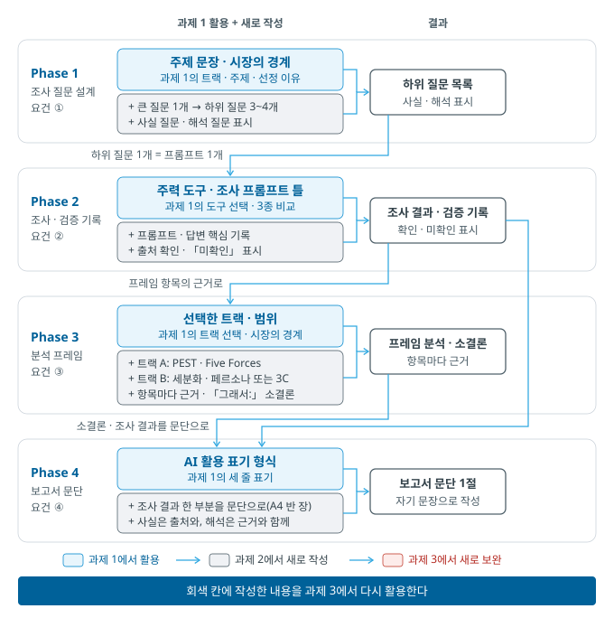
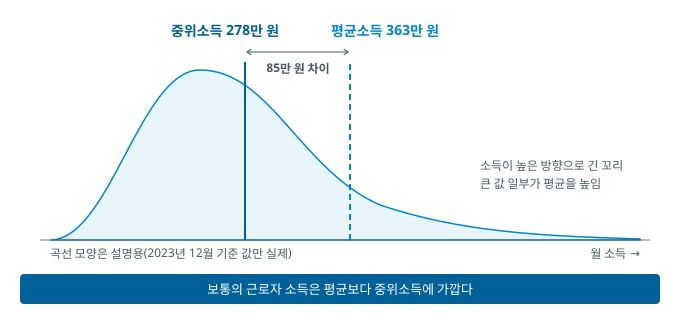
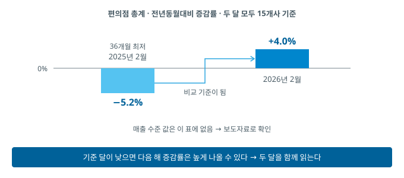
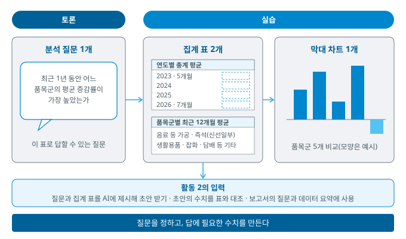
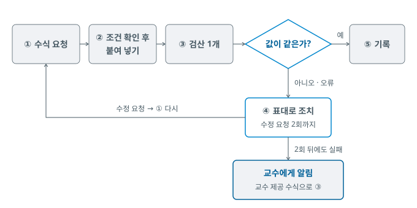
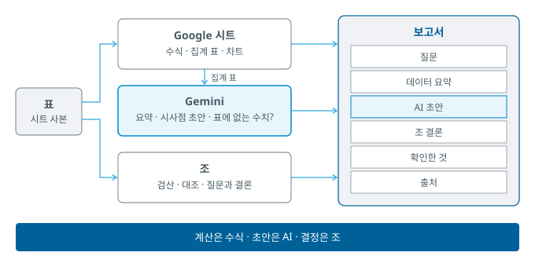
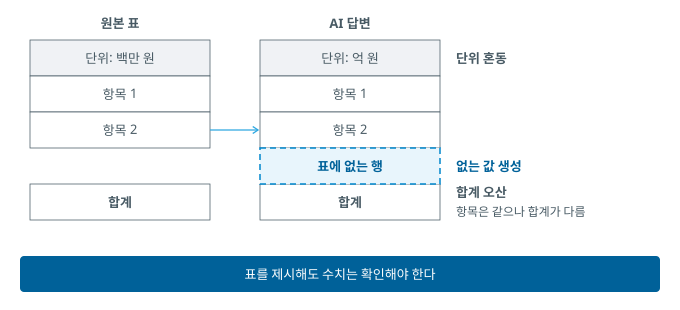
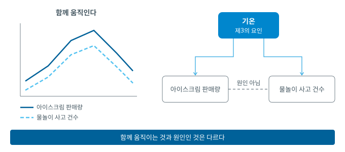

# 9주차 — 노코드 데이터 분석

> 경영경제 분야 AI 활용 입문 · 단국대학교
>
> **복습 기준 = 이 자료 + 수업 중 필기**

## 목차

- [1. 이번 주 개요 및 목표](#1-이번-주-개요-및-목표)
- [2. 표의 구성 · 수치 읽기 · 보고서](#2-표의-구성--수치-읽기--보고서)
- [3. 활동 1 — 질문 선정과 집계](#3-활동-1--질문-선정과-집계)
- [4. AI 데이터 분석의 원리와 한계 — 역할 분담 · 수치 오류 · 통계 단절](#4-ai-데이터-분석의-원리와-한계--역할-분담--수치-오류--통계-단절)
- [5. 활동 2 — AI 초안 · 대조 · 보고서 완성](#5-활동-2--ai-초안--대조--보고서-완성)
- [6. 심화·확장 — 표 정리 · 상관과 인과 · 시트 심화](#6-심화확장--표-정리--상관과-인과--시트-심화)
- [7. 요약 · 복습 문제 · AI 지문 비판](#7-요약--복습-문제--ai-지문-비판)
- [개정 이력](#개정-이력)

---

## 1. 이번 주 개요 및 목표

### 1.1 이번 주 학습 목표

1. 표의 구성과 평균·증감률의 뜻을 바탕으로 이 표로 답할 수 있는 질문을 정한다.
2. 공공 통계 표의 시트 사본에서 수식으로 연도별·품목군별 평균을 집계하고 막대 차트로 나타낸다.
3. 집계 표를 AI에 제시해 요약·시사점 초안을 받고, 초안의 수치를 표와 대조해 채택할 것과 고칠 것을 결정한다.
4. 통계 단절·부분 연도·비중 없는 평균처럼 해석을 좌우하는 조건을 찾아 보고서에 적는다.
5. 질문·데이터 요약·AI 초안·결론·확인한 것·출처로 구성된 보고서를 완성한다.

오늘은 제공하는 표를 분석해 **보고서**를 완성합니다.

- 지금까지의 AI 탐구 = 질문하고 답을 검증
- 오늘의 AI 탐구 = **표를 근거로 AI 초안을 받아 보고서로 완성**

### 1.2 이번 주 진행 순서

설명과 활동을 번갈아 진행합니다. **절 번호 = 진행 순서**

| 절 | 내용 |
|:--:|------|
| §2 | AI에 제시할 표의 구성 · 평균과 증감률 · 공공 데이터 사이트 3곳 · 보고서의 구성 |
| **§3** | **활동 1** — 토론(분석 질문 선정) → 실습(수식 요청 · 집계와 검산 · 막대 차트) |
| §4 | AI의 수치 처리와 역할 분담 · 수치 오류 3유형 · 검산의 우선순위 · 통계 단절과 부분 연도 · 대화 관리 |
| **§5** | **활동 2** — 실습(AI 요약 초안) → 토론(문장별 대조 · 조 결론 · 보고서 완성) → 수업 종료 |
| §6 · §7 | 수업 뒤 자습 — 표 정리 · 상관과 인과 · 시트 심화 · 복습 문제 |

- **수업 내 활동** = **2회** · 활동마다 실습과 토론 가운데 필요한 것으로 구성
  - **〈실습〉** = 실행·기록·검증
  - **〈토론〉** = 조원 간 논의와 합의
- **이전 활동 내용 = 다음 활동의 자료** · 활동 양식도 같은 순서로 작성
- **활동의 상세 절차 = 활동 양식** · 강의자료 §3 · §5 = 활동의 개요
- 조 편성 = 2\~4명 자유 구성 · 한 사람이 **활동 양식 사본**을 만들어 공유
  - [9주 활동 양식 사본 만들기](https://docs.google.com/document/d/1Da665soZ30ubnbSyYSvVwewO1SvLTBRoNxd-meGyvuo/copy) · 저장소 첫 화면 README에도 있음
- 제출 = 수업 후 조원 각자 **PDF로 내려받아** e-campus에 제출
  - 파일명 = `9주_이름1_이름2_이름3.pdf` · 마감 = 오늘 23:59

- **오늘의 성과물 = 보고서**(2.5)
  - 조가 정한 질문 하나 + 집계 표 2개 · 막대 차트 1개 · AI 초안 · 조 결론 · 확인한 것 · 출처
  - 작성 위치 = 활동 양식(위에서 아래로 한 번에 작성 · 첫머리에 흐름 그림)
- **실습 데이터** = 교수가 공공 통계에서 정리한 편의점 품목군별 월별 자료(36개월 · 288행)
  - 활동 1 · 2에서 같은 자료 사용
  - 시트 사본 링크 = 활동 양식의 준비 단계 · `data` 탭과 보조열 포함
  - 원본 CSV = [Data 폴더](../Data/README.md)
- 실습 도구 = **Google 시트**(집계·차트) · **Gemini 앱**(수식 요청 · 요약 초안) · 설치 프로그램 없음
- 과제 2 = 진행 중 · **다음 주(10주) 제출**

**과제 2의 진행 흐름** — 회색 칸 = 이번 과제에서 작성 · 과제 3에서 다시 활용



---

## 2. 표의 구성 · 수치 읽기 · 보고서

### 학습목표

- AI에 제시할 표의 구성 원칙을 설명하고, 분석용 표와 실무에서 자주 받는 표를 구분할 수 있다.
- 평균과 증감률이 각각 감추는 것을 지적할 수 있다.
- 공공 데이터 사이트 3곳의 용도를 구분할 수 있다.
- 보고서의 구성을 설명할 수 있다.

### 2.1 AI에 제시할 표의 구성

> [!IMPORTANT]
> - AI에 제시할 표 = 한 행에 관측 하나 · 한 열에 항목 하나
> - 첫 줄은 열 이름 한 층 · 합계와 소계는 표 밖에 따로
> - 이 구성을 갖춘 표 = **분석용 표**

**구성 원칙 네 가지**

- 한 행 = 관측 하나(사례 · 시점 · 대상)
- 한 열 = 항목 하나(측정한 값의 종류)
- 첫 줄 = 열 이름 한 층
- 합계 · 소계 = 표 밖에 따로

예: 월별 점포 매출 표의 한 행 = 「2026-03 · 서울점 · 1,200만 원」

**분석용 표(tidy data)** — 통계학자 Hadley Wickham이 2014년 논문에서 정리한 원칙

*(출처: Wickham, "Tidy Data", Journal of Statistical Software 59(10), 2014)*

| 조건 | 분석용 표 | 실무에서 자주 받는 표 |
|------|------|------|
| 행 | 관측 하나 | 한 행에 여러 시점·대상이 옆으로 펼쳐짐 |
| 열 | 항목 하나 · 셀마다 값 하나 | 한 셀에 여러 값 |
| 열 이름 | 첫 줄에 한 층 | 제목 줄이 여러 층 |
| 합계·소계 | 표 밖에 따로 | 데이터 행 사이에 섞임 |

**이 구성이 필요한 이유**

- 소계 행이 섞인 표를 그대로 집계 → 소계 행도 관측으로 계산될 수 있음 → **합계가 두 번 더해짐**
- 사람이 보기 좋은 형태와 도구가 처리하기 좋은 형태가 다름
- 분석용 표의 효과 = 사람이 읽을 때도 도구가 처리할 때도 오해 감소
- 받은 표가 이 구성과 다르면 = 정리 절차(6.1)

### 2.2 두 가지 수치 — 평균과 증감률

> [!IMPORTANT]
> - 평균은 분포를, 증감률은 규모를 감춘다
> - 한쪽으로 치우친 자료는 평균과 **중앙값**을 함께 확인한다
> - 평균이 중앙값보다 크게 높으면 큰 값 몇 개가 평균을 높인 구조다

이 두 수치를 다루는 이유 = AI 초안의 수치를 해석하고 고치기 위해

| 수치 | 알 수 있는 것 | 감추어지는 것 |
|------|------|------|
| **평균** | 전체의 중심 | 분포 — 한쪽에 치우쳐 있어도 가운데 값처럼 표시됨 |
| **증감률** | 변화의 방향과 속도 | 규모 — 작은 값의 큰 변화는 실질 영향이 작음 |

- 비율 = 분모와 함께 읽기 · %와 %p = 4.2

**평균과 중앙값** — 가장 자주 오해되는 수치 = 평균

- 예: 다섯 개 점포의 월 매출 800 · 900 · 1,000 · 1,100 · 5,000만 원
- 평균 = 1,760만 원 → **다섯 곳 중 네 곳이 평균보다 낮음**
- **중앙값** = 크기 순으로 나열했을 때 가운데 값 = 1,000만 원 → 보통의 점포를 더 잘 대표
- 소득 · 매출처럼 한쪽으로 치우치기 쉬운 자료 = 평균과 중앙값 함께 확인
- 평균만 인용하면 잘못된 인상을 전달할 수 있음

**실제 케이스 — 임금근로자의 월평균 소득과 중위소득**

| 구분 (2023년 12월 기준) | 월 소득 |
|------|:--:|
| 평균소득 | 363만 원 |
| 중위소득(소득 순으로 가운데에 있는 근로자의 소득) | 278만 원 |

*(출처: 통계청 「2023년 임금근로일자리 소득(보수) 결과」 2025-02-25 발표 — KDI 경제정보센터 게재본 · 2026-10-09 확인)*



### 2.3 증감률의 기준 시점

> [!IMPORTANT]
> - 증감률은 **기준 시점**에 따라 달라진다 — 기저 효과
> - 표를 받으면 단위·기준 시점·집계 범위부터 확인한다

**증감률은 기준 시점에 따라 달라짐**

- 전년동월대비 = **12개월 전 같은 달과 비교** · 전월 대비와 다른 값
- **기저 효과** = 기준 시점의 값이 이례적이면 다음 해 같은 달 증감률이 반대 방향으로 나타나는 현상

**실습 데이터의 기저 효과**



- 2025년 2월 증감률 = 36개월 최저 → 그 달의 매출 수준이 낮았을 가능성 → 2026년 2월의 비교 기준이 낮아짐
- 이 표에는 매출 수준 값이 없음 → 기저 효과로 단정 불가 · 그 달의 보도자료 확인
- 두 달 모두 15개사 기준 · 통계 단절을 넘지 않는 비교(4.4)

> [!TIP]
> 표를 받으면 세 가지를 먼저 확인합니다.
>
> - **단위** — 원인가, 천 원인가, 백만 원인가
> - **기준 시점** — 언제의 값이고, 무엇과 비교한 값인가
> - **집계 범위** — 무엇을 포함하고 무엇을 뺐는가
>
> 이 셋이 확인되지 않은 수치는 아직 해석할 수 없습니다.

### 2.4 공공 데이터 사이트 3곳

> [!IMPORTANT]
> - 원본이 어디 있는지 알아야 검증이 시작된다

| 사이트 | 담고 있는 것 | 사용하는 경우 |
|------|------------|------------|
| **KOSIS**(국가통계포털) | 인구·물가·소매판매·산업 등 국가 통계 전반 | 시장 규모·소비 동향·업종 현황 |
| **ECOS**(한국은행 경제통계시스템) | 금리·환율·통화·국민계정 등 거시 지표 | 경제 환경·지표 추이 |
| **DART**(전자공시시스템) | 기업의 공시·사업보고서·재무제표 | 개별 기업 분석(5주) |

- 실습 데이터의 출처 = KOSIS 「편의점 매출 동향(품목별)」
- 검증의 전제 = 원본의 위치 파악 · 4주 출처 확인 → 5주 공시 대조 → 이번 주 = 표를 직접 집계해 AI 초안 대조

### 2.5 보고서 — 오늘의 성과물

> [!IMPORTANT]
> - 보고서 = **질문 → 데이터 요약 → AI 초안 → 조 결론 → 확인한 것 → 출처**
> - 집계는 시트 수식이, 요약·시사점 초안은 AI가, 질문과 결론은 조가 담당한다
> - 초안의 수치는 **표의 어느 칸에서 왔는지 확인한 것만** 채택한다

- 오늘의 산출물 = **보고서**
- 목적 = 한 질문에 대한 데이터의 답과 근거를 한눈에 확인

| 구성 | 내용 |
|:--:|------|
| 분석 질문 | 이 표로 답할 수 있는 질문 1개(기간 · 품목군 · 비교 기준 명시) |
| 데이터 요약 | 집계 표 2개(연도별 평균 · 품목군별 최근 12개월 평균) + 막대 차트 1개 |
| AI 초안과 대조 | 초안 3문장 · 표의 위치 · 고친 문장 |
| 조 결론 | 질문의 답 한 문장 + 근거 수치 2개와 기간 · 「그래서:」 소결론 |
| 확인한 것 | 검산 · 보도자료 대조 · 확인하지 못한 가설 |
| 출처 | 통계표 이름·ID · 조회 일자 · 대조한 보도자료(양식에 미리 기재) |

- **AI 초안이 들어가는 곳 = 「AI 초안과 대조」** · 나머지 문장과 판단 = 조
- 집계 표의 수식 = Gemini 앱에게 받음 · 조건 지정과 검산 = 조
- 초안을 그대로 옮기지 않는 이유(4.2)
  - 표에 없는 수치가 섞일 수 있음
  - 통계 단절처럼 집계 표에 드러나지 않는 조건 = 프롬프트에 적지 않으면 AI가 알지 못함
- 작성 위치 = 활동 양식 · 위에서 아래로 한 번에 작성
- 과제 2 · 3 = 각자 선택한 주제의 표 하나에 같은 형식 적용 가능

---

## 3. 활동 1 — 질문 선정과 집계

### 학습목표

- 시트 사본을 만들어 열 구성과 행 수를 확인할 수 있다.
- 이 표로 답할 수 있는 질문 후보를 내고 조가 분석 질문 1개를 합의할 수 있다.
- 수식 요청 · 검산 · 오류 조치의 절차로 연도별 · 품목군별 평균을 집계하고 막대 차트로 나타낼 수 있다.

### 3.1 활동 1의 목표와 결과물



- 목표 = 제공하는 표로 답할 질문을 정하고, 집계 표 2개와 막대 차트를 시트 수식으로 작성
- 진행 = 준비 → 토론(질문 선정) → 실습(수식 요청 → 집계와 검산 → 막대 차트)
- **상세 절차 = 활동 양식의 준비 · 칸 1\~5** · 활동 중에는 활동 양식만 확인

| 결과물 | 만드는 곳 | 활동 2의 사용처 |
|------|------|------|
| 분석 질문 1개 | 토론 | 초안 요청 · 조 결론 |
| 집계 표 2개 | 실습 | AI에 제시 · 초안 대조 |
| 막대 차트 1개 | 실습 | 보고서의 데이터 요약 |

| 유형 | 수행 내용 | 가져올 것 | 비교 | **검증할 것** |
|:--:|------|------|:--:|------|
| **〈토론〉** | **분석 질문 1개 선정** — 후보 → 조 합의 | 시트 사본 · §2 | — | 필요한 열이 표에 있는가 · 집계 표 2개로 답할 수 있는가 |
| 〈실습〉 | **연도별 · 품목군별 평균** → 검산 1개 → 막대 차트 | 시트 사본 | ○ 집계값 | 검산 = 수식 값인가 · 품목군 이름 · 기간 ≥ 202508 · 부분 연도 표기 |

**활동 1의 규칙**

- 조 편성 = 2\~4명 · 조장 없음
- **활동 1의 실습 = 조원 전원이 같은 집계를 각자 수행** 후 값 비교
- **검증은 모든 활동에서 수행**
- **이전 활동 내용 = 다음 활동의 자료** · 활동 2로 넘기는 것 = 분석 질문 · 집계 표 2개 · 막대 차트
- **집계와 차트 = Google 시트 · 수식 요청 = Gemini 앱** · 결과 = 활동 양식에 붙여 넣기
- 조원의 이름이 남는 곳 = 후보 질문 행 · 초안 대조의 담당 열

### 3.2 수식을 받는 방법 — 프롬프트 기법 ③ 이해도 높이기

> [!IMPORTANT]
> - 수식은 **직접 작성하지 않고 Gemini 앱에게 받아** 붙여 넣는다
> - 설명을 요청할 때 **누가 읽을 설명인지**(대상·수준)를 적는다 — 프롬프트 기법 ③ 이해도 높이기
> - 붙여 넣은 수식은 **검산 1개**로 확인한 뒤 사용한다

「쉽게 설명해줘」만 적으면 읽는 사람의 수준이 프롬프트에 없으므로, AI가 정한 수준으로 답이 생성됩니다. 대상과 목적을 맥락으로 함께 적으면 수준에 적합한 설명을 받을 가능성이 높아집니다.

- Google Workspace 프롬프트 안내 = 페르소나·작업·맥락·형식의 네 영역 제시
- Anthropic 프롬프트 문서 = 지시의 맥락과 목적을 함께 제시하도록 권장
- 쉽게 풀어 쓴 설명 = 수식의 조건이 빠질 수 있음 → 수식의 조건과 대조

*(출처: Google Workspace 「비즈니스를 위해 효과적인 AI 프롬프트 작성하기」 · Anthropic 프롬프트 작성 문서 — 2026-10-09 확인)*

오늘의 적용 대상 = **수식 설명**

- 수식 요청에 「이 수식이 하는 일을 세 줄로 설명할 것」 추가 → 붙여 넣기 전에 계산 내용 확인
- 적용 = 활동 1의 집계 전체
- 확인할 것 = 수식의 문법이 아니라 **수식의 조건(품목군 · 기간)이 질문과 같은가** · **값이 검산과 같은가**
- 프롬프트와 오류 조치 = 활동 양식의 칸 2 · 3



**검산을 하는 이유** — 값이 표시되었다는 것만으로는 조건이 의도와 같은지 알 수 없습니다.

- 조건 = 조가 프롬프트에 적음 · 수식으로 옮긴 것 = AI
- 검산 1개 = 그 조건이 의도와 같은지 확인하는 가장 빠른 방법

<details>
<summary><b>교수 제공 수식 — 두 번 요청해도 실패한 경우에 사용</b></summary>

받은 수식이 달라도 조건과 값이 같으면 사용 가능 · 탭 이름 `data` · 보조열 H 연도 · I 연월 수치

| 구하는 것 | 수식 예시 |
|------|------|
| 2024년 총계 평균 | `=AVERAGEIFS(data!E:E, data!D:D, "총계", data!H:H, 2024)` |
| 즉석(신선일부) 최근 12개월 평균 | `=AVERAGEIFS(data!E:E, data!D:D, "즉석(신선일부)", data!I:I, ">=202508")` |

- 첫 수식 = 품목군이 「총계」이고 연도가 2024인 행의 E열(증감률) 평균 · 조건을 2023 · 2025 · 2026으로 변경 → 연도별 표 완성
- 둘째 수식 = 품목군 이름 + 「연월 수치가 202508 이상」 조건 · 다른 네 품목군은 이름만 변경

</details>

⛔ **여기까지 활동 1** · 활동 양식의 같은 자리에 경계선

- **활동 2를 시작하지 말고** 여기서 멈춘 뒤 §4 설명 듣기
- 이유 = 활동 2의 초안 대조에 §4의 **수치 오류**와 **통계 단절 · 부분 연도의 해석**이 전제

> **활동 2의 입력** = 조가 정한 **분석 질문 1개** · **집계 표 2개** · **막대 차트**
>
> AI 초안을 받아 대조한 뒤 보고서 완성

---

## 4. AI 데이터 분석의 원리와 한계 — 역할 분담 · 수치 오류 · 통계 단절

### 학습목표

- AI가 수치 계산에 약한 이유를 확률 예측과 토큰 단위 처리로 설명하고, 계산과 초안의 역할 분담을 말할 수 있다.
- 수치 오류 세 유형을 식별하고, 결론을 좌우하는 수치부터 검산할 수 있다.
- 통계 단절·부분 연도·비중 없는 평균이 해석을 어떻게 바꾸는지 실습 데이터에서 지적할 수 있다.
- 새 채팅과 프롬프트 수정으로 분석 대화를 관리할 수 있다.

### 4.1 AI가 수치를 다루는 방식 — 강점과 약점

> [!IMPORTANT]
> - AI의 데이터 분석 = **초안**에 강하고 **정확한 계산**에 약하다
> - 원인 = **확률 예측**과 **토큰 단위 처리**
> - 계산 과정이 적혀 있어도 확인 전에는 **확정된 값이 아니다**

AI는 제안과 문장 정리에 강하지만, 계산 결과를 예측으로 생성하는 경우가 있어 과정이 맞아 보여도 값이 틀릴 수 있습니다.

- 원인 1 = **확률 예측**(1주): 다음에 올 내용을 확률로 예측 · 계산 결과도 같은 방식으로 생성하는 경우 있음
- 원인 2 = **토큰 단위 처리**(2주): 처리 단위가 자릿수와 다를 수 있음

**연구 결과** (Singh · Strouse 2024 · 2023년 모델 기준)

- GPT-3.5 · GPT-4 = 1\~3자리 수마다 별도 토큰 · 수를 왼쪽부터 끊어 처리
- 같은 덧셈 문제도 쉼표로 세 자리씩 끊어 입력하면 정확도가 크게 상승

*(출처: Singh & Strouse, "Tokenization counts: the impact of tokenization on arithmetic in frontier LLMs", arXiv:2402.14903, 2024)*

- 결론 = 계산 과정이 적혀 있어도 **원본 확인 전에는 확정된 값이 아님**
- 오늘의 역할 분담 = **계산은 시트 수식 · 요약과 시사점 초안은 AI · 질문과 결론은 조**
- AI에는 계산을 요청하지 않고, 계산된 표를 제시해 문장을 받음
- 초안 수치의 확인 기준 = 4.2



### 4.2 수치 오류 세 유형

> [!IMPORTANT]
> - 합계 오산 · 단위 혼동 · 없는 값 생성
> - **없는 값 생성**이 가장 발견하기 어렵다 — 데이터 분석에서 나타나는 환각
> - 수치가 제시되면 더 의심한다(5주)

AI가 데이터를 다룰 때 반복되는 오류 세 가지

| 유형 | 증상 | 확인 방법 |
|------|------|----------|
| **합계 오산** | 항목별 값은 원본과 같으나 합계·평균이 어긋남 | 원본 표의 값을 직접 더한다 |
| **단위 혼동** | 천 원과 백만 원, %와 %p를 섞음 | 표의 단위 표기를 확인한다 |
| **없는 값 생성** | 표에 없는 항목·기간의 수치를 생성 | 그 값을 표의 행·열에서 찾는다 |

**세 유형의 실제 형태**

- **합계 오산**
  - 월별 값 여섯 개는 원본과 같으나 합계만 다름
  - 계산 과정을 질문하면 설명은 정확하지만 결과값만 어긋남
- **단위 혼동**
  - 표의 단위 = 백만 원 · 답변 = 억 원으로 서술
  - 점유율 5%p 상승을 5% 상승으로 서술
- **없는 값 생성**
  - 표에 없는 기간이나 품목군의 수치 제시
  - 금액 열이 없어도 매출액 제시
  - 활동 2의 요약 초안을 대조하는 기준

**%와 %p** — 실무 문서에서 가장 자주 틀리는 단위

- 점유율 20% → 25% = **5%p 상승** · 상대적 변화로는 **25% 증가**
- 둘은 다른 값 → 비율의 변화를 서술할 때 단위 명시

**없는 값 생성** — 가장 발견하기 어려운 유형

- 표에 없는 열 이름을 실재하는 것처럼 인용
- 요청한 기간이 자료에 없어도 그럴듯한 수치를 채워 생성
- 1주에 배운 환각이 데이터 분석에서 나타나는 형태



> [!WARNING]
> **자주 하는 실수**
>
> 집계 표를 제시했으므로 AI가 그 표만 근거로 답했으리라고 간주하는 경우
>
> - 표를 제시해도 표에 없는 수치가 초안에 섞일 수 있음
> - 표의 값이 잘못 합산되거나 반올림될 수 있음
> - 5주 기업 수치의 원칙(수치가 제시되면 더 의심한다)이 AI 초안에도 적용

### 4.3 검산의 우선순위와 방법

> [!IMPORTANT]
> - 모든 수치를 검산할 수는 없다 — **결론을 좌우하는 수치부터**
> - 계산은 수식으로 수행하고, 결과는 사람이 대조한다
> - 같은 자료 안의 **다른 수치와 어긋나지 않는지**도 확인한다

**검산의 우선 대상**

- 보고서의 핵심 주장을 뒷받침하는 값
- 다른 수치를 계산하는 데 사용되는 기준값
- 다른 값보다 유난히 크거나 작은 값

**그 밖의 수치와 목적**

- 배경 설명에 한 번 등장하고 결론과 무관한 수치 = 출처 확인 정도로 충분
- 검산의 목적 = 완벽한 확인이 아니라 **틀렸을 때 손실이 가장 큰 지점을 막는 것**

**대응 방법**

- AI에게 묻는 것 = 어떤 항목을 어떤 각도로 확인할지 · 결과를 어떻게 서술할지
- 정확한 계산 = **시트 수식**
- 수식의 값 = 적어도 하나는 **검산으로 확인** · 값이 표시되어도 조건이 의도와 같은지는 별도 확인
- 활동 1의 검산 = 수업 시간 때문에 값이 적은 집계를 선택 · 실무에서는 결론 수치부터

**검산 방법 두 가지**

- **원본 대조** — 원본 표의 값으로 직접 다시 계산
- **내부 정합 확인** — 같은 자료 안의 다른 수치(전년 값·증가율·구성비 합계)로 계산해 어긋나는지 확인

**실제 케이스 — 같은 통계를 전한 두 보도의 다른 평균**

- 자료 = 2026년 2월 23일 국가데이터처 「2024년 임금근로일자리 소득(보수) 결과」
- 두 보도의 전체 평균 소득이 서로 다름

| 보도 (2026-02-23) | 평균 소득 | 함께 적힌 변화 |
|------|:--:|------|
| 뉴시스 | 375만 원 | 전년보다 3.3%(12만 원) 증가 |
| 뉴데일리 | 357만 원 | 전년 대비 3.3% 증가 |

*(출처: 뉴시스 「60대가 20대보다 더 번다…임금근로자 62%, 월보수 350만원 안돼(종합)」 · 뉴데일리 「대기업 월급 20만원 늘 때 중소기업은 9만원 그쳐」 — 두 기사 모두 2026-02-23 · 2026-10-09 확인)*

원 통계표를 열기 전에도 내부 정합으로 어긋남을 찾을 수 있습니다.

- 2.2의 전년 값 363만 원 + 3.3% ≈ 375만 원
- 357만 원 = 전년보다 낮은 값 → 같은 문장의 「3.3% 증가」와 어긋남
- 두 값 = 같은 숫자의 자리만 바뀐 형태 · 사람이 작성한 문서에도 수치 오류 발생
- 어느 출처의 수치든 결론에 사용하기 전 = 원 통계표로 확정

### 4.4 통계 단절 · 부분 연도 · 비중 없는 평균

> [!IMPORTANT]
> - 조사 대상이 바뀐 시점을 넘어 추세를 이어 읽지 않는다 — **통계 단절**
> - 연도별 평균은 그 해에 **몇 개월이 포함되었는지** 함께 적는다 — **부분 연도**
> - 중분류 증감률의 단순평균은 총계와 다르다 — **비중이 없으면 총계를 검산할 수 없다**

AI 초안이 집계 표의 수치만 사용해도, 집계 표에 드러나지 않는 조건 세 가지 때문에 해석이 틀릴 수 있습니다. 실습 데이터에 모두 해당합니다.

| 연도 | 포함 기간 | 총계 평균 | 조사 대상 |
|:--:|------|:--:|:--:|
| 2023 | 8\~12월 · **5개월** | +6.88% | 13개사 |
| 2024 | 12개월 | +4.45% | 13개사 |
| 2025 | 12개월 | +0.05% | 15개사 |
| 2026 | 1\~7월 · **7개월** | +3.27% | 15개사 |

- **통계 단절** = 2025년 1월 · KOSIS 주석 「조사대상 확대(13개사->15개사)에 따라 통계 단절」
- 경계 표시 = 표의 「조사대상」 · 「통계표ID」 열

**통계 단절**

- 단절 전 17개월(2023-08\~2024-12) 총계 평균 = **+5.16%**
- 단절 후 19개월(2025-01\~2026-07) 총계 평균 = **+1.24%**
- 「증가세가 둔화되었다」로 그대로 잇지 않고, 조사 대상이 바뀌었다는 단서 적기

**부분 연도**

- 해당 = 2023년 · 2026년
- 「2026년은 2025년보다 회복했다」고 적을 때 개월 수 차이 함께 적기

**비중 없는 평균**

- 2026년 3월 중분류 다섯 품목군 = 음료 등 가공 +2.7 · 즉석(신선일부) +6.6 · 생활용품 +10.1 · 잡화 +31.4 · 담배 등 기타 +0.2(%)
- 단순평균 = **+10.2%** · 같은 달 총계 = **+2.7%**
- 총계 = 품목군의 매출 비중으로 가중된 값
- 이 표에는 비중 없음 → 중분류 평균으로 총계 검산 불가
- 잡화 +31.4%처럼 한 품목군의 큰 값이 단순평균을 크게 높임
- 연도별 평균도 같은 구조 = 월별 증감률의 단순평균 · 연간 매출 증감률과 다른 값

**이상값은 지우기 전에 확인합니다.**

- 예: 잡화 2026년 3월 +31.4% · 36개월 최대
- 잡화의 최근 12개월 평균 = +2.725% · 이 한 달을 빼면 +0.12% → 평균이 분포를 감춘 사례(2.2)
- 잡화 값을 근거로 삼는 조 = `data` 탭에서 해당 월 확인
- 가능성 = 입력 오류 또는 **실제로 일어난 사건**(행사 · 정책 변경 · 전년의 낮은 기준)
- 표만으로 구분 불가 → 「확인한 것」 칸에 「확인 필요」 → 그 달의 보도자료 찾기
- 확인 없이 지우면 가장 중요한 정보를 잃을 수 있음

### 4.5 대화 관리 — 새 채팅과 프롬프트 수정

> [!IMPORTANT]
> - 분석 대상 파일이나 주제가 바뀌면 **새 채팅**에서 시작한다
> - 첫 프롬프트의 전제가 틀렸다면 정정을 덧붙이기보다 **프롬프트를 수정**한다
> - 같은 대화의 앞선 내용은 뒤의 답변에 계속 반영된다(2주 — 컨텍스트 창)

프롬프트 기법 ③의 둘째 항목(첫째 = 이해도 높이기 · 3.2)

- AI = 같은 대화의 이전 내용을 함께 읽고 답함(2주 — 컨텍스트 창)
- 데이터 분석의 오류 경로 = 앞서 요청한 수식의 조건이나 앞서 정정한 가정이 뒤의 답변에 섞일 수 있음

| 상황 | 방법 | Gemini 웹 앱의 조작 |
|------|------|------|
| 다른 파일·다른 주제로 바꿀 때 | **새 채팅** | 왼쪽 위 「새 채팅」 아이콘(없으면 메뉴 아이콘을 먼저 선택) |
| 첫 프롬프트의 전제가 틀렸을 때 | **프롬프트 수정** | 프롬프트 오른쪽 「텍스트 수정」 아이콘 → 수정 → 「업데이트」 |

*(출처: Gemini 앱 고객센터 「Gemini 웹 앱 사용하기」 — 2026-10-09 확인)*

- 정정을 덧붙이면 = 잘못된 전제와 정정이 대화에 함께 남음
- 프롬프트 수정 = 고친 프롬프트로 응답을 새로 생성
- 활동 1의 수정 요청 = 전제가 맞고 수식만 틀린 경우 · 조건 자체가 틀린 경우 = 프롬프트 수정
- 활동 2의 실습 = 새 채팅에서 분석 질문과 집계 표를 붙여 넣어 시작 · 활동 1의 수식 요청 내용이 요약 초안에 섞이지 않게 하기 위함

---

## 5. 활동 2 — AI 초안 · 대조 · 보고서 완성

### 학습목표

- 집계 표를 제시해 AI에게 요약·시사점 초안을 받고, 초안의 수치가 표에서 왔는지 대조할 수 있다.
- 검증 결과를 반영해 조 결론을 내리고 보고서를 완성할 수 있다.

### 5.1 활동 2의 목표와 결과물

- 입력 = 활동 1에서 **조가 정한 질문** · **집계 표 2개 · 막대 차트**
- §4의 역할 분담 · 수치 오류 · 단절 · 대화 관리를 조의 질문에 적용
- **상세 절차 = 활동 양식의 칸 6\~9** · 활동 중에는 활동 양식만 확인

| 유형 | 수행 내용 | 가져올 것 | 비교 | **검증할 것** |
|:--:|------|------|:--:|------|
| 〈실습〉 | **새 채팅**에 분석 질문 · 집계 표 2개 → **요약 2항목 · 시사점 1항목 초안** 요청 | 활동 1의 질문 · 표 | — | 초안 3문장이 요청 형식과 같은가 |
| **〈토론〉** | **문장별 대조 → 조 결론 → 보고서 완성** | 활동 1 · 초안 | — | 표에 없는 수치 · 단절·부분 연도 · 보도자료와 최근 월 총계 · 미확인 가설 |

- 순서 = 초안 3문장 받기 → 문장별 대조 → **조 결론** 합의 → 「확인한 것」 작성 → **보고서 완성**
- 초안 문장 = 받은 그대로 두고 **고친 문장을 옆 칸에 기록** · 과제 2의 검증 기록
- 원인 단정 표현의 상세 = 6.2
- 활동 1 = 수치를 **만드는** 단계 · 활동 2 = 그 수치로 **문장을 만들고 확인하는** 단계
- 보고서 채택 기준 = 초안의 문장이 표에서 온 것을 확인했을 때만
- 기록하는 결과 = 「AI가 정확했다」가 아니라 **「확인했다」**

### 5.2 마무리와 제출

- 「확인한 것」까지 기록 = 보고서 완성 · 수업 종료
- 제출 = **PDF로 내려받아 조원 각자** e-campus 9주 과제란에 제출
- 파일명 = `9주_이름1_이름2_이름3.pdf` · 마감 = 오늘 23:59
- 시간 여유가 있는 조(제출 전) = 활동 양식 끝의 선택 실습(식품 · 비식품)

---

## 6. 심화·확장 — 표 정리 · 상관과 인과 · 시트 심화

- §2\~§5 = 표를 읽고 수치를 집계 · 확인하는 방법
- 이 절 = 수업 뒤 자습 · 실무에서 받는 표의 정리 · 수치 해석의 한계 · 시트 기능의 확장

### 학습목표

- 분석용 표가 아닌 자료를 AI와 함께 정리하는 절차를 설명할 수 있다.
- 상관관계와 인과관계를 구분하고 혼동 사례를 판별할 수 있다.
- 피벗 테이블과 조건부 서식으로 오늘의 집계를 다른 방식으로 확인할 수 있다.

### 6.1 분석용 표가 아닌 자료의 정리 절차

> [!IMPORTANT]
> - 정리를 요청할 때는 **무엇을 어떻게 처리할지** 지시한다
> - 판단이 애매한 행은 **삭제하지 않고 표시**하게 한다
> - 정리는 보기 좋게 만드는 작업이 아니라 **계산 결과가 달라지는 작업**이다

**실무에서 자주 받는 파일의 상태**

- 같은 사람이 이름 표기만 다르게 여러 행에 있음
- 날짜 형식이 섞여 있음
- 소계 행이 데이터 행 사이에 있음
- 한 셀에 여러 정보가 함께 있음

**정리 요청**

- **무엇을 어떻게 처리할지 지시**
- 「정리해줘」만 입력 → AI가 임의로 판단 · 그 판단이 무엇이었는지 알 수 없음

구분자 형식(6주 1.3)을 적용한 예

```
## 지시
이 명단 파일을 정리해줘.

## 요구
- 이름의 공백을 뺀 값과 연락처가 같으면 동일인으로 보고 중복을 제거하되, 제거한 행이 몇 개인지 알려줄 것
- 날짜는 YYYY-MM-DD 형식으로 통일할 것
- '소계'·'합계'가 포함된 행은 데이터에서 빼고 따로 표시할 것
- 판단이 애매한 행은 지우지 말고 '확인 필요'로 표시할 것
```

- 마지막 조건이 특히 중요 — AI가 임의로 삭제한 행은 결과에 남지 않아 무엇이 삭제되었는지 알 수 없음
- 첫 조건의 제거 행 개수 = 정리 전후 행 수를 시트에서 세어 대조 · AI가 보고한 개수도 확인 전에는 확정된 값이 아님(4.1)

**정리 전후의 비교**

| 구분 | 정리 전 | 정리 후 |
|------|------|------|
| 이름 | 「홍길동」·「홍 길동」을 다른 사람으로 집계 | 동일인 1명 |
| 날짜 | 「2026-03-05」·「26.3.5.」 혼재 | YYYY-MM-DD로 통일 |
| 소계 | 부서별 소계 행이 개인 행 사이에 있음 | 데이터에서 분리해 따로 표시 |

- 정리 전 표로 「총 인원」 질문 → 소계 행까지 인원으로 집계 → 실제보다 큰 값 출력(2.1의 이중 집계와 같은 구조)
- 빈 칸과 이상값의 처리(6.5 보충 · 4.4) = 같은 정리 단계에서 결정
- 정리 조건에 「빈 칸은 지우지 말고 개수를 알려줄 것」 추가 → 뜻을 확인하기 전의 행 삭제 방지

### 6.2 상관과 인과 — 함께 움직이는 것과 원인의 구분

> [!IMPORTANT]
> - 두 값이 **함께 움직인 것은 사실**이고, 하나가 원인이라는 것은 **해석**이다
> - **제3의 요인**이 두 값에 함께 작용할 수 있다
> - 인과를 확인하는 가장 확실한 방법 = **무작위로 나눈 비교 집단**

가장 흔한 오해 = 두 값이 함께 움직이면 하나가 다른 하나의 원인이라는 해석

- 자주 인용되는 예 = 아이스크림 판매량과 물놀이 사고 건수의 동시 증가
- 아이스크림은 사고의 원인이 아님
- **기온**이라는 제3의 요인이 두 값에 함께 작용

경영 자료의 같은 현상

| 관찰 | 원인으로 해석한 것 | 다른 설명 |
|------|------|------|
| 광고비를 늘린 달의 매출 증가 | 광고 효과 | 성수기 |
| 신규 기능 출시 뒤 이탈률 하락 | 기능의 효과 | 같은 시기 경쟁사의 문제 |
| 교육 이수 직원의 높은 성과 | 교육 효과 | 의욕이 높은 직원의 자발적 신청 |

- 세 경우 모두 = **함께 움직인 것은 사실** · **원인이라는 것은 해석**
- 4주의 사실과 해석 구분이 데이터에서 나타나는 형태

**AI 답변의 상관과 인과**

- 상관을 인과로 서술한 답이 생성될 수 있음 — 「매출 증가는 광고 확대에 기인한 것으로 분석됩니다」
- 답에 **「때문에·기인·효과」** 같은 표현이 있으면 근거를 다시 질문

**인과를 확인하는 방법**

- 가장 확실한 방법 = **무작위로 나눈 비교 집단** — 지역을 무작위로 나누어 광고 집행 여부를 정하면 지역 특성의 차이를 배제하고 광고의 영향 구분
- 스스로 선택한 집단의 비교(교육 이수자와 미이수자) = 의욕 차이가 섞임 · 차이를 교육 효과로 단정 불가
- 비교 집단을 마련하기 어려운 경우 = **다른 설명의 가능성을 함께 적기**

> 예: 「광고 효과로 판단되나, 같은 기간 경쟁사의 서비스 중단과 계절 요인이 함께 작용했을 가능성이 있다」

- 단정하는 문장보다 주장의 강도는 낮음 · 결과가 달라졌을 때 분석 전체의 신뢰 유지

> [!TIP]
> 인과를 주장하려면 최소 세 가지가 필요합니다.
>
> - 원인이 결과보다 **먼저** 일어났는가
> - 두 값이 실제로 **함께 움직이는가**
> - 다른 요인으로 설명되지 **않는가**
>
> 셋째 조건의 확인이 가장 어려우므로, 대부분의 분석은 「관련이 있다」까지만 주장할 수 있습니다.



### 6.3 「따라서」의 앞뒤를 나누어 읽기

- 앞 = 자료에서 확인된 사실 · 뒤 = 작성자의 해석
- 검증의 시작 = 사실과 해석 사이에 생략된 근거 확인

보고서 작성 = **관찰과 추론을 다른 문장으로**

| 구분 | 문장 예 |
|------|------|
| 관찰 | 「두 값은 같은 방향으로 움직였다」 |
| 추론 | 「따라서 하나가 원인일 가능성이 있다」 |

- 한 문장에 섞으면 = 어디까지가 자료인지 판단 불가
- 나누어 적으면 = 추론이 틀린 것으로 밝혀져도 관찰은 유지
- 과제 3의 제언 절에서 특히 중요

### 6.4 시트 심화 — 피벗 테이블 · 분리 집계 · 조건부 서식

- 오늘 수식으로 낸 집계 = 시트의 다른 기능으로도 확인 가능
- 수업 뒤 아래 순서로 확장 · 수식과 설정 방법 = 활동 1과 같은 절차로 Gemini 앱에 요청

| 단계 | 과제 | 확인할 것 |
|:--:|------|------|
| 1 | **피벗 테이블**로 연도 × 품목군 평균 표 | 수식으로 낸 값과 같은가 |
| 2 | **식품 · 비식품 분리** 집계와 차트 | 두 대분류의 흐름이 다른 시점 |
| 3 | **단절 전후** 품목군별 평균 비교 | 조사 대상이 바뀐 뒤 순위가 바뀐 품목군 |
| 4 | **조건부 서식**으로 음수 월 표시 | 어느 품목군에 음수 월이 집중되어 있는가 |

**피벗 테이블**

- 설정 = 데이터 범위 선택 → 삽입 → 피벗 테이블 → 행 = 연도(보조열 H) · 열 = 품목군 · 값 = 전년동월대비의 평균
- 수식 없이 연도 × 품목군 표 생성 → 활동 1의 연도별 값과 대조하는 두 번째 확인 수단(최근 12개월 평균은 대조 대상 아님)
- 값이 다르면 = 피벗의 집계 함수가 합계로 되어 있지 않은지 확인

**조건부 서식**

- 설정 = E열 선택 → 「0보다 작으면」 조건에 배경색 지정 → 음수 월 표시
- 품목군별 음수 월 수 집계(총계 = 36개월 중 4개월) → 「매출이 줄어든 기간」을 수치로 제시
- 집계 수식 = COUNTIFS로 요청

### 6.5 보충 — 더 알아보기

**중앙값과 분포를 함께 확인하는 습관**

- 평균만 제시된 자료 → 중앙값 · 가장 큰 값 · 가장 작은 값을 함께 질문
- 소득 · 매출 · 이용 시간처럼 치우치기 쉬운 자료 = 평균 하나로 집단 대표 불가(2.2)
- 과제 보고서에 평균을 적을 때 = 중앙값 한 줄 병기 → 서술의 근거가 분명해짐

**빈 칸과 이상값의 처리**

- 빈 칸 = 실제 0인가, 조사되지 않은 값인가 → 구분하지 않고 평균을 계산하면 결과가 달라짐

| 도구 | 빈 칸의 기본 처리 |
|------|------|
| Google 시트·엑셀의 AVERAGE 함수 | 빈 셀은 무시 · 값이 0인 셀은 평균에 포함 |
| Python pandas의 평균(`mean`) | 빈 값(NA)을 제외하고 계산(기본 설정) |
| AI의 답변 | 처리 방식을 밝히지 않으면 알 수 없음 |

*(출처: Microsoft 지원 「AVERAGE 함수」 · pandas 공식 문서 `DataFrame.mean` — 2026-10-09 확인)*

| 빈 칸의 뜻 | 처리 |
|------|------|
| 실제로 0이었던 달 | 0으로 계산 |
| 조사되지 않은 달 | 제외 |

- 뜻 확인 = 원 통계표의 주석 · 자료 제공자
- 실습 데이터에는 빈 칸 없음 · 과제 2 · 3의 통계표에는 있을 수 있음
- 이상값 확인 원칙 = 4.4와 같음

**파일을 업로드해 분석하기**

- 방법 = Gemini 앱 입력창 옆 **파일 추가** 아이콘 → 「파일 업로드」(한 프롬프트에 최대 10개 · 계정에 따라 다를 수 있음)
- 오늘 수업 = 집계 표를 붙여 넣는 방식
- 업로드의 용도 = AI가 표 구조를 설명하고 확인할 항목을 제안
- 업로드로 받은 계산 결과 = 4.1의 이유로 확정된 값이 아님 → 시트 수식이나 검산으로 확인
- 학교 계정의 파일 업로드 가능 여부 = 각자 확인
- 통계표 캡처 이미지 업로드도 가능(2주 — 멀티모달) · 수치가 잘못 인식될 수 있음 → 자릿수가 많은 값과 촘촘한 표의 핵심 수치를 원본과 대조

*(출처: Gemini 앱 고객센터 파일 업로드 도움말 — 2026-10-09 확인)*

**넓은 표와 긴 표** — 같은 자료도 시점을 배치하는 방식에 따라 두 형태로 표시

| 형태 | 시점의 위치 | 열의 예 |
|------|------|------|
| 넓은 표(wide) | 시점마다 열 하나 | 품목군 · 2026-01 · 2026-02 · … |
| 긴 표(long) | 시점이 한 열의 값 | 연월 · 품목군 · 매출액 |

- 넓은 표의 「2026-01」 같은 열 이름 = 변수가 아니라 값
- Wickham(2014) = 분석용 표가 아닌 자료의 흔한 문제 다섯 가지 가운데 첫째 = 「열 이름이 변수 이름이 아니라 값인 경우」
- 이를 정리하는 작업 = melting

- pandas 공식 문서의 `melt` 함수 = 넓은(wide) 형식을 긴(long) 형식으로 바꾸는 함수
- 넓은 · 긴 표현 = Wickham은 정확하지 않다며 미사용 · pandas 같은 도구 문서는 사용

*(출처: Wickham, "Tidy Data", JSS 59(10), 2014, §3 · pandas 공식 문서 `pandas.melt` — 2026-10-09 확인)*

- KOSIS 내려받기의 통계표 구성에서 시점을 가로에 두면 = 넓은 표
- 분석에 사용할 표 = 내려받을 때의 구성부터 확인

**물려받은 수식의 설명 요청**

- 엑셀 파일의 복잡한 수식을 붙여 넣고 「이 수식이 무엇을 계산하는지 설명해줘」 요청 → 구조를 빠르게 파악
- 읽는 사람의 수준을 함께 적기(3.2 — 이해도 높이기)
- 설명의 정확성 확인 = **결과를 아는 간단한 값**을 넣어 직접 시험

---

## 7. 요약 · 복습 문제 · AI 지문 비판

### 7.1 오늘의 요약

- 오늘의 성과물 = **보고서** — 질문 → 데이터 요약(표 2 · 막대 차트 1) → AI 초안 → 조 결론 → 확인한 것 → 출처
- AI에 제시할 표 = **한 행에 관측 하나, 한 열에 항목 하나** — 합계·소계는 표 밖에 따로(분석용 표)
- **평균**은 분포를, **증감률**은 규모를 감춘다 — 전년동월대비 = 12개월 전과의 비교 · 기저 효과
- 공공 데이터 사이트 3곳 = **KOSIS**(국가 통계) · **ECOS**(거시 지표) · **DART**(개별 기업) — 실습 데이터 = KOSIS
- 시트 준비 = 시트 사본 만들기 → **보조열 2개**(연도 · 연월 수치) 확인 → 수식은 Gemini 앱에게 받아 검산 1개로 확인
- 역할 분담 = **계산은 수식 · 초안은 AI · 질문과 결론은 조** — 서술된 계산 과정 ≠ 실행한 계산

- **수치 오류 3유형** = 합계 오산 · 단위 혼동(%와 %p) · **없는 값 생성** — 초안의 수치는 표의 어느 칸에서 왔는지 확인한 것만 채택
- 집계 표에 드러나지 않는 조건 3 = **통계 단절**(13→15개사) · **부분 연도**(2023 5개월 · 2026 7개월) · **비중 없는 평균**(중분류 단순평균 ≠ 총계)
- 검산 = **결론을 좌우하는 수치부터** — 수식 값도 검산 1개로 조건 확인 · 이상값은 지우기 전에 사건인지 확인
- 대화 관리 = 작업이 바뀌면 **새 채팅** · 첫 프롬프트의 전제가 틀리면 **프롬프트 수정**
- **상관 ≠ 인과** — 함께 움직인 것은 사실, 원인이라는 것은 해석
- 📝 과제 2 진행 중 — **다음 주(10주) 제출** · 각자 선택한 주제의 표 1개에 같은 보고서 형식 적용 가능

### 7.2 복습 문제

**문제 1 — 이 표가 말하는 것** — 실습 데이터인 편의점 통계 표에는 일곱 열이 있습니다(연월 · 구분 · 대분류 · 품목군 · 전년동월대비(%) · 조사대상 · 통계표ID). 값은 전년동월대비 증감률 하나뿐입니다. 이 표만으로 답할 수 있는 질문은 무엇입니까? 세 가지 이상 제시합니다.

<details>
<summary><b>문제 1 해설 보기</b></summary>

① **어느 품목군의 증감률이 가장 높았는가** — 특정 월의 증감률을 품목군끼리 비교

② **한 품목군의 흐름은 어떤가** — 같은 품목군을 36개월에 걸쳐 나열해 추이 확인

③ **같은 달이 해마다 어떻게 달랐는가** — 2월만 세 해를 비교 · 2025 → 2026 = 기저 효과 확인 · 2024 → 2025 = 통계 단절 단서 필요(4.4)

④ **연도별로 평균하면 어느 해가 높았는가** — 연도별로 묶어 평균

**답할 수 없는 질문** — 「어느 품목군의 매출액이 가장 많은가」(금액 열 없음) · 「식품 안에서 음료가 차지하는 비중」(비중 열 없음)

**핵심** — 증감률이 높다는 것과 매출액이 많다는 것은 다른 사실 · 답할 수 있는 범위는 표의 열에 따라 정해짐

</details>

**문제 2 — 이 표가 말하지 않는 것** — 실습 데이터의 마지막 달(2026-07) 총계 행에는 「2026년 7월 편의점 전체 매출이 전년 동월 대비 **1.1%** 증가」라는 수치가 있습니다. 이 수치만으로 알 수 없는 것은 무엇입니까? 세 가지 이상 제시합니다.

<details>
<summary><b>문제 2 해설 보기</b></summary>

① **규모** — 1.1%가 얼마의 1.1%인가(이 표에는 금액 없음)

② **기준 시점의 상태** — 2025년 7월이 이례적으로 높았거나 낮았다면 기저 효과(2025년 7월 총계 = +3.5%)

③ **구성** — 전체가 1.1% 늘어도 품목군별 증감은 섞여 있음(같은 달 즉석(신선일부) +4.1% · 비식품 −1.0%)

④ **조사 대상** — 이 수치 = 15개사 기준 · 2024년까지 = 13개사 기준(4.4)

⑤ **가격 요인** — 판매량 증가와 가격 상승이 구분되지 않음

⑤가 특히 중요합니다. 매출액은 **수량 × 가격**이므로, 물가가 오른 해에는 판매량이 같아도 매출이 늘어납니다.

</details>

**문제 3 — 결론 문장의 단서** — 조가 「편의점 매출은 2025년에 정체(+0.05%)되었다가 2026년에 회복(+3.27%)했다」는 결론 문장을 작성했습니다. 이 문장을 보고서에 그대로 적을 수 있습니까? 보완할 단서를 제시합니다.

<details>
<summary><b>문제 3 해설 보기</b></summary>

① **부분 연도** — 2026년 평균 = 1\~7월 7개월의 값 → 「2026년(1\~7월)」처럼 기간 표기

② **기준 시점** — 2026년의 증감률 = 2025년의 같은 달을 기준으로 계산된 값 · 2025년의 증감률이 낮았으므로 회복의 일부가 기저 효과일 가능성 · 이 표에는 매출 수준 값이 없어 단정 불가

③ **평균의 성격** — +0.05% · +3.27% = 월별 증감률의 평균 · 연간 매출 증감률과 다른 값(4.4)

**통계 단절의 영향** — 단절(13→15개사) = 2025년 1월 → 2025년과 2026년의 비교에는 영향 없음 · 2024년과 2025년을 비교하는 문장 = 단서 필요

</details>

**문제 4 — 이 해석은 성립하는가** — 어떤 보고서에 다음 문장이 있습니다. 「배달 앱 이용률이 높은 지역일수록 1인 가구 비율이 높다. 따라서 배달 앱 확산이 1인 가구 증가를 촉진하고 있다.」 이 해석의 문제는 무엇입니까?

<details>
<summary><b>문제 4 해설 보기</b></summary>

방향과 원인을 모두 단정했습니다.

① **방향** — 1인 가구가 많아서 배달 앱 이용률이 높을 가능성이 더 자연스러움 · 어느 값이 먼저 변했는지 자료로 확인 불가

② **제3의 요인** — 두 값 모두 도시화 정도에 따라 함께 높아질 수 있음 · 지역 특성이 동시에 작용했을 가능성

③ **표현** — 「촉진하고 있다」 = 인과를 확정하는 서술 · 근거는 상관뿐

</details>

**문제 5 — 빈 칸의 두 평균** — 어느 품목군의 6개월 매출이 120 · 130 · (빈 칸) · 140 · (빈 칸) · 150(단위: 백만 원)입니다. 빈 칸을 제외한 평균과 빈 칸을 0으로 계산한 평균은 각각 얼마입니까? 어느 값을 사용할지는 무엇으로 판단합니까?

<details>
<summary><b>문제 5 해설 보기</b></summary>

빈 칸 제외: (120 + 130 + 140 + 150) ÷ 4 = 540 ÷ 4 = **135**

빈 칸을 0으로 계산: 540 ÷ 6 = **90**

같은 자료에서 평균 차이 = 45(백만 원)

어느 값을 사용할지 = 빈 칸의 뜻으로 판단 · 도구의 기본 설정이 이 판단을 대신하지 않음

</details>

### 7.3 AI 지문 비판

**문항 1** — 다음은 AI가 집계 표 두 개를 보고 작성한 보고서 요약 초안의 일부입니다. 표에는 편의점 품목군별 전년동월대비 증감률(2023-08\~2026-07 · 2024-12까지 13개사 · 2025-01부터 15개사)의 연도별 평균과 최근 12개월 평균만 있습니다. 문제점을 2개 이상 지적합니다.

> "편의점 매출은 2023년 평균 6.9% 증가에서 2025년 0.1% 증가로 둔화되었으나 2026년에는 3.3% 증가로 회복했다. 최근 1년 동안 즉석식품(4.1%)과 생활용품(4.0%)이 성장을 이끌었고, 담배 등 기타는 −0.2%로 감소했다. 즉석식품의 매출 규모는 약 1조 2,000억 원으로 추정되며, 전체 매출의 35%를 차지한다."

<details>
<summary><b>문항 1 정답 및 해설 보기</b></summary>

① **표에 없는 수치** — 「약 1조 2,000억 원」 · 「35%」 = 표에 없는 매출액과 비중 · 이 표는 증감률만 있으므로 생성된 값(4.2 없는 값 생성)

② **부분 연도 미표기** — 2023년 평균 = 8\~12월 5개월 · 2026년 평균 = 1\~7월 7개월 · 연간 평균처럼 표기(4.4)

③ **단절 미언급** — 2023\~2024년(13개사)과 2025년 이후(15개사)의 평균을 「둔화 → 회복」으로 연결 · 조사 대상 변경 표기 필요(4.4)

④ **반올림한 수치의 확인** — 6.9 · 0.1 · 3.3 = 표의 6.88 · 0.05 · 3.27을 반올림한 값으로 볼 수 있음 · 0.05를 0.1로 적으면 「정체」가 「증가」로 읽힘 → 표의 수치를 그대로 표기

⑤ **명칭과 기여 주장** — 「즉석식품」 = 표의 「즉석(신선일부)」와 다른 명칭 · 「성장을 이끌었고」 = 비중 없이 기여를 주장(4.4)

**통찰**: 초안의 문장마다 확인할 세 가지 = **이 수치는 표의 어느 칸에서 왔는가** · **그 기간은 몇 개월인가** · **조사 대상이 바뀌었는가**

</details>

**문항 2** — 다음은 AI가 작성한 분석 문단입니다. 문제점을 2개 이상 지적합니다.

> "지난 3년간 자사 앱의 푸시 알림 발송량과 월 매출은 뚜렷한 상관관계를 보였다(상관계수 0.87). 따라서 알림 발송량을 늘리면 매출이 증가할 것으로 예상되며, 발송량을 두 배로 늘릴 경우 매출도 그에 비례해 성장할 것이다."

<details>
<summary><b>문항 2 정답 및 해설 보기</b></summary>

① **상관을 인과로 전환** — 함께 움직였다는 사실에서 「늘리면 증가한다」로 건너뜀 · 이용자 수 증가라는 제3의 요인으로 함께 증가했을 수 있음(6.2)

② **관계의 지속을 가정** — 지금까지의 관계가 유지된다고 전제 · 알림을 두 배로 늘리면 이용자가 앱을 삭제하는 반대 효과 가능 · 관찰된 범위 밖에서는 관계가 달라질 수 있음

③ **비례 관계 단정** — 「그에 비례해」 = 상관계수에 없는 정보 · 상관계수 = 두 값이 함께 움직이는 정도 · 배율은 나타내지 않음

**통찰**: 「따라서」 앞 = 자료 · 뒤 = 해석 → 둘 사이에 생략된 근거를 질문

</details>

---

## 개정 이력

| 날짜 | 내용 |
|:--:|------|
| 2026-11-05 | 최초 게시 |
