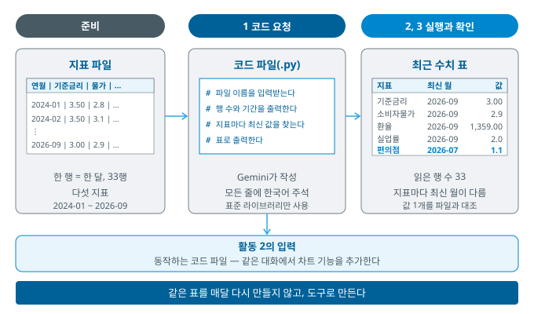
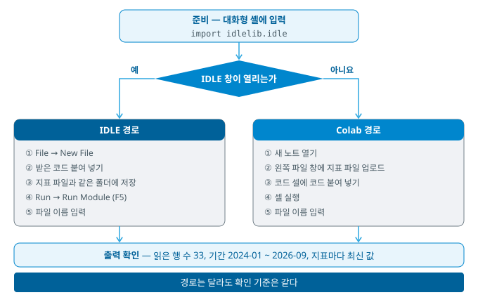
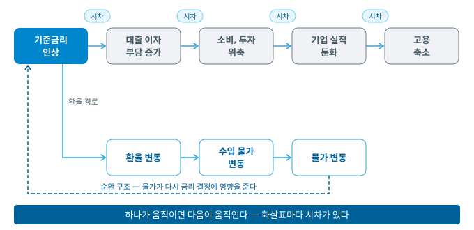
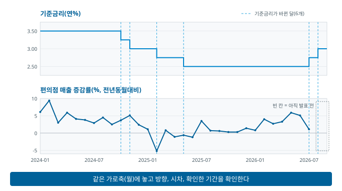
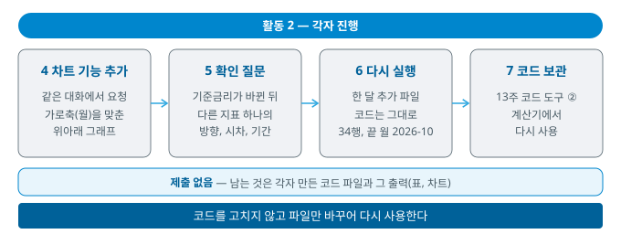

# 10주차 — 경제지표와 뉴스 해석

> 경영경제 분야 AI 활용 입문 · 단국대학교
>
> **복습 기준 = 이 자료 + 수업 중 필기**

## 목차

- [1. 이번 주 개요 및 목표](#1-이번-주-개요-및-목표)
- [2. 경제지표와 표 작업 — 다섯 지표, 최근 수치, 도구로 만드는 이유](#2-경제지표와-표-작업--다섯-지표-최근-수치-도구로-만드는-이유)
- [3. 활동 1 — 지표 표 도구 만들기](#3-활동-1--지표-표-도구-만들기)
- [4. 지표의 연쇄와 시차 — 차트로 연쇄를 확인하는 방법](#4-지표의-연쇄와-시차--차트로-연쇄를-확인하는-방법)
- [5. 활동 2 — 차트 기능 추가와 다시 실행](#5-활동-2--차트-기능-추가와-다시-실행)
- [6. 심화와 확장 — 발표문, 해석의 비약, 지표의 한계, AI와 노동시장](#6-심화와-확장--발표문-해석의-비약-지표의-한계-ai와-노동시장)
- [7. 요약, 복습 문제, AI 지문 비판](#7-요약-복습-문제-ai-지문-비판)
- [개정 이력](#개정-이력)

---

## 1. 이번 주 개요 및 목표

### 1.1 이번 주 학습 목표

1. 다섯 지표의 측정 대상과 발표 주기를 알고, 최근 발표 수치를 기준과 발표 시점과 함께 해석한다.
2. 매달 반복하는 지표 표 작업을 AI에게 코드로 요청해 도구로 만들고, 읽은 행 수와 값 1개로 결과를 확인한다.
3. 도구에 시계열 차트 기능을 추가하고, 기준금리가 바뀐 뒤 다른 지표의 방향과 시차를 판단한다.
4. 한 달이 추가된 파일로 같은 도구를 다시 실행해 도구를 다시 사용할 수 있는지 확인한다.

오늘은 매달 발표되는 지표의 표를 **코드 도구**로 만듭니다.

- 지난주 = 표의 수치를 시트 수식으로 집계하고 AI 초안과 대조
- 오늘 = 지표 파일을 넣으면 표와 차트를 출력하는 **도구를 만들어 다시 사용**
- 오늘의 성과물 = 각자 만든 도구(코드 파일)와 그 출력(최근 수치 표, 시계열 차트)

### 1.2 이번 주 진행 순서

설명과 활동을 번갈아 진행합니다. **절 번호 = 진행 순서**

| 절 | 내용 |
|:--:|------|
| §2 | 다섯 지표, 최근 발표 수치, 확인할 세 가지, 표 작업을 도구로 만드는 이유 |
| **§3** | **활동 1** — 실습(지표 표 도구 만들기) |
| §4 | 지표의 연쇄와 시차, 기준금리의 두 국면, 차트로 연쇄를 확인하는 절차 |
| **§5** | **활동 2** — 실습(차트 기능 추가, 확인 질문, 다시 실행) → 수업 종료 |
| §6, §7 | 수업 뒤 자습 — 발표문, 해석의 비약, 선행과 후행 지표, 지표의 한계, AI와 노동시장, 코드 자습 확장, 복습 문제 |

- **수업 내 활동** = **2회**, 오늘은 두 활동 모두 〈실습〉(실행, 기록, 검증)
- **오늘은 각자 진행** — 조를 만들지 않음, 막히면 옆 사람 화면을 보며 함께 진행
- **이전 활동 내용 = 다음 활동의 자료** — 활동 1에서 만든 코드에 활동 2에서 기능을 추가
- **활동의 상세 절차 = 실습 지침**, 강의자료 §3과 §5 = 활동의 개요
  - [10주 실습 지침](Week10_실습안내.md), 저장소 첫 화면 README에도 있음
- **제출 없음** — 남는 것 = 각자 만든 코드 파일과 그 출력

- **실습 데이터** = 교수가 공공 통계에서 정리한 다섯 지표의 월별 파일 2개
  - `Week10_indicators.csv` = 2024-01 \~ 2026-09, 33행(활동 1, 활동 2의 4단계와 5단계)
  - `Week10_indicators_plus1.csv` = 한 달(2026-10)이 추가된 파일, 34행(활동 2의 6단계)
  - 위치 = 강의자료 저장소(GitHub) `Data/` 폴더
- **실행 경로** = 강의실 PC의 Python(IDLE)이 먼저, 열리지 않으면 Google Colab — 준비 단계에서 각자 확인(3.2)
- **코드** = 직접 작성하지 않고 **Gemini 앱에게 요청**(Colab 경로는 Colab 안의 Gemini도 가능)
- 과제 2 = **오늘 제출**, 과제 3 = 다음 주(11주)에 안내

### 1.3 프롬프트 기법 ④ — 근거를 제시하게 하는 지시와 중립 요구

> [!IMPORTANT]
> - 근거를 제시하게 하는 지시 = 판단의 **근거를 답변에 포함**하라는 요구
> - 중립 요구 = 결론의 방향을 전제하지 않고 **양쪽 방향의 근거**를 함께 요청
> - 두 지시는 AI의 성능을 높이는 장치가 아니라 **검증할 재료를 받는 장치**다

**근거를 제시하게 하는 지시**

- 외부 자료의 이름 = **사고의 연쇄(CoT, Chain-of-Thought) 프롬프팅**
  - 2022년 연구에서 예시에 풀이의 중간 단계를 함께 제시하면 추론 성능이 높아진다고 보고하면서 이 이름이 정착
  - *(출처: Wei 외, "Chain-of-Thought Prompting Elicits Reasoning in Large Language Models", arXiv 2201.11903, 2022 — 2026-10-09 확인)*
- 이 과목의 입장(3주 1.3, 6.4) = 최근의 추론 모델은 지시가 없어도 답하기 전에 내부에서 여러 단계를 거침
  - 따라서 이 지시의 기능 = AI를 더 생각하게 만드는 것이 아니라 **판단의 근거를 답변에 포함하게 하는 것**
  - 근거가 답변에 있어야 어느 단계에서 어긋났는지 확인 가능

**오늘의 적용 = 코드 요청의 중간 결과 출력**

- 결과 표만 받으면 일부 행이 빠졌는지 확인할 수 없음
- 코드 요청에 「읽은 행 수, 시작 월과 끝 월을 먼저 출력할 것」을 추가 → 결과를 확인할 근거
- 활동 2의 차트 요청에 추가하는 「기준금리가 바뀐 달 목록을 출력할 것」도 같은 지시
- 요청 문안 = 실습 지침의 1단계와 4단계

**중립 요구** — 소개와 예시

- 질문에 결론의 방향이 있으면 답도 그 방향의 근거로 채워지기 쉬움
  - 예: 「금리 인상으로 소비가 얼마나 줄었는지 설명해줘」 = 소비가 줄었다는 전제를 이미 포함
- 원인 = 대화형 AI는 사람의 평가를 반영해 추가 학습되며, 사람과 평가 모델 모두 사용자의 견해와 일치하는 응답을 더 선호하는 경향
  - 주요 AI 비서 다섯 종 = 사용자의 견해에 맞추어 답하는 경향을 일관되게 나타냄
  - *(출처: Sharma 외, "Towards Understanding Sycophancy in Language Models", arXiv 2310.13548, 2023 — 2026-10-09 확인)*

중립 요구와 근거 제시를 함께 사용한 질문의 예입니다.

```
## 지시
기준금리 인상이 국내 소비에 미치는 영향의 최근 방향을 설명해줘.

## 요구
- 소비를 줄이는 방향과 줄이지 않는 방향의 근거를 모두 제시할 것
- 근거마다 어느 지표의 어느 기간 값인지 함께 적을 것
```

- `## 요구`의 첫 줄 = 중립 요구, 둘째 줄 = 근거를 제시하게 하는 지시
- 오늘 활동에서는 사용하지 않음 — 기사를 해석할 때의 적용 = 6.3

---

## 2. 경제지표와 표 작업 — 다섯 지표, 최근 수치, 도구로 만드는 이유

### 학습목표

- 경제지표 다섯 가지가 각각 무엇을 측정하는지 구분해 설명할 수 있다.
- 최근 발표 수치를 기준과 발표 시점과 함께 해석할 수 있다.
- 지표를 해석할 때 확인할 세 가지를 적용할 수 있다.
- 반복하는 표 작업을 도구로 만드는 이유를 설명할 수 있다.

### 2.1 경제의 계기판 — 지표

> [!IMPORTANT]
> - 경제지표 = 경제의 상태를 정기적으로 측정한 **눈금**
> - 눈금 하나로 판단하지 않고 **여러 눈금을 함께** 해석한다
> - 오늘의 대상 = 기업(5주)과 산업 환경(6주)을 둘러싼 **거시 조건**

- 경제지표 = 경제 전체를 한 번에 관찰할 수 없으므로, 몇 개의 수치를 정기적으로 측정해 상태를 짐작하는 수단
- 비유 = 자동차의 계기판 — 속도, 연료, 엔진 온도를 각각의 눈금으로 표시하듯 물가, 고용, 성장을 각각 표시
- **눈금 하나로 판단하지 않음**
  - 속도가 빨라도 연료가 없으면 곧 멈춤
  - 성장률이 높아도 물가가 함께 크게 오르면 상황이 좋다고 말하기 어려움
- 지표를 배우는 목적 = 개별 수치의 암기가 아니라 **여러 눈금을 함께 해석하는 능력**

### 2.2 지표 다섯 가지 — 측정 대상과 발표 주기

이 과목에서 다루는 지표는 다섯입니다. 각각 한 줄로 정리하면 다음과 같습니다.

| 지표 | 측정 대상 | 발표 주체 | 발표 주기 |
|------|-------------|:--:|:--:|
| **기준금리** | 돈을 빌리는 값 — 통화정책의 방향 | 한국은행 | 연 8회 결정 |
| **소비자물가지수** | 가계가 구매하는 상품·서비스 가격의 평균 변동 | 국가데이터처 | 월 1회 |
| **환율** | 원화와 외화의 교환 비율 | 외환시장(고시) | 실시간 |
| **고용 지표** | 일하는 사람과 일자리를 찾는 사람의 규모 | 국가데이터처 | 월 1회 |
| **국내총생산** | 일정 기간 국내에서 생산된 부가가치의 총합 | 한국은행 | 분기 1회 |

소비자물가지수는 CPI(Consumer Price Index), 국내총생산은 GDP(Gross Domestic Product)로 줄여 부릅니다.

발표 주기는 지표마다 다릅니다 — 환율은 실시간, 물가와 고용은 매달, GDP는 분기마다 발표됩니다. 주기의 차이에서 두 가지 성질이 생깁니다.

- **자주 발표되는 지표** — 일시적 변동이 섞입니다. 한 달 치 물가 변동만으로 흐름을 판단하지 않는 이유입니다.
- **드물게 발표되는 지표** — 현재 상황을 늦게 반영합니다. GDP로 현재 상황을 판단하기 어려운 이유입니다.

각 지표에서 함께 확인할 것도 다릅니다.

- **기준금리** — 수준보다 **방향과 속도**가 중요합니다. 기업의 판단은 3%라는 값보다 인상·인하의 방향과 속도에 따라 달라집니다.
- **물가** — 전년 동월 대비인지 전월 대비인지 확인합니다(9주 증감률). 식료품·에너지를 제외한 **근원물가**도 따로 발표되며, 변동이 큰 품목을 제외하므로 흐름을 파악하는 데 사용합니다.
- **환율** — 오르면 원화 가치가 **내려간 것**입니다. 수치가 커질 때 가치는 떨어지므로 방향을 반대로 이해하기 쉽습니다.
- **고용** — 실업률만으로는 놓치는 것이 있어 **고용률**과 함께 확인합니다(6.5).
- **GDP** — 전기 대비와 전년 동기 대비는 다른 값입니다. 물가 상승분을 제거한 **실질**과 제거하지 않은 **명목**도 구분합니다.

이 지표들을 조회하는 원천은 지난주에 다루었습니다. **ECOS**가 금리·환율·GDP를, **KOSIS**(국가통계포털, Korean Statistical Information Service)가 물가·고용을 제공합니다.

뉴스로 접한 수치는 원천에서 직접 조회하는 것이 가장 확실합니다. 지표는 대부분 시계열로 제공되므로 **최근 값 하나가 아니라 흐름**을 함께 확인할 수 있습니다. 값 하나만 인용한 서술과 추이를 함께 제시한 서술은 설득력이 다릅니다.

### 2.3 최근 발표 수치 — 다섯 지표의 실제 값

| 지표 | 최근 값 | 발표 |
|------|------|------|
| **기준금리** | **연 3.00%** — 10월 동결(7월, 8월 연속 인상 뒤 유지) | 한국은행 금융통화위원회 2026-10-22 |
| **소비자물가 상승률** | **2.8%** (9월 2.9% → 10월 2.8%) | 국가데이터처 「2026년 10월 소비자물가동향」 2026-11-03 |
| **원/달러 환율** | 10월 평균 **1,337.66원**, 🕒 수업 당일 값은 실시간 확인 | 한국은행 ECOS(월평균) |
| **고용(9월)** | 실업률 **2.0%**(−0.1%p), 고용률 **63.5%**(−0.2%p), 취업자 +11.3만 명 | 국가데이터처 2026-10-16 |
| **GDP 성장률** | 전기 대비 **1.0%**, 전년 동기 대비 **3.4%** | 2026년 3분기 **속보치**, 한국은행 2026-10-27 |

- 물가와 고용 = **전년 동월 대비** 값, 10월 고용은 아직 발표 전
- 기준금리, 물가, 환율, 실업률 = 실습 파일의 값과 같음

*(2026-11-11 확인 — KDI 경제정보센터 게재 발표 자료와 보도 대조, 10월 금융통화위원회 결정문 원문은 미확인)*

표의 각 행에서 확인할 것은 2.2의 「함께 확인할 것」과 같습니다.

- **기준금리** — 3.00%라는 수준보다 방향과 속도 = 7월과 8월 두 달 연속 인상 뒤 10월 동결
- **물가** — 8월 3.1%에서 두 달 연속 둔화
  - 다만 근원물가(식료품, 에너지 제외)는 10월 2.8%로 9월과 같음
  - 전체 값만으로 물가 압력이 줄었다고 단정할 수 없음
- **고용** — **실업률 하락과 고용률 하락이 동시에** 나타남 → 두 신호가 엇갈리는 경우(6.5)
- **GDP** — 성장률은 높지만 민간소비는 전기 대비 0.2% 감소 → 눈금 하나로 판단하지 않는 예(2.1)
  - 속보치이므로 같은 분기의 **잠정치가 약 6주 뒤에 다시 발표** → 인용할 때 발표 단계를 함께 적음

> [!WARNING]
> 위 표의 값은 **발표 시점의 값**입니다. 지표는 매월, 매 분기 갱신되므로, 과제에 인용할 때는 수업 자료의 값을 옮겨 적지 말고 원천(ECOS, KOSIS)에서 **인용 시점의 최신 값**을 직접 확인합니다.

### 2.4 지표를 해석할 때 확인할 세 가지

지표는 가공된 수치이므로 만들어진 방식을 알아야 오독을 피합니다. 세 가지를 확인합니다.

**① 무엇과 비교한 값인가** — 전월 대비와 전년 동월 대비는 다른 값입니다. 9주에 다룬 기준 시점 문제가 지표에서 특히 자주 나타납니다. 계절성이 강한 항목(농산물·에너지)은 전년 동월 대비를 사용하는 것이 흐름을 파악하기에 적절합니다.

**② 계절 요인이 제거되었는가** — 고용과 생산 지표는 계절에 따라 규칙적으로 오르내립니다(방학·명절·농번기). 이 규칙적 변동을 제거한 값을 계절조정치라고 합니다. 조정 전후의 값이 다르므로 인용한 값이 어느 값인지 확인합니다.

- 실습 파일의 실업률 = 계절조정 전 값(원계열) → 겨울에 높게 나타남(2024-12 3.8%, 2025-12 4.1%, 2026-01 4.1%)
- 12월과 1월의 상승을 고용 악화로 단정하지 않고, 전년 같은 달과 비교

**③ 평균에 가려진 것은 없는가** — 물가지수는 수백 개 품목의 가중 평균입니다. 전체가 2% 올랐어도 자주 구매하는 품목이 10% 올랐다면 체감은 전혀 다릅니다. 9주에 다룬 평균의 한계가 지표에서 반복되는 지점입니다(6.5).

> [!WARNING]
> 지표 하나를 인용하며 **기준을 밝히지 않는 것**입니다. "물가가 2% 올랐다"는 문장은 전년 동월 대비인지, 어느 시점 발표인지, 전체 물가인지에 따라 완전히 다른 주장이 됩니다. 과제에 지표를 인용할 때는 **수치 · 기준 · 발표 시점**을 한 묶음으로 적습니다.

### 2.5 반복하는 표 작업을 도구로 만드는 이유

> [!IMPORTANT]
> - 지표는 매달 갱신된다 — 같은 표를 매달 다시 만드는 작업이 반복된다
> - 도구 = 파일만 바꾸면 같은 표를 다시 출력하는 코드
> - 도구를 만들 때 확인하는 것 = 결과가 온전한가(읽은 행 수, 기간, 값 1개)

| 구분 | 매달 직접 만드는 표 | 도구(코드)로 만드는 표 |
|------|------|------|
| 다음 달 작업 | 값을 다시 찾아 옮겨 적음 | 새 파일 이름만 입력 |
| 실수가 생기는 곳 | 옮겨 적을 때마다 | 처음 만들 때 — 확인하면 이후 같은 방식으로 처리 |
| 확인 방법 | 매번 원천과 대조 | 처음 한 번 대조, 이후 행 수와 기간 확인 |
| 다시 사용 | 어려움 | 기능을 추가해 다른 작업에 사용(13주 계산기) |

- 오늘 만드는 도구 = 지표 파일을 넣으면 최근 수치 표가 출력되는 코드 → 활동 2에서 차트 기능 추가
- 역할 분담 = AI가 코드를 작성하고, 사람이 **조건을 정하고 결과를 확인**(9주의 역할 분담과 같음)
- 코드를 직접 작성하거나 고치지 않음 — 수정도 AI에게 요청
- 만드는 절차 = 실습 지침(활동 1)

---

## 3. 활동 1 — 지표 표 도구 만들기

### 학습목표

- 실행 경로(IDLE 또는 Colab)를 스스로 확인해 선택할 수 있다.
- 지표 파일을 읽어 최근 수치 표를 출력하는 코드를 AI에게 요청하고 실행할 수 있다.
- 읽은 행 수, 기간, 값 1개로 결과가 온전한지 확인할 수 있다.

### 3.1 활동 1의 목표와 결과물



- 목표 = 지표 파일을 넣으면 최근 수치 표가 출력되는 도구(코드 파일) 만들기
- 진행 = 준비(지표 파일, 실행 경로 확인) → 1 코드 요청 → 2 실행과 행 수 확인 → 3 최근 수치 표와 값 1개 대조
- **상세 절차 = 실습 지침의 준비와 1\~3단계**, 활동 중에는 실습 지침만 확인

| 결과물 | 만드는 단계 | 활동 2의 사용처 |
|------|:--:|------|
| 코드 파일(IDLE = `.py`, Colab = 노트) | 1, 2 | 같은 대화에서 차트 기능 추가 |
| 최근 수치 표(출력) | 3 | 확인 질문의 기준 값 |

| 유형 | 수행 내용 | 가져올 것 | 비교 | **검증할 것** |
|:--:|------|------|:--:|------|
| 〈실습〉 | **지표 표 도구** — 코드 요청 → 실행 → 최근 수치 표 | 지표 파일, §2 | — (각자) | 읽은 행 수, 기간, 지표마다 최신 월, 값 1개 |

**활동 1의 규칙**

- **각자 진행** — 조를 만들지 않음, 막히면 옆 사람 화면을 보며 함께 진행
- **검증은 모든 단계에서 수행** — 출력이 나와도 행 수와 기간을 확인하기 전에는 완료가 아님
- **코드는 직접 고치지 않음** — 오류는 오류 메시지와 함께 Gemini에게 수정 요청
- 두 번 다시 요청해도 실패하면 = 교수에게 알림 → 교수가 안내하는 코드로 진행
- 활동 2에서 사용할 것 = 동작하는 코드와 그 대화(같은 대화에서 기능을 추가)

### 3.2 코드를 받는 방법 — 요청의 조건과 실행 경로

> [!IMPORTANT]
> - 코드 요청에는 **조건**(사용할 도구, 주석, 입력, 출력)을 모두 적는다
> - **읽은 행 수와 기간을 먼저 출력**하게 하면 결과를 확인할 근거가 생긴다 — 프롬프트 기법 ④
> - 실행 경로는 준비 단계에서 **IDLE이 열리는지**로 정한다

**요청에 적는 조건**

| 조건 | 이유 |
|------|------|
| 표준 라이브러리만 사용 | 강의실 PC에서 추가 설치(pip) 가능 여부가 확인되지 않음 → 설치 없이 실행 |
| 모든 줄에 한국어 주석 | 코드가 무엇을 처리하는지 줄마다 확인 |
| 파일 이름을 입력받음 | 활동 2의 6단계에서 코드를 고치지 않고 파일만 바꾸어 실행 |
| 읽은 행 수, 시작 월과 끝 월 출력 | 일부 행이 빠졌는지 확인(1.3) |
| 파일 인코딩 = UTF-8(BOM 포함) | 파일의 한글 열 이름을 깨지지 않게 읽음 |



- 준비 단계 = Python을 실행하면 열리는 대화형 셸(`>>>` 창)에 `import idlelib.idle` 입력
  - IDLE 창이 열리면 = IDLE 경로
  - 열리지 않으면 = Colab 경로
- 두 경로의 차이 = 코드를 저장하고 실행하는 방법뿐, 확인 기준은 같음
- IDLE 경로에서 코드 파일을 지표 파일과 같은 폴더에 저장하는 이유 = 실행할 때 코드 파일이 있는 폴더에서 지표 파일을 찾음
- 경로별 화면과 오류 조치 = 실습 지침의 준비 단계

**읽은 행 수를 확인하는 이유**

- 한 행 = 한 달 → 시작 월부터 끝 월까지의 개월 수 = 읽은 행 수
- 개월 수 = (끝 연도 − 시작 연도) × 12 + (끝 월 − 시작 월) + 1
  - 예: 2024-01 \~ 2026-09 → 2 × 12 + 8 + 1 = **33개월**
- 행 수가 적으면 = 일부 달이 빠졌을 수 있음
- 행 수가 많으면 = 머리글이나 빈 행이 데이터로 읽혔을 수 있음
- 오류 메시지가 없어도 이 대조를 거쳐야 결과가 온전하다고 판단 가능

<details>
<summary><b>확인 기준 — 활동 1의 출력</b></summary>

- 읽은 행 수 33, 기간 2024-01 \~ 2026-09
- 최신 값 = 기준금리 3.00, 소비자물가 상승률 2.9, 원/달러 환율 1,359.00, 실업률 2.0(모두 2026-09)
- 편의점 매출 증감률 = 1.1(2026-07) — 2026-08과 2026-09 값이 아직 발표되지 않아 비어 있음

</details>

⛔ **여기까지 활동 1**, 실습 지침의 같은 자리에 경계선

- **활동 2를 시작하지 말고** 여기서 멈춘 뒤 §4 설명 듣기
- 이유 = 활동 2의 확인 질문에 §4의 **지표의 연쇄와 시차, 차트로 연쇄를 확인하는 절차**가 전제

> **활동 2의 입력** = 동작하는 코드와 그 대화
> 같은 대화에서 차트 기능을 추가한 뒤 확인 질문에 답함

---

## 4. 지표의 연쇄와 시차 — 차트로 연쇄를 확인하는 방법

### 학습목표

- 지표 사이의 연쇄와 시차를 설명할 수 있다.
- 같은 지표 변화가 업종에 따라 반대로 작용하는 경우를 설명할 수 있다.
- 기준금리의 변경 이력에서 인하 국면과 인상 국면을 구분할 수 있다.
- 두 지표의 차트로 연쇄의 방향과 시차를 확인하는 절차를 설명할 수 있다.

### 4.1 지표의 연쇄 — 금리에서 고용까지

> [!IMPORTANT]
> - 지표 하나의 값보다 **「이것이 움직이면 다음에 무엇이 움직이는가」가** 더 유용하다
> - 연쇄의 화살표마다 **시차**가 있고, 화살표의 크기도 다르다
> - 다섯 지표는 한 방향으로만 이어지지 않고 **서로 맞물려 있다**

- 기본 흐름 = **기준금리 인상 → 대출 이자 부담 증가 → 소비, 투자 위축 → 기업 실적 둔화 → 고용 축소**
- 화살표마다 시차 — 한국은행도 기준금리 변경과 금융 여건의 변화가 시차를 두고 실물경제에 파급된다고 설명(4.4)
- 지금의 경기 상황 = 얼마 전에 결정된 정책의 영향이 섞여 있음
  - 뉴스에 「금리 인하 효과가 아직 나타나지 않았다」는 서술이 자주 등장하는 이유



### 4.2 연쇄의 다른 경로 — 환율과 순환 구조

**환율 경로** — 같은 환율 상승이 업종에 따라 반대로 작용

| 업종 | 환율이 오르면 |
|------|------|
| 수입 의존 업종 | 수입 원자재 가격 상승 → 생산 비용 증가 → 소비자 가격에 반영되면 물가 상승 |
| 수출 업종 | 해외 시장에서 가격 경쟁력 상승 |

- 과제 주제의 대상이 수입에 의존하는지 수출에 의존하는지에 따라 해석의 방향이 달라짐

**순환 구조** — 연쇄는 한 방향으로만 이어지지 않음

1. 물가가 오르면 중앙은행은 금리를 인상해 물가를 억제하려 함
2. 금리의 변화는 환율에도 영향(금리가 높은 통화로 자금이 이동하는 경향)
3. 환율이 오르면 수입 물가가 올라 다시 물가를 자극

- **화살표의 크기와 속도는 경로마다 다름** — 금리가 소비에 미치는 영향과 소비가 금리 결정에 미치는 영향은 크기도 속도도 다름
- 방향만 확인하고 크기를 같게 취급하면 = 과장된 추론
- 과제 보고서 = 지표를 나열한 서술보다 **연쇄로 과제 주제까지 연결한 서술**이 분석에 가까움

### 4.3 기준금리의 변경 이력 — 두 국면

| 시점(월) | 기준금리(연%) | 변화 |
|:--:|:--:|:--:|
| 2024-01 \~ 2024-09 | 3.50 | — |
| 2024-10 | 3.25 | 인하 |
| 2024-11 | 3.00 | 인하 |
| 2025-02 | 2.75 | 인하 |
| 2025-05 | 2.50 | 인하 |
| 2026-07 | 2.75 | 인상 |
| 2026-08 | **3.00** | 인상 |
| 2026-09 \~ 2026-10 | 3.00 | 유지 |

*(출처: 한국은행 경제통계시스템 통계표 722Y001, 항목 0101000, 월별 — 실습 파일의 값, 2026-11-11 조회)*

- **인하 국면** — 2024년 10월부터 2025년 5월까지 네 차례, 모두 1.00%p 인하
- **유지** — 2025년 5월부터 2026년 6월까지 2.50%
- **인상 국면** — 2026년 7월과 8월 두 달 연속 인상, 10월 동결(2.3)
- 기준금리가 바뀐 달 = 6개 → 활동 2의 차트에 표시할 달

### 4.4 실제 케이스 — 인하의 효과는 언제 나타났는가

한국은행 2025년 9월 「통화신용정책보고서」의 점검 결과입니다.

- 그간의 인하 = 금융 여건 완화로 성장 둔화를 완충, 다만 높은 대내외 불확실성과 **파급시차** 등으로 성장 제고 효과는 크지 않았다고 평가
- 소비 증대 효과 = 2025년 1분기까지의 데이터에서 확인되지 않음
- 금리 인하가 성장에 파급되는 시차 = **2\~3분기 정도**

*(출처: 한국은행 「통화신용정책보고서(2025년 9월)」 — 파이낸셜뉴스 2025-09-11 보도, 2026-10-09 확인)*

**이 케이스에서 확인할 것**

- **효과는 결정한 달에 나타나지 않음** — 인하를 시작한 2024년 10월 이후 2025년 1분기까지도 소비 증대 효과는 확인되지 않음
  - 결정한 달의 변화만 확인하면 「효과가 없다」고 잘못 결론
- **시차는 판단의 대상** — 한국은행도 「2\~3분기 정도」라는 범위로 제시
  - AI가 시차를 「3개월 뒤」처럼 단정하면 그 판단의 근거를 확인
- 시차가 생기는 이유 = 대출 금리의 조정, 가계와 기업의 지출 계획 변경이 차례로 일어나기 때문

### 4.5 차트로 연쇄를 확인하는 절차

> [!IMPORTANT]
> - 연쇄의 서술은 **두 지표의 시계열**을 같은 가로축에 놓고 확인한다
> - 확인할 것 = **방향**(같은가 반대인가), **시차**(몇 달 뒤인가), **기간**(언제의 값인가)
> - 같은 달에 움직이지 않았다고 **영향이 없다고 단정하지 않는다**



**확인 절차 5단계**

1. **원인 지표의 변경 월 표시** — 기준금리가 바뀐 달(4.3)
2. **같은 가로축에 배치** — 단위가 다르면 그래프를 위아래로 나눔
3. **이후 여러 달의 흐름 확인** — 결정한 달 하나가 아니라 이후 몇 분기
4. **다른 요인 확인** — 계절 요인, 기저 효과, 같은 시기의 대외 여건(2.4)
5. **결론 작성** — 방향, 시차, 확인한 기간을 함께 적고 인과는 단정하지 않음(6.2)

**그래프를 위아래로 나누는 이유**

- 기준금리 = 연 %(2.50 \~ 3.50), 다른 지표 = 지수, 금액, 증감률 → 값의 범위가 다름
- 한 축에 함께 그리면 값의 범위가 작은 지표가 평평한 선에 가깝게 표시됨
- 위아래 두 그래프와 같은 가로축(월) = 기준금리가 바뀐 달 아래에서 다른 지표의 흐름을 비교 가능

**결론 문장의 형식**

- 「영향이 없다」가 아니라 「확인한 기간 안에서는 감소가 나타나지 않았다」처럼 기간을 함께 적음
- 활동 2의 확인 질문도 이 형식(방향, 시차, 확인한 기간)으로 답함
- 실습 파일의 예 = 인하 국면(2024-10 \~ 2025-05)에 편의점 매출 증감률은 오르지 않고 2025년 2월 −5.2%까지 낮아짐 → 9주에 다룬 기저 효과 등 다른 요인도 함께 확인

---

## 5. 활동 2 — 차트 기능 추가와 다시 실행

### 학습목표

- 같은 대화에서 차트 기능을 추가하도록 요청하고 결과를 확인할 수 있다.
- 기준금리가 바뀐 뒤 다른 지표의 방향과 시차를 확인한 기간과 함께 적을 수 있다.
- 한 달이 추가된 파일로 같은 코드를 다시 실행해 도구를 다시 사용할 수 있는지 확인할 수 있다.

**시작하기 전에** — 활동 2는 **활동 1의 코드와 그 대화**에서 출발합니다. Gemini 앱의 활동 1 대화를 열어 둡니다.

### 5.1 활동 2의 목표와 결과물



- 목표 = 활동 1의 도구에 시계열 차트 기능을 추가하고, 다른 파일로 다시 사용
- 진행 = 4 차트 기능 추가 → 5 확인 질문 → 6 한 달 추가 파일로 다시 실행 → 7 코드 파일 보관
- **상세 절차 = 실습 지침의 4\~7단계**

| 단계 | 결과물 | 확인 기준 |
|:--:|------|------|
| 4 | 위아래 시계열 차트(IDLE = HTML 파일, Colab = 셀 아래) | 기준금리가 바뀐 달 6개 표시 |
| 5 | 확인 질문의 답(각자, 제출 없음) | 방향, 시차, 확인한 기간 |
| 6 | 한 달 추가 파일의 출력 | 읽은 행 수 34, 끝 월 2026-10 |
| 7 | 보관한 코드 파일 | 13주 코드 도구 ②에서 다시 사용 |

**확인 질문(5단계)**

- 질문 = 기준금리가 바뀐 뒤 다른 지표 하나가 어느 방향으로, 몇 달 뒤에 움직였는가
- 답의 형식 = **방향, 시차, 확인한 기간**(4.5)
  - 「(지표)는 기준금리가 바뀐 (월)부터 (몇 달) 뒤에 (방향)으로 움직였다 — 확인한 기간 = (시작 월 \~ 끝 월)」
- 「영향이 없다」로 결론짓지 않음 — 확인한 기간 안에서 나타난 것만 적음
- 편의점 매출 증감률을 선택하면 = 2026-08 이후는 빈 칸 → 인상 국면의 확인한 기간은 2026-07까지

**한 달 추가 파일로 다시 실행하는 이유(6단계)**

- 다음 달에도 같은 도구를 사용할 수 있는지 = 코드를 고치지 않고 파일 이름만 바꾸어 실행
- 확인할 것
  - 행 수가 하나 늘었는가(33 → 34), 끝 월이 바뀌었는가(2026-10)
  - 아직 발표되지 않은 값(10월 실업률)을 빈 칸으로 처리했는가 → 실업률 최신 = 2026-09
- 실패하면 = 도구가 특정 파일에만 동작하게 만들어졌다는 뜻 → 오류 메시지와 함께 수정 요청

### 5.2 마무리

- **제출 없음** — 남는 것 = 각자 만든 코드 파일과 그 출력(표, 차트)
- **코드 파일 보관** — 13주 코드 도구 ②(계산기)에서 다시 사용
  - IDLE 경로 = 저장한 `.py` 파일의 사본을 각자의 드라이브 등에 보관
  - Colab 경로 = 노트는 Google 드라이브에 저장됨, 지표 파일은 다음에 다시 업로드
- 활동 2까지 마치면 오늘 수업을 마침

---

## 6. 심화와 확장 — 발표문, 해석의 비약, 지표의 한계, AI와 노동시장

수업에서 다루지 않은 내용입니다. 지표와 기사를 읽는 방법(6.1\~6.5), AI를 경제 현상으로 다루는 내용(6.6), 오늘 만든 도구의 확장(6.7)으로 구성됩니다.

### 학습목표

- 지표 발표문의 구조와 유보 표현을 알고 필요한 부분을 찾을 수 있다.
- 해석의 비약 네 유형과 기사의 강조와 생략을 구분할 수 있다.
- 선행, 동행, 후행 지표를 구분하고, 지표가 체감과 어긋나는 이유를 설명할 수 있다.
- AI가 노동시장에 미치는 영향을 대체와 보완의 두 관점으로 설명할 수 있다.
- 오늘 만든 도구에 증감률과 시차 상관 기능을 추가하고, 그 결과의 한계를 설명할 수 있다.

### 6.1 발표문의 구조 — 결정, 근거, 전망과 유보 표현

> [!IMPORTANT]
> - 발표문 = **결정 · 근거 · 전망**의 세 부분
> - 전망 부분의 유보 표현은 흐린 문장이 아니라 **확정되지 않은 것을 확정하지 않는 규율**
> - 뉴스와 AI 요약은 유보 표현을 **더 분명한 문장으로 바꾸는 경향**이 있다

지표는 대개 **발표문**과 함께 공개됩니다. 통화정책 결정문, 물가 동향 보도자료 같은 문서이며, 형식이 정해져 있어 구조를 알면 필요한 부분을 빠르게 찾을 수 있습니다. 8월 금융통화위원회의 결정문(이 절 끝의 전문)으로 세 부분을 확인하면 다음과 같습니다.

| 부분 | 담는 내용 | 8월 결정문의 예 |
|------|------|------|
| **결정·수치** | 무엇을 어떻게 결정했는가 | "현재의 2.75% 수준에서 3.00%로 상향 조정" |
| **근거** | 그렇게 판단한 이유 | "물가 오름세의 확산을 방지하는 것이 중요" |
| **전망·유의 사항** | 앞으로의 방향 | "추가 인상의 시기와 속도 등을 결정해 나갈 것" |

세 번째 부분의 어법이 특히 중요합니다. 공식 발표문은 **단정을 피하는 표현**을 사용합니다.

- "\~할 것으로 예상된다"
- "\~할 가능성을 배제할 수 없다"
- "불확실성이 큰 것으로 판단된다"(8월 결정문)

이러한 표현은 문장을 흐리게 작성한 것이 아니라 **확정되지 않은 것을 확정된 것처럼 말하지 않으려는 규율**입니다.

문제는 뉴스와 AI 요약이 이 신중한 표현을 **더 분명한 문장으로 바꾸는 경향**이 있다는 점입니다. "가능성을 배제할 수 없다"가 "전망된다"로, "결정해 나갈 것"이 "추가 인상이 이어질 것"으로 바뀝니다. 한 단계씩 옮겨 갈 때마다 원문에 없던 확신이 더해집니다.

- 직접 확인하는 방법 = 아래 8월 결정문 전문을 Gemini에 결정, 근거, 전망으로 나누어 정리하도록 요청 → 강도가 올라간 문장을 원문과 대조
- 정리를 요청할 때 「항목마다 원문의 어느 문장에서 가져왔는지 함께 표시해줘」를 추가하면 대조가 쉬워짐(1.3 근거 제시)

**8월 결정문 전문** — 한국은행 「통화정책방향」(2026-08-27). 아래 접힘 블록의 본문을 그대로 복사해 Gemini에 붙여 넣을 수 있습니다.

<details>
<summary><b>결정문 전문 ① — 결정과 세계경제 (한국은행 금융통화위원회, 2026-08-27)</b></summary>

금융통화위원회는 다음 통화정책방향 결정시까지 한국은행 기준금리를 현재의 2.75% 수준에서 3.00%로 상향 조정하여 통화정책을 운용하기로 하였다. 국내경제는 수출 호조와 내수 회복에 힘입어 예상보다 높은 성장세를 이어가는 가운데 물가상승률은 상당기간 목표수준을 상회할 것으로 전망된다. 이러한 상황에서는 선제적 대응을 통해 물가 오름세의 확산을 방지하는 것이 중요하고 금융안정 리스크에도 계속 유의할 필요가 있는 만큼 기준금리를 0.25%p 인상하는 것이 적절하다고 판단하였다.

세계경제는 중동지역 긴장이 이어지고 있지만 견조한 AI 투자 등으로 완만한 성장세를 보이고 물가상승률은 에너지 가격 상승의 영향 등으로 당분간 높은 수준을 나타낼 것으로 예상된다. 국제금융시장에서는 미 연준 통화정책 및 중동상황 관련 불확실성이 지속되는 가운데 주요국 재정건전성에 대한 우려가 커지면서 장기 국채금리가 상승하고 미 달러화는 약세를 나타내었다. 주가는 글로벌 AI 투자 수익성에 대한 우려에도 불구하고 양호한 기업 실적 등을 반영하여 대체로 상승하였다. 앞으로 세계경제와 국제금융시장은 중동사태의 전개양상, AI 투자 전망, 주요국 통화‧재정정책 및 통상환경 변화 등에 영향받을 것으로 예상된다.

</details>

<details>
<summary><b>결정문 전문 ② — 국내경제</b></summary>

국내경제는 수출 및 투자를 중심으로 높은 성장세를 지속하였다. 취업자수는 서비스업을 중심으로 완만한 증가세를 이어갔다. 앞으로도 국내경제는 반도체 경기 호조의 영향으로 수출과 투자의 높은 증가세가 지속되고 소득 여건 개선에 힘입어 소비 회복세도 점차 확대되면서 견조한 성장세를 이어갈 것으로 보인다. 이에 따라 금년 및 내년 성장률은 지난 5월 전망치(각각 2.6%, 2.1%)를 큰 폭 상회하는 3.3% 및 2.9%를 나타낼 것으로 전망된다. 향후 성장경로에는 반도체 경기의 확장 및 내수 파급 정도, 중동사태 전개상황 및 통상환경 변화 등과 관련한 불확실성이 잠재해 있다.

</details>

<details>
<summary><b>결정문 전문 ③ — 물가</b></summary>

물가를 보면, 7월 중 소비자물가 상승률이 석유류 및 농축수산물 가격 오름세가 둔화되면서 2.8%로 낮아졌으나 근원물가(식료품 및 에너지 제외 지수) 상승률은 개인서비스 및 내구재 가격 오름세가 확대되면서 2.6%로 높아졌다. 단기 기대인플레이션율(일반인)은 2%대 후반 수준을 이어갔다. 앞으로 물가는 그간 높아진 비용압력의 전이가 지속되고 소득 여건의 개선에 따른 수요측 압력도 점차 커지면서 상당기간 목표수준을 상회하는 오름세를 나타낼 것으로 보인다. 이에 따라 금년 및 내년 소비자물가 상승률은 지난 5월 전망과 같은 2.7% 및 2.3%로, 근원물가 상승률은 금년 및 내년 모두 지난 전망치(각각 2.4%, 2.3%)를 상회하는 2.5%로 전망된다. 향후 물가경로에는 국제유가 및 환율 움직임, 내수 개선 속도 및 임금 상승세 확산 정도 등과 관련한 불확실성이 큰 것으로 판단된다.

</details>

<details>
<summary><b>결정문 전문 ④ — 금융·외환시장과 향후 운용</b></summary>

금융·외환시장에서는 주요 가격변수의 높은 변동성이 지속되었다. 원/달러 환율은 외국인 주식자금 유출 완화 등으로 외환수급 여건이 개선되고 미 달러화가 약세를 보이면서 큰 폭 하락하였다. 국고채금리는 국내경제 성장세 확대, 미 국채금리 및 국제유가 움직임 등에 영향받으며 상당폭 등락하였다. 주가는 반도체 업종을 중심으로 급락하였다가 일부 반등하였다. 수도권 주택가격은 높은 오름세를 지속하였으며, 가계대출도 상당폭 증가하였다.

금융통화위원회는 앞으로 성장세를 점검하면서 중기적 시계에서 물가상승률이 목표수준에서 안정될 수 있도록 하는 한편 금융안정에 유의하여 통화정책을 운용해 나갈 것이다. 국내경제는 수출 및 투자 호조 지속, 소비 회복세 확대 등으로 견조한 성장세를 이어갈 것으로 보이며, 물가는 그간 누적된 비용압력 전이 효과, 수요측 압력 증대 등으로 상당기간 목표수준을 상회하는 오름세를 보일 것으로 전망된다. 금융안정 측면에서는 수도권 주택가격 상승세 및 가계부채 증가세 확대에 계속 유의할 필요가 있다. 따라서 향후 통화정책은 물가‧경기 흐름 및 금융안정 상황을 면밀히 점검하면서 추가 인상의 시기와 속도 등을 결정해 나갈 것이다.

금번 기준금리 인상 결정에 대해 금융통화위원 6명은 찬성하였으며, 황건일 위원은 기준금리를 2.75%로 유지하는 것이 바람직하다는 의견을 나타냈다.

*(출처: 한국은행 보도자료 「통화정책방향(2026.8.27)」)*

</details>

### 6.2 해석의 비약 — 네 유형

> [!IMPORTANT]
> - 해석의 비약 = 요약·해석 과정에서 **원문에 없는 내용이 섞여 드는** 현상
> - 네 유형 = 확신의 상향 · 전망 추가 · 인과 부여 · 맥락 삭제
> - 검증 = 문장마다 **원문의 어느 문장에서 왔는지**와 **서술의 강도**를 대조

AI에게 발표문 요약을 요청하면 대체로 잘 정리된 답을 얻습니다. 문제는 정리 과정에서 원문에 없는 내용이 섞여 드는 경우이며, 그 형태는 네 가지로 나눌 수 있습니다.

| 유형 | 나타나는 형태 |
|------|------|
| **확신의 상향** | 유보 표현이 단정으로 바뀜 — 「가능성」 → 「전망」 |
| **전망 추가** | 원문에 없는 앞날의 예측이 결론처럼 추가됨 |
| **인과 부여** | 나란히 서술된 두 사실이 원인과 결과로 연결됨(9주 상관과 인과) |
| **맥락 삭제** | 단서 조항(「다만 \~인 경우」)과 소수의견이 요약에서 사라짐 |

네 유형은 모두 **읽기 쉽게 정리하는 과정에서** 생깁니다. 요약은 본래 덜어 내는 작업입니다. 덜어 낼 때는 유보와 단서가 먼저 빠지고, 남은 결론은 더 선명한 문장으로 정리됩니다. 의도가 없어도 구조적으로 발생하는 이유입니다.

검증 방법은 9주와 같은 원문 대조입니다. 다만 대조하는 대상이 수치가 아니라 **서술의 강도**입니다. 9주가 「이 수치가 표에 있는가」를 확인했다면, 오늘은 **「이 문장이 원문에 있는가, 원문보다 강해지지 않았는가」를** 확인합니다.

근거 표시(1.3)가 이 대조를 쉽게 만듭니다. 대응하는 원문 문장을 제시하지 못한 항목은 전망 추가일 가능성이 큽니다.

### 6.3 같은 결정, 다른 헤드라인 — 강조와 생략

> [!IMPORTANT]
> - 같은 결정을 다룬 기사도 **무엇을 제목으로 택하고 무엇을 생략하는가**에 따라 독자에게 전달되는 메시지가 달라진다
> - 기사 단위의 생략은 비약 네 유형 가운데 **맥락 삭제**와 같은 구조다
> - 기사를 AI로 해석할 때는 **원문 대조**와 **중립 요구**를 함께 사용한다

8월 금융통화위원회의 결정(6.1)을 같은 날 보도한 기사 두 건을 비교합니다.

| 매체 | 제목 | 본문이 전한 것 |
|------|------|------|
| 주간경향 | 「한은, 기준금리 3%로 연속 인상 "관례 벗어난 조치···시장에 강한 시그널"」 | 두 달 연속 인상 · 선제 대응이라는 해석 |
| SBS Biz | 「금통위 "선제대응으로 물가 오름세 방지"」 | 6:1 표결 · 7월 결정문 문구의 삭제 |

*(출처: 주간경향 · SBS Biz 2026-08-27 보도 — 2026-10-09 확인)*

SBS Biz 기사는 7월 결정문에 있던 「향후 통화정책은 금리 인상 기조를 이어 나갈 필요가 있다고 판단된다」는 문구가 8월 결정문에서 삭제되었다고 전했습니다. 8월 결정문의 해당 자리에는 「추가 인상의 시기와 속도 등을 결정해 나갈 것이다」라는 문장이 있습니다(6.1).

주간경향 기사에는 표결 결과와 이 문구 변화가 언급되지 않았습니다. 두 기사 모두 사실을 전하고 있으며, 차이는 **무엇을 앞세우고 무엇을 생략했는가**에 있습니다.

- 첫 기사만 읽은 독자는 금리 인상이 계속된다고 받아들이기 쉽습니다.
- 둘째 기사까지 읽은 독자는 다음 결정이 열려 있다는 단서를 함께 얻습니다.

기사 한 건만 입력하고 요약을 요청하면, AI의 답에는 그 기사가 생략한 내용이 포함되지 않을 가능성이 큽니다. 기사를 AI로 해석할 때는 두 가지 원칙을 적용합니다.

- **원문과 대조한다** — 기사가 인용한 발표문(6.1)을 함께 입력하고, 기사의 서술이 원문의 어느 문장에 근거하는지 확인합니다.
- **중립 요구를 사용한다** — 「이 기사가 말하는 추가 인상의 근거를 설명해줘」처럼 방향을 전제하지 않고, 「추가 인상을 지지하는 근거와 신중론의 근거를 모두 제시해줘」처럼 요청합니다(1.3).

같은 사실을 다룬 여러 보도를 비교해 판단하는 방법은 교차 검증(12주)으로 이어집니다.

### 6.4 언제를 가리키는 지표인가 — 선행, 동행, 후행

> [!IMPORTANT]
> - 같은 경기 변화에도 지표마다 **움직이는 시점**이 다르다
> - 선행 = 먼저 · 동행 = 함께 · 후행 = 나중에 움직인다
> - 뉴스의 경기 판단은 **어느 지표에 근거했는가**를 먼저 확인한다

4.1에서 연쇄의 화살표마다 시차가 있다고 했습니다. 시차를 이해하면 지표를 **시점의 성격**으로 분류할 수 있습니다. 국내에서는 이 분류를 경기종합지수로 정리해 매월 공표합니다.

| 구분 | 성격 | 구성 | 구성지표의 예 |
|------|------|:--:|------|
| **선행종합지수** | 앞으로의 경기 동향을 예측 | 7개 | 기계류내수출하지수 · 건설수주액 · 재고순환지표 |
| **동행종합지수** | 현재의 경기 상태를 표시 | 7개 | 광공업생산지수 · 소매판매액지수 · 비농림어업취업자수 |
| **후행종합지수** | 경기 변동을 사후에 확인 | 5개 | 재고 · 취업자수 |

*(출처: 국가지표체계 「경기종합지수」 지표 해설 — 2026-10-09 확인)*

지표가 먼저 또는 나중에 움직이는 이유는 경제 주체가 결정하는 순서에 있습니다.

- **선행** — 설비 투자를 위한 기계류 출하, 건설 공사의 수주처럼 **계획과 주문**을 반영하는 지표는 실제 생산보다 먼저 움직입니다.
- **후행** — 재고와 고용은 판매와 실적의 변화를 확인한 뒤에 조정됩니다. 기업은 판매가 줄어든 것을 확인한 뒤에 생산과 채용을 줄입니다.

고용 관련 지표가 동행(비농림어업취업자수)과 후행(취업자수)에 각각 포함되어 있다는 점도 확인합니다. 같은 분야의 지표라도 정의에 따라 시점의 성격이 다릅니다.

이 분류에서 확인할 것은 **어느 지표로 무엇을 말할 수 있는가**입니다. 후행 지표로 앞날을 말하면 이미 지나간 변화를 근거로 삼게 되고, 선행 지표로 현재를 단정하면 아직 일어나지 않은 변화를 근거로 삼게 됩니다.

뉴스에 적용할 확인 방법이 여기서 도출됩니다. **「경기가 살아나고 있다」는 서술을 접하면 어느 지표를 근거로 삼았는지 먼저 확인합니다.**

| 근거 지표 | 서술의 무게 |
|------|------|
| 선행 지표만 | 아직 기대에 가까움 |
| 동행 지표까지 | 실제로 진행 중 |
| 후행 지표까지 | 이미 상당히 진행된 상태 |

과제에서도 지표를 인용할 때 **그 지표가 앞을 가리키는지 지금을 가리키는지** 함께 적으면 서술이 정확해집니다.

### 6.5 지표의 한계 — 체감과 다른 이유

경제 뉴스에 자주 등장하는 반응이 「지표는 좋다는데 체감은 다르다」입니다. 이 어긋남에는 구조적 이유가 있습니다.

**물가** — 지수는 수백 개 품목의 **가중 평균**입니다. 가중치는 가계의 평균 소비 구조를 따르므로, 자신의 소비 구조가 평균과 다르면 체감도 다릅니다. 자취하는 학생은 식료품·주거비 비중이 평균보다 높아, 그 항목이 오르면 체감 물가가 지수보다 높아질 수 있습니다.

**고용** — 실업률은 **일자리를 찾고 있는 사람** 가운데에서 계산합니다. 구직을 단념한 사람은 실업자로 집계되지 않으므로, 단념하는 사람이 늘면 **실업률이 오히려 낮아지는** 현상이 생깁니다. 따라서 고용률(**15세 이상 인구** 가운데 취업자 비율)을 함께 확인합니다.

**성장률** — 전체가 성장해도 부문별 성장은 다릅니다. 특정 산업이 주도한 성장이라면 다른 산업의 체감은 다릅니다.

2.3의 9월 고용은 **실업률 하락(2.0%, −0.1%p)과 고용률 하락(63.5%, −0.2%p)이 동시에** 나타난 경우입니다.

- 실업률만 확인하면 = 고용이 개선된 것으로 읽힘
- 고용률을 함께 확인하면 = 15세 이상 인구 가운데 일하는 사람의 비율이 줄어든 것으로 읽힘
- 두 신호가 엇갈릴 때의 해석 연습 = 7.2 복습 문제 3

세 경우 모두 **지표가 틀린 것이 아니라 측정 대상이 다른 것**입니다. 지표는 정의된 방식대로 측정하며, 그 정의가 개인의 상황과 다를 뿐입니다.

과제에서는 이 어긋남 자체를 소재로 사용할 수 있습니다. 지표는 개선을 가리키지만 현장의 체감이 다르다면, 그 간극이 분석의 재료입니다. 어떤 집단에서 어긋남이 큰지, 왜 그런지를 짚으면 지표를 인용하는 데 그치지 않고 해석을 더한 서술이 됩니다.

### 6.6 AI와 노동시장 — 대체인가 보완인가

이 과목은 AI를 **도구로 활용하는 방법**을 다루어 왔습니다. 이 소절에서는 관점을 바꾸어 AI를 **경제 현상**으로 다룹니다. 수강생이 진입할 노동시장이 이 현상의 영향을 직접 받기 때문입니다.

논쟁의 축은 오래되었습니다. 새 기술이 사람의 일을 **대체**하는가, 아니면 사람의 일을 **보완**해 생산성을 높이는가.

역사적 선례로 현금자동입출금기(ATM, Automated Teller Machine)가 자주 인용됩니다.

- 미국 도시 지역에서 지점 하나를 운영하는 데 필요한 창구 직원은 1988년부터 2004년 사이에 평균 20명에서 13명으로 줄었습니다.
- 지점 운영 비용이 낮아지자 은행은 지점을 늘렸고, 같은 기간 도시 지역의 은행 지점은 43% 늘었습니다.
- 창구 직원 일자리는 ATM 보급 과정에서 줄지 않았고, 현금 처리보다 고객 응대의 비중이 커졌습니다.

*(출처: Bessen, "Toil and Technology", IMF Finance & Development, 2015년 3월호 — 2026-10-09 확인)*

**일자리의 수보다 일의 내용이 먼저 바뀐** 사례입니다. 다만 선례를 그대로 적용하는 것은 주의해야 합니다. ATM은 정형화된 현금 처리 업무를 대체했지만, 생성형 AI는 문서 작성·요약·분석처럼 **사무직의 인지 작업**에 직접 작용합니다. 대상이 다르면 결과도 다를 수 있습니다.

국내 실증 연구의 결과는 다음과 같습니다. 한국노동연구원의 분석에 따르면 생성형 AI가 노동시장에 미친 영향은 **전반적으로는 아직 제한적**이지만, **청년층·정보통신업·사무직에 집중**되어 나타납니다. AI와 사람의 상호작용을 분석한 결과에서는 **증강(보완)이 57%, 자동화(대체)가 43%로** 나타나, 현 단계에서는 보완이 다소 우세합니다.

*(출처: 한국노동연구원 『노동리뷰』 2026년 2월호)*

이 수치를 해석할 때 주의할 점이 있습니다. 57 대 43은 **현재 시점의 관측**이지 미래의 예측이 아닙니다. 비율은 기술 성숙도와 도입 국면에 따라 달라지며, 9주에 다룬 대로 **관측된 값과 앞날의 전망은 다른 층위**입니다.

**취업을 앞둔 세대에게 중요한 두 가지** — 같은 연구에서 수강생과 직접 관련된 관찰이 두 가지 있습니다.

**첫째, 연공편향 기술변화.** AI 확산 초기에 **주니어 고용이 감소하고 시니어 고용이 증가**하는 경향이 한국에서도 관측됩니다. 신입이 맡던 정형 업무(자료 정리·초안 작성·요약)가 먼저 자동화되기 때문으로 해석됩니다. 진입 장벽이 높아지는 방향이므로 취업 준비 세대에게 직접적인 영향이 있습니다.

**둘째, 활용 역량의 임금 프리미엄.** AI 활용 역량을 갖춘 인력의 임금이 그렇지 않은 경우보다 **약 25% 높게** 나타납니다. 이 격차가 시사하는 바는 명확합니다 — 대체될 것인가 아닌가보다, **도구를 활용하는 위치에 설 것인가**가 당면한 구분선입니다.

*(출처: 한국노동연구원 『노동리뷰』 2026년 2월호)*

직무에 따라 영향의 방향도 다르게 나타납니다. 정형화된 문서 작업의 비중이 큰 직무일수록 자동화의 영향을 먼저 받는 경향이 있고, 사람을 직접 상대하거나 현장 판단이 필요한 직무는 상대적으로 늦게 받습니다.

다만 이 구분도 고정된 것이 아닙니다. 같은 직무 안에서도 어느 단계가 자동화되는가에 따라 남는 일의 성격이 달라지므로, 직무 이름보다 **그 일이 어떤 단계로 이루어져 있는가**를 확인하는 것이 정확합니다.

이 관찰은 이 과목의 위치와도 연결됩니다. 한 학기 동안 다룬 것은 AI를 만드는 기술이 아니라 **AI를 활용해 조사하고 검증하고 판단하는 능력**이며, 위 연구가 임금 프리미엄을 관측한 역량과 같은 계열입니다. 다만 수치를 그대로 받아들이기보다, 그 수치가 **어떤 표본에서 어떤 방법으로 산출되었는지** 확인하는 태도까지 갖추는 것이 이 과목의 목표입니다.

### 6.7 코드 자습 확장 — 기능 추가, 시차 상관, 직접 조회

오늘 만든 도구는 같은 대화에서 기능을 추가하면 다른 분석을 수행하는 도구가 됩니다. 자습에서도 코드를 직접 고치지 않고, 추가할 기능을 Gemini에게 요청해 코드를 다시 받습니다.

| 단계 | 추가할 기능 | 확인할 것 |
|:--:|------|------|
| 1 | 지표 교체 — 차트의 두 번째 지표를 물가, 환율, 실업률로 바꾸기 | 지표 이름과 단위 |
| 2 | 증감률 열 추가 — 환율을 전년 동월 대비 증감률로 변환(2.2) | 처음 12개월이 빈 칸인가 |
| 3 | 시차 상관 — 기준금리와 k개월 뒤 다른 지표의 상관계수(k = 0\~12) | k마다 사용한 행 수 |
| 4 | 직접 조회 — 지표 파일 대신 ECOS에서 월별 값 조회 | 받은 건수와 총 건수 |

3단계의 기능 추가 요청은 다음과 같이 작성합니다.

```
## 지시
지금 코드에 시차 상관을 계산하는 기능을 추가해줘.

## 요구
- 표준 라이브러리만 사용하고, 모든 줄에 한국어 주석을 달 것
- k = 0~12마다 기준금리와 k개월 뒤 소비자물가 상승률의 상관계수를 계산할 것
- k마다 계산에 사용한 행 수를 함께 출력할 것
- 기존의 표와 차트 출력은 그대로 둘 것
```

**결과를 해석할 때 주의할 점**

- **상관은 인과가 아니다** — 특정 시차에서 상관계수가 높게 계산되어도, 금리가 그 지표를 움직였다는 증거는 아닙니다(6.2 인과 부여).
- **추세가 같으면 상관계수가 높아진다** — 두 지표가 같은 기간에 함께 오르거나 내리는 추세를 가지면, 서로 관계가 없어도 상관계수가 높게 계산됩니다. 이를 허위 상관이라고 합니다.
- **사용 행 수를 확인한다** — 증감률로 바꾸면 처음 12개월의 값이 계산되지 않고, 시차를 두면 짝을 이루지 못하는 달이 생깁니다. 행 수가 적으면 상관계수가 불안정하므로 k마다 행 수를 함께 적습니다.

**ECOS에서 직접 조회하기** — 지표 파일 대신 ECOS에서 월별 값을 직접 조회할 수 있습니다.

- 기준금리 = 6주와 같은 통계표 `722Y001`, 항목 `0101000`을 주기 `M`(월)으로 조회
- `sample` 키 = 한 번에 10건까지 → 2024-01 \~ 2026-09의 월별 값 33건은 **네 번**(1\~10, 11\~20, 21\~30, 31\~40) 요청하고, 응답의 총 건수 33과 받은 행 수의 합을 대조
- 건수가 많으면 = 직접 발급한 인증키 사용(ECOS 회원가입과 본인인증을 거쳐 발급)
  - 키는 코드와 기록 문서에 적지 않음 → Colab의 보안 비밀에 저장(6주 6.4), 직접 조회는 Colab 경로에서 진행
- 다른 지표의 통계표와 항목 코드 = ECOS 사이트의 통계 검색에서 확인한 뒤 요청에 적음 — 코드를 AI에게 묻지 않는 이유는 6주 6.4와 같음
- 오늘의 지표 파일이 사용한 통계표 = 722Y001(기준금리), 901Y009(소비자물가지수), 731Y004(환율 월평균), 901Y027(실업률)

### 6.8 보충 — 더 알아보기

**환율과 유학·생활비** — 환율은 학생에게 가장 직접적인 지표입니다. 원/달러 환율이 오르면 해외 직구 가격과 유학 비용이 함께 오르고, 내리면 부담이 줄어듭니다.

방향을 혼동하기 쉬운 지표이기도 합니다. 환율 수치가 **커지면** 원화 가치가 **떨어진 것**입니다. 같은 1달러를 구매하는 데 더 많은 원화가 필요하다는 뜻이기 때문입니다.

**알고리즘이 가격을 정할 때** — 수요·재고·경쟁사 가격에 따라 알고리즘으로 가격을 조정하는 기업이 늘고 있습니다. 여러 회사가 비슷한 알고리즘을 사용하면, 담합을 약속하지 않아도 가격이 함께 움직이는 결과가 생길 수 있습니다.

OECD는 2017년 보고서에서 이 문제를 경쟁 정책의 과제로 다루었습니다. 알고리즘이 개입할 때 담합 판단의 전통적 기준인 「합의」의 개념을 다시 정의해야 하는지가 그 쟁점입니다. *(출처: OECD, "Algorithms and Collusion: Competition Policy in the Digital Age", 2017 — 2026-10-09 확인)*

**연산 자원과 데이터가 전략 변수가 될 때** — 국가가 자국의 연산 인프라·데이터·모델 역량을 직접 확보하려는 흐름을 주권 AI라고 부릅니다. 동기는 경제 효율이 아니라, **민감한 데이터와 핵심 연산을 외국 인프라에 의존하는 것이 전략적 위험**이라는 판단입니다.

이 흐름은 기업의 실무 변수가 됩니다. 데이터가 어느 국가에 저장되는지, 필요한 연산 자원을 어떤 조건으로 확보하는지가 입지·파트너·조달 선택에 영향을 미치기 시작했습니다. AI가 기술 문제에서 **경제·안보 문제로 확장된** 국면의 사례입니다.

**지표를 과제에 활용하는 방법** — 과제 3의 환경 분석에 지표를 포함할 때는 **나열이 아니라 연결**로 서술합니다. 「금리가 3%다」가 아니라 「금리 인상 국면이 이어지면서 본 주제의 대상 고객층인 ○○의 소비 여력이 제약되고 있다」처럼, 지표에서 과제 주제까지 연쇄를 따라 서술합니다.

6주 PEST의 경제 축을 채울 때도 같은 원칙이 적용됩니다. 요인을 적었으면 **「그래서 무엇이 달라지는가」를** 덧붙입니다.

---

## 7. 요약, 복습 문제, AI 지문 비판

### 7.1 오늘의 요약

- 지표 = 경제의 계기판 — **눈금 하나로 판단하지 않는다**
- 다섯 지표 = 기준금리, 물가(CPI), 환율, 고용, GDP — 발표 주기와 함께 확인할 것이 다르다
- 지표 확인 3항 = 무엇과 비교했는가, 계절 요인이 제거되었는가, 평균에 가려진 것은 없는가
- **도구** = 파일만 바꾸면 같은 표를 다시 출력하는 코드 — AI가 작성하고 사람이 조건을 정하고 결과를 확인
- 결과 확인 = **읽은 행 수 = 개월 수**, 기간, 값 1개 — 출력이 나와도 확인 전에는 완료가 아님
- 프롬프트 기법 ④ = 근거를 제시하게 하는 지시(중간 결과 출력), 중립 요구 — 검증할 재료를 받는 장치

- **연쇄** = 금리 → 소비와 투자 → 기업 실적 → 고용, 물가와 환율을 거쳐 금리로 다시 이어지는 순환 — 화살표마다 **시차**
- 기준금리 = 인하 국면(2024-10 \~ 2025-05) → 유지 → 인상 국면(2026-07, 2026-08) → 10월 동결
- 연쇄의 확인 = 두 지표의 차트 — **방향, 시차, 확인한 기간**, 같은 달에 움직이지 않아도 영향이 없다고 단정하지 않는다
- 다시 사용 = 한 달 추가 파일로 코드를 고치지 않고 실행 → 13주 코드 도구 ②
- 자습 = 발표문의 유보 표현, 해석의 비약 4유형, 선행과 후행 지표, 지표와 체감의 어긋남, AI와 노동시장
- 📝 **과제 2 제출** — 과제 3은 다음 주(11주) 안내

### 7.2 복습 문제

**문제 1** — 기준금리가 오르면 편의점 매출에는 어떤 영향이 있을까요? 연쇄를 따라 두 방향을 모두 추론합니다.

<details>
<summary><b>문제 1 정답 및 해설 보기</b></summary>

한 방향으로 단정할 수 없습니다. **두 방향의 힘이 동시에 작용합니다.**

- **줄어드는 방향** — 대출 이자 부담이 늘면 가계의 여유 자금이 줄어듦 → 단가가 높은 품목(주류, 선물세트)부터 영향을 받을 수 있음
- **늘어나는 방향** — 소비가 위축되면 외식을 줄이고 더 저렴한 대안을 찾음 → 식당 대신 편의점 도시락을 선택하면 매출이 늘어날 수 있음

과제에 적용한 문장의 예 = 「금리 인상은 가계 가처분소득을 줄여 전반적 소비를 위축시키나, 본 주제의 대상은 대체 소비처의 성격을 가져 반대 방향의 영향도 함께 받는다.」

**통찰**: 두 힘을 모두 적고, 어느 힘이 우세할지 근거와 함께 판단하면 분석이 됩니다.

</details>

**문제 2** — 실습 파일에서 기준금리를 인상한 2026년 7월에 소비 지표가 줄지 않았다면, 금리 인상이 소비에 영향을 주지 않았다고 판단할 수 있습니까?

<details>
<summary><b>문제 2 정답 및 해설 보기</b></summary>

판단할 수 없습니다. 최소 세 가지를 더 확인합니다.

- **시차** — 영향은 몇 분기에 걸쳐 나타날 수 있음(4.4) — 앞의 인하 국면에서도 2025년 1분기까지 소비 증대 효과가 확인되지 않음
- **발표 시차** — 소비 지표는 기준금리보다 늦게 발표되는 경우가 많아 파일의 마지막 달 값이 비어 있을 수 있음(편의점 = 2026-08부터 빈 칸)
- **다른 요인** — 같은 시기의 소득 여건, 물가, 계절 요인이 소비에 함께 작용

**통찰**: 결론은 「영향이 없다」가 아니라 「확인한 기간 안에서는 감소가 나타나지 않았다」로 적고, 확인한 기간을 함께 밝힙니다.

</details>

**문제 3** — 「지난달 실업률이 전년 동월 대비 0.1%p 하락해 고용 상황이 개선된 것으로 나타났다」는 기사를 읽었습니다. 이 문장만으로 고용이 좋아졌다고 판단할 수 있습니까?

<details>
<summary><b>문제 3 정답 및 해설 보기</b></summary>

판단하기 이릅니다. 최소 세 가지를 더 확인합니다.

- **고용률의 움직임** — 실업률과 함께 고용률도 올랐다면 실제 개선, 고용률이 변하지 않거나 내렸다면 구직 단념자가 늘어난 결과일 수 있음(6.5)
- **늘어난 일자리의 구성** — 전일제와 단시간 일자리, 연령대별 구성이 다르면 같은 수치도 의미가 다름
- **기준 시점의 상태** — 전년 동월이 이례적으로 나빴다면 기저 효과(9주)

**실제 확인**: 2026년 9월 = 실업률 2.0%(−0.1%p), 고용률 63.5%(−0.2%p) — 실업률은 내렸지만 고용률도 내림(국가데이터처 2026-10-16)

**통찰**: 「개선된 것으로 나타났다」는 지표 자체의 진술이 아니라 기사의 해석입니다. 지표 기사는 **수치 부분과 해석 부분을 나누어** 읽습니다.

</details>

### 7.3 AI 지문 비판

**문항 1** — 다음은 AI가 통화정책 발표문을 요약한 결과입니다. 문제점을 2개 이상 지적합니다.

> "한국은행은 기준금리를 연 3.00%로 0.25%포인트 인상했다. 물가 상승률이 목표 수준을 크게 웃돌고 있어 연내 추가 인상이 확실시된다. 이번 인상은 부동산 가격 억제를 위한 것으로, 하반기 주택 시장이 안정될 전망이다."

<details>
<summary><b>문항 1 정답 및 해설 보기</b></summary>

① **확신의 상향** — "연내 추가 인상이 확실시된다"는 결정문의 유보 표현("추가 인상의 시기와 속도 등을 결정해 나갈 것이다")이 단정으로 바뀐 형태입니다. "크게 웃돌고"도 원문의 "상당기간 목표수준을 상회"보다 강도가 올라간 표현입니다(6.1).

② **인과 부여** — 결정문은 인상의 판단 근거를 "물가 오름세의 확산을 방지"로 명시했고, 주택가격과 가계부채는 "유의할 필요"로 서술했습니다. 이를 "부동산 가격 억제를 위한 것"으로 바꾼 것은 요약자가 부여한 목적입니다.

③ **전망 추가** — "하반기 주택 시장이 안정될 전망"은 결정문 어디에도 없는 예측입니다. 어느 문장에서 왔는지 대응을 요구해야 합니다.

④ **맥락 삭제** — 위원 6명 찬성·1명 동결 의견이라는 표결 구도가 사라졌습니다. 만장일치가 아니었다는 사실은 향후 방향을 해석하는 데 필요한 단서입니다(6.3).

**실제 확인**: 결정문의 표결 = 위원 6명 찬성, 황건일 위원 2.75% 유지 의견(한국은행 2026-08-27), 이후 기준금리는 2026년 10월 동결로 3.00% 유지(금융통화위원회 2026-10-22, ECOS 722Y001 2026-11-11 조회)

**통찰**: 발표문 요약을 검증할 때는 문장마다 묻습니다 — **이 문장은 원문의 어디에서 왔는가, 옮겨 오는 동안 강해지지 않았는가.**

</details>

**문항 2** — 다음은 AI가 작성한 경제 분석 문단입니다. 문제점을 2개 이상 지적합니다.

> "지난달 실업률이 3.1%로 전년 대비 하락하며 고용 시장이 뚜렷하게 개선되었다. 같은 기간 소비자물가는 2.0% 상승에 그쳐 물가도 안정세를 보였다. 지표가 모두 양호한 만큼 소비 심리도 함께 회복될 것으로 보인다."

<details>
<summary><b>문항 2 정답 및 해설 보기</b></summary>

① **실업률 단독 해석** — 실업률 하락만으로 고용 개선을 단정했습니다. 구직 단념자가 늘어도 실업률은 내려가므로 고용률을 함께 확인해야 합니다(6.5).

② **기준 표기 누락** — "전년 대비"가 전년 동월인지 전년 평균인지, "2.0% 상승"이 어느 달의 전년 동월 대비인지 밝히지 않았습니다(2.4). 체감 물가와의 차이도 언급되지 않았습니다.

③ **지표에서 심리로의 비약** — "지표가 양호하니 소비 심리도 회복될 것"은 연쇄를 건너뛴 추론입니다. 지표와 체감은 어긋날 수 있고(6.5), 소비 심리는 별도로 측정되는 항목입니다.

**실제 확인**: 지문에는 기준 월이 없어 원천과 대조할 수 없습니다. 최근 발표값은 실업률 2.0%(2026년 9월, 전년 동월 대비 −0.1%p), 소비자물가 상승률 2.8%(2026년 10월)입니다(2.3).

**통찰**: 지표 기사는 두 층으로 나누어 읽습니다 — **측정된 값**(수치·기준·시점)과 **작성자의 해석**(개선·안정·회복). 해석의 층은 근거를 따로 확인합니다.

</details>

---

## 개정 이력

| 날짜 | 내용 |
|:--:|------|
| 2026-11-11 | 최초 게시 |
