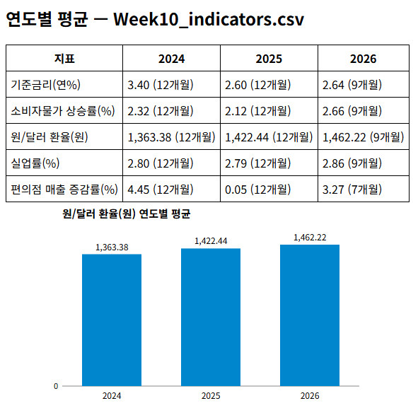
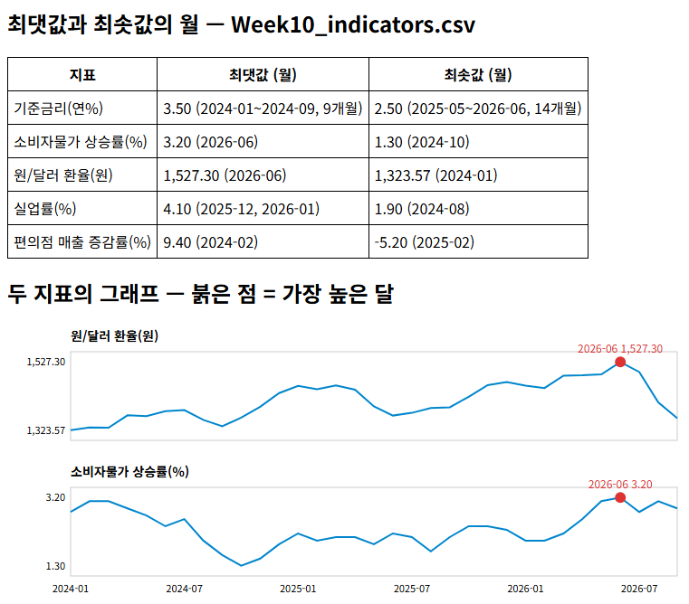

# 경영경제 AI 활용 입문 — 10주 미션 가이드 답안

> 실습 지침의 미션 2개에 대한 프롬프트 예시, 가이드 코드, 예상 출력입니다.
> 프롬프트는 예시입니다. 표현이 달라도 출력 값이 같으면 정상입니다.

- 가이드 코드는 ①과 ②를 한 파일에 담은 **단독 실행 예시**입니다.
  - 학생 코드는 활동 2의 코드에 기능을 더한 형태이므로, 구조가 달라도 됩니다.
  - 비교 기준 = 출력 값
- 실행 방법 = 실습 지침 2와 같습니다. 파일 이름을 묻는 문장에서 Enter를 누르면 `Week10_indicators.csv`를 읽습니다.

## 미션 1. 연도별 평균

### ① 표 — 프롬프트 예시

```
## 지시
지금 코드에 연도별 평균 기능을 추가해줘.

## 요구
- 지표마다 2024년, 2025년, 2026년의 평균을 표로 출력할 것(소수 둘째 자리까지)
- 빈 칸은 평균에서 제외하고, 연도마다 평균에 사용한 달의 수도 함께 출력할 것
- 기존 출력은 그대로 둘 것
- 모든 줄에 한국어 주석을 달 것
```

- 핵심 조건 = **빈 칸 제외**
  - 이 조건이 없으면 2026년 편의점 평균에 빈 칸 2달(2026-08, 2026-09)이 섞여 오류가 나거나 달 수가 9로 나옵니다.

### ② 차트 — 프롬프트 예시

```
## 지시
지금 코드에 원/달러 환율의 연도별 평균을 막대그래프로 그리는 기능을 추가해줘.

## 요구
- 표준 라이브러리만 사용할 것(차트는 SVG로 그려 HTML 파일로 저장)
- 막대 높이는 ①에서 계산한 평균을 그대로 사용할 것
- 막대 위에 평균 값을, 막대 아래에 연도를 적을 것
- 세로축은 0부터 시작할 것
- 저장한 HTML 파일 이름을 출력하고 웹 브라우저로 열 것(Colab에서는 셀 아래에 표시할 것)
- 모든 줄에 한국어 주석을 달 것
```

- 핵심 조건 = **①의 계산 결과를 그대로 사용**
  - 막대그래프를 위해 평균을 다시 계산하게 하면 ① 표와 값이 어긋날 수 있습니다.
- 세로축을 0부터 시작하지 않으면 연도 사이의 차이가 실제보다 크게 보입니다.

### 가이드 코드

```python
# 10주 미션 1 가이드 코드 — 연도별 평균 표 + 원/달러 환율의 연도별 평균 막대그래프
# 실행 = IDLE: 이 파일과 지표 파일을 같은 폴더에 두고 F5 / Colab: 지표 파일을 올리고 셀에 붙여 넣어 실행
# 표준 라이브러리만 사용한다(설치할 패키지 없음). 차트는 HTML 안의 SVG 그림으로 그린다

import csv                     # CSV 파일을 읽는 표준 라이브러리
import html                    # HTML에 넣을 글자를 안전하게 바꾸는 표준 라이브러리
import os                      # 파일 경로를 다루는 표준 라이브러리
import pathlib                 # 파일 경로를 브라우저 주소로 바꾸는 표준 라이브러리
import webbrowser              # 만든 HTML 파일을 브라우저로 여는 표준 라이브러리

DEFAULT_FILE = "Week10_indicators.csv"   # Enter만 누르면 읽을 기본 지표 파일 이름
OUTPUT_FILE = "Week10_mission1.html"     # 결과를 저장할 HTML 파일 이름
YEARS = ["2024", "2025", "2026"]         # 평균을 낼 연도
CHART_COLUMN = "원/달러 환율(원)"         # 막대그래프로 그릴 지표의 열 이름

try:                                     # Colab에서 실행 중인지 확인한다
    import google.colab                  # Colab에만 있는 모듈
    IN_COLAB = True                      # 불러오기에 성공하면 Colab
except ImportError:                      # 모듈이 없으면
    IN_COLAB = False                     # IDLE 같은 내 컴퓨터 환경

try:                                     # 이 코드 파일이 있는 폴더를 찾는다
    BASE = os.path.dirname(os.path.abspath(__file__))   # IDLE에서는 코드 파일의 폴더
except NameError:                        # Colab 셀에는 코드 파일 경로가 없다
    BASE = os.getcwd()                   # Colab에서는 현재 폴더(/content)


def to_number(text):                     # 칸의 글자를 숫자로 바꾸는 함수
    text = text.strip()                  # 앞뒤 공백을 지운다
    if text == "":                       # 빈 칸이면
        return None                      # 값 없음(아직 발표되지 않은 달)
    return float(text)                   # 숫자로 바꾸어 돌려준다


def read_file(name):                     # 지표 파일을 읽는 함수
    path = os.path.join(BASE, name)      # 코드와 같은 폴더의 파일 경로
    with open(path, encoding="utf-8-sig", newline="") as f:   # BOM이 있는 UTF-8로 연다
        rows = list(csv.reader(f))       # 모든 행을 목록으로 읽는다
    return rows[0], rows[1:]             # 첫 행 = 열 이름, 나머지 = 한 달에 한 행


def yearly_means(header, data):          # 지표마다 연도별 평균과 사용한 달 수를 구하는 함수
    result = []                          # 결과를 담을 목록
    for col in range(1, len(header)):    # 연월 열(0번)을 뺀 지표 열마다
        cells = []                       # 연도별 (평균, 달 수)를 담을 목록
        for year in YEARS:               # 연도마다
            values = [to_number(row[col]) for row in data if row[0].startswith(year)]   # 그 연도의 값
            values = [v for v in values if v is not None]   # 빈 칸을 뺀다
            mean = sum(values) / len(values)                 # 평균 = 합계 ÷ 달 수
            cells.append((mean, len(values)))                # (평균, 달 수) 추가
        result.append((header[col], cells))                  # 지표 이름과 연도별 값 추가
    return result                        # 지표별 결과를 돌려준다


def bar_svg(title, labels, values):      # 막대그래프를 SVG로 그리는 함수
    width, height = 520, 300             # 그림 크기(픽셀)
    left, bottom, top = 80, 40, 40       # 안쪽 여백
    low = 0                              # 세로축 시작 값(막대그래프는 0부터)
    high = max(values) * 1.1             # 세로축 끝 값(가장 큰 값의 110%)
    slot = (width - left - 20) / len(values)   # 막대 하나가 차지하는 가로 폭

    def y(v):                            # 값 v의 세로 위치(위로 갈수록 큰 값)
        return top + (high - v) / (high - low) * (height - top - bottom)

    parts = [f"<svg width='{width}' height='{height}' style='display:block'>"]   # 그림 시작
    parts.append(f"<text x='{left}' y='22' font-size='15' font-weight='bold'>{html.escape(title)}</text>")   # 제목
    base = height - bottom               # 막대 바닥의 세로 위치
    parts.append(f"<line x1='{left}' y1='{base}' x2='{width - 20}' y2='{base}' stroke='#888'/>")   # 바닥 선
    parts.append(f"<text x='{left - 6}' y='{base + 4}' font-size='11' text-anchor='end'>{low:,.0f}</text>")   # 세로축 시작 값
    for i, (label, v) in enumerate(zip(labels, values)):   # 막대마다
        x = left + i * slot + slot * 0.2                   # 막대 왼쪽 위치
        w = slot * 0.6                                     # 막대 폭
        parts.append(f"<rect x='{x:.1f}' y='{y(v):.1f}' width='{w:.1f}' height='{base - y(v):.1f}' fill='#0086CD'/>")   # 막대
        parts.append(f"<text x='{x + w / 2:.1f}' y='{y(v) - 6:.1f}' font-size='12' text-anchor='middle'>{v:,.2f}</text>")   # 막대 위 값
        parts.append(f"<text x='{x + w / 2:.1f}' y='{base + 18}' font-size='12' text-anchor='middle'>{label}</text>")   # 막대 아래 연도
    parts.append("</svg>")               # 그림 끝
    return "".join(parts)                # 하나의 SVG 글자로 돌려준다


def main():                              # 도구 전체를 실행하는 함수
    name = input(f"읽을 지표 파일 이름(Enter = {DEFAULT_FILE}): ").strip() or DEFAULT_FILE   # 파일 이름을 묻는다
    try:                                 # 파일 읽기를 시도한다
        header, data = read_file(name)   # 지표 파일을 읽는다
    except FileNotFoundError:            # 파일이 없으면
        print(f"오류: {name} 파일을 찾을 수 없습니다. 코드 파일과 같은 폴더에 있는지 확인합니다.")   # 원인 안내
        return                           # 도구를 끝낸다
    print("읽은 행 수:", len(data))      # 읽은 행 수를 출력한다
    print("시작 월:", data[0][0], "/ 끝 월:", data[-1][0])   # 시작 월과 끝 월을 출력한다
    table = yearly_means(header, data)   # 연도별 평균을 구한다
    print()                              # 빈 줄
    print("[연도별 평균] 값 (평균에 사용한 달 수)")          # 표 제목
    for label, cells in table:           # 지표마다
        text = ", ".join(f"{y} {m:,.2f} ({n}개월)" for y, (m, n) in zip(YEARS, cells))   # 연도별 값을 한 줄로
        print(f"- {label}: {text}")      # 한 줄씩 출력
    chart = dict(table)[CHART_COLUMN]    # 막대그래프로 그릴 지표의 연도별 값
    means = [m for m, n in chart]        # 평균만 꺼낸다
    print()                              # 빈 줄
    print(f"[막대그래프] {CHART_COLUMN}:", ", ".join(f"{y} {m:,.2f}" for y, m in zip(YEARS, means)))   # 막대 높이 출력
    rows = "".join(f"<tr><td>{html.escape(label)}</td>" + "".join(f"<td>{m:,.2f} ({n}개월)</td>" for m, n in cells) + "</tr>"
                   for label, cells in table)                # 표의 행들
    page = ("<html><head><meta charset='utf-8'><title>10주 미션 1</title></head><body style='font-family:sans-serif'>"
            f"<h2>연도별 평균 — {html.escape(name)}</h2>"
            "<table border='1' cellpadding='6' style='border-collapse:collapse'><tr><th>지표</th>"
            + "".join(f"<th>{y}</th>" for y in YEARS) + "</tr>" + rows + "</table>"
            + bar_svg(f"{CHART_COLUMN} 연도별 평균", YEARS, means) + "</body></html>")   # HTML 문서
    if IN_COLAB:                         # Colab이면
        from IPython.display import HTML, display          # Colab의 화면 표시 기능
        display(HTML(page))              # 결과 칸에 바로 표시한다
    else:                                # IDLE 같은 내 컴퓨터 환경이면
        out = os.path.join(BASE, OUTPUT_FILE)               # 저장할 파일 경로
        with open(out, "w", encoding="utf-8") as f:         # HTML 파일을 쓴다
            f.write(page)                # 문서를 저장한다
        print("저장:", out)              # 저장 위치를 출력한다
        webbrowser.open(pathlib.Path(out).as_uri())         # 브라우저로 연다


main()                                   # 도구를 실행한다
```

### 예상 출력

```
읽을 지표 파일 이름(Enter = Week10_indicators.csv):
읽은 행 수: 33
시작 월: 2024-01 / 끝 월: 2026-09

[연도별 평균] 값 (평균에 사용한 달 수)
- 기준금리(연%): 2024 3.40 (12개월), 2025 2.60 (12개월), 2026 2.64 (9개월)
- 소비자물가 상승률(%): 2024 2.32 (12개월), 2025 2.12 (12개월), 2026 2.66 (9개월)
- 원/달러 환율(원): 2024 1,363.38 (12개월), 2025 1,422.44 (12개월), 2026 1,462.22 (9개월)
- 실업률(%): 2024 2.80 (12개월), 2025 2.79 (12개월), 2026 2.86 (9개월)
- 편의점 매출 증감률(%): 2024 4.45 (12개월), 2025 0.05 (12개월), 2026 3.27 (7개월)

[막대그래프] 원/달러 환율(원): 2024 1,363.38, 2025 1,422.44, 2026 1,462.22
저장: (week10 폴더 경로)\Week10_mission1.html
```

- 소비자물가 상승률의 2024년 평균은 2.32로 나옵니다. 실습 지침의 기준 값은 2.33입니다.
  - 정확한 평균은 2.325(합계 27.9 ÷ 12)입니다.
  - Python의 소수 계산에서는 2.3249…로 저장되어 2.32로 표시되고, 반올림하면 2.33입니다.
  - 실습 지침의 「끝자리가 0.01 다르면 반올림 방식의 차이」가 이 경우입니다.

### 결과 화면



## 미션 2. 최댓값과 최솟값의 월

### ① 표 — 프롬프트 예시

```
## 지시
지금 코드에 지표별 최댓값과 최솟값을 찾는 기능을 추가해줘.

## 요구
- 지표마다 최댓값과 그 월, 최솟값과 그 월을 출력할 것
- 같은 값이 여러 달이면 그 달을 모두 출력할 것(세 달 이상이면 처음 월~끝 월과 달 수)
- 빈 칸은 제외할 것
- 기존 출력은 그대로 두고, 모든 줄에 한국어 주석을 달 것
```

- 핵심 조건 = **같은 값이면 모든 달 출력**
  - 이 조건이 없으면 대개 처음 찾은 한 달만 출력합니다(기준금리 최댓값 = 2024-01, 실업률 최댓값 = 2025-12만 나옴).
- 「세 달 이상이면 처음 월\~끝 월」은 출력을 짧게 하는 조건입니다. 기준금리의 같은 값이 이어진 달이 연속이므로 성립합니다.

### ② 차트 — 프롬프트 예시

```
## 지시
지금 코드에 원/달러 환율과 소비자물가 상승률의 시계열 차트 기능을 추가해줘.

## 요구
- 표준 라이브러리만 사용할 것(차트는 SVG로 그려 HTML 파일로 저장)
- 두 지표를 가로축(월)을 맞춘 위아래 두 그래프로 그릴 것
- 각 지표가 가장 높은 달에 붉은 점을 찍고, 그 월과 값을 점 위에 적을 것
- 빈 칸인 달은 선을 끊어서 그릴 것
- 저장한 HTML 파일 이름을 출력하고 웹 브라우저로 열 것(Colab에서는 셀 아래에 표시할 것)
- 모든 줄에 한국어 주석을 달 것
```

- 핵심 조건 = **지표마다 따로 가장 높은 달을 찾기**
  - 두 지표는 단위가 달라(원, %) 한 그래프에 그리면 물가 선이 바닥에 붙습니다. 위아래 두 그래프로 나누는 이유입니다.
- 확인 = 두 점이 모두 2026-06에 있으므로 위아래 같은 세로 위치에 찍힙니다.

### 가이드 코드

```python
# 10주 미션 2 가이드 코드 — 최댓값과 최솟값의 월 표 + 환율과 소비자물가 상승률의 두 그래프(가장 높은 달에 점)
# 실행 = IDLE: 이 파일과 지표 파일을 같은 폴더에 두고 F5 / Colab: 지표 파일을 올리고 셀에 붙여 넣어 실행
# 표준 라이브러리만 사용한다(설치할 패키지 없음). 차트는 HTML 안의 SVG 그림으로 그린다

import csv                     # CSV 파일을 읽는 표준 라이브러리
import html                    # HTML에 넣을 글자를 안전하게 바꾸는 표준 라이브러리
import os                      # 파일 경로를 다루는 표준 라이브러리
import pathlib                 # 파일 경로를 브라우저 주소로 바꾸는 표준 라이브러리
import webbrowser              # 만든 HTML 파일을 브라우저로 여는 표준 라이브러리

DEFAULT_FILE = "Week10_indicators.csv"   # Enter만 누르면 읽을 기본 지표 파일 이름
OUTPUT_FILE = "Week10_mission2.html"     # 결과를 저장할 HTML 파일 이름
CHART_COLUMNS = ["원/달러 환율(원)", "소비자물가 상승률(%)"]   # 위아래로 그릴 두 지표의 열 이름

try:                                     # Colab에서 실행 중인지 확인한다
    import google.colab                  # Colab에만 있는 모듈
    IN_COLAB = True                      # 불러오기에 성공하면 Colab
except ImportError:                      # 모듈이 없으면
    IN_COLAB = False                     # IDLE 같은 내 컴퓨터 환경

try:                                     # 이 코드 파일이 있는 폴더를 찾는다
    BASE = os.path.dirname(os.path.abspath(__file__))   # IDLE에서는 코드 파일의 폴더
except NameError:                        # Colab 셀에는 코드 파일 경로가 없다
    BASE = os.getcwd()                   # Colab에서는 현재 폴더(/content)


def to_number(text):                     # 칸의 글자를 숫자로 바꾸는 함수
    text = text.strip()                  # 앞뒤 공백을 지운다
    if text == "":                       # 빈 칸이면
        return None                      # 값 없음(아직 발표되지 않은 달)
    return float(text)                   # 숫자로 바꾸어 돌려준다


def read_file(name):                     # 지표 파일을 읽는 함수
    path = os.path.join(BASE, name)      # 코드와 같은 폴더의 파일 경로
    with open(path, encoding="utf-8-sig", newline="") as f:   # BOM이 있는 UTF-8로 연다
        rows = list(csv.reader(f))       # 모든 행을 목록으로 읽는다
    return rows[0], rows[1:]             # 첫 행 = 열 이름, 나머지 = 한 달에 한 행


def max_min(header, data):               # 지표마다 최댓값, 최솟값과 그 달(같은 값이면 모든 달)을 찾는 함수
    result = []                          # 결과를 담을 목록
    for col in range(1, len(header)):    # 연월 열(0번)을 뺀 지표 열마다
        points = [(row[0], to_number(row[col])) for row in data]   # (연월, 값) 목록
        points = [p for p in points if p[1] is not None]           # 빈 칸을 뺀다
        high = max(v for m, v in points)                           # 가장 큰 값
        low = min(v for m, v in points)                            # 가장 작은 값
        high_months = [m for m, v in points if v == high]          # 가장 큰 값인 달 모두
        low_months = [m for m, v in points if v == low]            # 가장 작은 값인 달 모두
        result.append((header[col], high, high_months, low, low_months))   # 한 행 추가
    return result                        # 지표별 결과를 돌려준다


def month_text(months):                  # 달 목록을 읽기 쉬운 글자로 바꾸는 함수
    if len(months) > 2:                  # 세 달 이상 이어지면
        return f"{months[0]}~{months[-1]}, {len(months)}개월"   # 처음 ~ 끝, 달 수
    return ", ".join(months)             # 한두 달이면 그대로 나열


def panel_svg(title, months, values, show_axis):   # 지표 하나의 선 그래프를 그리고 가장 높은 달에 점을 찍는 함수
    width, height = 760, 150             # 그래프 한 칸의 크기(픽셀)
    left, right, top, bottom = 70, 20, 28, 24   # 안쪽 여백(왼쪽 = 세로축 숫자 자리)
    known = [v for v in values if v is not None]   # 빈 칸을 뺀 값
    low, high = min(known), max(known)   # 가장 작은 값과 가장 큰 값
    pad = (high - low) * 0.15 or 1       # 위아래 여유(값이 모두 같으면 1)
    step = (width - left - right) / (len(months) - 1)   # 한 달의 가로 간격

    def x(i):                            # i번째 달의 가로 위치
        return left + i * step           # 왼쪽 여백 + 간격 × 순서

    def y(v):                            # 값 v의 세로 위치(위로 갈수록 큰 값)
        return top + (high + pad - v) / (high - low + 2 * pad) * (height - top - bottom)

    parts = [f"<svg width='{width}' height='{height}' style='display:block'>"]   # 그림 시작
    parts.append(f"<text x='{left}' y='16' font-size='14' font-weight='bold'>{html.escape(title)}</text>")   # 지표 이름
    parts.append(f"<rect x='{left}' y='{top}' width='{width - left - right}' height='{height - top - bottom}' fill='none' stroke='#ccc'/>")   # 테두리
    for v in (low, high):                # 세로축에 가장 작은 값과 가장 큰 값을 적는다
        parts.append(f"<text x='{left - 6}' y='{y(v) + 4:.1f}' font-size='11' text-anchor='end'>{v:,.2f}</text>")
    segment = []                         # 빈 칸 없이 이어지는 점들
    for i, v in enumerate(values + [None]):   # 마지막에 None을 더해 남은 선을 마무리한다
        if v is None:                    # 빈 칸을 만나면
            if len(segment) > 1:         # 점이 두 개 이상 모였으면
                parts.append("<polyline fill='none' stroke='#0086CD' stroke-width='2' points='" + " ".join(segment) + "'/>")   # 선을 그린다
            segment = []                 # 다음 선을 새로 시작한다
        else:                            # 값이 있으면
            segment.append(f"{x(i):.1f},{y(v):.1f}")   # 점을 모은다
    for i, v in enumerate(values):       # 달마다
        if v == high:                    # 가장 높은 달이면
            parts.append(f"<circle cx='{x(i):.1f}' cy='{y(v):.1f}' r='6' fill='#d33'/>")   # 붉은 점
            parts.append(f"<text x='{x(i):.1f}' y='{y(v) - 10:.1f}' font-size='12' text-anchor='middle' fill='#d33'>{months[i]} {v:,.2f}</text>")   # 점 위 글자
    if show_axis:                        # 맨 아래 그래프에만 가로축 글자를 적는다
        for i, month in enumerate(months):   # 달마다
            if month.endswith("-01") or month.endswith("-07"):   # 1월과 7월만 적는다
                parts.append(f"<text x='{x(i):.1f}' y='{height - 6}' font-size='11' text-anchor='middle'>{month}</text>")
    parts.append("</svg>")               # 그림 끝
    return "".join(parts)                # 하나의 SVG 글자로 돌려준다


def main():                              # 도구 전체를 실행하는 함수
    name = input(f"읽을 지표 파일 이름(Enter = {DEFAULT_FILE}): ").strip() or DEFAULT_FILE   # 파일 이름을 묻는다
    try:                                 # 파일 읽기를 시도한다
        header, data = read_file(name)   # 지표 파일을 읽는다
    except FileNotFoundError:            # 파일이 없으면
        print(f"오류: {name} 파일을 찾을 수 없습니다. 코드 파일과 같은 폴더에 있는지 확인합니다.")   # 원인 안내
        return                           # 도구를 끝낸다
    print("읽은 행 수:", len(data))      # 읽은 행 수를 출력한다
    print("시작 월:", data[0][0], "/ 끝 월:", data[-1][0])   # 시작 월과 끝 월을 출력한다
    table = max_min(header, data)        # 지표별 최댓값과 최솟값을 구한다
    print()                              # 빈 줄
    print("[최댓값과 최솟값의 월]")      # 표 제목
    for label, high, high_months, low, low_months in table:   # 지표마다
        print(f"- {label}: 최댓값 {high:,.2f} ({month_text(high_months)}), 최솟값 {low:,.2f} ({month_text(low_months)})")   # 한 줄씩 출력
    months = [row[0] for row in data]    # 가로축 = 연월 목록
    print()                              # 빈 줄
    print("[차트의 점]")                 # 점 위치 제목
    panels = []                          # 그래프를 담을 목록
    for k, column in enumerate(CHART_COLUMNS):   # 그릴 지표마다
        col = header.index(column)       # 그 지표의 열 번호
        values = [to_number(row[col]) for row in data]   # 그 지표의 값 목록
        top = max(v for v in values if v is not None)    # 가장 높은 값
        print(f"- {column}: {', '.join(m for m, v in zip(months, values) if v == top)} {top:,.2f}")   # 점을 찍은 달 출력
        panels.append(panel_svg(column, months, values, k == len(CHART_COLUMNS) - 1))   # 그래프 추가
    rows = "".join(f"<tr><td>{html.escape(label)}</td><td>{high:,.2f} ({month_text(hm)})</td><td>{low:,.2f} ({month_text(lm)})</td></tr>"
                   for label, high, hm, low, lm in table)    # 표의 행들
    page = ("<html><head><meta charset='utf-8'><title>10주 미션 2</title></head><body style='font-family:sans-serif'>"
            f"<h2>최댓값과 최솟값의 월 — {html.escape(name)}</h2>"
            "<table border='1' cellpadding='6' style='border-collapse:collapse'><tr><th>지표</th><th>최댓값 (월)</th><th>최솟값 (월)</th></tr>"
            + rows + "</table><h2>두 지표의 그래프 — 붉은 점 = 가장 높은 달</h2>" + "".join(panels) + "</body></html>")   # HTML 문서
    if IN_COLAB:                         # Colab이면
        from IPython.display import HTML, display          # Colab의 화면 표시 기능
        display(HTML(page))              # 결과 칸에 바로 표시한다
    else:                                # IDLE 같은 내 컴퓨터 환경이면
        out = os.path.join(BASE, OUTPUT_FILE)               # 저장할 파일 경로
        with open(out, "w", encoding="utf-8") as f:         # HTML 파일을 쓴다
            f.write(page)                # 문서를 저장한다
        print("저장:", out)              # 저장 위치를 출력한다
        webbrowser.open(pathlib.Path(out).as_uri())         # 브라우저로 연다


main()                                   # 도구를 실행한다
```

### 예상 출력

```
읽을 지표 파일 이름(Enter = Week10_indicators.csv):
읽은 행 수: 33
시작 월: 2024-01 / 끝 월: 2026-09

[최댓값과 최솟값의 월]
- 기준금리(연%): 최댓값 3.50 (2024-01~2024-09, 9개월), 최솟값 2.50 (2025-05~2026-06, 14개월)
- 소비자물가 상승률(%): 최댓값 3.20 (2026-06), 최솟값 1.30 (2024-10)
- 원/달러 환율(원): 최댓값 1,527.30 (2026-06), 최솟값 1,323.57 (2024-01)
- 실업률(%): 최댓값 4.10 (2025-12, 2026-01), 최솟값 1.90 (2024-08)
- 편의점 매출 증감률(%): 최댓값 9.40 (2024-02), 최솟값 -5.20 (2025-02)

[차트의 점]
- 원/달러 환율(원): 2026-06 1,527.30
- 소비자물가 상승률(%): 2026-06 3.20
저장: (week10 폴더 경로)\Week10_mission2.html
```

### 결과 화면



---

## 개정 이력

| 날짜 | 내용 |
|------|------|
| 2026-11-12 | 최초 게시 |
