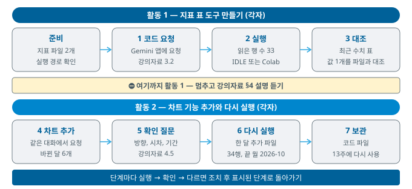
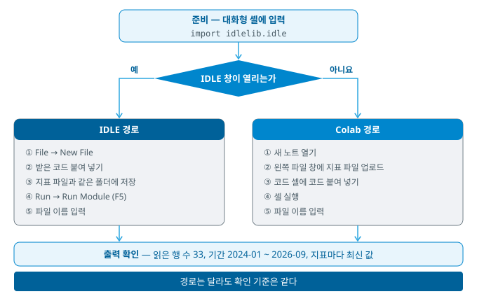

# 경영경제 AI 활용 입문 — 10주 실습 지침

> 오늘 활동 중에는 **이 문서만 확인**하면 됩니다. 개념 설명은 강의자료(10주)에 있습니다.
> 오늘부터 **조별 활동은 없고**, 활동 내용은 **제출하지 않습니다**. 다만 생성된 결과물(프로그램 코드와 출력물)은 각자 보관합니다.



- 단계마다 **실행 → 확인 → 다르면 조치**의 순서로 진행합니다. 조치 끝에 적힌 단계로 돌아갑니다.
- 코드는 직접 작성하거나 고치지 않습니다. 오류가 나면 오류 메시지와 함께 Gemini에게 수정을 요청합니다.
- 두 번 다시 요청해도 해결되지 않으면 교수에게 알립니다. 교수가 안내하는 코드로 다음 단계를 진행합니다.

## 준비 — 지표 파일과 실행 경로

**준비-1. 지표 파일 2개 내려받기**

- 실행: 아래 두 링크를 각각 열고, 파일 화면 오른쪽 위의 다운로드 아이콘(Download raw file)을 누릅니다.
  - [Week10_indicators.csv](https://github.com/Daesung7723/AI-for-Business/blob/main/Data/Week10_indicators.csv) — 2024-01 \~ 2026-09, 33행
  - [Week10_indicators_plus1.csv](https://github.com/Daesung7723/AI-for-Business/blob/main/Data/Week10_indicators_plus1.csv) — 한 달(2026-10)이 추가된 파일, 34행
- 실행: 바탕 화면에 새 폴더 `week10`을 만들고, 내려받은 두 파일을 이 폴더로 옮깁니다.
- 확인: `week10` 폴더에 파일 2개가 있으면 정상입니다. 확장자(.csv)가 보이지 않아도 정상입니다.
- 다르면: 파일이 「다운로드」 폴더에 있는지 확인하고 `week10` 폴더로 옮깁니다 → **준비-1의 확인부터 다시**

**준비-2. 실행 경로 확인**



- 실행: 시작 메뉴에서 「Python」을 찾아 실행합니다. 검은 창에 `>>>`가 표시됩니다.
- 실행: `>>>` 뒤에 아래 한 줄을 입력하고 Enter를 누릅니다.

```
import idlelib.idle
```

- 확인: 「IDLE Shell」 창이 열리면 **IDLE 경로**입니다. 검은 창은 닫지 않습니다(닫으면 IDLE도 닫힘).
- 다르면: 오류 메시지가 나오거나 창이 열리지 않으면 **Colab 경로**입니다. 웹 브라우저에서 `colab.research.google.com`에 학교 계정 또는 개인 Google 계정으로 로그인합니다.
- 아래 단계는 두 경로를 함께 적었습니다. 자신의 경로에 해당하는 줄만 따라 합니다.

## 활동 1 — 지표 정리표를 만드는 도구

**1. 코드 요청**

- 실행: Gemini 앱(`gemini.google.com`)에서 새 채팅을 열고, 아래 프롬프트를 복사해 붙여 넣은 뒤 전송합니다. Colab 경로는 Colab 안의 Gemini에 요청해도 됩니다.

```
## 지시
다섯 가지 경제지표의 월별 CSV 파일을 읽어 지표마다 최신 값을 표로 출력하는 Python 코드를 작성해줘.

## 데이터
- 파일: Week10_indicators.csv (UTF-8, BOM 포함)
- 첫 줄의 열 이름: 연월, 기준금리(연%), 소비자물가 상승률(%), 원/달러 환율(원), 실업률(%), 편의점 매출 증감률(%)
- 한 행 = 한 달(연월은 2024-01 형식), 아직 발표되지 않은 값은 빈 칸

## 요구
- Python 표준 라이브러리만 사용할 것(설치가 필요한 라이브러리는 사용하지 말 것)
- 모든 줄에 한국어 주석을 달 것
- 실행하면 읽을 파일 이름을 입력받을 것
- 읽은 행 수, 시작 월, 끝 월을 먼저 출력할 것
- 지표마다 빈 칸이 아닌 마지막 값과 그 월을 표로 출력할 것
- 파일을 찾지 못하면 오류 메시지를 출력할 것
```

- 확인: 응답에 코드가 있고, 줄마다 한국어 주석이 있으면 정상입니다.
- 다르면: 주석이 없으면 「모든 줄에 한국어 주석을 달아 다시 작성해줘」를 입력합니다 → **1의 확인부터 다시**
- 다르면: 코드 첫머리에 `import pandas`처럼 설치가 필요한 라이브러리가 있으면 「표준 라이브러리만 사용해 다시 작성해줘」를 입력합니다 → **1의 확인부터 다시**
- 이 대화는 활동 2에서 다시 사용하므로 닫지 않습니다.

**2. 실행과 행 수 확인**

- 실행(IDLE 경로)
  1. IDLE Shell 창에서 **File → New File**을 선택합니다.
  2. 새 창에 받은 코드를 붙여 넣습니다.
  3. **File → Save As**로 `week10` 폴더에 `week10_tool.py`로 저장합니다(지표 파일과 같은 폴더).
  4. **Run → Run Module**(또는 F5)을 선택합니다.
  5. IDLE Shell 창에 파일 이름을 묻는 문장이 나오면 `Week10_indicators.csv`를 입력하고 Enter를 누릅니다.
- 실행(Colab 경로)
  1. 「새 노트」를 엽니다.
  2. 화면 왼쪽의 폴더 아이콘(파일 창)을 열고, 업로드 아이콘으로 지표 파일 2개를 업로드합니다.
  3. 코드 셀에 받은 코드를 붙여 넣고 셀 왼쪽의 실행 버튼을 누릅니다.
  4. 셀 아래 입력 칸에 `Week10_indicators.csv`를 입력하고 Enter를 누릅니다.
- 확인: 「읽은 행 수 33」, 시작 월 2024-01, 끝 월 2026-09가 출력되면 정상입니다 → **3으로**
- 다르면: 출력에 따라 아래 표대로 진행합니다. 코드는 직접 고치지 않습니다.

| 출력 | 원인 | 조치 → 돌아갈 단계 |
|------|------|------|
| `FileNotFoundError` 또는 「파일을 찾을 수 없음」 | 파일 이름 또는 위치 불일치 | IDLE = 코드 파일이 `week10` 폴더에 저장되었는지 확인<br>Colab = 파일 창에 파일이 있는지 확인<br>→ **2 다시** |
| `ModuleNotFoundError` | 설치가 필요한 라이브러리 사용 | 「표준 라이브러리만 사용해 다시 작성해줘」 → **2 다시** |
| `UnicodeDecodeError` 또는 첫 열 이름이 깨짐 | 파일 인코딩 | 「utf-8-sig로 읽도록 고쳐줘」 → **2 다시** |
| 읽은 행 수가 33이 아님 | 일부 행 누락 또는 머리글 중복 | 「처음 3행과 마지막 3행을 출력해줘」 → **2 다시** |
| 그 밖의 오류 메시지 | 코드 오류 | 오류 메시지 전체를 복사해 수정 요청 → **2 다시** |
| 두 번 다시 요청해도 실패 | — | **교수에게 알림** → 교수가 안내하는 코드로 **3** |

- Colab 경로 주의: Colab 안의 Gemini에 입력한 내용은 Google이 수집할 수 있으므로 개인정보와 인증키는 입력하지 않습니다.

**3. 최근 수치 표와 값 1개 대조**

- 실행: 출력된 표를 아래 기준과 비교합니다.

| 지표 | 최신 월 | 값 |
|------|:--:|:--:|
| 기준금리(연%) | 2026-09 | 3.00 |
| 소비자물가 상승률(%) | 2026-09 | 2.9 |
| 원/달러 환율(원) | 2026-09 | 1359.00 |
| 실업률(%) | 2026-09 | 2.0 |
| 편의점 매출 증감률(%) | 2026-07 | 1.1 |

- 실행: 지표 하나를 선택해 `Week10_indicators.csv`를 메모장으로 열고, 그 지표의 마지막 값과 월을 직접 찾아 표의 값과 대조합니다.
- 확인: 다섯 가지 지표의 최신 월과 값이 기준과 같으면 정상입니다.
- 다르면: 편의점의 최신 월이 2026-09이고 값이 비어 있으면 빈 칸 처리 누락입니다 → 「빈 칸은 건너뛰고 빈 칸이 아닌 마지막 값을 찾도록 고쳐줘」 → **2 다시**
- 참고: 소수 자릿수만 다르면(예: 3.0과 3.00) 같은 값입니다.

⛔ **여기까지 활동 1** — 활동 2를 시작하지 말고 멈춘 뒤 강의자료 §4 설명을 듣습니다.

## 활동 2 — 차트 기능 추가와 다시 실행

**4. 차트 기능 추가**

- 실행: 기준금리와 함께 그릴 지표 하나를 정합니다. 후보 = 소비자물가 상승률, 원/달러 환율, 실업률, 편의점 매출 증감률
- 실행: 활동 1의 **같은 대화**에 아래 프롬프트를 입력합니다. `(지표 이름)`은 정한 지표의 열 이름으로 바꿉니다.

```
## 지시
지금 코드에 시계열 차트 기능을 추가해줘.

## 요구
- 표준 라이브러리만 사용할 것(차트는 SVG로 그려 HTML 파일로 저장)
- 기준금리(연%)와 (지표 이름)을 가로축(월)을 맞춘 위아래 두 그래프로 그릴 것
- 기준금리가 바뀐 달을 두 그래프에 세로 점선으로 표시하고, 바뀐 달 목록을 출력할 것
- 빈 칸인 달은 선을 끊어서 그릴 것
- 저장한 HTML 파일 이름을 출력하고 웹 브라우저로 열 것(Colab에서는 셀 아래에 표시할 것)
- 기존의 표 출력은 그대로 둘 것
- 모든 줄에 한국어 주석을 달 것
```

- 실행: 2와 같은 방법으로 코드를 붙여 넣고 실행합니다. IDLE 경로는 `week10_tool.py`의 내용을 새 코드로 바꾸어 저장한 뒤 실행합니다. 파일 이름은 `Week10_indicators.csv`를 입력합니다.
- 확인: 바뀐 달 목록이 2024-10, 2024-11, 2025-02, 2025-05, 2026-07, 2026-08의 6개이고, 차트의 위아래 그래프에 같은 위치의 점선이 있으면 정상입니다.

| 출력 | 원인 | 조치 → 돌아갈 단계 |
|------|------|------|
| 바뀐 달이 6개가 아님 | 기준금리가 아닌 열을 읽음 | 「기준금리 열 이름과 바뀐 달 목록을 출력해줘」 → **4의 실행 다시** |
| 브라우저가 열리지 않음(IDLE) | 자동 열기 실패 | `week10` 폴더에서 출력된 이름의 HTML 파일을 더블클릭 → **4의 확인** |
| 차트의 글자가 네모(□)로 표시됨 | 그래프 도구의 한글 글꼴 | 「표준 라이브러리로 SVG를 그리도록 다시 작성해줘」 → **4의 실행 다시** |
| 그 밖의 오류 메시지 | 코드 오류 | 오류 메시지 전체를 복사해 수정 요청 → **4의 실행 다시** |
| 두 번 다시 요청해도 실패 | — | **교수에게 알림** → 교수가 안내하는 코드로 **5** |

**5. 확인 질문**

- 실행: 차트를 보며 아래 질문에 답합니다. 답은 메모장 등에 각자 적어 둡니다(제출 없음).
  - 질문 = 기준금리가 바뀐 뒤 선택한 지표가 어느 방향으로, 몇 달 뒤에 움직였는가
  - 답의 형식 = 「(지표)는 기준금리가 바뀐 (월)부터 (몇 달) 뒤에 (방향)으로 움직였다 — 확인한 기간 = (시작 월 \~ 끝 월)」
- 확인: 답에 방향, 시차, 확인한 기간이 모두 있으면 정상입니다.
- 다르면: 「영향이 없다」로 적었으면 확인한 기간 안에서 나타난 것만 적도록 고칩니다(강의자료 4.5) → **5의 확인**
- 편의점 매출 증감률을 선택했으면 2026-08부터 빈 칸이므로 확인한 기간은 2026-07까지입니다.

**6. 한 달 추가 파일로 다시 실행**

- 실행: 코드는 그대로 두고 다시 실행합니다(IDLE = Run → Run Module, Colab = 셀 실행 버튼).
- 실행: 파일 이름으로 `Week10_indicators_plus1.csv`를 입력합니다.
- 확인: 「읽은 행 수 34」, 끝 월 2026-10이 출력되고, 실업률의 최신 월이 2026-09이면 정상입니다(10월 실업률은 아직 발표 전이므로 빈 칸).
- 다르면: 읽은 행 수가 33이면 이전 파일을 읽은 것입니다 → 입력한 파일 이름을 확인 → **6 다시**
- 다르면: 실업률의 최신 월이 2026-10이고 값이 비어 있으면 빈 칸 처리 누락입니다 → 「빈 칸은 건너뛰고 빈 칸이 아닌 마지막 값을 찾도록 고쳐줘」 → **6 다시**

**7. 코드 파일 보관**

- 실행(IDLE 경로): `week10` 폴더의 `week10_tool.py`를 각자의 클라우드 드라이브나 메일 등에 보관합니다.
- 실행(Colab 경로): 노트 이름을 `week10_tool`로 바꿉니다. 노트는 Google 드라이브에 저장되며, 지표 파일은 다음에 다시 업로드합니다.
- 확인: 보관한 위치에서 코드 파일 또는 노트를 다시 열 수 있으면 정상입니다.
- 이 코드는 13주 실습(계산기)에서 다시 사용합니다.

## 미션 — 직접 작성한 프롬프트로 표와 차트 만들기

활동 2까지 마친 뒤 진행합니다. 미션마다 표 기능(활동 1 형태)을 만든 뒤 차트 기능(활동 2 형태)을 더합니다.

- 프롬프트는 **직접 작성**합니다. 형식은 1단계와 4단계의 프롬프트(`## 지시`, `## 데이터`, `## 요구`)를 참고합니다.
- 활동 2의 **같은 대화**에서 지금 코드에 기능을 추가하도록 요청합니다.
- 실행 방법은 2와 같습니다. 파일 이름은 `Week10_indicators.csv`를 입력합니다.
- 미션 1의 ①과 ②를 마친 뒤 미션 2로 넘어갑니다.

**미션 1. 연도별 평균**

① 표 — 지표마다 2024년, 2025년, 2026년의 평균을 표로 출력

| 지표 | 2024 (12개월) | 2025 (12개월) | 2026 |
|------|:--:|:--:|:--:|
| 기준금리(연%) | 3.40 | 2.60 | 2.64 (9개월) |
| 소비자물가 상승률(%) | 2.33 | 2.12 | 2.66 (9개월) |
| 원/달러 환율(원) | 1363.38 | 1422.44 | 1462.22 (9개월) |
| 실업률(%) | 2.80 | 2.79 | 2.86 (9개월) |
| 편의점 매출 증감률(%) | 4.45 | 0.05 | 3.27 (7개월) |

- 확인: 값이 위 표와 같고, 2026년 편의점 평균에 들어간 달 수가 7이면 정상입니다.
- 다르면: 무엇이 다른지 적어 수정을 요청합니다 → **① 다시**
- 참고: 끝자리가 0.01 다르면 반올림 방식의 차이일 수 있습니다.

② 차트 — 원/달러 환율의 연도별 평균을 막대그래프로 그리기

- 확인: 막대가 3개(2024, 2025, 2026)이고, 막대 높이가 ① 표의 환율 값(1363.38, 1422.44, 1462.22)과 같으면 정상입니다.
- 다르면: 무엇이 다른지 적어 수정을 요청합니다 → **② 다시**

**미션 2. 최댓값과 최솟값의 월**

① 표 — 지표마다 최댓값과 그 월, 최솟값과 그 월을 출력

| 지표 | 최댓값 (월) | 최솟값 (월) |
|------|------|------|
| 기준금리(연%) | 3.50 (2024-01\~2024-09, 9개월) | 2.50 (2025-05\~2026-06, 14개월) |
| 소비자물가 상승률(%) | 3.2 (2026-06) | 1.3 (2024-10) |
| 원/달러 환율(원) | 1527.30 (2026-06) | 1323.57 (2024-01) |
| 실업률(%) | 4.1 (2025-12, 2026-01) | 1.9 (2024-08) |
| 편의점 매출 증감률(%) | 9.4 (2024-02) | -5.2 (2025-02) |

- 확인: 값과 월이 위 표와 같으면 정상입니다. 기준금리와 실업률은 월이 하나만 나오지 않아야 합니다.
- 다르면: 무엇이 다른지 적어 수정을 요청합니다 → **① 다시**

② 차트 — 원/달러 환율과 소비자물가 상승률을 가로축(월)을 맞춘 위아래 두 그래프로 그리고, 각 지표가 가장 높은 달에 점을 표시

- 확인: 두 점이 모두 2026-06(환율 1527.30, 소비자물가 상승률 3.2)에 있고, 위아래 같은 세로 위치에 있으면 정상입니다.
- 다르면: 무엇이 다른지 적어 수정을 요청합니다 → **② 다시**

미션을 마치면 7과 같은 방법으로 코드 파일을 다시 보관하고 오늘 수업을 마칩니다.

---

## 개정 이력

| 날짜 | 내용 |
|------|------|
| 2026-11-12 | 활동 2 뒤에 미션 2개 추가(직접 작성한 프롬프트로 표와 차트 만들기) |
| 2026-11-12 | 첫머리 안내(조별 활동 없음, 활동 내용 제출 없음, 결과물 각자 보관)와 활동 1 제목 정리 |
| 2026-11-11 | 최초 게시 |
