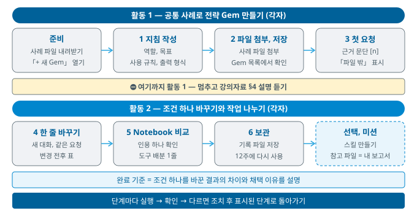

# 경영경제 AI 활용 입문 — 11주 실습 지침

> 오늘 활동 중에는 **이 문서만 확인**하면 됩니다. 개념 설명은 강의자료(11주)에 있습니다.
> 활동은 **각자** 진행하고, 활동 내용은 **제출하지 않습니다**. 만든 Gem과 기록은 각자 보관합니다(12주에 다시 사용).



- 단계마다 **실행 → 확인 → 다르면 조치**의 순서로 진행합니다. 조치 끝에 적힌 단계로 돌아갑니다.
- 트랙 = 과제 1, 2에서 정한 트랙입니다(A = 기업, 산업 분석 / B = 아이디어 검증). 아래에서 각자 트랙의 줄만 따라 합니다.
- 오늘은 **공통 사례**로 Gem을 만들고, 미션에서는 같은 지침으로 새 Gem을 만들어 참고 파일만 **각자의 과제 2 보고서**로 바꿉니다.
- 두 번 다시 요청해도 해결되지 않으면 교수에게 알립니다.

## 준비 — 사례 파일과 Gem 만들기 화면

**준비-1. 공통 사례 파일 내려받기**

- 실행: [Week11_case_store.pdf](https://github.com/Daesung7723/AI-for-Business/blob/main/Data/Week11_case_store.pdf)를 열고, 파일 화면 오른쪽 위의 다운로드 아이콘(Download raw file)을 누릅니다.
- 실행: 바탕 화면에 새 폴더 `week11`을 만들고, 내려받은 파일을 이 폴더로 옮깁니다.
- 확인: 파일을 열어 2쪽이고, 첫 줄이 「가상 사례 — 한결편의점 대학정문점 점포 자료」이며, 문단마다 [1]\~[16]의 번호가 있으면 정상입니다.
- 다르면: 파일이 「다운로드」 폴더에 있는지 확인하고 `week11` 폴더로 옮깁니다 → **준비-1의 확인부터 다시**

**준비-2. Gem 만들기 화면 열기**

- 실행: 학교 계정(단국대 Google 계정)으로 로그인한 웹 브라우저의 주소 창에 `gemini.google.com/gems/view`를 입력합니다. 「Gem 관리자」 화면이 열립니다.
- 실행: 「+ 새 Gem」을 누릅니다.
- 확인: 「새 Gem」 화면이 열리고 「이름」, 「요청 사항」, 「지식」 칸이 있으면 정상입니다 → **0으로**
- 다르면: 화면에 따라 아래 표대로 진행합니다.

| 화면 | 조치 → 돌아갈 단계 |
|------|------|
| 로그인 화면 또는 개인 계정의 화면 | 학교 계정으로 로그인 → **준비-2 다시** |
| 「+ 새 Gem」이 없거나 사용할 수 없다는 안내 | **대체 경로**로 진행 — 같은 학교 계정의 Gemini 일반 채팅(`gemini.google.com`)을 사용하며, 1\~5단계의 「대체 경로」 줄을 따릅니다 → **0으로** |
| 일반 채팅도 열리지 않음 | **교수에게 알림** → 교수가 안내하는 준비 응답으로 **3의 확인**부터 |

## 활동 1 — 공통 사례로 전략 Gem 만들기

**0. 판매 기록 파일 만들고 실행하기**

강의자료 2.1\~2.3의 판매 분석을 각자의 PC에서 실행합니다. 판매 기록 파일은 사례 PDF의 표로 직접 만듭니다.

- 실행: 새 탭에서 학교 계정의 Gemini(`gemini.google.com`)를 열고, 준비-1의 사례 PDF를 첨부한 뒤 아래 요청을 붙여 넣어 보냅니다.

```text
문단 [5]의 1주 판매량 표를 CSV로 만들어 주세요. 열은 날짜, 요일, 입고분, 판매량 4개, 합계 행과 합계 열은 빼고 14행, 날짜는 2026-11-09(월)부터
```

- 확인: 답의 코드 블록 첫 줄이 `날짜,요일,입고분,판매량`이고, 그 아래가 14행이며, 판매량을 모두 더하면 78, 금요일 두 행의 합이 16이면 정상입니다.
- 다르면: 같은 요청을 한 번 더 보냅니다 → **0의 확인부터 다시**
- 실행: 메모장을 열고 코드 블록만 복사해 붙여 넣습니다(설명 문장은 제외). 「파일 → 다른 이름으로 저장」에서 위치 = `week11` 폴더, 파일 이름 = `Week11_lunchbox_sales.csv`, 파일 형식 = 「모든 파일」, 인코딩 = 「UTF-8」로 저장합니다.
- 실행: IDLE에서 「File → New File」로 편집기 창을 열고, 강의자료 2.3의 코드 두 부분을 차례로 붙여 넣은 뒤 같은 `week11` 폴더에 `week11_sales.py`로 저장하고 F5를 누릅니다.
- 확인: Shell 창에 「읽은 행 수: 14」와 월 9부터 일 8까지의 요일별 판매량이 나타나고, `week11` 폴더에 결과 파일 `Week11_sales_by_day.csv`가 생기면 정상입니다 → **1로**
- 다르면: 아래 표대로 진행합니다.

| 증상 | 원인 | 조치 → 돌아갈 단계 |
|------|------|------|
| `KeyError: '판매량'` 또는 `'요일'` | 첫 줄의 열 이름이 다름 | 메모장에서 첫 줄을 `날짜,요일,입고분,판매량`으로 고쳐 저장 → **F5부터 다시** |
| `KeyError: '합계'`, 읽은 행 수가 14가 아님 | 합계 행이나 합계 열이 들어감 | 합계를 빼고 14행으로 다시 요청 → **0의 첫 확인부터** |
| `UnicodeDecodeError` | Excel의 「CSV(쉼표로 분리)」로 저장함 | 메모장에서 인코딩 「UTF-8」로 다시 저장 → **F5부터 다시** |
| `FileNotFoundError` | 저장 위치가 다르거나 이름 끝에 `.txt`가 붙음 | 강의자료 2.5 확인, 파일 형식 「모든 파일」로 `week11` 폴더에 다시 저장 → **F5부터 다시** |
| `SyntaxError` | 코드 파일에 설명 문장이 들어감 | 2.3의 코드 블록만 다시 붙여 넣고 저장 → **F5부터 다시** |
| Gemini를 사용할 수 없거나 두 번 다시 요청해도 다름 | — | [원본 CSV](https://github.com/Daesung7723/AI-for-Business/blob/main/Data/Week11_lunchbox_sales.csv)를 오른쪽 위 다운로드 아이콘(Download raw file)으로 내려받아 `week11` 폴더로 옮김 → **IDLE 실행부터** |

- 결과 파일과 직접 만든 판매 기록 파일은 제출하지 않고 `week11` 폴더에 보관합니다.

**1. 지침 작성**

- 실행: 「이름」 칸에 `11주 전략 Gem A` 또는 `11주 전략 Gem B`를 입력합니다. 「설명」 칸은 비워 두어도 됩니다.
- 실행: 「요청 사항」 칸에 각자 트랙의 지침을 복사해 붙여 넣습니다. Gem 화면에서는 지침을 「요청 사항」이라고 부릅니다.

트랙 A — 기업, 산업 분석

```
## 역할
너는 첨부한 자료에 나오는 기업이나 점포의 전략을 검토하는 경영 분석가다.

## 목표
자료의 기업이나 점포가 실행할 전략 대안을 SWOT 교차 전략으로 제안한다.

## 참고 파일 사용 규칙
- 첨부한 자료의 내용을 근거로 사용할 것
- 근거마다 자료의 위치를 적을 것(문단 번호가 있으면 [5]처럼, 없으면 절 제목이나 쪽)
- 첨부한 자료에 없는 내용은 문장 끝에 「(파일 밖)」으로 표시할 것

## 출력 형식
- 표로 출력할 것
- 열 = 대안, 교차 유형(SO, ST, WO, WT), 근거 문단, 예상 효과, 확인할 점
```

트랙 B — 아이디어 검증

```
## 역할
너는 첨부한 자료에 나오는 사업의 마케팅 담당자다.

## 목표
자료의 사업이 집중할 목표 고객 한 유형을 정하고, 그 고객을 위한 마케팅 대안을 제안한다.

## 참고 파일 사용 규칙
- 첨부한 자료의 내용을 근거로 사용할 것
- 근거마다 자료의 위치를 적을 것(문단 번호가 있으면 [13]처럼, 없으면 절 제목이나 쪽)
- 첨부한 자료에 없는 내용은 문장 끝에 「(파일 밖)」으로 표시할 것

## 출력 형식
- 표로 출력할 것
- 열 = 목표 고객, 선택 이유, 근거 문단, 마케팅 대안, 확인할 점
```

- 확인: 지침에 역할, 목표, 참고 파일 사용 규칙, 출력 형식의 네 부분이 모두 있으면 정상입니다.
- 다르면: 빠진 부분을 다시 복사해 붙여 넣습니다 → **1의 확인부터 다시**
- 대체 경로: 지침을 메모장에 붙여 두고 **3**에서 사용합니다(2는 건너뜀).

**2. 사례 파일 첨부와 저장**

- 실행: 「지식」 칸 오른쪽의 + 버튼을 누르고 `week11` 폴더의 `Week11_case_store.pdf`를 선택합니다.
- 실행: 그 아래 「지식 출처 사용 중지」는 선택하지 않고, 「기본 도구」는 「기본 도구 없음」 그대로 둡니다.
- 실행: 화면 오른쪽 위의 「저장」을 누릅니다.
- 확인: 「Gem 관리자」 목록에 `11주 전략 Gem A`(또는 B)가 표시되면 정상입니다.
- 다르면: 파일을 추가하지 못했다는 안내가 나오면 **교수에게 알림** → 교수의 안내에 따라 **2 다시** 또는 대체 경로로 **3**

**3. 저장한 Gem을 다시 열어 첫 요청**

- 실행: 「Gem 관리자」 목록에서 저장한 Gem을 눌러 엽니다.
- 실행: 각자 트랙의 첫 요청을 입력합니다.
  - 트랙 A = `다음 달(12월)에 실행할 SWOT 교차 전략 대안 2개를 제안해줘.`
  - 트랙 B = `다음 달(12월)에 집중할 목표 고객 한 유형과 그 고객을 위한 마케팅 대안 2개를 제안해줘.`
- 대체 경로: 일반 채팅의 새 채팅에서 사례 파일을 첨부하고(입력창의 + → 파일 업로드), 메모장의 지침을 붙여 넣은 뒤 그 아래 줄에 첫 요청을 이어 붙여 한 번에 전송합니다.
- 확인: 아래 표의 네 항목이 모두 정상이면 첫 대안 표를 복사해 메모장에 붙여 둡니다(4의 「변경 전」) → **⛔ 정지선**

| 확인 항목 | 정상 | 다르면 → 돌아갈 단계 |
|------|------|------|
| 근거 문단 | 대안마다 [n] 형식의 문단 번호가 있음 | 「대안마다 근거 문단 번호를 적어줘」 → **3의 확인** |
| 문단 대조 | 번호 1개를 사례 파일에서 찾아 읽으면 대안의 근거와 내용이 같음 | 「[n]에는 그 내용이 없어. 근거를 다시 확인해줘」 → **3의 확인** |
| 「파일 밖」 표시 | 사례 파일에 없는 내용(예: 새 메뉴, 앱 쿠폰 도입 비용)에 「(파일 밖)」이 있음 | 「사례 파일에 없는 내용은 (파일 밖)으로 표시해줘」 → **3의 확인** |
| 바꿀 수 없는 것 | 입고 시각, 판매가, 본사 메뉴를 바꾸는 대안이 없음([16]) | 「[16]의 바꿀 수 없는 것은 바꾸지 않는 대안으로 다시 제안해줘」 → **3의 확인** |

- 두 번 다시 요청해도 정상이 되지 않으면 **교수에게 알림** → 교수가 안내하는 준비 응답으로 활동 1을 마칩니다.

⛔ **여기까지 활동 1** — 활동 2를 시작하지 말고 멈춘 뒤 강의자료 §4 설명을 듣습니다.

## 활동 2 — 조건 하나 바꾸기와 작업 나누기

**4. 지침 한 줄 바꾸어 같은 요청**

- 실행: 저장한 Gem의 편집 화면을 열고, 「요청 사항」에서 **목표 줄 하나만** 아래처럼 바꾸어 저장합니다. 다른 줄은 바꾸지 않습니다.

| 트랙 | 바꾼 목표 줄(굵은 글씨 = 추가한 조건) |
|------|------|
| A | 자료의 기업이나 점포가 실행할 전략 대안을 SWOT 교차 전략으로 제안하되, **비용을 줄이는 효과가 큰 대안을 먼저** 제안한다. |
| B | 자료의 사업이 집중할 목표 고객 한 유형을 정하되 **아직 이용하지 않는 새 고객층을 후보에 반드시 포함**하고, 그 고객을 위한 마케팅 대안을 제안한다. |

- 실행: 같은 Gem의 **새 대화**에서 3과 같은 요청을 입력합니다.
- 대체 경로: 새 채팅에서 사례 파일을 첨부하고, 목표 줄을 바꾼 지침과 같은 요청을 한 번에 전송합니다.
- 실행: 메모장에 변경 전후 표를 작성합니다.

```
| 비교 항목 | 변경 전 | 변경 후 |
| 바꾼 지침 한 줄 | | |
| 대안 1 | | |
| 대안 2 | | |
| 근거 문단 | | |
| 「파일 밖」 표시 | | |
채택 이유(1줄):
다음 주에 확인할 주장(1개):
```

- 확인: 표의 다섯 행, 채택 이유 1줄, 다음 주에 확인할 주장 1개가 있고, **무엇이 달라졌고 왜 그 결과를 채택하는지** 설명할 수 있으면 정상입니다(오늘 활동의 완료 기준).
- 다르면: 변경 전과 대안이 같으면 변경 후 칸에 「차이 없음」을 적고, 그 이유(추가한 조건을 변경 전의 대안이 이미 충족했는가)를 채택 이유에 적습니다 → **4의 확인**
- 다르면: 목표 줄 외의 줄도 바뀌었으면 한 줄만 바꾼 상태로 되돌립니다 → **4 다시**
- 다르면: Gem과 일반 채팅을 모두 사용할 수 없으면 **교수에게 알림** → 교수가 안내하는 변경 전후 표의 예로 **4의 확인**

**5. Gemini Notebook과 비교**

- 실행: 주소 창에 `notebooklm.google`을 입력하고 새 노트북을 만듭니다.
- 실행: 자료로 `Week11_case_store.pdf`를 추가하고, 3과 같은 요청을 입력합니다.
- 실행: 답변의 인용 번호 하나를 눌러, 사례 파일의 어느 문장이 근거인지 확인합니다.
- 실행: 메모장에 도구 배분 1줄을 적습니다.
  - 형식 = 「전략 초안 작성 = (도구), 근거 확인 = (도구) — 이유」
- 확인: 인용이 가리키는 문장을 사례 파일에서 찾았고, 도구 배분 1줄이 있으면 정상입니다.
- 다르면: 노트북을 만들 수 없으면 **교수에게 알림** → 도구 배분 1줄만 적고 **6으로**

**6. 보관**

- 실행: 메모장의 기록을 아래 형식으로 정리해 `week11_기록.txt`로 저장하고, 각자의 클라우드 드라이브나 메일에 보관합니다.

```
11주 전략 Gem 기록 — (날짜)
Gem 이름:
최종 지침: (지침 전문)
변경 전후 표:
채택 이유:
다음 주에 확인할 주장:
도구 배분:
```

- 대체 경로: 「Gem 이름」 칸에 「일반 채팅」이라고 적습니다. 12주에는 기록 파일의 최종 지침을 다시 사용합니다.
- 확인: 보관한 위치에서 기록 파일을 다시 열 수 있으면 정상입니다. Gem은 학교 계정에 저장되어 있으며 12주에 다시 사용합니다.

## 선택 — 같은 지침으로 스킬 만들기

활동 2까지 마친 뒤 진행합니다. 학교 계정에서 「스킬 만들기」가 없거나 저장되지 않으면 이 절은 건너뜁니다.

- 실행: 「Gem 관리자」 화면에서 「스킬 만들기」를 누르고, 4의 최종 지침과 사례 파일로 스킬을 만들어 저장합니다.
- 실행: 일반 채팅의 입력창에 「/」를 입력하고 목록에서 만든 스킬을 선택한 뒤 3과 같은 요청을 입력합니다.
- 실행: 스킬 페이지에서 만든 스킬을 비활성화합니다.
- 확인: 「/」 목록에서 만든 스킬을 선택해 답변을 받았으면 정상입니다.
- 다르면: 「/」 목록에 스킬이 없으면 이 절은 건너뜁니다.

## 미션 — 내 주제 Gem 완성

같은 지침으로 **새 Gem**을 만들고 **참고 파일만** 각자의 과제 2 보고서로 바꿉니다. 활동 1, 2에서 만든 Gem은 그대로 둡니다. 수업 뒤에 진행해도 됩니다.

- 실행: 과제 2 보고서의 사본을 만들고 **이름과 학번을 지운 뒤** PDF로 저장합니다.
- 실행: 「Gem 관리자」에서 「+ 새 Gem」을 누르고, 「이름」에 `내 주제 전략 Gem`, 「요청 사항」에 기록 파일(6)의 최종 지침을 붙여 넣습니다. 「지식」 칸의 +로 보고서 사본을 추가하고 「저장」을 누릅니다.
- 실행: 새 대화에서 각자 트랙의 요청을 입력합니다.
  - 트랙 A = `내 주제의 기업이 다음 분기에 실행할 SWOT 교차 전략 대안 2개를 제안해줘.`
  - 트랙 B = `내 주제의 사업이 집중할 목표 고객 한 유형과 그 고객을 위한 마케팅 대안 2개를 제안해줘.`
- 대체 경로: 새 채팅에서 보고서 사본을 첨부하고, 최종 지침과 위 요청을 한 번에 전송합니다.
- 확인: 대안 2개가 있고, 근거마다 보고서의 위치(절 제목이나 쪽)가 적혀 있으면 정상입니다. 「(파일 밖)」 표시가 있는 내용은 과제 3에 옮기기 전에 따로 확인합니다.
- 다르면: 근거 위치가 없으면 「근거마다 보고서의 절 제목이나 쪽을 적어줘」 → **미션의 확인**

미션의 결과도 6과 같은 방법으로 보관합니다. 과제 3 보고서를 작성할 때 이 Gem을 활용합니다(AI 활용 부록에 기록).

---

## 개정 이력

| 날짜 | 내용 |
|------|------|
| 2026-11-19 (2차) | 활동 1에 0단계 「판매 기록 파일 만들고 실행하기」 추가(사례 PDF로 CSV 만들기, IDLE에서 강의자료 2.3 코드 실행, 결과가 다를 때의 조치), 준비-2 다음 단계를 0으로 |
| 2026-11-19 | 미션을 같은 지침의 새 Gem 만들기로 변경, 4단계에 Gem과 일반 채팅을 모두 사용할 수 없을 때의 분기, 6단계에 일반 채팅 경로의 기재 방법 추가 |
| 2026-11-18 (2차) | 「새 Gem」 화면의 칸과 버튼 이름 반영(「이름」, 「요청 사항」, 「지식」, 「저장」) |
| 2026-11-18 | 최초 게시 |
