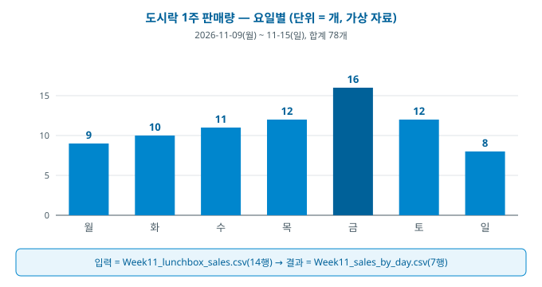
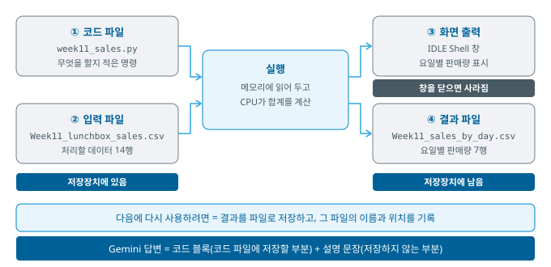
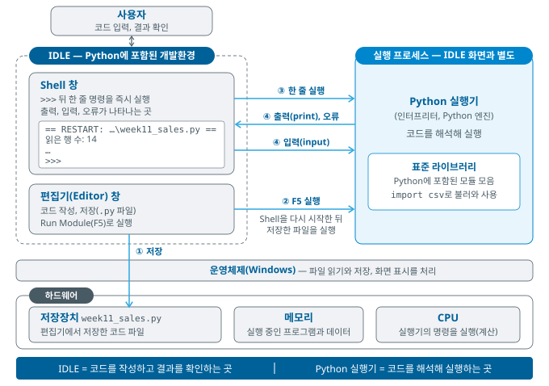
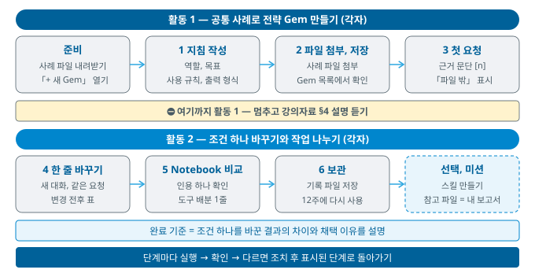

# 11주차 — 컴퓨터 안에서 일어나는 일과 맞춤 AI

> 경영경제 분야 AI 활용 입문 · 단국대학교
>
> **복습 기준 = 이 자료 + 수업 중 필기**

## 목차

- [1. 이번 주 개요 및 목표](#1-이번-주-개요-및-목표)
- [2. 컴퓨터 안에서 일어나는 일 — 실행 경로, 파일과 저장, 같은 결과로 하는 판단](#2-컴퓨터-안에서-일어나는-일--실행-경로-파일과-저장-같은-결과로-하는-판단)
- [3. 활동 1 — 공통 사례로 전략 Gem 만들기](#3-활동-1--공통-사례로-전략-gem-만들기)
- [4. 결과를 다듬는 조정, Gem과 스킬, 과제 3 안내](#4-결과를-다듬는-조정-gem과-스킬-과제-3-안내)
- [5. 활동 2 — 조건 하나 바꾸기와 작업 나누기](#5-활동-2--조건-하나-바꾸기와-작업-나누기)
- [6. 심화와 확장 — 반복 업무 Gem, 스킬, 파일 형식, 부팅](#6-심화와-확장--반복-업무-gem-스킬-파일-형식-부팅)
- [7. 요약, 복습 문제, AI 지문 비판](#7-요약-복습-문제-ai-지문-비판)
- [개정 이력](#개정-이력)

---

## 1. 이번 주 개요 및 목표

### 1.1 이번 주 학습 목표

1. 판매 분석 한 번이 컴퓨터 안에서 거치는 실행 경로(프로그램, 운영체제, CPU, 메모리, 저장장치)를 부팅 과정과 구분해 설명한다.
2. 코드 파일, 입력 파일, 화면 출력, 저장한 결과 파일을 구분하고, 결과를 다음에 다시 사용하려면 무엇을 어디에 저장해야 하는지 설명한다.
3. 판매 결과를 입고 판단의 출발 자료로 해석하고, 판단에 먼저 필요한 자료를 선택한다.
4. 지침과 참고 파일을 저장한 맞춤 AI(Gem)를 만들어 전략 대안을 받고, 조건 하나를 바꾸어 결과 차이와 채택 이유를 설명한다.
5. Gem, 스킬, Gemini Notebook이 담당하는 일의 차이를 알고 작업에 적합한 도구를 선택한다.

오늘은 **컴퓨터 안에서 일어나는 일**을 먼저 다루고, 같은 사례로 **맞춤 AI**를 만듭니다.

- 지난주 = AI에게 코드를 요청해 지표 표와 차트를 만드는 도구를 제작
- 오늘 = 그 도구가 컴퓨터 안에서 어떻게 실행되었는지 이해하고, 지침을 **저장해 두고 다시 사용하는** AI를 제작
- 오늘의 성과물 = 각자 만든 전략 Gem, 변경 전후 표와 채택 이유, 다음 주에 확인할 주장 1개

### 1.2 이번 주 진행 순서

설명과 활동을 번갈아 진행합니다. **절 번호 = 진행 순서**

| 절 | 내용 |
|:--:|------|
| §2 | 컴퓨터의 구성, 실행 경로와 부팅, 프로그램과 데이터, 메모리와 저장장치, 파일의 위치, IDLE의 두 창, 같은 결과로 하는 경영 판단 |
| **§3** | **활동 1** — 실습(판매 기록 파일을 만들어 2.3 코드 실행, 공통 사례로 전략 Gem 만들기) |
| §4 | 결과를 다듬는 조정 세 가지, Gem과 스킬, 다른 서비스의 같은 기능, 과제 3 안내 |
| **§5** | **활동 2** — 실습(조건 하나 바꾸기, Gemini Notebook과 비교, 보관) → 수업 종료 |
| §6, §7 | 수업 뒤 자습 — 반복 업무 Gem, 스킬 만들기, 파일 형식, 부팅 과정, 복습 문제 |

- **수업 내 활동** = **2회**, 두 활동 모두 〈실습〉을 **각자** 진행
- **활동 2** = 활동 1에서 만든 Gem의 조건 하나를 바꾸어 결과를 비교
- **실습 활동의 내용** = 실습 지침 참고
  - [11주 실습 지침](Week11_실습안내.md), 저장소 첫 화면 README에도 있음
- **활동 내용 제출 없음** — 만든 Gem과 기록은 각자 보관(12주에 다시 사용)

- **실습 자료** = 공통 사례 파일 1개(가상 편의점 점포 자료, PDF 2쪽)
  - `Week11_case_store.pdf` = 활동 1의 0단계(판매 기록 파일 만들기)와 Gem 참고 파일, 활동 2의 Gemini Notebook 자료
  - 위치 = 강의자료 저장소(GitHub) `Data/` 폴더
- **Gem 만들기 화면** = 학교 계정으로 `gemini.google.com/gems/view` → 「+ 새 Gem」
- **미션** = 같은 지침으로 새 Gem을 만들고 참고 파일만 각자의 과제 2 보고서(이름과 학번을 지운 사본)로 바꾸어 내 주제 Gem 완성
- 과제 3 = **오늘 안내**, 14주 제출

---

## 2. 컴퓨터 안에서 일어나는 일 — 실행 경로, 파일과 저장, 같은 결과로 하는 판단

### 학습목표

- CPU, 메모리, 저장장치, 운영체제, 프로그램의 역할을 구분할 수 있다.
- 프로그램 실행 경로와 부팅 과정을 구분해 설명할 수 있다.
- 코드 파일, 입력 파일, 화면 출력, 결과 파일의 역할과 위치를 구분할 수 있다.
- 메모리와 저장장치의 차이로 「저장하지 않은 결과가 남지 않는 이유」를 설명할 수 있다.
- 판매 결과에서 입고 판단에 먼저 필요한 자료를 선택할 수 있다.

### 2.0 컴퓨터의 구성 — 판매 분석에 사용되는 다섯 가지

> [!IMPORTANT]
> - 컴퓨터 = **하드웨어**(실제 장치)와 **소프트웨어**(장치에서 실행되는 프로그램)
> - 오늘의 예시에 사용되는 것 = 하드웨어 3가지(CPU, 메모리, 저장장치), 소프트웨어 2가지(운영체제, 프로그램)

| 구분 | 구성 요소 | 역할 |
|------|------|------|
| 하드웨어 | CPU(중앙처리장치, Central Processing Unit) | 프로그램의 명령을 실행(계산) |
| 하드웨어 | 메모리 | 실행 중인 프로그램과 값을 임시로 보관, 전원을 끄면 지워짐 |
| 하드웨어 | 저장장치 | 파일을 보관, 전원을 꺼도 남음(하드디스크 등) |
| 소프트웨어 | 운영체제(Windows) | 장치를 관리하고 프로그램의 요청(파일, 화면)을 처리 |
| 소프트웨어 | 프로그램(IDLE, Python) | 사용자가 원하는 작업을 수행 |

- 다음 예시(2.1)에서 다섯 가지가 각각 어디에 사용되는지 확인

### 2.1 오늘의 예시 — 판매 기록으로 요일별 판매량 계산

> [!IMPORTANT]
> - 오늘의 예시 = 편의점 1주 도시락 판매 기록(파일)으로 **요일별 판매량**을 계산하는 분석 한 번
> - 이 분석 한 번에 2.0의 다섯 가지가 모두 사용됨
> - 확인할 질문 = **판매 기록 파일은 어디에서 읽혔고, 계산 결과는 어디에 남았는가**



- 예시 자료 = 가상 편의점 「한결편의점 대학정문점」의 1주(11/9 \~ 11/15) 도시락 판매 기록, 하루 두 번 입고분씩 14행
- 분석 과정 = 강의실 PC에서 Python 코드가 판매 기록 파일을 읽어 요일별로 더하고, 결과를 화면에 표시한 뒤 파일로 저장
  - 각자 직접 실행 = 활동 1의 0단계(실습 지침 — 사례 PDF로 판매 기록 파일을 만들어 같은 코드 실행)
- 분석 결과 = 금요일 16개로 가장 많고 일요일 8개로 가장 적음, 1주 합계 78개(그래프는 이 값을 그린 것)
- 이 분석을 2.0의 다섯 가지로 따라가기
  - 파일을 어디에서 읽어 어디서 계산했는가 → 2.2 실행 경로, 2.3 파일 네 가지
  - 결과는 화면에만 있는가, 파일로도 남았는가 → 2.4 메모리와 저장장치, 2.5 파일의 위치, 2.6 IDLE의 두 창
  - 답 = 2.7(세 문장)

**AI와 사용자의 역할**

- AI의 역할 = 컴퓨터 안의 흐름(필요 → 코드 → 운영체제 → 저장장치와 메모리 → CPU)을 일으키는 **코드를 생성**
- 사용자의 역할 = 이 흐름을 이해하고, 원하는 결과를 얻는 코드가 생성되도록 **AI를 활용**
  - 어떤 파일을 읽고, 무엇을 계산해, 결과를 어디에 남길지(화면, 파일)를 정해 요청
  - 10주 지표 도구도 같은 방식 — 요청은 사용자, 코드 작성은 AI, 실행은 컴퓨터

### 2.2 실행 경로와 부팅 — 한 번의 분석이 거치는 곳

> [!IMPORTANT]
> - **부팅** = 전원을 켤 때 한 번, 컴퓨터가 프로그램을 실행할 준비를 하는 과정
> - **실행 경로** = 분석을 할 때마다 거치는 경로 — 계산은 CPU가 프로그램을 실행해 처리하고, 파일 읽기, 화면 표시, 저장은 프로그램이 운영체제에 요청
> - 두 과정의 연결 = 부팅이 운영체제를 저장장치에서 메모리로 불러와 두어야, 분석할 때마다 프로그램이 그 운영체제에 파일과 화면을 요청할 수 있음

| 구성 요소(2.0) | 오늘의 예시에서 한 일 |
|------|------|
| 프로그램 | IDLE, Python, 판매 분석 코드 |
| 운영체제 | Windows — 파일 읽기, 화면 표시, 저장 |
| CPU | Python이 요일별 합계를 계산 |
| 메모리 | 읽어 둔 14행, 계산 중인 합계 |
| 저장장치 | 코드 파일, 입력 파일, 결과 파일 |

- 계산 = 운영체제를 거치지 않고 CPU가 Python의 명령을 실행
- 파일과 화면처럼 장치를 사용하는 일 = 프로그램이 운영체제에 요청

**부팅과 실행의 구분**

| 구분 | 부팅 | 실행 |
|------|------|------|
| 시점 | 전원을 켤 때 한 번 | 프로그램을 실행할 때마다 |
| 주된 역할 | 펌웨어(UEFI)가 장치를 점검하고 운영체제를 불러옴 | CPU가 프로그램을 실행, 운영체제가 파일과 화면 요청을 처리 |
| 결과 | 로그인 화면(실행 준비 완료) | 화면 출력, 결과 파일 |

- 펌웨어 = 메인보드에 저장된 기본 프로그램으로, 부팅 때 장치를 준비하는 역할
- 펌웨어는 분석을 실행하는 경로의 중간 단계가 아님 — 실행 중의 요청은 운영체제가 처리
- 부팅의 단계별 과정 = 6.6

**AI에게 요청한 곳과 코드가 실행된 곳**

| 구분 | 위치 | 연결 |
|------|------|------|
| 코드를 요청하고 받은 곳 | 인터넷 너머 Gemini의 서버 | 12주 — 네트워크 |
| 코드를 실행한 곳 | 강의실의 이 PC(IDLE과 Python) | 오늘 |

- 10주에 Gemini 앱에서 받은 코드는 **텍스트**로 전달되었고, 실행은 각자의 PC에서 진행됨
- 따라서 실행 오류의 원인은 PC의 파일 위치, 파일 이름, 인코딩에서 찾는 경우가 많음

### 2.3 프로그램과 데이터 — 판매 분석의 네 가지

> [!IMPORTANT]
> - 판매 분석 한 번에 관여하는 것 = **코드 파일, 입력 파일, 화면 출력, 결과 파일**
> - 코드 = 무엇을 할지 적은 명령, 데이터 = 처리할 대상
> - 화면 출력과 결과 파일은 **남는 곳**이 다름



오늘의 예시에서 실행한 코드입니다. 지금은 네 가지의 위치만 확인하고, 각자 실행은 활동 1의 0단계(실습 지침)에서 합니다.

```python
import csv  # CSV 파일을 읽고 쓰는 표준 라이브러리

입력파일 = "Week11_lunchbox_sales.csv"  # 읽을 파일(입력 파일)
결과파일 = "Week11_sales_by_day.csv"  # 저장할 파일(결과 파일)
요일순서 = ["월", "화", "수", "목", "금", "토", "일"]

합계 = {요일: 0 for 요일 in 요일순서}  # 요일별 합계를 담을 자리(메모리)
with open(입력파일, encoding="utf-8-sig") as f:  # 입력 파일을 연다
    행목록 = list(csv.DictReader(f))  # 모든 행을 메모리로 읽는다
for 행 in 행목록:
    합계[행["요일"]] += int(행["판매량"])  # 그 요일의 합계에 더한다
```

```python
print("읽은 행 수:", len(행목록))  # 화면 출력 ① 읽은 행 수
for 요일 in 요일순서:
    print(요일, 합계[요일])  # 화면 출력 ② 요일별 판매량

with open(결과파일, "w", encoding="utf-8-sig", newline="") as f:  # 결과 파일을 만든다
    기록기 = csv.writer(f)
    기록기.writerow(["요일", "판매량"])  # 첫 줄 = 열 이름
    for 요일 in 요일순서:
        기록기.writerow([요일, 합계[요일]])  # 한 줄씩 저장한다
print("저장한 파일:", 결과파일)  # 화면 출력 ③ 저장한 파일 이름
```

| 구분 | 코드에서 | 실행 결과 |
|------|------|------|
| 입력 파일 | `open(입력파일)` | 14행을 메모리로 읽음 |
| 계산 | `합계[...] += ...` | CPU가 요일별로 더함 |
| 화면 출력 | `print(...)` | IDLE Shell에 「읽은 행 수: 14」와 요일별 값 표시 |
| 결과 파일 | `open(결과파일, "w")` | `Week11_sales_by_day.csv` 7행 저장 |

**Gemini 답변의 두 부분 — 지난주에 확인한 오류**

| 부분 | 모양 | 처리 |
|------|------|------|
| 코드 블록 | 회색 상자 안의 코드, 오른쪽 위 복사 아이콘 | 코드 파일에 붙여 넣고 저장 |
| 설명 문장 | 코드 블록 밖의 문장 | 읽고 이해하는 부분 — 코드 파일에 붙여 넣지 않음 |

- 설명 문장까지 코드 파일에 붙여 넣으면 실행 때 `SyntaxError`가 발생
- 10주 수업에서 같은 원인의 오류를 확인함 — 코드 블록만 복사

### 2.4 메모리와 저장장치 — 저장하지 않은 결과가 남지 않는 이유

> [!IMPORTANT]
> - **메모리** = 실행 중에만 값을 보관, 프로그램을 닫거나 전원을 끄면 남지 않음
> - **저장장치** = 파일로 저장한 것을 전원이 꺼져도 보관
> - 결과를 다시 사용하려면 = **파일로 저장**

| 구분 | 메모리 | 저장장치 |
|------|------|------|
| 보관하는 것 | 실행 중인 프로그램과 데이터 | 파일(코드, 데이터, 결과) |
| 전원을 끄면 | 남지 않음 | 남음 |
| 속도 | 빠름 | 메모리보다 느림 |
| 오늘의 예시 | 읽어 둔 14행, 계산 중인 합계, 화면 출력 | 코드 파일, 입력 파일, 결과 파일 |

- 화면 출력 = 메모리의 값을 화면에 표시한 것 → IDLE Shell 창을 닫으면 남지 않음
- 결과 파일 = 저장장치에 기록 → 다음 날에도 열어 다시 사용

**저장과 다른 이름으로 저장**

| 메뉴 | 동작 |
|------|------|
| Save(저장) | 지금 연결된 파일에 덮어씀, 연결된 파일이 없으면 「다른 이름으로 저장」을 실행 |
| Save As(다른 이름으로 저장) | 이름과 위치를 정해 저장, 그 파일이 앞으로 연결된 파일이 됨 |

- 출처 = Python 공식 문서 「IDLE」의 File 메뉴 설명(docs.python.org, 2026-11-18 확인)
- 편집기에서 F5(Run Module)를 누르면 = 고친 코드를 저장할지 먼저 묻거나 자동으로 저장한 뒤 실행(같은 문서의 Run 메뉴 설명)
- 지난주에 확인한 어려움 = 파일 만들기, 저장, 다른 이름으로 저장의 차이

**함께 짚어보기**

**Q**: 10주에 IDLE Shell에 출력된 최근 수치 표를 다음 날 과제에 사용하려고 합니다. IDLE을 닫았다가 다시 열었더니 표가 없습니다. 무엇이 빠졌습니까?

**A**: 표를 **파일로 저장하는 단계**가 빠졌습니다.

- 화면에 표시된 표는 메모리에 있던 값 → 창을 닫으면 남지 않음
- 다시 사용하는 방법 = 코드 파일을 저장해 두고 다시 실행하거나, 결과를 파일로 저장하도록 코드에 요청
- 10주에 코드 파일을 보관한 이유도 같음 — 코드 파일이 있으면 같은 결과를 다시 만들 수 있음

### 2.5 파일의 위치 — 폴더, 경로, 확장자

> [!IMPORTANT]
> - 파일 = **위치(폴더)** + **이름** + **확장자**
> - 경로 = 파일의 위치를 적은 주소
> - 프로그램이 파일을 찾지 못하는 원인의 대부분 = 위치나 이름의 불일치

| 용어 | 뜻 | 예 |
|------|------|------|
| 폴더 | 파일을 모아 두는 단위 | 바탕 화면의 `week11` |
| 경로 | 폴더를 차례로 적은 파일의 주소 | `C:\Users\(사용자)\Desktop\week11\Week11_lunchbox_sales.csv` |
| 확장자 | 파일 형식을 나타내는 이름 끝부분 | `.py` 코드, `.csv` 표 데이터, `.pdf` 문서 |
| 현재 작업 폴더 | 파일 이름만 적었을 때 프로그램이 찾는 폴더 | 코드 파일이 있는 폴더(10주 IDLE 실행) |

- 코드의 `"Week11_lunchbox_sales.csv"`처럼 **파일 이름만** 적으면 = 현재 작업 폴더에서 찾음
- 10주 수업에서 확인 = 코드 파일과 지표 파일을 같은 `week10` 폴더에 두고 IDLE에서 실행하면 파일 이름만으로 읽힘
- 코드 파일을 저장한 폴더에 입력 파일이 없으면 = `FileNotFoundError`(파일을 찾을 수 없음)
- Windows 탐색기는 확장자를 표시하지 않는 경우가 있음 → `.csv`가 보이지 않아도 파일 형식은 같음

### 2.6 IDLE의 두 창 — 편집기와 Shell

> [!IMPORTANT]
> - **편집기(Editor) 창** = 코드를 작성하고 **파일로 저장**하는 창
> - **Shell 창** = 명령을 **즉시 실행**하고, 실행 중의 입력과 출력을 확인하는 창
> - Python 공식 문서 = 「IDLE의 주요 창은 Shell 창과 Editor 창 두 가지」



**Python 개발환경의 용어** (Python 공식 문서 「IDLE」, 2026-11-19 확인)

| 용어 | 뜻 | 오늘의 예시에서 |
|------|------|------|
| 개발환경 | 코드를 작성, 저장, 실행하고 결과를 확인하는 프로그램 | IDLE — 편집기 창과 Shell 창 |
| Python 실행기(인터프리터) | 코드를 해석해 실행하는 프로그램, 이른바 「Python 엔진」 | IDLE 화면과 별도 프로세스에서 `week11_sales.py`를 실행 |
| 편집기 창 | 코드를 작성해 `.py` 파일로 저장하는 창 | `week11_sales.py` 작성과 저장 |
| Shell 창 | 한 줄 명령을 즉시 실행하고 출력, 입력, 오류가 나타나는 창 | 「읽은 행 수: 14」와 요일별 판매량 표시 |
| `>>>` | Shell 창의 입력 대기 표시(프롬프트), 뒤에 문장을 입력하면 실행 | `print(16 - 8)` 입력 → 8(금요일과 일요일의 차이) 표시 |
| Run Module(F5) | 저장과 점검 뒤 Shell을 다시 시작해 편집기의 코드를 실행 | `week11_sales.py` 저장 뒤 F5 → 출력은 Shell 창 |
| `RESTART` 줄 | 실행 프로세스가 다시 시작되었다는 Shell 창의 표시 | F5 실행 때 출력 위에 표시 |
| 표준 라이브러리 | Python에 포함된 모듈 모음, `import`로 불러와 사용 | `import csv` — CSV 파일을 읽고 저장하는 모듈 |

| 구분 | 편집기 창 | Shell 창 |
|------|------|------|
| 여는 방법 | File → New File | IDLE을 실행하면 열림 |
| 역할 | 코드 작성, 저장(File → Save) | 한 줄 명령 실행, 실행 결과 표시 |
| 남는 것 | 저장한 코드 파일 | 저장하지 않으면 남지 않음 |
| 10주의 사용 | 코드 붙여 넣기, 저장, Run Module(F5) | 파일 이름 입력, 출력 확인 |

- Run Module(F5) = 코드를 점검한 뒤 Shell을 다시 시작해 실행하고, 출력을 Shell 창에 표시(Python 공식 문서 「IDLE」, 2026-11-18 확인)
- 연결 = 편집기 창은 **저장해 두고 다시 실행하는 명령**을 다룸 → 오늘의 Gem도 **저장해 두고 다시 사용하는 지침**(§3)

### 2.7 정리 — 2.1의 질문에 세 문장으로 답하기

2.1의 질문에 세 문장으로 답합니다. 먼저 각자 적은 뒤 아래 답과 비교합니다.

- 질문 = 판매 기록 파일은 어디에서 읽혔고, 계산 결과는 어디에 남았는가

<details>
<summary><b>답의 예 보기</b></summary>

① 코드 파일 `week11_sales.py`가 저장장치의 입력 파일 `Week11_lunchbox_sales.csv` 14행을 메모리로 읽었습니다.

② CPU가 요일별 합계를 계산했고, 그 값은 IDLE Shell 창에 표시되었습니다(창을 닫으면 남지 않음).

③ 같은 값을 결과 파일 `Week11_sales_by_day.csv`로 저장했으므로 다음에도 열어 사용할 수 있습니다.

</details>

### 2.8 같은 결과로 하는 경영 판단 — 판매량은 입고 판단의 출발 자료

> [!IMPORTANT]
> - 요일별 판매량은 **입고량을 정하는 출발 자료**이며, 판단의 결론이 아님
> - 금요일 16개 = 그날 입고한 16개가 모두 판매된 값 → **실제 수요는 확인되지 않음**
> - 판단 전에 **어떤 자료를 먼저 확인할지** 선택

- 점주의 질문 = 「다음 달에 금요일 입고량을 늘려야 하는가」
- 그래프만 보면 = 금요일이 가장 많이 팔렸으므로 늘린다
- 그러나 금요일에는 오전분과 오후분이 모두 품절 → 16개는 **품절로 잘린 판매량**
  - 품절 뒤에 찾은 고객이 몇 명이었는지 기록되지 않음
- 반대로 일요일 8개 = 입고 16개 가운데 8개가 남아 폐기

**먼저 확인할 자료 — 하나를 선택하고 이유를 말하기**

| 자료 | 확인하는 것 | 없으면 생기는 문제 |
|------|------|------|
| 비교 기간 | 다른 주의 금요일 판매량 | 이번 주가 평소인지 알 수 없음 |
| 행사와 날씨 | 11/13(금)의 비, 학과 행사 | 일시적 요인을 추세로 오해 |
| 품절 시각 | 언제 모두 팔렸는가 | 더 팔 수 있었는지 알 수 없음 |
| 폐기량 | 요일별로 남아 폐기한 수 | 늘린 만큼 폐기하는지 알 수 없음 |

- 같은 결과도 **어떤 자료를 함께 보는가**에 따라 판단이 달라짐
- AI에게 판단을 요청할 때도 같음 = 어떤 자료를 **참고 자료로 함께 주는가**가 답을 결정
- 이 점포의 판매, 폐기, 품절, 날씨, 고객 자료를 모은 문서 = 오늘 활동의 **공통 사례 파일**(2쪽, 문단 번호 [1]\~[16])
- 다음 활동 = 이 사례 파일을 참고 자료로 저장한 맞춤 AI(Gem)를 만들어 전략 대안을 요청

---

## 3. 활동 1 — 공통 사례로 전략 Gem 만들기

### 학습목표

- 역할, 목표, 참고 파일 사용 규칙, 출력 형식을 갖춘 지침을 작성해 Gem으로 저장할 수 있다.
- Gem의 답변에서 근거 문단과 「파일 밖」 표시를 사례 파일과 대조할 수 있다.

### 3.1 활동 1의 목표와 결과물



- 목표 = 사례 파일로 판매 기록 파일을 만들어 2.3 코드를 직접 실행하고, 같은 사례 파일을 참고 파일로 저장한 **전략 Gem**을 만들어 첫 대안 2개를 받기
- 진행 = 준비 → 0 판매 기록 파일 만들고 실행 → 1 지침 작성 → 2 사례 파일 첨부와 저장 → 3 다시 열어 첫 요청
- **상세 절차 = 실습 지침의 준비와 0\~3단계**

| 단계 | 결과물 | 확인 기준 |
|:--:|------|------|
| 준비 | 사례 파일, Gem 만들기 화면 | PDF 2쪽, 문단 [1]\~[16] |
| 0 | 직접 만든 `Week11_lunchbox_sales.csv`, 실행 결과 | 첫 줄 열 이름 4개, 14행, 합계 78, Shell의 「읽은 행 수: 14」, 결과 파일 생성 |
| 1 | 각자 트랙의 지침 | 네 부분(역할, 목표, 규칙, 형식) |
| 2 | 저장된 Gem | Gem 관리자 목록에 표시 |
| 3 | 첫 대안 표(대안 2개) | 근거 문단, 「파일 밖」 표시 |

- 트랙 = 과제 1, 2에서 정한 트랙
  - 트랙 A(기업, 산업 분석) = SWOT 교차 전략 대안
  - 트랙 B(아이디어 검증) = 목표 고객 한 유형과 마케팅 대안
- 결과물 → 활동 2의 입력 = 저장된 Gem과 첫 대안 표(변경 전)
- Gem 화면을 사용할 수 없으면 = 같은 학교 계정의 일반 채팅으로 진행(대체 경로 — 실습 지침)

### 3.2 Gem — 지침과 참고 파일을 저장한 맞춤 AI

> [!IMPORTANT]
> - **Gem** = 지침과 참고 파일을 **저장해 두고**, 대화를 시작할 때마다 다시 적용하는 맞춤 AI
> - 일반 채팅 = 대화마다 지침과 파일을 다시 입력
> - 오늘의 지침 = 네 부분

| 지침의 부분 | 적는 것 | 오늘의 지침(트랙 A) |
|------|------|------|
| 역할 | AI가 맡을 입장 | 기업이나 점포의 전략을 검토하는 경영 분석가 |
| 목표 | 결과로 받을 것 | SWOT 교차 전략 대안 |
| 참고 파일 사용 규칙 | 근거의 범위와 표시 | 근거 위치 [n], 파일에 없으면 「(파일 밖)」 |
| 출력 형식 | 결과의 모양 | 표 — 대안, 교차 유형, 근거 문단, 예상 효과, 확인할 점 |

- Gem 화면의 칸 이름 = 지침은 「요청 사항」, 참고 파일은 「지식」
- 역할과 목표는 **사례에 한정하지 않는 표현**으로 작성 → 미션에서 참고 파일만 바꾸어 같은 지침을 다시 사용
- 「(파일 밖)」 표시를 요구하는 이유 = 참고 파일에 없는 내용이 섞여도 답변의 문장만으로는 구분되지 않음
  - 표시가 있으면 = 다음에 따로 확인할 대상이 드러남(12주 — 조사 위임과 결과 확인)
- 사례 파일의 [16] = 바꿀 수 없는 것(입고 시각, 판매가, 본사 메뉴) → 이것을 바꾸는 대안은 실행할 수 없는 대안

### 3.3 교수가 안내하는 준비 응답

Gem과 일반 채팅을 모두 사용할 수 없을 때 교수가 안내하는 자료입니다. 아래 표로 3단계의 확인을 진행합니다.

<details>
<summary><b>준비 응답 — 트랙 A(예시)</b></summary>

| 대안 | 교차 유형 | 근거 문단 | 확인할 점 |
|------|:--:|------|------|
| 기말고사 기간에 오후 입고량을 12개로 늘리고 취식 공간과 밤 10시 이후 할인을 SNS로 안내 | SO | [3], [9], [14] | 야간 구매 증가는 점주의 기억([14]) |
| 금요일 입고량을 늘리고 일요일, 월요일 오전 입고량을 줄이며 폐기 직전 할인 시각을 고정해 안내 | WT | [5], [6], [7], [10], [15] | 금요일 16개는 품절로 잘린 값([7]) |

</details>

<details>
<summary><b>준비 응답 — 트랙 B(예시)</b></summary>

| 목표 고객 | 근거 문단 | 마케팅 대안 | 확인할 점 |
|------|------|------|------|
| 기말고사 기간의 학생 | [9], [13], [14] | 밤 10시 이후 할인 시간대를 SNS로 미리 안내 | 야간 구매 증가는 기록이 아닌 기억([14]) |
| 〃 | [3], [8], [15] | 데우지 않는 메뉴를 계산대 옆에 진열해 점심 전자레인지 대기를 줄임 | 데우지 않는 메뉴의 비율은 파일 밖 |

</details>

⛔ **여기까지 활동 1**, 실습 지침의 같은 자리에 경계선

- 활동 2를 시작하지 않고 멈춤
- 다음 = 결과를 다듬는 조정 세 가지, Gem과 스킬, 과제 3 안내

---

## 4. 결과를 다듬는 조정, Gem과 스킬, 과제 3 안내

### 학습목표

- 지침, 요청, 참고 자료 가운데 하나만 바꾸어 결과를 비교하는 이유를 설명할 수 있다.
- Gem과 스킬의 공통점과 차이, 학교 계정에서의 전환 일정을 설명할 수 있다.
- 지침과 자료를 저장해 다시 사용하는 기능이 다른 서비스에도 있음을 알고 비교할 수 있다.
- 과제 3의 제출물 구성과 제출 일정을 확인할 수 있다.

### 4.1 결과를 다듬는 조정 세 가지 — 한 번에 하나만

> [!IMPORTANT]
> - 결과를 바꾸는 손잡이 = **지침, 요청, 참고 자료** 세 가지
> - 한 번에 **하나만** 바꾸어 비교
> - 둘 이상을 함께 바꾸면 = 결과가 달라진 원인을 알 수 없음

| 조정 | 바꾸는 곳 | 활동 1의 예 | 달라지는 것 |
|------|------|------|------|
| 지침 | Gem에 저장한 지침의 한 줄 | 목표에 「한 달 안에 실행할 수 있는 대안만」 추가 | 대안의 범위 |
| 요청 | 대화에 입력하는 문장 | 「대안 2개」 → 「대안 3개」 | 이번 대화의 결과 |
| 참고 자료 | Gem에 첨부한 파일 | 사례 파일 → 과제 2 보고서 | 근거의 범위 |

- 지침과 참고 자료 = **저장되어** 다음 대화에도 적용 / 요청 = 그 대화에만 적용
- 같은 Gem의 **새 대화**에서 비교하는 이유 = 앞 대화의 내용이 다음 답에 영향을 주지 않게 하기 위함
- 같은 요청에도 답변은 실행마다 달라질 수 있음 → 바꾼 조건이 결과에 **반영되었는지** 답변에서 확인
- 비교 결과의 기록 = 변경 전후 표 + 채택 이유 1줄(활동 2)
- 결과가 달라지지 않는 것도 결과 — 「추가한 조건을 변경 전의 대안이 이미 충족했는가」를 확인

### 4.2 Gem과 스킬 — 저장해 두는 지침

> [!IMPORTANT]
> - Gem과 스킬 = 둘 다 **지침과 참고 파일을 저장해 두고 다시 사용**하는 기능
> - 차이 = **부르는 방법** — Gem은 목록에서 열고, 스킬은 대화 중에 「/」나 「@」로 부름
> - Google은 Gem을 스킬로 전환하는 중 — 학교 계정은 전환 전까지 Gem 사용 가능

| 구분 | Gem | 스킬 |
|------|------|------|
| 만드는 곳 | Gem 관리자 「+ 새 Gem」 | Gem 관리자 「스킬 만들기」 |
| 부르는 방법 | 목록에서 열어 대화 시작 | 대화 입력창에 「/」 또는 「@」 |
| 참고 파일 | 첨부 가능 | 첨부 가능(텍스트, PDF, 이미지, 최대 100MB) |
| 켜고 끄기 | — | 스킬 페이지에서 활성화와 비활성화 |
| 오늘의 사용 | 활동 1, 2 | 활동 2 뒤 선택 |

**Gem에서 스킬로의 전환(2026-11-18 확인)**

| 계정 | 일정 |
|------|------|
| 개인 Google 계정 | 2026-11-17부터 Gem 읽기 전용, 이후 삭제 예정 — 스킬로 대체 |
| Workspace 교육용(학교 계정) | Gem 계속 사용 가능, 빠르면 2027-06-01 이후 Gem이 **초안 스킬**로 자동 이전(이름, 지침, 파일 유지) → 검토 뒤 활성화 |
| 2026-11-17 종료 | Opal, Google Labs에서 만든 Gem |

- 오늘 학교 계정으로 만든 Gem = 학기 동안 사용 가능, 전환되면 같은 지침의 스킬로 이어짐
- 출처 = Gemini 고객센터 「About the transition from Gems to skills」, Workspace 관리자 도움말 「About the transition to skills」, Gemini 앱 스킬 도움말, Google 블로그 「Let skills in Gemini tackle your most repetitive tasks」(2026-09-30) — 2026-11-18 확인

- 4주 「동향을 읽는 틀」의 스킬 = **반복하는 작업 방법을 저장해 두고 필요할 때 부르는 기능** — 오늘 실제로 만드는 대상
- 선택 활동 = 같은 지침과 사례 파일로 스킬을 만들어 「/」로 한 번 부르고, 스킬 페이지에서 비활성화
- 학교 계정에서 「스킬 만들기」가 동작하지 않으면 건너뜀

### 4.3 다른 서비스의 같은 기능 — 지침과 자료를 저장해 다시 사용

| 서비스 | 기능 이름 | 저장하는 것 |
|------|------|------|
| Gemini | Gem, 스킬 | 지침, 참고 파일 |
| ChatGPT | 프로젝트 | 지침, 파일, 관련 대화 |
| Claude | 프로젝트 | 지침, 파일, 관련 대화 |
| Perplexity | 프로젝트(구 스페이스) | 지침, 파일, 검색 기록 |

- 공통점 = 같은 지침과 자료를 **매번 다시 입력하지 않고** 반복 작업에 적용
- 차이 = 기능 이름, 부르는 방법, 계정 종류별 사용 가능 여부 → 사용 전에 각 서비스의 도움말 확인
- Perplexity는 스페이스를 프로젝트로 바꾸어 안내함(Perplexity 고객센터 「What are Projects?」, 2026-11-18 확인)

### 4.4 과제 3 안내 — 최종 분석보고서

> [!IMPORTANT]
> - 과제 3 = 과제 1, 2의 주제와 트랙을 이어 **하나의 보고서로 완성**
> - 오늘 안내 → **14주 제출**, 배점 15%
> - 두 트랙 모두 **AI 활용 부록** 포함

| 트랙 | 본문 구성 |
|------|------|
| A(기업, 산업 분석) | ① 환경 분석(PEST) ② SWOT ③ 비즈니스 모델 ④ 재무 하이라이트 ⑤ 제언 |
| B(아이디어 검증) | ① 문제와 고객 ② 린 캔버스 ③ 시장 규모 ④ 검증 질문과 그 결과 |

- AI 활용 부록 = 본문 뒤에 첨부, 분량 외 — AI 답변을 그대로 옮기면 감점, 검증한 흔적이 있으면 가점
- 오늘 만든 Gem의 활용 = 미션에서 만든 내 주제 Gem(참고 파일 = 과제 2 보고서)으로 대안을 받고, 사용 내용을 부록에 기록
- 「(파일 밖)」 표시가 있는 내용 = 보고서에 옮기기 전에 따로 확인
- 상세 = 과제 3 안내문(강의자료 저장소 `Assignments/`), 제출 채널과 마감 시각은 별도 안내

---

## 5. 활동 2 — 조건 하나 바꾸기와 작업 나누기

### 학습목표

- 같은 Gem의 지침 한 줄만 바꾸어 결과를 비교하고, 차이와 채택 이유를 설명할 수 있다.
- Gemini Notebook의 인용으로 근거의 원문 위치를 확인하고, 작업에 맞는 도구를 배분할 수 있다.

**시작하기 전에** — 활동 2는 **활동 1에서 저장한 Gem**과 첫 대안 표(변경 전)에서 출발합니다.

- 일반 채팅으로 진행한 경우 = 새 채팅에서 사례 파일과 목표 줄을 바꾼 지침으로 같은 요청
- Gem과 일반 채팅을 모두 사용할 수 없는 경우 = 교수가 안내하는 변경 전후 표의 예(5.2)로 비교

### 5.1 활동 2의 목표와 결과물

- 목표 = 조건 하나를 바꾼 결과의 **차이와 채택 이유**를 설명하기(오늘 활동의 완료 기준)
- 진행 = 4 지침 한 줄 바꾸기 → 5 Gemini Notebook과 비교 → 6 보관 → 선택, 미션
- **상세 절차 = 실습 지침의 4\~6단계, 선택, 미션**

| 단계 | 결과물 | 확인 기준 |
|:--:|------|------|
| 4 | 변경 전후 표, 채택 이유, 확인할 주장 | 차이와 이유를 설명함 |
| 5 | 도구 배분 1줄 | 인용 하나의 원문 위치를 확인 |
| 6 | 기록 파일 | 12주에 다시 사용 |
| 선택 | 같은 지침의 스킬 | 「/」로 부르고 비활성화 |
| 미션 | 내 주제 Gem | 보고서 근거로 대안 2개 |

**4단계 — 바꾸는 줄**

| 트랙 | 목표 줄에 추가하는 조건 | 사례에서 예상되는 차이 |
|------|------|------|
| A | 비용을 줄이는 효과가 큰 대안을 먼저 | 폐기([6])를 줄이는 대안이 앞으로 옴 |
| B | 아직 이용하지 않는 새 고객층을 후보에 반드시 포함 | 공유 오피스 이용자([10])가 후보에 포함됨 |

- 다른 줄은 바꾸지 않음 — 한 번에 하나만(4.1)
- 다음 주에 확인할 주장 = 답변 가운데 근거가 약하거나 「(파일 밖)」인 주장 1개 → 12주에 확인

**5단계 — Gem과 Gemini Notebook의 작업 나누기**

| 작업 | 적합한 도구 | 이유 |
|------|------|------|
| 전략 초안 작성 | Gem | 저장한 지침으로 같은 형식을 반복 |
| 근거 확인 | Gemini Notebook(구 NotebookLM) | 인용을 누르면 자료의 원문 위치가 표시됨 |

- 도구의 우열을 정하는 비교가 아님 = **작업마다 수행할 도구**를 정하는 비교(과제 1의 도구 비교와 다름)
- 실습에서 확인하는 것 = 인용 하나를 눌러 사례 파일의 어느 문장이 근거인지 확인

### 5.2 변경 전후 표의 예

트랙 A에서 목표 줄에 「비용을 줄이는 효과가 큰 대안을 먼저」를 추가한 경우의 예입니다.

| 비교 항목 | 변경 전 | 변경 후 |
|------|------|------|
| 바꾼 지침 한 줄 | 목표 = 실행할 전략 대안 | 비용을 줄이는 대안 먼저 |
| 대안 1 | 기말고사 기간 야간 판매(SO) | 요일별 입고량 조정(WT) |
| 대안 2 | 요일별 입고량 조정(WT) | 폐기 직전 할인 시각 고정(WT) |
| 근거 문단 | [3], [9], [14] / [5], [6], [7] | [5], [6] / [6], [15] |
| 「파일 밖」 표시 | 0곳 | 1곳(할인율의 수익 영향) |

- 채택 이유의 예 = 「변경 후 — 12월에는 경쟁점 개점([10])과 공급가 인상([11])이 겹치므로 폐기 비용을 먼저 줄이는 대안이 적합하다.」
- 다음 주에 확인할 주장의 예 = 「금요일의 실제 수요는 16개보다 많다 — 오전분과 오후분이 모두 품절되었고, 품절 뒤 찾은 고객 수는 기록되지 않음([7])」
- 위 표는 예시이며, 실제 답변은 사람마다 다를 수 있음 — 기록의 형식을 확인하는 용도

### 5.3 마무리

- **활동 내용 제출 없음** — 만든 Gem과 기록 파일은 각자 보관
- **12주에 다시 사용** = 저장한 Gem, 변경 전후 표, 다음 주에 확인할 주장
- **미션** = 같은 지침으로 **새 Gem**을 만들고 참고 파일만 과제 2 보고서(이름과 학번을 지운 사본)로 바꾸어 내 주제 Gem 완성 → 과제 3 작성에 활용, 수업 뒤에도 가능
- 활동 2까지 마치면 오늘 수업을 마침

---

## 6. 심화와 확장 — 반복 업무 Gem, 스킬, 파일 형식, 부팅

수업에서 다루지 않은 내용입니다. 반복 업무에 Gem을 적용하는 방법(6.1\~6.3), 스킬(6.4), 파일 형식(6.5), 부팅(6.6)으로 구성됩니다.

### 학습목표

- 반복 업무(보고 이메일, 회의록 요약)의 지침을 Gem으로 저장하고 결과를 확인할 수 있다.
- 여러 Gem을 이어 사용하는 방법과 그때 확인할 점을 설명할 수 있다.
- 파일 형식과 인코딩의 차이로 생기는 오류를 설명할 수 있다.
- 부팅의 단계를 순서대로 설명할 수 있다.

### 6.1 반복 업무 Gem ① — 보고 이메일

업무 이메일은 형식이 정해져 있어 지침을 저장해 두기에 적합한 문서입니다. 다만 **무엇을 보고할지는 사람이 정합니다.**

| 단계 | 담당 | 내용 |
|:--:|------|------|
| 1 | 사람 | 받는 사람, 요청 사항, 상대가 알아야 할 사실 세 가지 이내 |
| 2 | Gem | 저장한 지침의 형식으로 초안 작성 |
| 3 | 사람 | 아래 네 항목을 확인하고 고침 |

```
## 역할
너는 업무 이메일 초안을 작성하는 보조자다.

## 목표
요청한 사실만으로 업무 이메일 초안을 작성한다.

## 규칙
- 6문장 이내로 작성할 것
- 요청 사항은 마지막 문단에 한 번만 적을 것
- 입력하지 않은 수치와 날짜는 적지 말고 「(확인 필요)」로 표시할 것
```

- 매번 입력하는 것 = 받는 사람, 목적, 전달할 사실(요청)
- 저장해 두는 것 = 분량, 요청의 위치, 확인 표시 규칙(지침)

| 사람이 확인할 것 | 이유 |
|------|------|
| 수치와 날짜 | 원자료 대조가 필요함 |
| 확정과 미확정의 구분 | 미확정 사항이 확정형으로 서술되기 쉬움 |
| 요청의 강도 | 「가능하시면」과 「부탁드립니다」의 차이는 관계에 따라 다름 |
| 수신자에게 불필요한 배경 | AI 초안은 배경 설명이 길어지기 쉬움 |

모든 문서에 초안을 요청할 수 있는 것은 아닙니다. **관계를 다루는 문서**는 직접 작성합니다.

| 문서 | 직접 작성하는 이유 |
|------|------|
| 사과, 해명 | 형식적인 문장은 상대가 즉시 알아봄 — 가치는 발신자가 직접 작성했다는 사실에 있음 |
| 거절, 계약 종료 | 표현 하나가 이후 관계와 법적 해석에 영향 |
| 평가, 추천 | 사람을 평가하는 판단은 위임할 수 없음 |
| 기밀이 포함된 문서 | 3주 수칙 — 외부 도구에 입력하지 않음 |

- 기준 = 문서의 목적이 **정보 전달**이면 AI로 초안 작성 가능, **관계의 조정**이면 직접 작성

### 6.2 반복 업무 Gem ② — 회의록 요약

회의록에서 필요한 것은 **오간 말의 기록이 아니라 남은 결과**입니다. 이 구분을 지침의 규칙과 출력 형식으로 저장합니다. 기밀이 포함된 회의 내용은 입력하지 않습니다.

```
## 목표
회의 메모에서 결정, 미확정, 담당, 기한을 정리한다.

## 규칙
- 논의 과정은 생략할 것
- 결정으로 확인되지 않은 내용은 「미확정」으로 표시할 것
- 담당이나 기한이 정해지지 않았으면 「미정」으로 적을 것

## 출력 형식
- 표로 출력할 것 — 열: 항목, 상태(결정 / 미확정), 담당, 기한
```

- 핵심 규칙 = 뒤의 두 줄 — **결정되지 않은 것을 결정된 것처럼 적는 오류**는 나중에 책임 소재의 문제가 됨
- 표 형식을 요구하는 이유 = 열이 정해지면 담당이나 기한이 없는 항목이 「미정」 칸으로 드러남

**함께 짚어보기**

**Q**: 회의록 요약 Gem이 다음 문단을 생성했습니다. 어디를 고쳐야 합니까?

> "신규 서비스 출시일은 12월로 확정되었으며, 마케팅 예산은 5천만 원 규모로 편성하기로 했다. 담당자는 각 부서에서 지정하며, 세부 일정은 추후 공유될 예정이다."

**A**: 세 곳입니다.

① **「확정되었으며」의 근거** — 회의에서 확정된 것인지, 논의 중 언급된 목표인지 원문 대조가 필요합니다(10주 확신의 상향과 같은 유형).

② **「5천만 원 규모」의 정확성** — 수치는 원문 대조 대상입니다(9주). 「규모」라는 표현 때문에 정확한 값인지 어림값인지도 불분명합니다.

③ **담당과 기한의 부재** — 「각 부서에서 지정」, 「추후 공유」는 담당도 기한도 정해지지 않은 상태입니다. 미확정으로 표시해야 할 항목을 확정 서술에 섞은 형태입니다.

- 또한 이 답변은 지침의 출력 형식(표)을 따르지 않았음 → 저장한 지침도 매번 적용되지는 않으므로 형식부터 확인

### 6.3 Gem 여러 개 연결 — 한 Gem의 결과를 다음 Gem의 입력으로

| 순서 | Gem | 입력 | 결과 |
|:--:|------|------|------|
| 1 | 회의록 요약 Gem | 회의 메모 | 결정과 미확정 표 |
| 2 | 보고 이메일 Gem | 1의 결정 항목 | 이메일 초안 |
| 3 | 전략 Gem | 2의 보고 내용과 사례 파일 | 다음 대안 |

- 장점 = 작업마다 지침을 따로 다듬을 수 있음(한 Gem에 모든 지시를 포함하지 않음)
- 확인할 점 = 앞 Gem의 「미확정」이 다음 Gem에서 확정 서술로 바뀌지 않았는가
  - 단계가 늘어날수록 앞의 표시가 사라지기 쉬움 → 단계마다 결과를 확인한 뒤 다음 Gem에 입력
- 12주의 연결 = 여러 단계를 AI가 스스로 이어 수행하는 **에이전트**

### 6.4 스킬 만들기와 회사마다 다른 「스킬」

**Gemini에서 스킬을 만드는 절차(요지)**

1. Gem 관리자에서 「스킬 만들기」 → 이름, 지침, 필요한 파일
2. 저장한 뒤 대화 입력창에서 「/」 또는 「@」로 불러 사용
3. 사용하지 않을 때는 스킬 페이지에서 비활성화

- Google은 스킬 파일(`SKILL.md`)을 업로드해 만드는 방법도 지원함(Gemini 앱 스킬 도움말, 2026-11-18 확인)

| 비교할 것 | 확인하는 이유 |
|------|------|
| 제품 화면 | 같은 「스킬」이라는 이름도 만드는 곳이 다름 |
| 부르는 방법 | 「/」, 「@」, 자동 선택 등 서비스마다 다름 |
| 지원 자료 | 첨부 가능한 파일 형식과 크기가 다름 |
| 계정 종류 | 개인, 학교, 회사 계정에 따라 사용 가능 여부가 다름 |

- 여러 AI 서비스가 「스킬」이라는 이름을 사용하지만 기능의 범위가 같지 않음
- 다른 서비스에서 사용할 때는 그 서비스의 도움말에서 위 네 항목을 먼저 확인

### 6.5 파일 형식과 인코딩 — 10주 오류의 원인

| 용어 | 뜻 | 10주의 예 |
|------|------|------|
| 파일 형식 | 내용을 담는 규칙(확장자로 표시) | `.csv` = 쉼표로 열을 나눈 표 데이터 |
| 인코딩 | 글자를 숫자로 바꾸어 저장하는 규칙 | UTF-8 |
| BOM | 파일 맨 앞에 붙어 UTF-8임을 알리는 표시 | 지표 파일은 BOM 포함 |

- BOM이 있는 파일을 일반 UTF-8로 읽으면 = 첫 열 이름 앞에 보이지 않는 글자가 붙어 「연월」 열을 찾지 못함
- 해결 = `utf-8-sig`로 읽기 — 10주 실습 지침의 `UnicodeDecodeError`, 첫 열 이름이 깨질 때의 조치
- 같은 내용도 형식과 인코딩이 다르면 다른 파일 → 엑셀에서 열고 다시 저장하면 인코딩이 바뀔 수 있음

### 6.6 부팅 과정 — 전원부터 로그인까지

| 단계 | 역할 | 담당 |
|:--:|------|------|
| 1 | 전원 공급 | 전원 장치, 메인보드 |
| 2 | 장치 점검과 초기화(CPU, 메모리, 저장장치) | 펌웨어(UEFI) |
| 3 | 부팅할 저장장치를 찾아 운영체제의 시작 프로그램 실행 | 펌웨어 → 부트 로더 |
| 4 | 운영체제의 핵심 부분을 메모리로 불러와 장치 관리를 시작 | 운영체제 |
| 5 | 로그인 화면 표시 → 프로그램 실행 준비 완료 | 운영체제 |

- 부팅이 끝나면 하드웨어의 관리는 운영체제가 담당 → 프로그램 실행 중의 요청도 운영체제가 처리(2.2)
- UEFI = 예전 방식(BIOS)을 대신하는 현재 PC의 펌웨어 규격

### 6.7 보충 — 더 알아보기

**메모리가 부족할 때** — 여러 프로그램을 동시에 실행해 메모리가 부족하면, 운영체제는 당장 사용하지 않는 내용을 저장장치에 임시로 옮깁니다. 저장장치는 메모리보다 느리므로 컴퓨터 전체가 느려집니다. 브라우저 탭을 많이 열었을 때 느려지는 이유 가운데 하나입니다.

**파일 이름만으로는 같은 파일인지 알 수 없을 때** — 같은 이름의 파일이 「다운로드」 폴더와 `week11` 폴더에 하나씩 있으면, 프로그램은 현재 작업 폴더의 파일을 읽습니다. 수정한 파일과 다른 파일이 읽히는 경우가 생기므로, 실습 폴더를 하나로 정하고 그 폴더에서 작업합니다.

**Gem 지침의 공유** — 잘 다듬은 지침은 문서로 저장해 두면 다른 서비스나 다른 계정에서도 다시 사용할 수 있습니다. 6.1과 6.2의 지침처럼 역할, 목표, 규칙, 출력 형식으로 나누어 저장하면 수정할 곳을 찾기 쉽습니다.

---

## 7. 요약, 복습 문제, AI 지문 비판

### 7.1 오늘의 요약

- **부팅** = 전원을 켤 때 한 번, 펌웨어가 장치를 준비하고 운영체제를 불러옴
- **실행 경로** = 계산은 CPU가 프로그램을 실행해 처리, 파일 읽기, 화면 표시, 저장은 프로그램이 운영체제에 요청 → 화면과 결과 파일
- 판매 분석의 네 가지 = **코드 파일, 입력 파일, 화면 출력, 결과 파일**
- 메모리 = 실행 중에만 보관 / 저장장치 = 파일로 남음 → 다시 사용하려면 **파일로 저장**
- 파일 = 위치 + 이름 + 확장자, 이름만 적으면 **현재 작업 폴더**에서 찾음
- IDLE = **편집기 창**(작성, 저장) + **Shell 창**(즉시 실행, 출력 확인), 코드의 실행 = IDLE과 별도의 **Python 실행기**

- 판매량은 입고 판단의 **출발 자료** — 품절로 잘린 값, 폐기, 날씨와 행사를 함께 확인
- **Gem** = 지침과 참고 파일을 저장한 맞춤 AI, 지침 = 역할, 목표, 사용 규칙, 출력 형식
- 조정 = 지침, 요청, 참고 자료 가운데 **한 번에 하나만** 바꾸어 비교
- **스킬** = 저장한 지침을 「/」나 「@」로 부르는 기능 — 학교 계정의 Gem은 빠르면 2027-06 이후 초안 스킬로 이전
- 작업 나누기 = 전략 초안은 Gem, 근거 확인은 Gemini Notebook
- 📝 **과제 3 안내** — 14주 제출, AI 활용 부록 포함

### 7.2 복습 문제

**문제 1** — 화면에만 표시된 분석 결과를 다음 날 다시 사용하려면 무엇을 어디에 저장해야 합니까? 메모리와 저장장치의 차이를 들어 서술합니다.

<details>
<summary><b>문제 1 정답 및 해설 보기</b></summary>

결과를 **파일로 저장**해야 합니다. 화면에 표시된 결과는 메모리에 있던 값을 표시한 것이므로 프로그램을 닫으면 남지 않습니다.

- 저장할 것 = 결과 파일(예: `Week11_sales_by_day.csv`), 같은 결과를 다시 만들 수 있는 코드 파일
- 저장할 곳 = 저장장치의 정해 둔 폴더 — 파일의 이름과 위치를 함께 기록

**통찰**: 「저장했다」는 말은 **저장장치에 파일로 남겼다**는 뜻일 때만 다음 날의 사용을 보장합니다.

</details>

**문제 2** — 점주가 「금요일에 16개로 가장 많이 팔렸으니 금요일 입고량을 20개로 늘리자」고 말합니다. 이 판단에서 확인되지 않은 점은 무엇입니까?

<details>
<summary><b>문제 2 정답 및 해설 보기</b></summary>

16개는 **수요가 아니라 입고량에서 잘린 판매량**입니다. 그날 입고한 16개가 모두 판매되었으므로(품절) 실제로 몇 개가 더 팔릴 수 있었는지 알 수 없습니다.

- 확인할 자료 = 품절 뒤 찾은 고객 수, 다른 주의 금요일 판매량, 11/13의 비와 학과 행사의 영향
- 늘린 만큼 남을 경우 = 폐기 비용, 12월의 공급가 인상([11])도 함께 고려

**통찰**: 판매량은 **팔 수 있었던 양**의 하한일 뿐이며, 품절이 있는 날의 값은 수요를 직접 나타내지 않습니다.

</details>

**문제 3** — 같은 Gem에서 지침의 목표 줄과 참고 파일을 함께 바꾸었더니 대안이 달라졌습니다. 이 결과로 어떤 결론을 낼 수 있습니까?

<details>
<summary><b>문제 3 정답 및 해설 보기</b></summary>

대안이 달라진 **원인을 특정할 수 없습니다.** 두 조건을 함께 바꾸었으므로 목표 줄 때문인지 참고 파일 때문인지 구분되지 않습니다.

- 다시 하는 방법 = 하나만 바꾼 상태로 같은 요청을 다시 입력하고, 나머지 하나는 그 뒤에 따로 바꿈
- 기록 = 변경 전후 표의 「바꾼 지침 한 줄」 행에 바꾼 것을 하나만 적음

**통찰**: 한 번에 하나만 바꾸어야 비교가 성립합니다. 같은 요청에도 답이 달라질 수 있으므로 **바꾼 조건이 답에 반영되었는지**까지 확인합니다.

</details>

### 7.3 AI 지문 비판

**문항 1** — 다음은 AI가 작성한 컴퓨터 개념 설명입니다. 문제점을 2개 이상 지적합니다.

> "Python으로 계산한 결과는 자동으로 메모리에 저장되므로 컴퓨터를 꺼도 다음에 다시 확인할 수 있다. 또한 프로그램을 실행할 때마다 펌웨어가 코드를 해석해 CPU에 전달하므로, 실행이 느리면 펌웨어를 업데이트하면 된다."

<details>
<summary><b>문항 1 정답 및 해설 보기</b></summary>

① **메모리의 성질** — 메모리는 실행 중에만 값을 보관하므로 컴퓨터를 끄면 남지 않습니다. 다시 확인하려면 결과를 파일로 저장장치에 저장해야 합니다(2.4).

② **펌웨어의 역할** — 펌웨어는 부팅 때 장치를 점검하고 운영체제를 불러오는 역할입니다. 실행 중에 코드의 명령을 처리하는 것은 CPU에서 실행되는 Python, 파일과 화면 요청을 처리하는 것은 운영체제입니다(2.2).

③ **근거 없는 해결책** — 실행 속도의 원인(메모리 부족, 프로그램 수, 코드의 처리량)을 확인하지 않고 펌웨어 업데이트를 결론으로 제시했습니다.

**통찰**: 개념 설명을 검증할 때는 **각 구성 요소가 언제, 무엇을 담당하는가**를 대조합니다.

</details>

**문항 2** — 다음은 공통 사례 파일을 참고 파일로 저장한 Gem의 답변 일부입니다. 문제점을 2개 이상 지적합니다.

> "금요일 판매량이 16개로 가장 높아 금요일 수요가 가장 크다[5]. 따라서 금요일 입고량을 24개로 늘리고, 단백질 도시락 신메뉴를 추가해 직장인 고객을 확보한다[13]. 경쟁점 개점은 영향이 작을 것이다[10]."

<details>
<summary><b>문항 2 정답 및 해설 보기</b></summary>

① **품절 값의 해석** — [5]의 16개는 품절로 잘린 판매량([7])이므로 「수요가 가장 크다」는 결론은 자료가 뒷받침하지 않습니다.

② **바꿀 수 없는 것** — 1회 입고 수량은 4\~12개이므로 하루 24개는 가능하지만, 본사 메뉴는 바꿀 수 없으므로([16]) 신메뉴 추가는 실행할 수 없는 대안입니다.

③ **근거 표시의 오류** — [13]은 고객 구분 건수이며 단백질 메뉴의 근거가 아닙니다([15]의 의견 1건). [10]에는 경쟁점의 영향에 대한 판단이 없으므로 「영향이 작을 것」은 「(파일 밖)」으로 표시해야 합니다.

**통찰**: 근거 번호가 붙어 있어도 **번호가 가리키는 문단이 그 주장을 뒷받침하는지** 사례 파일에서 직접 대조합니다.

</details>

---

## 개정 이력

| 날짜 | 내용 |
|:--:|------|
| 2026-11-19 (5차) | 판매 기록 파일 만들기와 실행을 활동 1의 0단계(필수, 실습 지침)로 옮기고 2.3의 선택 실습을 정리, AI와 사용자의 역할을 2.1 끝으로 옮김, 2.2의 그림을 빼고 부팅과 실행의 연결 1줄 추가, 2.6에 Python 개발환경의 구조 그림과 용어 표 추가 |
| 2026-11-19 (4차) | 2.3 끝에 선택 실습 추가 — 사례 PDF로 판매 기록 CSV를 직접 만들어 코드를 실행하는 절차, 결과가 다를 때의 조치, 원본 CSV 링크 |
| 2026-11-19 (3차) | 2.0 AI와 사용자의 역할에 컴퓨터 안의 흐름(필요 → 코드 → 운영체제 → 저장장치와 메모리 → CPU)을 풀어 서술함 |
| 2026-11-19 (2차) | 2절 첫머리에 2.0 컴퓨터의 구성(다섯 가지 구성 요소의 역할)과 AI와 사용자의 역할 추가, 2.1을 예시 소개로 다시 쓰고 2.2 표를 오늘의 예시에서 한 일로 정리 |
| 2026-11-19 | 실행 경로 설명 정정(계산은 CPU, 파일과 화면은 운영체제에 요청)과 그림, 지난주 오류 표현, 조정 예와 답변 변동, 활동 2의 시작점, 주장 예, 미션을 새 Gem으로 |
| 2026-11-18 (2차) | 3.2에 Gem 화면의 칸 이름 추가(지침 = 「요청 사항」, 참고 파일 = 「지식」) |
| 2026-11-18 | 최초 게시 |
