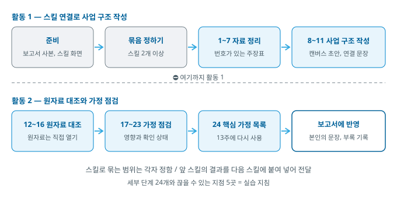

# 경영경제 AI 활용 입문 — 12주 실습 지침

> 오늘 활동 중에는 **이 문서만 확인**하면 됩니다. 개념 설명은 강의자료(12주)에 있습니다.
> 활동은 **각자** 진행하고, 활동 내용은 **제출하지 않습니다**. 만든 스킬과 기록은 각자 보관합니다(13주에 다시 사용).



- 실습 대상은 각자 현재 작성 중인 **최종 보고서**입니다(이름과 학번을 지운 사본).
- 교수가 예시 보고서로 과정을 먼저 진행합니다(시연 1, 시연 2). 그 뒤에 각자의 보고서로 같은 과정을 진행합니다.
- 이 문서에는 단계마다 **목표, 결과물, 확인 기준**만 있습니다. 스킬의 「요청 사항」과 요청문은 각자의 보고서에 맞추어 **직접 작성**합니다. 앞 주차에서 학습한 내용을 모두 활용합니다.
- 구간마다 **실행 → 확인 → 다르면 조치**의 순서로 진행합니다. 조치 끝에 적힌 자리로 돌아갑니다.
- 트랙은 과제 1, 2에서 정한 트랙입니다(A = 기업, 산업 분석 / B = 아이디어 검증). 표에서 각자 트랙의 내용만 따라 합니다.
- 두 번 다시 요청해도 해결되지 않으면 교수에게 알립니다.

**활동 결과의 사용**

- 활동의 결과는 각자의 최종 보고서에 반영합니다.
- AI의 답을 그대로 옮기지 않고, 확인한 내용을 본인의 문장으로 작성합니다.
- 사용한 스킬과 확인 기록은 보고서의 AI 활용 부록에 기록합니다.

## 준비 — 보고서 사본, 기록 파일, 스킬 만들기 화면

**준비-1. 보고서 사본 만들기**

- 실행: 작성 중인 최종 보고서의 사본을 만들고 **이름과 학번을 지운 뒤** PDF로 저장합니다.
- 실행: 바탕 화면에 새 폴더 `week12`를 만들고 사본을 이 폴더에 둡니다.
- 확인: 사본을 열어 이름과 학번이 없고, 절 제목과 출처가 원본과 같으면 정상입니다.
- 다르면: 보고서를 아직 작성하지 않은 절이 있어도 그대로 진행합니다. 작성한 절만 오늘의 대상입니다 → **준비-2로**

**준비-2. 기록 파일 만들기**

- 실행: 메모장이나 문서 프로그램에서 새 파일을 만들고 `week12` 폴더에 `week12_기록`으로 저장합니다.
- 실행: 구간이 끝날 때마다 결과물(표, 목록)을 이 파일에 붙여 넣고 저장합니다.
- 확인: `week12` 폴더에 보고서 사본과 기록 파일이 있으면 정상입니다.

**준비-3. 스킬 만들기 화면 열기**

- 실행: 학교 계정(단국대 Google 계정)으로 로그인한 Gemini에서 「스킬」 탭을 열고 오른쪽 위의 「만들기」를 누릅니다.
- 확인: 「이름」, 「설명」, 「요청 사항」 칸과 「파일 추가」 버튼이 있으면 정상입니다 → **묶음 정하기로**
- 다르면: 화면에 따라 아래 표대로 진행합니다.

| 화면 | 조치 → 돌아갈 자리 |
|------|------|
| 로그인 화면 또는 개인 계정의 화면 | 학교 계정으로 로그인 → **준비-3 다시** |
| 「스킬」 탭이나 「만들기」가 없음 | **대체 경로**로 진행 — 같은 학교 계정의 Gemini 일반 채팅을 사용하며, 구간마다 「대체 경로」 줄을 따릅니다 → **묶음 정하기로** |
| 일반 채팅도 열리지 않음 | **교수에게 알림** |

## 세부 단계 24개와 끊을 수 있는 지점

오늘 작업을 가장 잘게 나눈 단계입니다. 24개를 모두 따로 스킬로 만들지 않습니다. 이어지는 단계를 묶어 스킬 하나가 담당하게 합니다.

**구간 1. 자료 정리**

| 단계 | 목표 | 결과물 | 확인 기준 | 사용되는 단계 |
|:--:|------|------|------|:--:|
| 1 | 분석 범위를 정함(A = 기업의 어느 사업이나 제품, B = 어느 고객의 문제와 아이디어) | 분석 범위 | 대상이 하나로 정해져 있음 | 2, 6 |
| 2 | 분석 범위에 관련된 보고서의 절을 선택 | 대상 절 목록 | 절 제목이 보고서에 실제로 있음 | 3 |
| 3 | 대상 절의 문장을 주장 하나씩으로 나누고 번호를 붙임 | 번호가 있는 주장 목록 | 번호 하나에 주장 하나 | 4, 5, 6, 9 |
| 4 | 주장마다 성격을 표시(자료의 관찰과 기록, 작성자의 해석, 검토할 가정) | 성격이 표시된 주장표 | 모든 주장에 성격 표시 | 7, 17 |
| 5 | 주장이 인용한 출처를 연결, 수치에는 기준 시점과 단위를 표시 | 출처가 연결된 주장표 | 출처가 없는 주장은 「출처 없음」 | 12, 13 |
| 6 | 주장을 A의 BMC 네 블록 또는 B의 린 캔버스 아홉 칸에 연결 | 칸별 주장표 | 칸마다 주장 번호 | 7, 8 |
| 7 | 근거 후보가 없는 칸과 사용처가 정해지지 않은 주장을 표시 | 칸별 근거 현황표 | 빈 칸에 「근거 후보 없음」 | 8, 12 |

**구간 2. 사업 구조 작성**

| 단계 | 목표 | 결과물 | 확인 기준 | 사용되는 단계 |
|:--:|------|------|------|:--:|
| 8 | 칸의 내용을 작성(칸마다 반복), 자료가 부족한 칸에는 그 상태를 표시 | 캔버스 초안 | 칸의 내용이 보고서와 같음 | 9 |
| 9 | 초안의 문장을 뒷받침하는 주장 번호를 연결 | 근거가 연결된 캔버스 | 번호가 3의 목록에 있음 | 11, 12 |
| 10 | 칸 사이의 관계를 설명하는 연결 문장을 작성(A = 고객, 가치, 수익 경로 / B = 고객, 문제, 해결책) | 연결 문장 | A = 지불하는 사람과 지불 대상이 있음<br>B = 같은 고객의 문제와 해결책 | 11 |
| 11 | 9와 10을 대조해 칸 사이에서 어긋나는 부분을 찾음(A = 핵심 자원과 수익 경로 / B = 같은 고객의 문제와 해결책) | 불일치가 표시된 구조표 | 없으면 「없음」으로 기록 | 12, 16 |

**구간 3. 원자료 대조**

| 단계 | 목표 | 결과물 | 확인 기준 | 사용되는 단계 |
|:--:|------|------|------|:--:|
| 12 | 달라지면 사업 구조에 영향이 큰 주장 1건을 선택 | 원자료 확인 대상 1건 | 주장 번호와 선택한 이유 | 13 |
| 13 | 확인 대상의 원자료를 **직접** 찾아 열고 해당 표, 쪽, 문단을 찾음 | 원자료의 위치 또는 접근 결과 | 주소와 위치, 또는 접근하지 못한 이유 | 14 |
| 14 | 보고서의 주장과 원자료를 **직접** 대조(대상, 시점, 단위) | 원자료 대조 기록 | 일치, 불일치, 접근하지 못함 가운데 하나 | 15 |
| 15 | 대조 결과를 같은 주장 번호에 연결(기존 주장과 확인 결과를 함께 둠) | 갱신된 근거표 | 주장 번호가 바뀌지 않음 | 16, 19 |
| 16 | 11과 15를 바탕으로 영향받은 칸과 연결 문장을 수정 | 수정된 캔버스 | 수정한 칸에 수정 이유 | 17 |

**구간 4. 가정 점검**

| 단계 | 목표 | 결과물 | 확인 기준 | 사용되는 단계 |
|:--:|------|------|------|:--:|
| 17 | 구조가 성립하려면 참이어야 하지만 아직 확인하지 못한 내용을 가정으로 작성 | 가정 목록 | 가정마다 관련 칸 | 18 |
| 18 | 가정이 틀렸을 때 구조가 성립하지 않는지, 일부를 조정하면 되는지 판정 | 영향이 표시된 가정 목록 | 가정마다 영향 표시 | 19 |
| 19 | 영향이 크고 확인이 덜 된 가정부터 검토 순서를 정함 | 순서가 표시된 가정 목록 | 첫 순서의 가정 1건 | 20 |
| 20 | 첫 순서의 가정 1건에 대해 이미 모은 자료에서 반대 근거 후보를 찾음 | 반대 근거 후보 또는 미발견 기록 | 후보의 위치, 없으면 「검토한 자료에서는 찾지 못함」 | 21 |
| 21 | 후보가 같은 고객이나 사업 범위에 적용되고 그 가정을 실제로 약화하는지 판정 | 반대 근거 판정 기록 | 적용 여부와 이유 | 22 |
| 22 | 가정을 유지할지, 범위를 좁힐지, 판단을 보류할지 정함 | 처리 판단이 표시된 가정 목록 | 셋 가운데 하나와 이유 | 23 |
| 23 | 달라진 가정이 영향을 미치는 칸과 연결 문장을 갱신 | 점검을 반영한 캔버스 | 갱신한 칸의 표시 | 24 |
| 24 | 전체 판단을 좌우하는 가정을 선택해 보관 | 핵심 가정 목록 | 관련 칸, 틀리면 달라지는 판단, 근거, 확인 상태 | 13주 |

**끊을 수 있는 지점 5곳**

사람이 정하거나 직접 확인하는 단계입니다. 스킬은 이 지점 사이의 단계를 묶어 담당하게 합니다.

| 지점 | 단계 | 사람이 정하거나 확인하는 것 |
|:--:|:--:|------|
| ① | 1 | 분석 범위 |
| ② | 12 | 원자료 확인 대상 1건 |
| ③ | 13, 14 | 원자료를 직접 열어 대조 |
| ④ | 18, 22 | 가정의 영향과 처리 판단 |
| ⑤ | 24 | 핵심 가정의 선택 |

- 이 밖의 자리에서 끊어도 됩니다(예: 구간이 바뀌는 7단계 뒤).
- 스킬은 **2개 이상** 만듭니다.

## 활동 1 — 스킬 연결로 사업 구조 작성

**묶음 정하기**

- 실행: 위의 단계 표를 읽고, 1\~24단계를 몇 개의 스킬로 묶을지 정합니다.
- 실행: 기록 파일에 묶음 표를 작성합니다.

```
| 스킬 이름 | 담당하는 단계 | 받는 입력 | 다음에 전달할 결과물 |
```

- 확인: 스킬이 2개 이상이고, 묶음마다 담당하는 마지막 단계와 다음에 전달할 결과물이 적혀 있으면 정상입니다 → **스킬 만들기로**
- 다르면: 전달할 결과물을 정하지 못한 경우에는 그 묶음의 마지막 단계의 「결과물」 칸을 그대로 적습니다 → **묶음 정하기의 확인부터 다시**

**스킬 만들기**

활동 1에서 사용할 스킬(1\~11단계를 담당하는 묶음)부터 만듭니다. 나머지 스킬은 활동 2에서 만듭니다.

- 실행: 「스킬」 탭에서 「만들기」를 누르고 칸을 채운 뒤 「만들기」를 누릅니다.

| 칸 | 입력 |
|------|------|
| 이름 | 영문 소문자와 하이픈(담당하는 단계가 드러나는 이름) |
| 설명 | 이 스킬을 사용하는 시점 |
| 요청 사항 | 담당하는 단계의 목표와 결과물을 바탕으로 직접 작성 |
| 「파일 추가」 | 보고서를 읽는 스킬에만 `week12` 폴더의 보고서 사본을 추가 |

- 확인: 「스킬」 탭의 목록에 만든 스킬이 표시되면 정상입니다 → **1\~7 자료 정리로**
- 다르면: 아래 표대로 진행합니다.

| 화면 | 조치 → 돌아갈 자리 |
|------|------|
| 「만들기」가 눌리지 않음 | 「이름」 칸을 영문 소문자와 하이픈만으로 수정 → **스킬 만들기의 실행부터** |
| 파일을 추가하지 못했다는 안내 | 사본이 PDF인지 확인하고 다시 추가 → **스킬 만들기의 실행부터** |
| 두 번 다시 해도 만들어지지 않음 | **교수에게 알림** → 교수의 안내에 따라 대체 경로 |

- 대체 경로: 「요청 사항」으로 작성한 글을 기록 파일에 묶음마다 저장해 둡니다. 구간을 진행할 때 일반 채팅의 새 채팅에 그 글을 붙여 넣고 시작합니다.

**1\~7. 자료 정리**

- 실행: 1단계의 분석 범위를 직접 정해 기록 파일에 적습니다.
- 실행: 새 채팅의 입력창에 「@」를 입력하고 2\~7단계를 담당하는 스킬을 선택한 뒤, 분석 범위와 함께 요청을 보냅니다.
  - 이 구간을 스킬 여러 개로 나누었으면 차례로 부르고, 앞 스킬의 결과물을 다음 스킬의 입력에 붙여 넣습니다.
- 대체 경로: 새 채팅에 보고서 사본을 첨부하고, 기록 파일의 「요청 사항」 글과 분석 범위를 함께 보냅니다.
- 실행: 결과물(칸별 주장표, 칸별 근거 현황표)을 기록 파일에 붙여 넣습니다.
- 확인: 아래 세 항목이 모두 정상이면 다음으로 진행합니다 → **8\~11 사업 구조 작성으로**

| 확인 항목 | 정상 | 다르면 → 돌아갈 자리 |
|------|------|------|
| 주장 번호 | 주장마다 번호가 있고 번호 하나에 주장 하나 | 「요청 사항」에서 결과물의 형식을 수정해 저장 → **1\~7의 둘째 실행부터** |
| 보고서 대조 | 주장 2개를 보고서 사본에서 찾으면 같은 내용이 있음 | 보고서에 없는 주장은 표에서 지우도록 다시 요청 → **1\~7의 확인부터** |
| 근거 현황 | 근거 후보가 없는 칸이 표시되어 있음 | 빈 칸의 표시를 다시 요청 → **1\~7의 확인부터** |

**8\~11. 사업 구조 작성**

- 실행: 새 채팅에서 8\~11단계를 담당하는 스킬을 「@」로 부르고, 앞 구간의 결과물(칸별 주장표, 칸별 근거 현황표)을 **복사해 붙여 넣은 뒤** 요청을 보냅니다.
  - 같은 스킬이 1\~11단계를 모두 담당하는 묶음이면 앞 구간의 채팅에서 이어서 요청합니다.
- 대체 경로: 새 채팅에 기록 파일의 「요청 사항」 글과 앞 구간의 결과물을 함께 보냅니다.
- 실행: 결과물(근거가 연결된 캔버스, 연결 문장, 불일치가 표시된 구조표)을 기록 파일에 붙여 넣습니다.
- 확인: 아래 세 항목이 모두 정상이면 활동 1을 마칩니다 → **⛔ 정지선**

| 확인 항목 | 정상 | 다르면 → 돌아갈 자리 |
|------|------|------|
| 전달 | 캔버스의 문장에 앞 구간의 주장 번호가 사용됨 | 붙여 넣은 결과물에 주장 번호가 있는지 확인하고 다시 붙여 넣음 → **8\~11의 첫 실행부터** |
| 연결 문장 | A = 지불하는 사람과 지불 대상이 있음<br>B = 같은 고객의 문제와 해결책이 이어짐 | 빠진 부분을 채우도록 다시 요청 → **8\~11의 확인부터** |
| 부족한 칸 | 자료가 부족한 칸에 그 상태가 표시됨 | 보고서에 없는 내용으로 채워진 칸은 「자료 부족」으로 수정 → **8\~11의 확인부터** |

⛔ **여기까지 활동 1** — 다음은 시연 2(원자료 대조와 가정 점검)입니다.

## 활동 2 — 원자료 대조와 가정 점검

**12\~16. 원자료 대조**

- 실행: 12단계 — 캔버스에서 **달라지면 사업 구조에 영향이 큰 주장 1건**을 직접 선택해 주장 번호와 이유를 기록 파일에 적습니다.
- 실행: 13단계 — 그 주장의 원자료를 **직접** 찾아 엽니다. AI의 답에 있는 링크나 검색 결과가 아니라, 자료를 만든 곳(통계 기관, 공시 사이트, 기업)의 문서를 엽니다.
- 실행: 14단계 — 원자료에서 해당 표, 쪽, 문단을 찾아 보고서의 주장과 대조합니다. 대상, 시점, 단위가 같은지 확인합니다.
- 실행: 대조 기록을 기록 파일에 작성합니다.

```
| 주장 번호 | 보고서의 주장 | 원자료(기관, 문서, 주소) | 결과 | 확인한 날짜 |
```

- 확인: 결과 칸에 **일치, 불일치, 접근하지 못함** 가운데 하나가 있고, 불일치이면 원자료의 값이, 접근하지 못함이면 그 이유가 적혀 있으면 정상입니다.
- 다르면: 아래 표대로 진행합니다.

| 상황 | 조치 → 돌아갈 자리 |
|------|------|
| 로그인 화면으로 이동 | 「접근하지 못함(로그인 필요)」과 주소를 기록 → **12\~16의 확인** |
| 요약만 표시되고 결제 안내 | 「접근하지 못함(유료)」과 확인한 범위를 기록 → **12\~16의 확인** |
| 「페이지를 찾을 수 없음」 안내 | 「접근하지 못함(삭제 또는 이동)」과 주소를 기록 → **12\~16의 확인** |
| 열린 문서에 그 수치가 없음 | 「불일치」와 열린 문서의 제목을 기록 → **12\~16의 확인** |
| 원자료가 무엇인지 알 수 없음 | 보고서의 출처가 인용한 기관을 확인하고 그 기관의 사이트에서 찾음 → **13단계부터** |

- 실행: 15, 16단계 — 새 채팅에서 이 단계를 담당하는 스킬을 「@」로 부르고, 캔버스와 대조 기록을 붙여 넣어 요청합니다(스킬을 아직 만들지 않았으면 「스킬 만들기」의 순서로 먼저 만듭니다).
- 대체 경로: 새 채팅에 기록 파일의 「요청 사항」 글과 캔버스, 대조 기록을 함께 보냅니다.
- 확인: 대조 결과가 같은 주장 번호에 연결되고, 수정한 칸에 수정 이유가 있으면 정상입니다 → **17\~23 가정 점검으로**

**17\~23. 가정 점검**

- 실행: 새 채팅에서 17\~23단계를 담당하는 스킬을 「@」로 부르고, 수정된 캔버스와 갱신된 근거표를 붙여 넣어 요청합니다.
- 실행: 18단계(가정의 영향)와 22단계(처리 판단)는 AI의 답을 읽고 **직접 판정**합니다. 판정이 AI의 답과 다르면 기록 파일에서 수정합니다.
- 대체 경로: 새 채팅에 기록 파일의 「요청 사항」 글과 캔버스, 근거표를 함께 보냅니다.
- 확인: 아래 세 항목이 모두 정상이면 다음으로 진행합니다 → **24 핵심 가정 목록으로**

| 확인 항목 | 정상 | 다르면 → 돌아갈 자리 |
|------|------|------|
| 가정의 형식 | 가정마다 관련 칸이 적혀 있음 | 관련 칸을 적도록 다시 요청 → **17\~23의 확인부터** |
| 영향의 구분 | 「구조가 성립하지 않음」과 「조정할 수 있음」이 구분됨 | 구분이 없는 가정을 직접 판정해 표시 → **17\~23의 확인부터** |
| 반대 근거 | 후보의 위치가 있거나 「검토한 자료에서는 찾지 못함」이 있음 | 자료에 없는 일반론은 지우고 「찾지 못함」으로 기록 → **17\~23의 확인부터** |

**24. 핵심 가정 목록**

- 실행: 가정 목록에서 **전체 판단을 좌우하는 가정**을 직접 선택합니다.
- 실행: 기록 파일에 핵심 가정 목록을 작성합니다.

```
| 핵심 가정 | 관련 칸 | 틀리면 달라지는 판단 | 근거(주장 번호) | 확인 상태 |
```

- 확인: 다섯 칸이 모두 채워져 있으면 정상입니다(오늘 활동의 완료 기준). 이 목록은 13주 계산의 입력입니다.
- 다르면: 근거가 없는 가정은 근거 칸에 「없음」, 확인 상태 칸에 「추측」을 적습니다 → **24의 확인**

**반영 — 결과를 보고서에**

- 실행: 결과를 최종 보고서의 해당 부분에 반영합니다.

| 트랙 | 반영하는 부분 | 반영하는 내용 |
|------|------|------|
| A | 「③ 비즈니스 모델 — 수익 구조」 | 네 블록, 연결 문장, 확인한 주장과 확인하지 못한 주장의 구분 |
| B | 「② 린 캔버스」 | 아홉 칸과 확인 여부의 표시, 핵심 가정 |
| 공통 | 「AI 활용 부록」 | 사용한 스킬(이름, 담당하는 단계), 원자료 대조 기록 |

- 실행: AI의 답을 그대로 옮기지 않고, 확인한 내용을 본인의 문장으로 작성합니다.
- 실행: 불일치한 주장은 원자료의 값으로 수정해 출처를 표기하고, 접근하지 못한 주장은 「확인하지 못함」으로 표시하거나 다른 원자료로 교체합니다.
- 확인: 보고서의 어느 부분에 무엇을 반영할지 기록 파일에 적혀 있으면 정상입니다. 반영은 수업 뒤에 이어서 해도 됩니다.

**보관**

- 실행: 기록 파일을 저장하고 각자의 클라우드 드라이브나 메일에 보관합니다.
- 확인: 보관한 위치에서 기록 파일을 다시 열 수 있고, 「스킬」 탭의 목록에 만든 스킬이 2개 이상 있으면 정상입니다. 스킬과 핵심 가정 목록은 13주에 다시 사용합니다.

## 미션 — 끊는 지점 옮기기

일찍 마친 경우에 진행합니다. 수업 뒤에 진행해도 됩니다.

- 실행: 묶음 표에서 끊는 지점 하나를 옮깁니다(묶음 두 개를 하나로 합치거나, 묶음 하나를 둘로 나눔).
- 실행: 바뀐 묶음의 스킬을 새로 만들고, 같은 보고서 사본으로 그 구간을 다시 진행합니다.
- 실행: 기록 파일에 달라진 점을 적습니다(확인한 횟수, 다시 실행한 범위, 결과의 차이).
- 확인: 처음의 묶음과 바꾼 묶음 가운데 어느 것을 계속 사용할지와 그 이유가 적혀 있으면 정상입니다.

---

## 개정 이력

| 날짜 | 내용 |
|------|------|
| 2026-11-26 | 최초 게시 |
