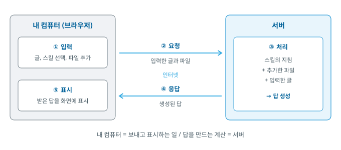
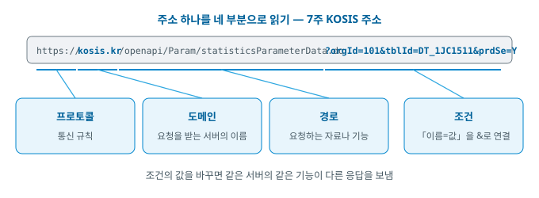
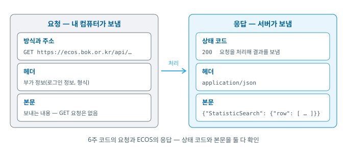
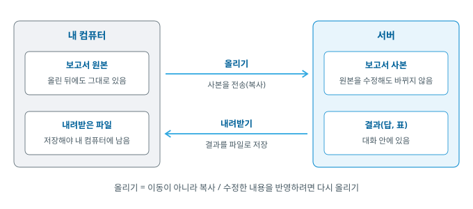
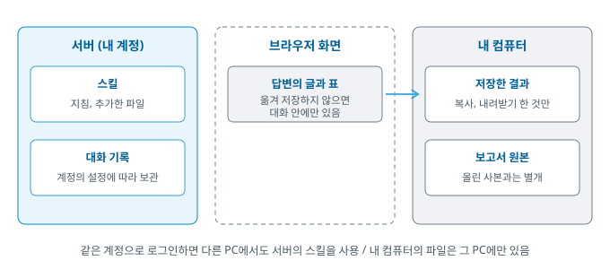
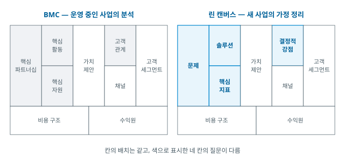
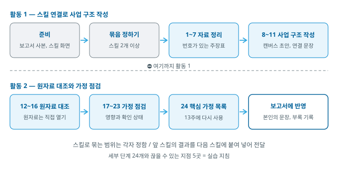

# 12주차 — 컴퓨터 밖에서 일어나는 일과 스킬 연결

> 경영경제 분야 AI 활용 입문 · 단국대학교
>
> **복습 기준 = 이 자료 + 수업 중 필기**

## 목차

- [1. 이번 주 개요 및 목표](#1-이번-주-개요-및-목표)
- [2. 컴퓨터 밖에서 일어나는 일 — 요청과 응답, 주소와 API, 파일이 오가는 길](#2-컴퓨터-밖에서-일어나는-일--요청과-응답-주소와-api-파일이-오가는-길)
- [3. 사업 구조와 가정 — BMC 네 블록과 린 캔버스](#3-사업-구조와-가정--bmc-네-블록과-린-캔버스)
- [4. 시연 1과 활동 1 — 스킬 연결로 사업 구조 작성](#4-시연-1과-활동-1--스킬-연결로-사업-구조-작성)
- [5. 시연 2와 활동 2 — 원자료 대조와 가정 점검](#5-시연-2와-활동-2--원자료-대조와-가정-점검)
- [6. 심화와 확장 — 린 캔버스, 스킬, 주소 읽기, 원자료 대조](#6-심화와-확장--린-캔버스-스킬-주소-읽기-원자료-대조)
- [7. 요약, 복습 문제, AI 지문 비판](#7-요약-복습-문제-ai-지문-비판)
- [개정 이력](#개정-이력)

---

## 1. 이번 주 개요 및 목표

### 1.1 이번 주 학습 목표

1. 스킬을 부를 때와 코드가 요청을 보낼 때 내 컴퓨터와 서버 사이에서 일어나는 일(요청과 응답, 파일의 이동, 결과가 남는 곳)을 설명한다.
2. 주소, 요청, 응답의 구성(조건, 방식, 상태 코드, JSON)을 읽고, 통신이 실패했을 때 문제가 있는 곳을 구분한다.
3. 검색 결과와 원자료를 구분하고, 원자료 페이지에 접근하지 못하는 경우를 구분해 기록한다.
4. 사업 구조를 트랙에 맞는 틀(BMC 네 블록, 린 캔버스 아홉 칸)로 세우고, 구조가 성립하려면 참이어야 하는 가정을 찾는다.
5. 일을 단계로 나누어 단계마다 스킬을 만들고, 앞 스킬의 결과를 다음 스킬로 전달해 사업 구조를 작성한다.
6. 원자료 대조와 가정 점검의 결과를 각자의 최종 보고서에 반영한다.

오늘은 **컴퓨터 밖에서 일어나는 일**을 먼저 다루고, 스킬 여러 개를 연결해 **사업 구조와 가정**을 정리합니다.

- 지난주 = 내 컴퓨터 안에서 코드가 실행되는 과정, 지침을 저장해 다시 사용하는 스킬 1개
- 오늘 = 내 컴퓨터와 **서버** 사이의 요청과 응답(주소, 상태 코드, API), 스킬 **여러 개를 연결**해 진행하는 작업
- 오늘의 성과물 = 연결한 스킬(2개 이상), 사업 구조, 원자료 대조 기록 1건, 핵심 가정 목록

### 1.2 이번 주 진행 순서

설명, 시연, 활동의 순서로 진행합니다. **절 번호 = 진행 순서**

| 절 | 내용 |
|:--:|------|
| §2 | 클라이언트와 서버, 주소의 구성, 요청과 응답의 구성, API, 코드에서 보내는 요청, 파일이 오가는 길, 원자료 페이지 열기 |
| §3 | 읽는 틀과 세우는 틀, 린 캔버스의 아홉 칸, 칸은 가정, 실패 사례, BMC 네 블록의 가정 |
| **§4** | 시연 1 → **활동 1** — 실습(단계 나누기, 스킬 만들기, 결과 전달, 사업 구조 작성) |
| **§5** | 시연 2 → **활동 2** — 실습(원자료 대조, 가정 점검, 보고서에 반영) → 수업 종료 |
| §6, §7 | 수업 뒤 자습 — 린 캔버스, 스킬, 주소 읽기, 원자료 대조, 복습 문제 |

- **시연** = 교수가 예시 보고서 1편으로 과정을 먼저 진행, 입력 과정까지 화면으로 확인
- **수업 내 활동** = **2회**, 두 활동 모두 〈실습〉을 **각자** 진행
- **실습 대상** = 각자 현재 작성 중인 **최종 보고서**(이름과 학번을 지운 사본)
- **실습 활동의 내용** = 실습 지침 참고
  - [12주 실습 지침](Week12_실습안내.md), 저장소 첫 화면 README에도 있음
- **활동 내용 제출 없음** — 만든 스킬과 기록은 각자 보관(13주에 다시 사용)

**활동 결과의 사용 — 세 가지**

- 활동의 결과는 각자의 **최종 보고서에 반영**
- AI의 답을 그대로 옮기지 않고, **확인한 내용을 본인의 문장으로** 작성
- 사용한 스킬과 확인 기록 = 보고서의 **AI 활용 부록**에 기록

- **스킬 만들기 화면** = 학교 계정 Gemini의 「스킬」 탭 → 「만들기」
- **스킬 부르기** = 입력창에 「@」를 입력하고 스킬 이름을 선택
- **요청문** = 각자의 보고서와 단계에 맞추어 직접 작성(3주의 프롬프트 요소 등 앞 주차에서 학습한 내용을 모두 활용)
- **미션** = 스킬을 끊는 지점을 옮겨 다시 연결하고 결과를 비교
- 과제 3 = 진행 중, **12월 20일(일) 23:59까지 제출**

---

## 2. 컴퓨터 밖에서 일어나는 일 — 요청과 응답, 주소와 API, 파일이 오가는 길

### 학습목표

- 클라이언트와 서버의 역할을 구분하고 요청과 응답의 순서를 설명할 수 있다.
- 주소를 프로토콜, 도메인, 경로, 조건으로 나누어 읽을 수 있다.
- 요청의 방식(GET, POST), 응답의 상태 코드, 본문의 형식(HTML, JSON)을 구분할 수 있다.
- API 문서에서 확인할 네 가지와 인증키, 호출 한도의 뜻을 설명할 수 있다.
- 요청을 보내는 코드에서 주소, 요청, 응답 변환, 확인 부분을 찾고, 실패했을 때 문제가 있는 곳을 구분할 수 있다.
- 올린 파일과 결과가 남는 곳, 검색 결과와 원자료를 구분할 수 있다.

### 2.1 오늘의 예시 — 스킬을 부르는 요청과 코드가 보내는 요청

> [!IMPORTANT]
> - 예시 ① = 보고서 파일을 올리고 스킬을 「@」로 불러 답을 받는 한 번
> - 예시 ② = 6주에 실행한 코드가 한국은행의 서버에서 기준금리를 받아 온 한 번
> - 확인할 질문 = **두 예시에서 내 컴퓨터는 무엇을 보냈고, 답은 어디에서 만들어져 무엇으로 돌아왔는가**

- 지난주의 판매 분석 = 코드 파일도, 계산하는 CPU도, 결과 파일도 **내 컴퓨터 안**
- 오늘의 두 예시 = 내 컴퓨터가 **다른 컴퓨터(서버)에 요청**하고 결과를 받음
  - 예시 ① = 브라우저가 요청을 보냄
  - 예시 ② = 코드가 요청을 보냄
- 두 예시는 요청을 보내는 프로그램만 다르고 **구조가 같음**
  - 이 구조를 알면 = AI에게 서버와 통신하는 프로그램을 요청하고, AI가 작성한 코드를 점검할 수 있음

**이 절의 순서**

| 질문 | 소절 |
|------|------|
| 누가 누구에게 요청하는가 | 2.2 클라이언트와 서버 |
| 어디로 보내는가 | 2.3 주소의 구성 |
| 무엇을 보내고 무엇을 받는가 | 2.4 요청의 구성, 2.5 응답의 구성 |
| 프로그램은 어떤 창구를 사용하는가 | 2.6 API |
| 코드에는 어떻게 적혀 있는가 | 2.7 코드에서 보내는 요청 |
| 파일과 결과는 어디에 남는가 | 2.8 파일이 오가는 길과 결과가 남는 곳 |
| 출처 링크를 열면 무엇이 열리는가 | 2.9 원자료 페이지 열기 |

### 2.2 클라이언트와 서버 — 요청과 응답

> [!IMPORTANT]
> - **클라이언트** = 요청을 보내는 프로그램(브라우저, 코드)
> - **서버** = 요청을 받아 처리하고 응답을 보내는 컴퓨터
> - 통신의 단위 = **요청 한 번에 응답 한 번**



| 순서 | 일어나는 곳 | 내용 |
|:--:|------|------|
| ① 입력 | 내 컴퓨터(브라우저) | 입력창에 글 작성, 스킬 선택, 파일 추가 |
| ② 요청 | 내 컴퓨터 → 서버 | 입력한 글과 파일이 인터넷으로 전송 |
| ③ 처리 | 서버 | 스킬의 지침, 추가한 파일, 입력한 글을 함께 사용해 답 생성 |
| ④ 응답 | 서버 → 내 컴퓨터 | 생성된 답이 인터넷으로 전송 |
| ⑤ 표시 | 내 컴퓨터(브라우저) | 받은 답을 화면에 표시 |

- 내 컴퓨터가 하는 일 = 입력을 **보내는 일**과 응답을 **표시하는 일**
- 답을 만드는 계산 = 서버에서 진행
  - 인터넷 연결이 끊기면 요청이 서버에 도달하지 못해 답을 받을 수 없음
  - 강의실 PC의 성능이 낮아도 답의 내용은 달라지지 않음
- 스킬의 지침을 사용자가 매번 보내지 않아도 되는 이유 = 지침이 **서버에 저장**되어 있음(2.8)

**서버 — 다른 곳에 있는 컴퓨터**

- 서버도 11주 2.0의 다섯 가지(CPU, 메모리, 저장장치, 운영체제, 프로그램)로 구성된 컴퓨터
- 내 컴퓨터와 다른 점 = 서비스 회사의 시설에 있고, 많은 사용자의 요청을 동시에 처리
- 답을 만드는 AI 모델 = 서버에서 실행되는 프로그램
  - 내 컴퓨터에 AI 모델이 설치되어 있지 않아도 답을 받을 수 있는 이유

**브라우저와 코드 — 둘 다 클라이언트**

| 구분 | 예시 ① 브라우저 | 예시 ② 코드 |
|------|------|------|
| 요청을 보내는 것 | Chrome | Python 코드의 요청 줄 |
| 요청을 받는 서버 | Gemini의 서버 | 한국은행 ECOS의 서버 |
| 응답의 형태 | 화면에 표시할 글과 페이지 | 프로그램이 읽는 자료(JSON) |
| 응답을 받은 뒤 | 화면에 표시 | 필요한 값을 읽어 출력, 계산, 저장 |

- 사람이 브라우저로 하던 일을 코드가 대신하는 것 = **서버와 통신하는 프로그램**

**지난주의 코드 실행과 비교**

| 구분 | 11주 Python 코드 | 12주 스킬 |
|------|------|------|
| 계산이 진행되는 곳 | 내 컴퓨터의 CPU | 서버 |
| 인터넷 연결 | 실행에는 필요 없음 | 필요 |
| 결과가 처음 나타나는 곳 | IDLE의 Shell 창 | 브라우저 화면 |
| 다시 사용하려면 | 결과 파일을 저장장치에 저장 | 답을 복사하거나 내려받아 저장(2.8) |

**10주의 두 경로 — 같은 코드, 다른 실행 위치**

| 구분 | IDLE 경로 | Colab 경로 |
|------|------|------|
| 코드가 실행된 곳 | 강의실 PC | Google의 서버 |
| 지표 파일이 있어야 하는 곳 | 강의실 PC의 폴더 | 서버(올린 사본) |
| 결과를 남기는 방법 | 강의실 PC에 파일로 저장 | 서버에 생성된 파일을 내려받기 |

- Colab 경로에서 지표 파일을 올려야 했던 이유 = 코드가 서버에서 실행되므로 **파일도 서버에 있어야** 함
- 실행 위치가 정해지면 = 파일이 있어야 할 곳과 결과가 남는 곳이 정해짐

### 2.3 주소의 구성 — 어느 서버의 무엇을 요청하는가

> [!IMPORTANT]
> - **주소**(URL) = 어느 서버의 어느 자료를 어떤 조건으로 요청하는지 적은 문자열
> - 구성 = **프로토콜, 도메인, 경로, 조건**
> - AI가 작성한 코드에서 가장 먼저 확인할 줄 = **주소를 작성하는 줄**



| 부분 | 7주 KOSIS 주소의 예 | 뜻 |
|------|------|------|
| 프로토콜 | `https://` | 통신 규칙, `https`는 전송 중인 내용을 암호화 |
| 도메인 | `kosis.kr` | 요청을 받는 서버의 이름 |
| 경로 | `/openapi/Param/statisticsParameterData.do` | 그 서버에서 요청하는 자료나 기능 |
| 조건 | `?orgId=101&tblId=DT_1JC1511&prdSe=Y` | 「이름=값」을 `&`로 연결해 `?` 뒤에 둠 |

*(주소의 구성 = MDN Web Docs 「What is a URL?」 — 2026-11-25 확인)*

**조건을 적는 두 가지 방식**

| 방식 | 예 | 읽는 방법 |
|------|------|------|
| `?` 뒤에 「이름=값」 | KOSIS — `…?orgId=101&tblId=DT_1JC1511` | 이름으로 뜻을 확인 |
| 경로에 순서대로 | ECOS — `…/sample/json/kr/1/10/722Y001/Q/…` | 자리의 순서로 뜻을 확인 |

- ECOS 주소의 순서 = 서비스 이름 / 인증키 / 형식 / 언어 / 시작 번호 / 끝 번호 / 통계표 / 주기 / 시작 시점 / 끝 시점 / 항목
- 조건의 값을 바꾸면 응답이 달라짐
  - 형식 `json`을 `xml`로 바꾸면 = 같은 자료가 다른 형식으로 응답
  - 끝 번호 `10`을 `12`로 바꾸면 = 공개 키의 한도를 넘어 오류 응답(2.5)

**도메인, IP 주소, 포트**

| 용어 | 뜻 | 예 |
|------|------|------|
| 도메인 | 사람이 읽는 서버의 이름 | `ecos.bok.or.kr` |
| IP 주소 | 네트워크에서 컴퓨터를 구분하는 번호 | 도메인을 IP 주소로 바꾸는 체계 = DNS |
| 포트 | 한 컴퓨터 안에서 서비스를 구분하는 번호 | `https`의 기본값 443(주소에서 생략) |
| `localhost` | 내 컴퓨터 자신을 가리키는 이름 | `http://localhost:8000` |

- AI가 작성한 프로그램이 `localhost` 주소를 안내한 경우 = 그 프로그램이 **내 컴퓨터 안에서** 실행 중이며, 다른 사람의 컴퓨터에서는 그 주소가 열리지 않음

### 2.4 요청의 구성 — 방식, 헤더, 본문

> [!IMPORTANT]
> - 요청 = **방식 + 주소 + 헤더 + 본문**
> - 방식 **GET** = 자료를 가져오는 요청, **POST** = 자료를 보내는 요청
> - 브라우저 주소창에 주소를 입력하는 것 = GET 요청

| 구성 | 내용 | 예시 ① 스킬 | 예시 ② 6주 코드 |
|------|------|------|------|
| 방식 | 가져오기(GET), 보내기(POST) | 글과 파일을 보냄 | 자료를 가져옴(GET) |
| 주소 | 어느 서버의 무엇 | Gemini 서비스의 주소 | ECOS의 통계 조회 주소 |
| 헤더 | 요청에 붙는 부가 정보 | 로그인한 계정의 정보 | 코드에서 따로 지정하지 않음 |
| 본문 | 보내는 내용 | 입력한 글, 추가한 파일 | 없음(조건은 주소에 포함) |

*(요청 방식 = MDN Web Docs 「HTTP request methods」 — 2026-11-25 확인)*

- **GET** = 조건을 주소에 적음 → 주소가 같으면 같은 요청
  - 6주와 7주의 통계 조회 코드는 모두 GET
- **POST** = 보내는 내용을 본문에 담음 → 글, 파일, 양식의 제출
- **헤더의 로그인 정보** = 서버가 누구의 요청인지 구분하는 근거
  - 학교 계정에서 만든 스킬이 개인 계정으로 로그인하면 표시되지 않는 이유
- 프로그램을 요청하기 전에 정할 것 = 가져오는 요청인가 보내는 요청인가, 조건을 어디에 적는가

### 2.5 응답의 구성 — 상태 코드와 본문

> [!IMPORTANT]
> - 응답 = **상태 코드 + 헤더 + 본문**
> - **상태 코드** = 요청이 어떻게 처리되었는지 알리는 세 자리 숫자
> - **본문의 형식** = 사람이 읽는 페이지(HTML), 프로그램이 읽는 자료(JSON)



| 상태 코드 | 뜻 | 문제가 있는 곳 |
|:--:|------|------|
| 200 | 요청을 처리해 결과를 보냄 | 없음 |
| 301, 302 | 주소가 바뀜(새 주소로 다시 요청) | 없음 |
| 400 | 요청의 형식이 잘못됨 | 요청(주소, 조건) |
| 401 | 인증이 필요함 | 요청(로그인, 인증키) |
| 403 | 접근 권한이 없음 | 요청(권한) |
| 404 | 요청한 자료를 찾을 수 없음 | 요청(주소) |
| 429 | 정해진 시간 안에 요청을 너무 많이 보냄 | 요청(횟수) |
| 500, 503 | 서버가 처리하지 못함 | 서버 |

*(출처: MDN Web Docs 「HTTP response status codes」 — 2026-11-25 확인)*

- 첫 자리로 구분 = **2**는 성공, **3**은 이동, **4**는 요청의 문제, **5**는 서버의 문제
- 4로 시작하는 경우 = 같은 요청을 다시 보내도 같은 결과 → **요청을 수정**
- 5로 시작하는 경우 = 요청은 그대로 두고 **시간을 두고 다시 요청**

**본문의 형식 — HTML과 JSON**

| 형식 | 읽는 주체 | 모습 | 예 |
|------|------|------|------|
| HTML | 사람(브라우저가 화면으로 표시) | 제목, 문단, 표, 그림의 배치 | 기사, 통계 사이트의 화면 |
| JSON | 프로그램 | 「이름: 값」의 묶음과 목록 | ECOS, KOSIS의 조회 응답 |
| 파일 | 사람 또는 프로그램 | PDF, CSV, 그림 | 보고서, 내려받는 자료 |

- 형식은 응답의 헤더에 표시 = ECOS의 JSON 응답은 `application/json` *(2026-11-25 요청으로 확인)*

**JSON 읽는 방법 — 6주 ECOS 응답의 구조**

```json
{"StatisticSearch": {
    "list_total_count": 12,
    "row": [
      {"ITEM_NAME1": "한국은행 기준금리", "TIME": "2023Q4",
       "DATA_VALUE": "3.5", "UNIT_NAME": "연%"}
    ]
}}
```

- `{ }` = 「이름: 값」의 묶음, `[ ]` = 같은 모양의 항목이 여러 개인 목록
- 이 응답 = 전체 건수 12, `row` 목록의 항목 하나가 분기 하나의 값
- 값을 찾는 경로 = `StatisticSearch` → `row` → 항목 → `DATA_VALUE`
- 실제 응답의 항목에는 통계표 코드, 항목 코드 등의 이름이 더 있음(위는 일부)

**상태 코드가 200인데 원하는 자료가 아닌 경우**

| 요청 | 상태 코드 | 본문 |
|------|:--:|------|
| ECOS 공개 키로 1\~10번 요청 | 200 | 기준금리 자료 10건 |
| ECOS 공개 키로 1\~12번 요청 | 200 | `ERROR-301`(공개 키는 10건까지) |
| KOSIS에 인증키 없이 요청 | 200 | 오류 코드 10(인증키 누락) |
| ECOS에 없는 경로를 요청 | 404 | 안내 페이지(HTML) |

*(2026-11-25 요청으로 확인)*

- 상태 코드 200 = **서버가 응답을 보냈다**는 뜻이며, 원하는 자료를 받았다는 뜻이 아님
- 서비스가 본문에 **자체 오류 코드**를 담는 경우가 있음 → 상태 코드와 본문을 **둘 다 확인**
- 6주 코드가 응답에 `StatisticSearch`가 있는지 먼저 확인한 이유

### 2.6 API — 프로그램이 사용하는 창구

> [!IMPORTANT]
> - **API**(Application Programming Interface) = 프로그램이 요청할 수 있도록 서버가 정해 둔 주소와 규칙
> - 웹 페이지 = 사람이 읽는 화면, API = 프로그램이 읽는 자료
> - 프로그램으로 자료를 받을 때는 **API가 있는지부터** 확인

| 구분 | 웹 페이지 | API |
|------|------|------|
| 사용하는 주체 | 사람(브라우저) | 프로그램(코드) |
| 응답의 형식 | HTML | JSON 등 |
| 사용 조건 | 대부분 주소만으로 열림 | 인증키, 호출 한도, 이용 약관 |
| 화면이 개편된 경우 | 사람은 그대로 읽음 | 주소와 규칙이 유지되어 프로그램이 계속 동작 |

**API 문서에서 확인할 네 가지**

| 확인할 것 | 내용 | 6주 ECOS의 예 |
|------|------|------|
| 주소 | 요청을 보낼 곳 | `https://ecos.bok.or.kr/api/StatisticSearch/…` |
| 요청 조건 | 조건의 이름, 순서, 값의 형식 | 통계표 `722Y001`, 주기 `Q`, 기간, 항목 |
| 인증 | 인증키의 발급과 전달 방법 | 주소의 둘째 자리에 인증키 |
| 응답 형식 | 형식, 이름의 뜻, 오류 코드 | JSON, `DATA_VALUE`, `ERROR-301` |

- AI에게 프로그램을 요청할 때 = 위 네 가지가 정해져 있어야 원하는 요청을 보내는 코드가 작성됨
- AI가 학습한 내용으로 작성한 주소와 조건의 이름은 **실제 API 문서와 다를 수 있음**
  - API 문서의 해당 부분을 함께 제공하거나, 작성된 코드의 주소를 문서와 대조

**인증키와 호출 한도**

- **인증키** = 서버가 누구의 프로그램인지 구분하는 문자열(로그인 정보와 같은 역할)
  - 코드와 AI에 입력하는 글에 **인증키를 적지 않음** → 7주의 Colab 보안 비밀처럼 따로 보관
  - 주소에 인증키가 포함되는 서비스 = 주소를 그대로 공유하면 인증키도 함께 공유됨
  - 인증키를 다른 사람이 사용하게 하는 것은 각 기관의 약관으로 금지
- **호출 한도** = 정해진 범위 안에서만 요청할 수 있다는 제한

| 서비스 | 한도 |
|------|------|
| ECOS 공개 키(`sample`) | 요청 한 번에 10건까지 |
| KOSIS | 분당 200건 |
| OpenDART | 하루 20,000건, 분당 1,000회를 넘으면 해당 IP를 1시간 차단 |

*(각 기관의 안내와 약관 — 2026-10-07 확인)*

- 반복해서 요청하는 프로그램 = 한도를 넘지 않도록 요청 사이에 **간격**을 둠

### 2.7 코드에서 보내는 요청 — 6주 코드 읽기

> [!IMPORTANT]
> - 요청을 보내는 코드의 순서 = **주소 작성 → 요청 → 응답 변환 → 확인**
> - 코드를 직접 작성하지 않아도, 이 네 부분을 찾아 읽으면 AI가 작성한 코드를 점검할 수 있음

```python
url = (f"https://ecos.bok.or.kr/api/StatisticSearch/{API_KEY}/json/kr/"
       f"{first}/{last}/{STAT_CODE}/{CYCLE}/{START}/{END}/{ITEM_CODE}")
with urllib.request.urlopen(url, timeout=30) as resp:
    data = json.loads(resp.read().decode("utf-8"))
if "StatisticSearch" not in data:
    result = data.get("RESULT", {})
```

*(6주 예시 코드의 요청 부분, 주석은 생략)*

| 줄 | 내용 | 2절의 개념 |
|:--:|------|------|
| 1\~2 | 조건을 넣어 주소를 작성 | 주소의 구성(2.3) |
| 3 | 주소로 요청을 보내고 응답을 받음, 30초 안에 응답이 없으면 중단 | 요청(2.4), 시간 제한 |
| 4 | 응답의 본문(JSON)을 프로그램의 자료로 변환 | 본문의 형식(2.5) |
| 5\~6 | 정상 응답인지 확인하고 오류 코드를 읽음 | 본문의 오류 코드(2.5) |

- 7주 KOSIS 코드도 같은 순서 = 조건 묶음으로 주소 작성 → 요청 → 변환 → 오류 확인

**실패했을 때 — 어디의 문제인가**

| 문제가 있는 곳 | 브라우저에서의 모습 | 코드에서의 모습 | 먼저 확인할 것 |
|------|------|------|------|
| 연결 | 페이지가 열리지 않음 | 연결 오류, 시간 초과 | 다른 사이트는 열리는가 |
| 주소 | 「찾을 수 없음」 안내 | 상태 코드 404 | 주소의 철자와 경로 |
| 인증 | 로그인 화면으로 이동 | 401, 403 또는 본문의 오류 코드 | 계정, 인증키 |
| 요청 조건 | 빈 결과 | 400 또는 본문의 오류 코드 | 조건의 이름과 값의 형식 |
| 횟수 | 잠시 뒤에 다시 시도하라는 안내 | 429 | 요청 사이의 간격 |
| 서버 | 오류 안내, 응답이 멈춤 | 500, 503 | 잠시 뒤에 같은 요청 |

- AI에게 오류의 수정을 요청할 때 필요한 정보 = **상태 코드, 본문의 오류 코드와 메시지, 요청한 주소(인증키는 지움)**
- 「오류가 발생합니다」만 전달한 경우 = AI는 문제가 있는 곳을 추측해 코드를 수정
- 오류 없이 끝난 경우에도 확인할 것 = 받은 건수와 전체 건수가 같은가(6주의 `list_total_count`)

### 2.8 파일이 오가는 길과 결과가 남는 곳

> [!IMPORTANT]
> - **올리기**(업로드) = 내 컴퓨터에 있는 파일의 **사본**이 서버로 전송
> - **내려받기**(다운로드) = 서버에 있는 결과가 내 컴퓨터의 **파일**로 저장
> - 올린 뒤에 내 컴퓨터의 원본을 수정해도 **서버의 사본은 바뀌지 않음**



- 올리기 = 이동이 아니라 **복사** → 원본은 내 컴퓨터에 그대로 있음
- 입력창에 붙여 넣은 글도 같은 길로 전송(요청에 포함)
- 올린 파일은 내 컴퓨터 밖에 보관 → 올리기 전에 내용을 확인
  - 오늘 실습에서 이름과 학번을 지운 **사본**을 사용하는 이유
  - 3주의 사용 수칙(기밀과 개인정보를 입력하지 않음)과 같은 원칙

**올리기 전에 확인할 세 가지**

| 확인할 것 | 이유 |
|------|------|
| 이름, 학번, 연락처를 지웠는가 | 올린 파일은 내 컴퓨터 밖에 보관 |
| 가장 최근에 저장한 파일인가 | 올린 시점의 내용만 서버에 전달 |
| 스킬에 추가할 수 있는 형식인가 | 텍스트, PDF, 이미지 파일(합계 100MB까지) |

*(스킬에 추가하는 파일의 형식과 용량 = Gemini 고객센터 안내, 2026-11-18 확인)*

**올린 뒤에 원본을 수정한 경우**

| 상황 | 스킬이 사용하는 것 | 필요한 조치 |
|------|------|------|
| 보고서를 올린 뒤 내 컴퓨터에서 수정 | 수정 전의 사본 | 수정한 파일을 다시 올림 |
| 스킬에 추가한 파일을 내 컴퓨터에서 삭제 | 서버에 있는 사본 | 없음(스킬은 그대로 동작) |
| 스킬에서 파일을 삭제 | 파일 없이 지침만 | 원본은 내 컴퓨터에 그대로 |

- 위 표는 **내 컴퓨터에서 올린 파일**의 경우
- Google Drive에 있는 파일을 연결한 경우의 동작은 6.3 참고

**결과가 남는 곳 — 서버에 남는 것과 내 컴퓨터에 남는 것**

> [!IMPORTANT]
> - 스킬(지침과 추가한 파일)과 대화 기록 = **계정에 연결되어 서버에 보관**
> - 내 컴퓨터에 남는 것 = **복사하거나 내려받아 저장한 것**만
> - 다른 PC에서도 같은 계정으로 로그인하면 스킬이 표시되는 이유 = 스킬이 PC가 아니라 서버에 있음



| 대상 | 남는 곳 | 다시 사용하는 방법 |
|------|------|------|
| 스킬(지침, 추가한 파일) | 서버(내 계정) | 같은 계정으로 로그인해 「@」로 부름 |
| 대화 기록 | 서버(내 계정, 계정의 설정에 따름) | 대화 목록에서 열기 |
| 답변의 글과 표 | 브라우저 화면 | 복사해 문서에 붙여 넣고 저장 |
| 올린 보고서의 원본 | 내 컴퓨터 | 내 컴퓨터에서 열기 |

- 강의실 PC는 여러 사람이 사용 → 내려받은 파일은 개인 저장 공간(Drive, 메일, USB)에도 보관
- 11주와 같은 원칙 = **다음에 사용할 결과는 파일로 저장**(화면의 답은 대화 안에만 있음)

**스킬 사이에서 결과가 전달되는 방법**

- 스킬의 답 = 그 요청에 포함된 내용(지침, 추가한 파일, 입력한 글)을 근거로 생성(2주의 컨텍스트 창)
- 앞 스킬의 결과를 다음 스킬이 사용하게 하려면 = 그 결과가 **다음 요청에 포함**되어야 함
- 오늘의 방법 = 앞 스킬의 결과를 복사해 다음 스킬의 입력에 **붙여 넣기**
  - 무엇이 전달되었는지 사용자가 직접 확인할 수 있음
  - 전달이 되었는지의 확인 = 다음 스킬의 답이 앞 결과의 번호와 표현을 사용했는가

**Q**: 강의실에서 만든 스킬을 집에서 사용하려고 합니다. 가져가야 하는 것과 가져가지 않아도 되는 것은 무엇입니까?

**A**: 스킬은 가져가지 않아도 되고, **내려받은 결과 파일은 가져가야** 합니다.

- 스킬(지침, 추가한 파일) = 서버에 있음 → 집에서 같은 학교 계정으로 로그인하면 「@」로 부를 수 있음
- 강의실 PC에 내려받은 파일, 문서에 옮겨 적은 결과 = 강의실 PC에 있음 → 개인 저장 공간에 보관해야 사용할 수 있음
- 보고서의 원본 = 내 컴퓨터에 있음 → 스킬에 추가한 사본과는 별개

### 2.9 원자료 페이지 열기 — 검색 결과와 원자료는 다른 문서

> [!IMPORTANT]
> - AI 답변의 출처 링크와 검색 결과 화면 = 원자료가 아니라 **원자료를 가리키는 주소**
> - **원자료** = 통계 기관, 공시 사이트, 기업처럼 자료를 만든 곳의 서버에 있는 문서
> - 링크를 여는 것 = 그 서버에 **새 요청**을 보내는 것

- AI의 답에 있는 수치 = AI가 생성한 글의 일부
- 그 수치가 원자료에 실제로 있는지는 **원자료 페이지를 직접 열어야** 확인됨
- 링크가 열려도 확인이 끝난 것은 아님 = 열린 문서에서 그 수치가 있는 표, 쪽, 문단까지 찾아 대조
- 대조할 때 확인할 것 = **대상**(누구, 어느 범위), **시점**(기준 연도와 월), **단위**(원, 명, %)

**검색 결과와 AI의 답이 만들어지는 곳**

| 화면 | 만든 곳 | 원자료와의 관계 |
|------|------|------|
| 검색 결과 목록 | 검색 서비스의 서버 | 원자료의 주소와 일부 문장만 표시 |
| AI의 답과 출처 링크 | AI 서비스의 서버 | AI가 가져온 글의 일부를 근거로 생성 |
| 원자료 페이지 | 자료를 만든 곳의 서버 | 원자료 자체 |

- AI가 웹 검색을 사용한 경우(2주) = AI 서비스의 서버가 사용자를 대신해 요청을 보내 글을 가져옴
- AI가 가져와 사용한 범위와 원자료 전체는 다를 수 있음 → 표의 주석, 기준 시점, 단위는 원자료에서 확인

**원자료에 접근하지 못하는 경우**

| 경우 | 화면에 나타나는 모습 | 흔한 상태 코드 | 기록할 내용 |
|------|------|:--:|------|
| 로그인 필요 | 로그인 화면으로 이동 | 302, 401, 403 | 접근하지 못함(로그인 필요), 주소 |
| 유료 자료 | 요약만 표시, 결제 안내 | 200, 403 | 접근하지 못함(유료), 확인한 범위 |
| 삭제나 이동 | 「페이지를 찾을 수 없음」 안내 | 404, 301 | 접근하지 못함(삭제 또는 이동), 주소 |
| 주소가 다른 문서로 연결 | 주장과 관계없는 문서 | 200 | 불일치(다른 문서), 열린 문서의 제목 |

- 상태 코드의 사용은 사이트마다 다름 → 판단의 기준은 **화면에 열린 내용**

**열렸지만 그 자료가 아닌 경우**

- 주소가 이동한 경우(301, 302) = 브라우저가 새 주소로 다시 요청 → 처음 주소와 **최종 주소**가 다름
  - 최종 주소가 사이트의 첫 화면인 경우 = 원래의 자료가 그 자리에 없을 수 있음
- 상태 코드는 200인데 내용이 「찾을 수 없음」 안내이거나 빈 페이지인 경우 = **소프트 404** *(출처: Google Search Central 문서 — 2026-10-09 확인)*
- 확인의 기준 = 상태 코드가 아니라 **열린 문서에 그 수치가 있는가**
- 출처의 상태는 **확인한 날짜와 함께** 기록

- 오늘 활동의 완료 기준 = 원자료를 **직접 열어 대조를 시도하고 결과를 기록**
  - 결과 = 일치, 불일치, 접근하지 못함 가운데 하나
  - 접근하지 못한 경우에도 이유를 적으면 완료
- 접근하지 못한 주장 = 보고서에서 「확인하지 못함」으로 표시하거나 다른 원자료로 교체

### 2.10 정리 — 2.1의 질문에 답하기

2.1의 질문에 답합니다. 먼저 각자 적은 뒤 아래 답과 비교합니다.

- 질문 = 두 예시에서 내 컴퓨터는 무엇을 보냈고, 답은 어디에서 만들어져 무엇으로 돌아왔는가

<details>
<summary><b>답의 예 보기</b></summary>

① 스킬을 부를 때는 브라우저가 입력한 글과 올린 파일을 요청으로 보냈습니다. 서버가 저장된 지침과 함께 사용해 답을 생성했고, 그 답이 응답으로 돌아와 화면에 표시되었습니다.

② 6주 코드는 조건을 넣어 작성한 주소로 GET 요청을 보냈습니다. 한국은행의 서버가 상태 코드 200과 JSON 본문으로 응답했고, 코드가 그 본문에서 값을 읽어 출력했습니다.

③ 두 경우 모두 계산과 자료는 서버에 있었고, 내 컴퓨터에는 복사하거나 내려받거나 파일로 저장한 것만 남았습니다.

</details>

- 오늘 실습에서 자료가 지나는 길
  - 보고서 사본 = 내 컴퓨터 → 서버(올리기)
  - 앞 스킬의 결과 = 화면 → 다음 스킬의 입력(붙여 넣기)
  - 원자료 = 자료를 만든 곳의 서버 → 내 화면(링크 열기)
  - 최종 결과 = 화면 → 내 보고서 파일(옮겨 적고 저장)

---

## 3. 사업 구조와 가정 — BMC 네 블록과 린 캔버스

### 학습목표

- BMC와 린 캔버스의 용도 차이와 린 캔버스에서 바꾼 네 칸을 설명할 수 있다.
- 캔버스의 칸을 확인된 내용과 추측으로 구분하고, 핵심 가정을 찾을 수 있다.
- 실패한 사업에서 틀린 가정이 어느 칸에 있었는지 설명할 수 있다.
- BMC 네 블록에서 가정이 되는 지점을 찾을 수 있다.

### 3.1 읽는 틀과 세우는 틀 — BMC와 린 캔버스

> [!IMPORTANT]
> - **BMC**(Business Model Canvas) = 운영 중인 사업의 구조를 **분석하는** 틀
> - **린 캔버스**(Lean Canvas) = 아직 없는 사업의 **가정을 정리하는** 틀
> - 칸의 수는 아홉으로 같고, **네 칸**의 질문이 다름

| 구분 | BMC | 린 캔버스 |
|------|------|------|
| 대상 | 이미 운영 중인 사업 | 아직 없는 사업, 새 아이디어 |
| 질문 | 이 회사는 어떻게 수익을 내는가 | 이 아이디어가 성립하려면 무엇이 참이어야 하는가 |
| 다룬 주차 | 5주(이마트) | 오늘 |
| 최종 보고서 | 트랙 A 「비즈니스 모델 — 수익 구조」 | 트랙 B 「린 캔버스」 |

- 트랙 A = BMC 아홉 블록 가운데 **고객, 가치 제안, 수익원, 핵심 자원** 네 블록을 중심으로 서술
- 트랙 B = 린 캔버스 아홉 칸
- 기존 기업이 검토하는 **신사업**에도 린 캔버스를 적용할 수 있음(오늘 시연의 예시)
- 린 캔버스 = Ash Maurya가 2010년 무렵 BMC를 초기 단계의 사업에 맞게 고쳐 제안 *(출처: LEANSTACK 소개 페이지 — 2026-10-09 확인)*

### 3.2 린 캔버스의 아홉 칸 — BMC에서 바꾼 네 칸



| BMC의 칸 | 린 캔버스의 칸 | 바꾼 이유 |
|------|------|------|
| 핵심 파트너십 | **문제** | 파트너보다 문제의 확인이 먼저 |
| 핵심 활동 | **솔루션** | 문제 확인 전의 활동 설계는 시기상조 |
| 핵심 자원 | **핵심 지표** | 자원 목록보다 성장 여부의 측정이 중요 |
| 고객 관계 | **결정적 강점** | 복제하기 어려운 근거의 확인 |

- 바꾼 방향 = 초기 단계의 가장 큰 위험은 자원 부족이 아니라 **원하는 사람이 없는 것을 만드는 일**
- 나머지 다섯 칸(가치 제안, 채널, 고객 세그먼트, 비용 구조, 수익원)은 동일

**작성할 때 유의할 두 가지**

- **문제 칸은 구체적으로 작성**
  - 「배달 앱 사용이 불편하다」 → 확인할 방법을 정할 수 없음
  - 「1인 가구가 최소 주문 금액을 채우려고 필요 없는 메뉴를 추가한다」 → 확인할 수 있는 가설
- **결정적 강점 칸은 비워 둘 수 있음**
  - 경력, 좋은 팀, 빠른 대응 = 경쟁자도 같은 주장을 할 수 있음
  - 특허, 독점 데이터, 전환 비용처럼 복제하기 어려운 것만 해당
  - 비어 있는 칸 = 앞으로 확보할 영역의 표시

### 3.3 함께 채우기 — 예시 아이디어

예시 아이디어 하나로 아홉 칸을 함께 채웁니다. 칸마다 확인 여부를 표시합니다.

- 예시 아이디어 = 「자취 대학생을 위한 소분 재료 정기 배송」
- 작성 순서 = 문제 → 고객 세그먼트 → 가치 제안 → 솔루션 → 나머지 다섯 칸
  - 문제부터 작성하지 않으면 솔루션이 문제를 정의하게 됨

| 칸 | 채운 내용 | 확인 여부 |
|------|------|:--:|
| **문제** | 자취 대학생의 소량 재료 구매 곤란(대용량 구매 뒤 폐기, 배달로 대체) | 추측 |
| **고객 세그먼트** | 1인 가구 대학생(자취, 주 2회 이상 요리) | 추측 |
| **가치 제안** | 한 끼 분량 소분 재료의 정기 배송 | 추측 |
| **솔루션** | 주 1회 소분 재료 상자 배송, 앱에서 메뉴 선택 | 추측 |

| 칸 | 채운 내용 | 확인 여부 |
|------|------|:--:|
| **채널** | 인스타그램 광고, 대학 커뮤니티 | 추측 |
| **수익원** | 월 구독료 19,900원 | 추측 |
| **비용 구조** | 재료 매입, 소분 포장, 배송비, 앱 운영 | 확인 가능(견적) |
| **핵심 지표** | 월 구독자 수, 재구독률 | 측정 대상 |
| **결정적 강점** | (비어 있음) | 앞으로 확보할 영역 |

- 여덟 칸 가운데 일곱 칸이 추측 → 이 캔버스는 계획이 아니라 **가정의 목록**

### 3.4 칸은 가정 — 확인 여부의 표시와 핵심 가정

> [!IMPORTANT]
> - 채워진 칸 = 확인된 사실이 아니라 **아직 확인되지 않은 가정**
> - 칸마다 **확인됨과 추측**을 구분해 표시
> - **핵심 가정** = 틀리면 사업 구조 전체가 성립하지 않는 가정 → 가장 먼저 확인

| 가정의 성격 | 예 | 처리 |
|------|------|------|
| **틀리면 구조 전체가 성립하지 않는 가정** | 문제의 실재, 지불할 만큼의 불편 | 가장 먼저 확인 |
| 틀리면 조정할 수 있는 가정 | 가격 수준, 채널 선택 | 나중에 실험으로 조정 |
| 확인된 내용 | 공식 통계로 확인한 시장 규모 | 출처를 표기 |

- 초기 계획의 핵심 가정은 대개 **문제** 칸과 **고객 세그먼트** 칸에 있음

- AI가 채운 캔버스에서 표시가 더 중요한 이유
  - 공개된 문서의 캔버스는 대개 모든 칸이 채워져 있음
  - AI는 학습한 문서의 흔한 형태를 따라 생성 → 확인되지 않은 칸도 확인된 칸과 **같은 어조**로 작성(6주 2.7과 같은 원인)
- 표시가 정확한지는 사람이 다시 확인
  - 오늘 활동 2의 원자료 대조와 가정 점검이 이 확인에 해당

**Q**: 3.3의 캔버스에서 **틀렸을 때 구조 전체가 성립하지 않는 칸**은 무엇입니까?

**A**: **문제 칸**입니다. 정확히는 「소량 구매가 불편한 정도」입니다.

- 구독료가 비싸면 = 가격을 조정
- 인스타그램 광고의 효과가 없으면 = 다른 채널을 시도
- 소량 구매의 불편이 감수할 만한 수준이면 = **조정으로 해결되지 않음**
  - 편의점 소포장이나 마트 소량 코너로 이미 해결되고 있다면 가격을 낮추어도 정기 구독을 할 이유가 없음
- 가장 먼저 확인할 것 = 그 문제가 **비용을 지불할 만큼 불편한가**

### 3.5 실패 사례 2건 — 틀린 가정이 있던 칸

| 틀린 칸 | 나타나는 형태 | 사후에 확인되는 신호 |
|------|------|------|
| **문제** | 불편은 있었으나 지불할 만큼은 아님 | 관심은 많으나 결제로 이어지지 않음 |
| **고객 세그먼트** | 문제를 겪는 사람과 비용을 내는 사람이 다름 | 사용자는 증가하나 매출은 정체 |
| **채널** | 고객은 있으나 도달 경로가 없음 | 기존 지인만 이용, 확산 없음 |
| **결정적 강점** | 성과가 나자 곧 복제됨 | 경쟁자 진입 뒤 수익성 하락 |

| 사례 | 경과 | 틀린 칸 |
|------|------|:--:|
| 쿡킷(CJ제일제당 밀키트, 트랙 A 유형) | 2019-06 온라인몰 개설 → 2023-03 새벽배송 종료 → **2024-07 온라인몰 종료** | 문제 |
| 디코드(엔코드, 명품 프리오더, 트랙 B 유형) | 6회 투자 유치 **235억 원** → **2025-03 폐업 신고** | 문제, 고객 |

*(출처: 쿡킷 = CEO스코어데일리 2024-06-19, 뉴데일리 2023-02-21 / 디코드 = 중소기업신문 2025-07-28, 파이낸셜뉴스 2025-07-28)*

- **쿡킷 — 문제 칸**
  - 감염병 시기의 불편(외식 제한)을 지속되는 문제로 가정했으나 일상 회복과 함께 강도가 약해짐
  - 시장은 2018년 대비 10배 이상 성장했지만 성장률이 둔화, 편의점과 무인 매장까지 경쟁 증가
- **디코드 — 문제, 고객 칸**
  - 프리오더 수요의 지속과 고객의 계속 지불을 확인하기 전에 규모를 확장
  - 투자를 여러 차례 유치한 사실이 **수요의 증거는 아니었음**
- 위 판정 = 공개 보도로 재구성한 **외부 관찰**, 회사 내부의 판단 근거는 확인되지 않음

### 3.6 트랙 A의 적용 — BMC 네 블록의 가정

> [!IMPORTANT]
> - 운영 중인 기업의 BMC에도 **가정이 되는 지점**이 있음
> - 네 블록을 따로 채우는 것으로 끝내지 않고, 블록 사이의 **연결이 성립하는지** 확인

| 블록 | 작성하는 것 | 가정이 되는 지점 |
|------|------|------|
| 고객 | 누구에게 제공하는가 | 사용하는 사람과 비용을 내는 사람이 같은가 |
| 가치 제안 | 고객의 무엇을 해결하는가 | 고객이 그 가치에 실제로 지불하는가 |
| 수익원 | 무엇에 대해 어떻게 받는가 | 그 지불 방식과 가격이 유지되는가 |
| 핵심 자원 | 무엇으로 그 가치를 제공하는가 | 그 자원이 수익 경로를 실제로 가능하게 하는가 |

**연결 문장 — 칸 사이의 관계를 설명하는 문장**

| 트랙 | 연결하는 것 | 확인할 것 |
|------|------|------|
| A | 고객, 가치, 수익 경로 | 지불하는 사람과 지불 대상이 문장에 드러나는가 |
| B | 고객, 문제, 해결책 | 같은 고객의 문제와 해결책이 이어지는가 |

- 연결 문장을 작성하면 **칸 사이에서 어긋나는 부분**이 드러남
  - 예 = 고객은 대학생으로 적고, 수익원은 기업 대상 이용료로 적은 경우
- 어긋나는 부분과 근거가 없는 칸 = 오늘 활동 2에서 확인할 대상

---

## 4. 시연 1과 활동 1 — 스킬 연결로 사업 구조 작성

### 학습목표

- 일을 단계로 나누고, 단계를 묶어 스킬의 범위를 정할 수 있다.
- 스킬을 2개 이상 만들고, 앞 스킬의 결과를 다음 스킬로 전달해 사업 구조의 초안을 작성할 수 있다.

### 4.1 스킬 연결 — 단계를 나누고 결과를 전달

> [!IMPORTANT]
> - **스킬** = 저장해 둔 지침을 「@」로 불러 사용하는 기능(11주)
> - **스킬 연결** = 일을 단계로 나누어 단계마다 스킬을 만들고, 앞 스킬의 결과를 다음 스킬의 입력으로 전달
> - 사람의 역할 = 어디에서 나눌지 정하고, 단계마다 **결과를 확인한 뒤** 전달

| 구분 | 한 번에 요청 | 단계로 나누어 연결 |
|------|------|------|
| 결과를 확인하는 곳 | 마지막 결과 한 곳 | 단계마다 |
| 결과가 다를 때 다시 하는 범위 | 처음부터 | 그 단계만 |
| 근거의 추적 | 어느 문장에서 온 내용인지 찾기 어려움 | 주장 번호로 앞 단계까지 추적 |
| 준비 | 요청문 1개 | 스킬 여러 개, 전달할 결과물의 형식 |

**세부 단계 24개와 끊을 지점**

- 실습 지침 = 오늘 작업을 가장 잘게 나눈 **세부 단계 24개**와 **끊을 수 있는 지점 5곳**을 제시
- 각자 정할 것 = 세부 단계를 몇 개의 스킬로 묶을지(**2개 이상**)
- 묶음마다 정할 것
  - 그 스킬이 담당하는 **마지막 단계**
  - 다음 스킬에 전달할 **결과물**(표, 목록)
- 묶음을 작게 나누면 확인 지점이 늘고, 크게 묶으면 전달 횟수가 줄어듦

| 구간 | 세부 단계 | 내용 |
|------|:--:|------|
| 자료 정리 | 1\~7 | 분석 범위 정하기, 보고서의 주장에 번호 붙이기, 칸별로 연결 |
| 사업 구조 작성 | 8\~11 | 칸별 초안, 근거 번호 연결, 연결 문장, 어긋나는 부분 찾기 |
| 원자료 대조 | 12\~16 | 영향이 큰 주장 1건을 원자료와 대조, 결과 반영 |
| 가정 점검 | 17\~24 | 가정 문장, 영향 판정, 반대 근거, 핵심 가정 목록 |

- 활동 1 = 1\~11단계, 활동 2 = 12\~24단계

### 4.2 시연 1 — 예시 보고서로 사업 구조 작성까지

- 시연 예시 = 기존 IT 기업이 검토하는 신사업 「**AI 품질검사 솔루션**」
  - 제조 중소기업의 제품 검사에 사용하는 솔루션, 연 이용료 방식
  - 4주 4.4의 시장 규모 계산 예시와 같은 사업(가상의 예시 보고서)
  - 13주와 14주의 시연에도 같은 예시를 사용
- 시연의 범위 = 실습 지침의 1\~11단계

**시연에서 확인할 것**

| 순서 | 화면에서 확인할 것 |
|:--:|------|
| 묶음 정하기 | 어느 단계에서 끊었는가, 다음 스킬에 무엇을 전달하는가 |
| 스킬 만들기 | 「이름」, 「설명」, 「요청 사항」 칸에 무엇을 적는가 |
| 스킬 부르기 | 「@」를 입력하고 스킬을 선택하는 과정 |
| 결과 전달 | 앞 스킬의 결과에서 어느 부분을 복사해 붙여 넣는가 |
| 전달 확인 | 다음 스킬의 답이 앞 결과의 주장 번호를 사용했는가 |

- 시연의 요청문은 예시 보고서와 시연의 묶음에 맞춘 것 → 각자의 보고서와 묶음에 맞게 **직접 작성**
- 시연 예시는 신사업이므로 린 캔버스로 진행 → 트랙 A는 아래 차이를 적용

| 구분 | 트랙 A | 트랙 B |
|------|------|------|
| 틀 | BMC 네 블록 | 린 캔버스 아홉 칸 |
| 분석 범위 | 기업의 어느 사업이나 제품 | 어느 고객의 문제와 아이디어 |
| 연결 문장 | 고객, 가치, 수익 경로 | 고객, 문제, 해결책 |
| 어긋남을 찾는 곳 | 핵심 자원과 수익 경로 | 같은 고객의 문제와 해결책 |

### 4.3 활동 1의 목표와 결과물



- 목표 = 각자의 보고서를 스킬 연결로 처리해 **사업 구조의 초안**을 작성
- 진행 = 준비 → 묶음 정하기 → 1\~7 자료 정리 → 8\~11 사업 구조 작성
- **상세 절차 = 실습 지침의 준비와 1\~11단계**

| 단계 | 결과물 | 확인 기준 |
|:--:|------|------|
| 준비 | 보고서 사본, 스킬 만들기 화면 | 이름과 학번을 지운 사본 |
| 묶음 정하기 | 스킬 묶음(2개 이상) | 묶음마다 마지막 단계와 전달할 결과물 |
| 1\~7 | 번호가 있는 칸별 주장표, 근거 현황 | 근거 후보가 없는 칸의 표시 |
| 8\~11 | 캔버스 초안, 연결 문장 | 다음 스킬이 앞 결과의 주장 번호를 사용 |

- 결과물 → 활동 2의 입력 = 캔버스 초안, 근거가 연결된 주장표, 어긋나는 부분의 표시
- 스킬 화면을 사용할 수 없으면 = 같은 학교 계정의 일반 채팅에서 단계마다 새 대화로 진행(대체 경로 — 실습 지침)

⛔ **여기까지 활동 1**, 실습 지침의 같은 자리에 경계선

- 다음 = 시연 2(원자료 대조와 가정 점검)

---

## 5. 시연 2와 활동 2 — 원자료 대조와 가정 점검

### 학습목표

- 사업 구조에 영향이 큰 주장 1건을 선택해 원자료와 직접 대조하고 결과를 기록할 수 있다.
- 구조가 성립하려면 참이어야 하는 가정을 문장으로 적고, 영향과 확인 상태를 표시할 수 있다.
- 활동의 결과를 최종 보고서의 해당 부분에 반영할 수 있다.

### 5.1 시연 2 — 원자료 대조와 가정 점검

- 시연의 범위 = 같은 예시로 실습 지침의 12\~24단계

| 순서 | 화면에서 확인할 것 |
|:--:|------|
| 대상 선택 | 달라지면 사업 구조에 영향이 큰 주장 1건을 어떻게 선택하는가 |
| 원자료 열기 | 출처 링크가 아니라 자료를 만든 곳의 문서를 직접 여는 과정 |
| 대조 | 대상, 시점, 단위가 보고서의 주장과 같은가 |
| 가정 문장 | 확인하지 못한 내용을 가정으로 적는 형식 |
| 영향 판정 | 틀리면 구조가 성립하지 않는가, 조정할 수 있는가 |
| 핵심 가정 목록 | 관련 칸, 틀리면 달라지는 판단, 근거, 확인 상태 |

- 원자료 열기와 대조 = **사람이 직접** 진행(2.9)
  - AI에게 「원자료와 같은가」를 요청하면 AI는 원자료를 열지 않고 답을 생성할 수 있음
- 반대 근거 = 이미 모은 자료에서 먼저 찾음
  - 같은 고객, 같은 사업 범위에 적용되는 근거인지 사람이 판정
  - 찾지 못한 경우 = 「검토한 자료에서는 찾지 못함」으로 기록

### 5.2 활동 2의 목표와 결과물

- 목표 = 캔버스 초안의 주장 1건을 원자료와 대조하고, **핵심 가정 목록**을 작성
- 진행 = 12\~16 원자료 대조 → 17\~23 가정 점검 → 24 핵심 가정 목록 → 보고서에 반영
- **상세 절차 = 실습 지침의 12\~24단계**

| 단계 | 결과물 | 확인 기준 |
|:--:|------|------|
| 12\~16 | 원자료 대조 기록 1건, 수정된 캔버스 | 일치, 불일치, 접근하지 못함과 그 이유 |
| 17\~23 | 가정 목록, 점검을 반영한 캔버스 | 가정마다 영향과 확인 상태 |
| 24 | 핵심 가정 목록 | 관련 칸, 달라지는 판단, 근거, 확인 상태 |
| 반영 | 보고서의 해당 부분 | 본인의 문장, AI 활용 부록의 기록 |

### 5.3 기록의 예 — 원자료 대조와 핵심 가정

3.3의 예시 아이디어로 작성한 기록의 예입니다. 형식을 참고하고 내용은 각자의 보고서로 작성합니다.

| 주장 번호 | 보고서의 주장 | 원자료 | 결과 |
|:--:|------|------|------|
| 3 | 1인 가구 수(기준 연도) | 통계청 KOSIS의 해당 통계표 | 일치 또는 불일치(대상, 시점, 단위) |
| 7 | 자취 대학생의 식재료 폐기 비율 | 인용한 기사의 원 조사 | 접근하지 못함(유료 보고서) |

- 값은 각자의 원자료에서 직접 확인해 기록(위 표에는 값을 적지 않음)

| 핵심 가정 | 관련 칸 | 틀리면 달라지는 판단 | 근거 | 확인 상태 |
|------|------|------|:--:|:--:|
| 자취 대학생이 소량 구매의 불편에 비용을 지불한다 | 문제, 수익원 | 구독 방식 자체가 성립하지 않음 | 없음 | 추측 |
| 주 2회 이상 요리하는 자취 대학생이 충분히 있다 | 고객 세그먼트 | 목표 고객의 수가 달라짐 | 주장 3 | 일부 확인 |

- 핵심 가정 목록 = **13주 계산의 입력**(가정을 식에 넣어 계산하고 대조)

### 5.4 결과를 보고서에 반영

| 트랙 | 반영하는 부분 | 반영하는 내용 |
|------|------|------|
| A | 「비즈니스 모델 — 수익 구조」 | 네 블록, 연결 문장, 확인한 주장과 확인하지 못한 주장의 구분 |
| B | 「린 캔버스」 | 아홉 칸과 확인 여부의 표시, 핵심 가정 |
| 공통 | AI 활용 부록 | 사용한 스킬(이름, 담당 단계), 원자료 대조 기록 |

- AI의 답을 그대로 옮기지 않음 → **확인한 내용을 본인의 문장으로** 작성
- 원자료와 불일치한 주장 = 원자료의 값으로 수정하고 출처를 표기
- 접근하지 못한 주장 = 「확인하지 못함」으로 표시하거나 다른 원자료로 교체
- 스킬과 핵심 가정 목록은 삭제하지 않고 보관(13주)

### 5.5 미션과 마무리

- **미션**(일찍 마친 경우) = 스킬을 끊는 지점을 옮겨 다시 연결하고 결과를 비교
  - 예 = 3개로 나눈 묶음을 2개로 합치거나, 한 묶음을 둘로 나눔
  - 기록 = 달라진 점(확인 지점의 수, 다시 실행한 범위, 결과의 차이)
- 마무리 확인
  - 스킬 2개 이상이 스킬 목록에 있는가
  - 캔버스, 대조 기록, 핵심 가정 목록을 **내 파일로 저장**했는가(2.8)
  - 보고서의 어느 부분에 반영할지 정했는가

---

## 6. 심화와 확장 — 린 캔버스, 스킬, 주소 읽기, 원자료 대조

수업 뒤에 각자 읽는 절입니다.

### 학습목표

- 린 캔버스의 작성 순서와 초기 계획에서 자주 나타나는 형태를 설명할 수 있다.
- 스킬을 나누는 기준과 「설명」 칸의 역할을 설명할 수 있다.
- 주소에서 자료를 만든 곳을 확인하고, 주장을 나누어 원자료까지 거슬러 올라갈 수 있다.

### 6.1 린 캔버스 보충 — 작성 순서와 자주 나타나는 형태

| 순서 | 칸 | 질문 |
|:--:|------|------|
| 1 | 문제 | 누가 어떤 상황에서 무엇 때문에 곤란한가 |
| 2 | 고객 세그먼트 | 그 문제를 겪는 사람은 누구인가 |
| 3 | 가치 제안 | 그 문제가 해결되면 무엇이 달라지는가 |
| 4 | 솔루션 | 어떻게 해결하는가 |
| 5 | 나머지 다섯 칸 | 채널, 수익원, 비용 구조, 핵심 지표, 결정적 강점 |

- 넷째 칸까지 채우면 자주 확인되는 형태 = **솔루션은 상세하고 문제는 추상적**
  - 만들 것을 먼저 정하고 문제를 나중에 작성한 상태
  - 조치 = 문제 칸을 「누가, 어떤 상황에서, 무엇 때문에」로 다시 작성
- 캔버스 한 장이 알려 주지 않는 것 = 시장의 크기와 계산
  - 13주 = 핵심 가정을 식에 넣어 계산하고 실제 값과 대조

### 6.2 스킬 보충 — 나누는 기준과 「설명」 칸

| 나누는 기준 | 내용 |
|------|------|
| 결과물이 하나로 정해지는가 | 한 스킬의 결과 = 표 하나 또는 목록 하나 |
| 그 부분만 다시 실행할 수 있는가 | 앞 단계를 다시 하지 않고도 그 스킬만 다시 부를 수 있음 |
| 사람이 확인할 내용이 있는가 | 확인이 필요한 지점 앞에서 끊음 |

- 「설명」 칸 = 그 스킬을 **언제 사용하는지** 적는 칸
  - 스킬이 여러 개일 때 목록에서 구분하는 기준
- 「이름」 칸 = 영문 소문자와 하이픈으로 작성 → 담당 단계가 드러나는 이름이 구분하기 쉬움

**끊는 지점에 따라 달라지는 것**

| 끊는 지점 | 전달되는 결과물 | 다음 스킬의 작업 |
|------|------|------|
| 분석 범위를 정한 뒤 | 분석 범위 | 그 범위의 주장만 정리 |
| 원자료 확인 대상을 정한 뒤 | 확인 대상 1건 | (사람이 원자료를 직접 대조) |
| 원자료 대조 뒤 | 대조 결과가 연결된 근거표 | 영향받은 칸을 수정 |
| 가정의 영향을 판정한 뒤 | 영향이 표시된 가정 목록 | 검토 순서, 처리 판단 |
| 핵심 가정을 선택한 뒤 | 핵심 가정 목록 | (13주 계산의 입력) |

### 6.3 주소 읽기 — 자료를 만든 곳의 확인

- 주소의 앞부분(도메인) = 그 문서가 있는 서버를 운영하는 곳
- 원자료 여부를 판단할 때 = 문서의 내용보다 먼저 **누구의 서버인가**를 확인

| 주소의 앞부분 | 운영하는 곳 | 찾을 수 있는 자료 |
|------|------|------|
| `kosis.kr` | 통계청 국가통계포털 | 인구, 가구, 산업 통계 |
| `ecos.bok.or.kr` | 한국은행 경제통계시스템 | 금리, 물가, 환율 |
| `dart.fss.or.kr` | 금융감독원 전자공시시스템 | 사업보고서, 공시 |

- 기사나 블로그가 통계를 인용한 경우 = 그 글은 원자료가 아님 → 글이 밝힌 기관의 주소에서 다시 확인
- **Google Drive에 있는 파일을 스킬에 연결한 경우**
  - 내 컴퓨터에서 올린 파일과 달리, Drive의 파일이 수정되면 스킬이 사용하는 내용도 달라질 수 있음
  - 학교 계정에서의 동작은 각자 확인(파일을 수정한 뒤 같은 요청을 다시 입력해 비교)

### 6.4 원자료 대조 보충 — 주장 나누기와 거슬러 올라가기

- **주장 나누기** = 하나의 문장에 주장이 여러 개인 경우 하나씩 분리
  - 「국내 1인 가구가 늘어 간편식 시장이 빠르게 성장했다」 = 1인 가구 증가, 간편식 시장 성장, 두 사실의 인과 관계
  - 수치 주장에는 기준 시점과 단위를 함께 적음
- **거슬러 올라가기** = 인용한 글이 다른 글을 인용했으면 처음 만든 곳까지 확인
  - 인용이 반복되면서 대상, 시점, 단위가 바뀌는 경우가 있음

| 대조 결과 | 뜻 | 보고서에서의 처리 |
|------|------|------|
| 일치 | 원자료의 값, 대상, 시점, 단위가 같음 | 원자료를 출처로 표기 |
| 불일치 | 값이나 대상, 시점, 단위가 다름 | 원자료의 값으로 수정 |
| 접근하지 못함 | 원자료를 열지 못함 | 「확인하지 못함」으로 표시, 이유 기록 |

- 인과 관계의 주장 = 통계 두 개가 각각 일치해도 인과까지 확인된 것은 아님 → 해석으로 표시

### 6.5 보충 — 더 알아보기

- **투자 유치와 수요** = 투자를 받았다는 사실은 고객이 지불한다는 증거가 아님(3.5 디코드)
- **같은 시장, 다른 질문** = 4주는 밀키트 시장 전망의 확인, 오늘은 그 시장에 진입한 기업(쿡킷)의 가정 확인
- **계정과 기기** = 스킬은 계정에 연결 → 로그아웃한 PC에는 스킬이 남지 않음, 내려받은 파일은 PC에 남으므로 공용 PC에서는 삭제
- **대화를 나누는 이유** = 대화가 길어지면 앞부분의 내용이 답에 반영되지 않을 수 있음(2주) → 단계마다 필요한 결과만 전달하는 방식이 추적하기 쉬움
- **https와 암호화** = `https`로 시작하는 주소는 전송 중인 내용을 암호화 → 로그인이나 파일을 보내는 화면에서는 주소가 `https`인지 확인
- **로그인이 유지되는 이유** = 로그인하면 서버가 발급한 표시(쿠키)를 브라우저가 보관하고 요청마다 헤더에 포함 → 공용 PC에서는 사용한 뒤 로그아웃

---

## 7. 요약, 복습 문제, AI 지문 비판

### 7.1 오늘의 요약

- **요청과 응답** = 클라이언트(브라우저, 코드)가 요청을 보내고 서버가 처리해 응답
- **주소** = 프로토콜, 도메인, 경로, 조건 / **요청** = 방식(GET, POST), 주소, 헤더, 본문
- **응답** = 상태 코드(2 성공, 3 이동, 4 요청의 문제, 5 서버의 문제)와 본문(HTML, JSON), 200이어도 본문을 확인
- **API** = 프로그램이 사용하는 창구, 인증키는 코드와 AI에 입력하는 글에 적지 않음
- **올리기** = 파일의 사본이 서버로 전송, 원본을 수정해도 서버의 사본은 바뀌지 않음
- **남는 곳** = 스킬과 대화 기록은 서버(계정), 내 컴퓨터에는 복사하거나 내려받아 저장한 것만
- **원자료** = 자료를 만든 곳의 서버에 있는 문서, 출처 링크와 검색 결과는 그 주소
- 원자료 대조 = 직접 열어 대상, 시점, 단위를 확인하고 결과를 기록(접근하지 못한 이유 포함)

- **BMC** = 운영 중인 사업의 분석, **린 캔버스** = 새 사업의 가정 정리(네 칸 = 문제, 솔루션, 핵심 지표, 결정적 강점)
- 채워진 칸 = 가정, **핵심 가정** = 틀리면 구조 전체가 성립하지 않는 가정
- **스킬 연결** = 단계를 나누어 스킬을 만들고 앞 결과를 다음 스킬에 전달, 단계마다 사람이 확인
- 활동의 결과 = 최종 보고서에 본인의 문장으로 반영, 스킬과 확인 기록은 AI 활용 부록에
- 📝 **과제 3** — 12월 20일(일) 23:59까지 제출

### 7.2 복습 문제

**문제 1** — 스킬에 올린 보고서 파일은 어디에 있습니까? 내 컴퓨터의 원본을 수정하면 스킬의 답이 달라지는지 이유와 함께 서술합니다.

<details>
<summary><b>문제 1 정답 및 해설 보기</b></summary>

올린 파일은 **서버에 사본으로** 보관됩니다. 내 컴퓨터의 원본을 수정해도 서버의 사본은 바뀌지 않으므로 스킬의 답은 달라지지 않습니다.

- 올리기 = 이동이 아니라 복사
- 수정한 내용을 반영하려면 = 수정한 파일을 다시 올림

**통찰**: 「파일을 고쳤다」와 「스킬이 사용하는 파일을 고쳤다」는 서로 다른 일입니다. 어느 위치의 파일을 고쳤는지 확인합니다.

</details>

**문제 2** — AI의 답에 통계 수치와 출처 링크가 있습니다. 링크를 열었더니 로그인 화면이 표시되었습니다. 이 주장을 보고서에 어떻게 기록합니까?

<details>
<summary><b>문제 2 정답 및 해설 보기</b></summary>

「접근하지 못함(로그인 필요)」으로 기록하고 주소를 함께 적습니다. 원자료를 확인하지 못했으므로 그 수치는 **확인된 값으로 사용할 수 없습니다.**

- 보고서에서는 「확인하지 못함」으로 표시하거나, 같은 통계를 제공하는 다른 원자료로 교체
- 링크가 있다는 사실 = 그 수치가 원자료에 있다는 근거가 아님

**통찰**: 확인의 완료는 「링크가 있음」이 아니라 「원자료에서 대상, 시점, 단위를 대조함」입니다.

</details>

**문제 3** — 트랙 A의 BMC에 고객은 「대학생」, 수익원은 「기업 대상 광고료」로 적었습니다. 이 구조에서 확인할 가정은 무엇입니까?

<details>
<summary><b>문제 3 정답 및 해설 보기</b></summary>

**사용하는 사람과 비용을 내는 사람이 다릅니다.** 이 구조가 성립하려면 「기업이 대학생에게 도달하기 위해 광고료를 지불한다」가 참이어야 합니다.

- 연결 문장에 지불하는 사람(기업)과 지불 대상(대학생에게 도달)을 함께 적음
- 확인할 것 = 기업이 실제로 지불한 기록(공시의 매출 구분 등)

**통찰**: 블록을 따로 채우면 드러나지 않는 가정이 **블록을 문장으로 연결할 때** 드러납니다.

</details>

**문제 4** — AI가 작성한 통계 조회 코드를 실행했더니 오류 없이 끝났지만 값이 출력되지 않았습니다. 확인할 순서를 상태 코드와 본문을 들어 서술합니다.

<details>
<summary><b>문제 4 정답 및 해설 보기</b></summary>

① **상태 코드**를 확인합니다. 4로 시작하면 요청(주소, 조건, 인증키)을 수정하고, 5로 시작하면 시간을 두고 다시 요청합니다.

② 상태 코드가 200이면 **본문**을 확인합니다. 서비스가 본문에 자체 오류 코드를 담는 경우가 있습니다(ECOS의 `ERROR-301`, KOSIS의 오류 코드 10).

③ 주소의 조건(이름, 순서, 값의 형식)을 **API 문서와 대조**합니다. AI가 작성한 주소는 실제 문서와 다를 수 있습니다.

④ 자료를 받았으면 **받은 건수와 전체 건수**가 같은지 확인합니다.

**통찰**: 「오류가 없다」와 「원하는 자료를 받았다」는 서로 다른 일입니다. 상태 코드와 본문을 둘 다 확인합니다.

</details>

### 7.3 AI 지문 비판

**문항 1** — 다음은 AI가 작성한 설명입니다. 문제점을 2개 이상 지적합니다.

> "스킬을 부르면 내 컴퓨터가 지침을 읽어 답을 계산하므로, 컴퓨터의 성능이 좋을수록 정확한 답이 생성된다. 스킬에 올린 파일은 내 컴퓨터의 원본과 연결되어 있어 원본을 수정하면 자동으로 반영된다. 답에 출처 링크가 있으면 그 수치는 원자료에서 확인된 것이다."

<details>
<summary><b>문항 1 정답 및 해설 보기</b></summary>

① **답이 생성되는 곳** — 답은 내 컴퓨터가 아니라 서버에서 생성됩니다. 내 컴퓨터는 요청을 보내고 응답을 표시합니다(2.2).

② **올린 파일의 성질** — 올린 파일은 사본입니다. 내 컴퓨터의 원본을 수정해도 서버의 사본은 바뀌지 않습니다(2.8).

③ **출처 링크의 뜻** — 링크는 원자료를 가리키는 주소일 뿐입니다. 원자료를 직접 열어 대조해야 확인됩니다(2.9).

**통찰**: 설명을 검증할 때는 **어느 컴퓨터에서 일어나는 일인가**를 문장마다 대조합니다.

</details>

**문항 2** — 다음은 AI가 작성한 린 캔버스 설명의 일부입니다. 문제점을 2개 이상 지적합니다.

> "이 서비스의 문제 칸은 '대학생의 식생활이 불편하다'이며, 고객은 20대 전체다. 결정적 강점은 열정적인 팀과 빠른 실행력이다. 최근 유사 서비스가 대규모 투자를 유치했으므로 수요는 이미 검증되었다. 따라서 아홉 칸이 모두 확정되었다."

<details>
<summary><b>문항 2 정답 및 해설 보기</b></summary>

① **추상적인 문제 칸** — 「식생활이 불편하다」로는 확인할 방법을 정할 수 없습니다. 누가, 어떤 상황에서, 무엇 때문에 곤란한지 적어야 합니다(3.2).

② **결정적 강점** — 팀과 실행력은 경쟁자도 같은 주장을 할 수 있습니다. 복제하기 어려운 것이 없으면 비워 둡니다(3.2).

③ **투자 유치와 수요** — 다른 회사의 투자 유치는 이 서비스의 고객이 지불한다는 근거가 아닙니다(3.5).

④ **확정이라는 결론** — 칸마다 확인 여부를 표시하지 않았습니다. 채워진 칸은 가정입니다(3.4).

**통찰**: 캔버스를 검토할 때는 **칸마다 「확인됨인가, 추측인가」를** 먼저 표시합니다.

</details>

---

## 개정 이력

| 날짜 | 내용 |
|:--:|------|
| 2026-11-26 | 최초 게시 |
